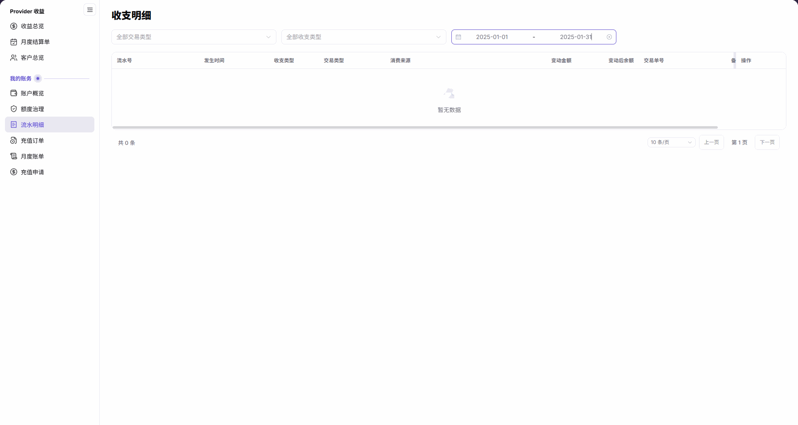

# 流水明细

::: info 文档信息
版本：v2.1
更新日期：2026-11-05
:::

## 功能概述

| 项目 | 内容 |
| --- | --- |
| 适用角色 | 模型提供方&用户 |
| 导航路径 | 账务 > 我的账务 > 流水明细 |
| 页面路由 | `/billing/my/account/transactions/records` |
| 管理对象 | 当前账号的收支流水、消费来源、余额变动和关联交易单号 |

流水明细用于按交易类型、收支类型和日期范围查询账务记录，并核对单笔记录的变动金额、变动后余额及业务关联信息。

#### 新手理解

流水明细像账户的收支小票：先确定查询范围，再逐笔阅读金额变化和关联单号，而不是把筛选后的列表当作完整的余额变动链。

#### 术语速查

| 术语 | 说明 |
| --- | --- |
| 收支类型 | 流水的收入或支出方向，与交易类型分列展示。 |
| 交易类型 | 流水对应的业务类别，可作为筛选条件。 |
| 消费来源 | 列表展示的消费来源信息。 |
| 变动金额 | 单笔流水对应的金额变化。 |
| 变动后余额 | 该笔流水变动后的账户余额，不是项目或成员配额。 |
| 交易单号 | 关联业务的参考单号，与流水号分列展示。 |

## 前提条件

1. 当前账号可以进入 `账务 > 我的账务 > 流水明细`。
2. 已确定需要查询的日期范围，以及是否限定交易类型或收支类型。
3. 查看具体流水时，使用有权访问的账号和业务范围。

## 页面说明

左侧菜单名称为 `流水明细`，页面内容标题为 `收支明细`。英文菜单对应 `Transactions`，内容标题为 `Transaction Details`。英文左侧分组名为 `Billing`。

页面只有交易类型、收支类型和日期范围三项筛选；调整条件后自动查询列表。表格包含十列，行内入口为 `查看详情`。

| 区域 | 说明 |
| --- | --- |
| 交易类型筛选 | 未限定类型时显示 `全部交易类型`。 |
| 收支类型筛选 | 未限定方向时显示 `全部收支类型`。 |
| 日期范围 | 用起止日期限定查询范围。 |
| 流水列表 | 流水号、发生时间、收支类型、交易类型、消费来源、变动金额、变动后余额、交易单号、备注、操作。 |
| 行内入口 | 有记录时，可在操作列使用 `查看详情`。 |
| 空结果与分页 | 没有匹配记录时显示 `暂无数据` 和 `共 0 条`；分页用于浏览查询结果。 |

图示为日期范围设为 `2025-01-01` 至 `2025-01-31` 的收支明细空列表，展示三项筛选、当前横向视窗内的表头及 `暂无数据`、`共 0 条`；备注表头被固定的操作列遮挡，需在页面中横向滚动查看，图中不包含单笔详情。

## 主要操作

### 查询流水明细

1. 进入 `账务 > 我的账务 > 流水明细`，确认内容标题为 `收支明细`。
2. 按需选择交易类型；查看所有类型时使用 `全部交易类型`。
3. 按需选择收支类型；不限定方向时使用 `全部收支类型`。
4. 设置起止日期，等待列表按当前条件自动更新。
5. 阅读匹配记录或 `暂无数据` 空态；需要改变范围时直接调整筛选条件。

### 核对单笔流水

1. 在查询结果中定位目标记录，核对 `流水号` 和 `发生时间`。
2. 阅读 `收支类型`、`交易类型` 和 `消费来源`，区分方向、类别与来源。
3. 分别核对 `变动金额` 和 `变动后余额`，不要把余额读作配额。
4. 查看 `交易单号`，并横向滚动表格查看 `备注`，不将业务参考单号与流水号混用。
5. 需要继续查看时，使用该行的 `查看详情`；以打开页面实际展示的内容为准。

## 参数速查表

| 字段名称 | 是否必填 | 字段类型 | 示例 | 说明 |
| --- | --- | --- | --- | --- |
| 交易类型（筛选） | 否 | 下拉选择 | `全部交易类型` | 限定业务类别，选择后自动查询。 |
| 收支类型（筛选） | 否 | 下拉选择 | `全部收支类型` | 限定收支方向，选择后自动查询。 |
| 日期范围 | 否 | 日期范围 | `2025-01-01` 至 `2025-01-31` | 限定查询的起止日期。 |
| 流水号 | 不适用 | 列表列 | — | 单笔流水的标识。 |
| 发生时间 | 不适用 | 时间列 | — | 记录展示的发生时间。 |
| 收支类型 | 不适用 | 列表列 | — | 该笔流水的收支方向。 |
| 交易类型 | 不适用 | 列表列 | — | 该笔流水的业务类别。 |
| 消费来源 | 不适用 | 列表列 | — | 该笔流水展示的消费来源。 |
| 变动金额 | 不适用 | 金额列 | `0` | 该笔流水的金额变化；示例不代表实际交易。 |
| 变动后余额 | 不适用 | 余额列 | `0` | 该笔流水变动后的账户余额，不是配额。 |
| 交易单号 | 不适用 | 列表列 | — | 关联业务的参考单号。 |
| 备注 | 不适用 | 列表列 | — | 记录展示的补充说明。 |
| 操作 / 查看详情 | 否 | 行内入口 | `查看详情` | 查看对应的单笔流水。 |

## 踩坑提示

- `变动金额` 与 `变动后余额` 是两个字段，不能把金额变化读成剩余配额。
- 列表受筛选和分页影响，不能要求可见的相邻两行构成连续余额链，也不能据此判定余额异常。
- `暂无数据` 只说明当前查询结果为空，不代表其他日期或其他筛选范围也没有流水。

## 结果校验

| 检查项 | 成功表现 | 异常时处理 |
| --- | --- | --- |
| 页面定位 | 左侧菜单为 `流水明细`，内容标题为 `收支明细`。 | 按导航路径核对当前页面，不因标题不同另找入口。 |
| 查询范围 | 交易类型、收支类型及日期控件显示需要的条件。 | 直接调整对应条件，重新查看列表结果。 |
| 列表结构 | 在页面中结合横向滚动可核对完整十个列名；空结果显示 `暂无数据` 和 `共 0 条`。 | 横向滚动查看备注列，并核对列名和当前条件，不把空结果当作字段缺失。 |
| 行内入口 | 有记录的行在操作列显示 `查看详情`。 | 先区分当前是空列表还是有记录的结果，不从空态判断详情能力。 |

## 常见问题

#### 为什么菜单和页面标题不同？

**问题现象：** 点击 `流水明细` 后，内容标题显示 `收支明细`。

**可能原因：** 该页面的菜单名与内容标题采用不同文案；英文对应 `Transactions` 与 `Transaction Details`。

**处理方式：** 按当前菜单和页面路由定位，在 `收支明细` 中查询，无需寻找另一个同名页面。

#### 为什么列表显示暂无数据？

**问题现象：** 列表显示 `暂无数据`，分页显示 `共 0 条`。

**可能原因：** 当前交易类型、收支类型和日期范围下没有匹配记录；图中的日期范围为 `2025-01-01` 至 `2025-01-31`。

**处理方式：** 核对三项筛选；需要查看其他范围时直接更改条件，不把当前空结果解释为整个账户没有流水。

## 注意事项

- 不公开真实客户信息、账号邮箱、私人账务金额、流水号、交易单号或凭证；公开示例使用 `0` 或占位符，配图使用空结果。
- 本页用于查询和核对记录，不依据单笔流水或筛选后加总结果推断整月结算结论。
- 需要向授权人员反馈差异时，说明查询条件和字段差异，不在公共工单、评论或报告中附带真实账务数据。

## 后续操作

1. 核对充值记录，进入 [充值订单](../top-up-orders/)。
2. 核对账期汇总，进入 [月度账单](../monthly-bill/)。
3. 查看当前余额，进入 [账户概览](../overview/)。
