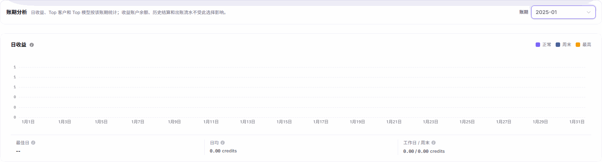

# 收益总览

::: info 文档信息
版本：v2.1
更新日期：2026-11-05
:::

## 功能概述

| 项目 | 内容 |
| --- | --- |
| 适用角色 | 模型提供方 |
| 导航路径 | 账务 > Provider 收益 > 收益总览 |
| 页面路由 | `/billing/provider/revenue` |
| 管理对象 | 收益账户余额、当前账期预估、账期分析和收益账户出账 |

收益总览用于区分当前收益账户余额、尚未结算的预估收益和历史结算结果，并按账期查看日收益、Top 客户和 Top 模型。需要继续核对时，可使用 `结算单`、`客户明细` 和 `出账流水` 入口。

#### 新手理解

本页像一本分区账本：账户区看当前余额和历史累计，分析区看指定月份的收益来源，两者不是同一个时间范围。

#### 术语速查

| 术语 | 说明 |
| --- | --- |
| 实时收益账户余额 | 当前收益账户的余额，不随分析账期切换。 |
| 当前账期预估 | 尚未结算的预估收益，不计入收益账户余额。 |
| 全历史结算净额 | 历史全部已完成结算的净额，不受所选账期影响。 |
| 累计已出账 | 转入 Credit 的累计出账，不含结算补差扣回。 |
| 账期分析 | 日收益、Top 客户和 Top 模型按所选账期统计。 |

## 前提条件

1. 使用模型提供方账号进入 `账务 > Provider 收益 > 收益总览`。
2. 明确需要查看的是账户汇总、月度分析还是出账记录。
3. 如需核对结算结果，准备好要比较的账期。

## 页面说明

页面内容标题为 `收益总览`，页签为 `概览` 和 `收益账户出账`。

| 区域 | 说明 |
| --- | --- |
| 概览顶部 | 提供最近更新时间、刷新、出账流水、结算单和客户明细入口。 |
| 账户与历史指标 | 展示实时收益账户余额、全历史结算净额和累计已出账；不受分析账期影响。 |
| 当前账期预估 | 显示 `未结算，不计入收益账户余额`，可使用 `查看明细 →` 继续查看。 |
| 下次结算提示 | 显示 `仅为时间提示，不代表已进入结算`。 |
| 账期分析 | 通过 `账期` 下拉选择分析月份，查看日收益、Top 客户和 Top 模型。 |
| 收益账户出账 | 展示收益账户余额、结算净额、累计已出账及出账区域。 |
| Provider 收益转 Credit | 打开同名转入表单，包含可转余额、转入金额和备注。 |

账期分析的范围说明为：`日收益、Top 客户和 Top 模型按该账期统计；收益账户余额、历史结算和出账流水不受此选择影响。`

本页没有模型、客户或结算状态等全页筛选；`账期` 下拉只控制分析区。

## 主要操作

### 查看收益概览与账期分析

1. 进入 `账务 > Provider 收益 > 收益总览`，选择 `概览`。
2. 查看实时收益账户余额、当前账期预估、下次结算提示和全历史结算净额，分别确认其口径。
3. 在 `账期分析` 的 `账期` 下拉中选择目标月份。
4. 查看该账期的日收益、Top 客户和 Top 模型；需要核对结算或客户来源时，使用 `结算单` 或 `客户明细`。

图示为选择 `2025-01` 后的账期分析工具栏和日收益卡片，包含分析范围说明、账期选择及日收益统计，不展示账户余额或客户、模型排行。

### 查看收益账户出账

1. 切换到 `收益账户出账` 页签，也可使用概览顶部的 `出账流水` 入口。
2. 核对 `收益账户余额`、`结算净额` 和 `累计已出账` 三项汇总。
3. 阅读结算净额说明 `普通结算加上尾差补发和尾差扣回`，以及累计已出账说明 `转入 Credit；不含结算补差扣回`。
4. 查看出账区域；为空时显示 `暂无出账记录`。有历史出账记录时，按实际展示核对出账时间、出账方式、出账金额、出账月份和凭证，并结合 [月度结算单](../settlements/) 查看结算结果。

图示为出账区域的 `暂无出账记录` 空态，不包含顶部三项账户汇总。

### 查看收益转入表单

1. 点击 `Provider 收益转 Credit`，打开同名表单。
2. 查看显示项 `可转余额`，确认当前展示的可转余额。
3. 核对必填数字输入项 `转入金额` 和无必填标记的文本项 `备注`；表单操作为 `取消` 和 `确认转入`。
4. 仅查看时点击 `取消` 关闭表单；`确认转入` 是提交操作，不作为只读核对步骤。

## 参数速查表

| 字段名称 | 是否必填 | 字段类型 | 示例 | 说明 |
| --- | --- | --- | --- | --- |
| 概览 | 否 | 页签 | `概览` | 查看账户指标和账期分析。 |
| 收益账户出账 | 否 | 页签 | `收益账户出账` | 查看账户汇总及出账记录区域。 |
| 实时收益账户余额 / 收益账户余额 | 不适用 | 金额显示 | — | 分别位于概览和出账页签，不受分析账期影响。 |
| 当前账期预估 | 不适用 | 预估金额 | — | 未结算，不计入收益账户余额。 |
| 下次结算提示 | 不适用 | 时间提示 | — | 不代表已进入结算。 |
| 全历史结算净额 / 结算净额 | 不适用 | 汇总金额 | — | 历史结算净额；出账页签说明包含普通结算、尾差补发和尾差扣回。 |
| 累计已出账 | 不适用 | 汇总金额 | — | 转入 Credit；不含结算补差扣回。 |
| 账期 | 否 | 月份下拉 | `2025-01` | 只影响日收益、Top 客户和 Top 模型分析。 |
| 日收益 | 不适用 | 图表 | — | 所选账期的日收益及日均、工作日 / 周末统计。 |
| Top 客户 | 不适用 | 排行 | — | 所选分析账期的客户收益贡献。 |
| Top 模型 | 不适用 | 排行 | — | 所选分析账期的模型收益贡献。 |
| 可转余额 | 不适用 | 显示项 | — | 转入表单中的余额显示，不是输入项。 |
| 转入金额 | 是 | 数字输入 | — | 转入表单必填字段。 |
| 备注 | 否 | 多行文本 | — | 转入表单无必填标记的字段。 |

## 踩坑提示

- 切换分析账期不会改变收益账户余额、历史结算和出账流水的范围，不能把账户汇总当成所选月份的收益。
- 当前账期预估明确标注未结算，不能把它加作已入账余额。
- 下次结算提示只提供时间信息，不是已进入结算的状态证明。
- 结算净额包含尾差补发和尾差扣回；累计已出账不含结算补差扣回，两项口径不可互换。

## 结果校验

| 检查项 | 成功表现 | 异常时处理 |
| --- | --- | --- |
| 分析范围 | 下拉显示目标账期，范围说明仍明确账户汇总不受影响。 | 返回账期分析区核对所选月份，不用账户余额判断筛选结果。 |
| 预估口径 | 当前账期预估旁显示 `未结算，不计入收益账户余额`。 | 使用预估的 `查看明细 →` 继续核对，不将其视作已入账。 |
| 出账区域 | 在收益账户出账中看到记录区域，空态为 `暂无出账记录`。 | 核对所在页签，区分空出账区域与顶部账户汇总。 |
| 转入表单 | 标题及可转余额、转入金额、备注、取消、确认转入可见。 | 核对表单标题；只读查看时使用 `取消`，不以提交验证页面。 |

## 常见问题

#### 为什么选择历史账期后账户余额仍不按该月变化？

**问题现象：** 分析区已选择历史月份，账户余额和历史累计仍显示账户汇总。

**可能原因：** 页面范围说明明确，收益账户余额、历史结算和出账流水不受账期分析选择影响。

**处理方式：** 使用日收益、Top 客户和 Top 模型查看所选账期，核对该月结算时进入 [月度结算单](../settlements/)。

#### 为什么当前账期预估不能当作账户余额？

**问题现象：** 页面同时展示当前账期预估和收益账户余额。

**可能原因：** 预估卡片明确显示 `未结算，不计入收益账户余额`。

**处理方式：** 点击 `查看明细 →` 查看预估构成，按预估口径阅读，不将其视为已入账金额。

## 注意事项

- 账户汇总、分析账期和预估明细应分别阅读，不根据单个金额推断已结算或已转入。
- 转入表单中的 `确认转入` 与 `取消` 用途不同；只查看表单时不要提交。
- 共享核对结果时，不公开真实客户、账号邮箱、私人账务数值、凭证或内部地址。

## 后续操作

1. 进入 [月度结算单](../settlements/) 查看结算列表和当前账期预估明细。
2. 进入 [客户总览](../customers/) 按客户维度核对收益来源。
3. 需要查看转入入口时，返回本页的 `Provider 收益转 Credit` 表单。
