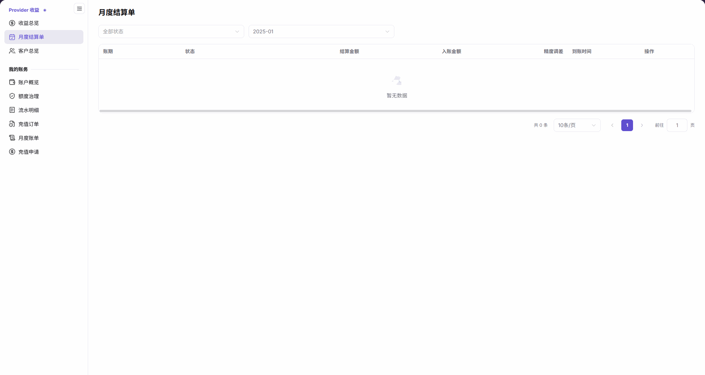
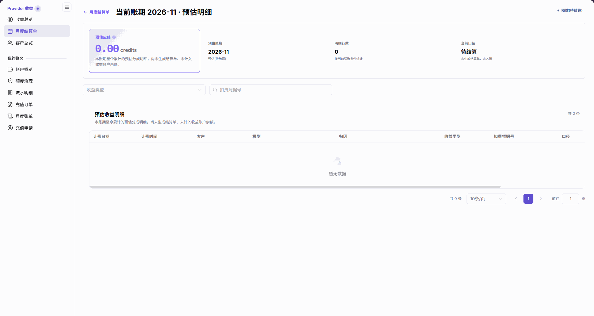

# 月度结算单

::: info 文档信息
版本：v2.1
更新日期：2026-11-05
:::

## 功能概述

| 项目 | 内容 |
| --- | --- |
| 适用角色 | 模型提供方 |
| 导航路径 | 账务 > Provider 收益 > 月度结算单 |
| 页面路由 | `/billing/provider/settlements` |
| 管理对象 | 账期结算记录、结算金额、入账金额、精度调差和当前账期预估明细 |

月度结算单用于按状态和账期查看收益结算记录，通过行内 `详情` 查看对应内容。当前账期的预估行可进入预估明细页面；预估尚未生成结算单，也未计入收益账户余额。

#### 新手理解

列表像月度对账目录：先找到月份和状态，再打开详情。预估行是当前账期的暂算明细，不是已完成入账的结算单。

#### 术语速查

| 术语 | 说明 |
| --- | --- |
| 账期 | 列表记录或预估明细对应的月份。 |
| 结算金额 | 列表展示的该账期结算或预估金额，需结合状态阅读。 |
| 入账金额 | 列表的入账结果字段，也可显示 `待结算`，不一定是金额。 |
| 精度调差 | 列表单独展示的精度调整项，不与结算金额、入账金额混为一列。 |
| 预估(待结算) | 当前账期预估状态，尚未生成结算单、未入账。 |
| 预估明细 | 本账期至今累计的预估分成明细，不计入收益账户余额。 |

## 前提条件

1. 使用模型提供方账号进入 `账务 > Provider 收益 > 月度结算单`。
2. 确认目标账期，区分当前账期预估与历史结算记录。
3. 如需交叉核对，准备查看 [收益总览](../revenue/) 的账户汇总和收益账户出账。

## 页面说明

菜单和列表内容标题均为 `月度结算单`。当前账期预估详情是完整页面，不是抽屉；标题使用 `当前账期 YYYY-MM · 预估明细` 的形式，返回入口为 `月度结算单`。

| 区域 | 说明 |
| --- | --- |
| 列表筛选 | 只有 `全部状态` 和 `账期` 两项，没有搜索、重置、结算单号、生成时间或导出控件。 |
| 列表字段 | 账期、状态、结算金额、入账金额、精度调差、到账时间、操作。 |
| 行内详情 | 点击 `详情` 查看对应行内容；当前预估行进入预估明细页面。 |
| 预估顶部 | 展示预估应结、预估账期、明细行数和当前口径；明细行数按当前筛选条件统计。 |
| 预估范围说明 | `本账期至今累计的预估分成明细，尚未生成结算单、未计入收益账户余额。` |
| 预估查询区 | 提供 `收益类型` 筛选和 `扣费凭据号` 输入。 |
| 预估明细表 | 计费日期、计费时间、客户、模型、归因、收益类型、扣费凭据号、口径、应结算。 |

列表可见状态包括 `预估(待结算)` 和 `结算处理中`。阅读时以每行实际状态为准，不将预估行视为已完成结算。

## 主要操作

### 查询结算列表

1. 进入 `账务 > Provider 收益 > 月度结算单`。
2. 使用 `全部状态` 和 `账期` 选择查询范围。
3. 核对目标行的账期、状态、结算金额、入账金额、精度调差和到账时间；入账金额显示 `待结算` 时按文本状态阅读。
4. 若列表显示 `暂无数据`，核对当前两项筛选；需要查看其他账期时直接更改账期选择。

图示为选择 `2025-01` 的月度结算单列表，展示全部状态、账期筛选、七个表格列和 `暂无数据` 空态。

### 查看当前账期预估明细

1. 在列表中选择当前账期，定位状态为 `预估(待结算)` 的行。
2. 点击该行的 `详情`，进入 `当前账期 YYYY-MM · 预估明细` 页面；地址包含对应的 `cycle` 和 `view=estimated`。
3. 阅读预估应结、预估账期、明细行数和当前口径，确认 `未生成结算单，未入账` 及未计入收益账户余额的提示。
4. 按需选择 `收益类型`，或在 `扣费凭据号` 输入框中输入要核对的凭据号。
5. 在页面中查看计费日期、计费时间、客户、模型、归因、收益类型、扣费凭据号、口径，并横向滚动查看最右侧的应结算，核对完整九列；没有匹配明细时，表格显示 `暂无数据`。
6. 点击 `月度结算单` 返回列表。

图示为当前账期预估明细页面，展示四项顶部指标、未生成结算单且未计入余额的提示、收益类型筛选、扣费凭据号输入和空明细表；当前横向视窗仅包含计费日期至口径的八个表头，未包含最右侧的应结算列，需在页面中横向滚动查看。

### 查看历史结算记录并交叉核对

1. 返回列表，在 `账期` 中选择需要核对的历史月份。
2. 有记录时核对该行状态、结算金额、入账金额、精度调差和到账时间。
3. 使用该行的 `详情` 查看对应结算内容，按页面实际展示的信息核对，不将当前账期预估口径套用于所有历史详情。
4. 进入 [收益总览](../revenue/) 交叉查看账户汇总与收益账户出账；收益转 Credit 的入口位于收益总览，不是本列表的操作按钮。

## 参数速查表

| 字段名称 | 是否必填 | 字段类型 | 示例 | 说明 |
| --- | --- | --- | --- | --- |
| 全部状态 | 否 | 列表筛选 | `全部状态` | 按状态查看结算记录。 |
| 账期 | 否 | 列表筛选 | `2025-01` | 选择要查询的月份。 |
| 账期 | 不适用 | 列表列 | — | 记录对应的账期。 |
| 状态 | 不适用 | 列表列 | `预估(待结算)` | 可见状态还包括 `结算处理中`；以行内显示为准。 |
| 结算金额 | 不适用 | 列表列 | — | 结合行状态阅读结算或预估金额。 |
| 入账金额 | 不适用 | 金额或文本 | `待结算` | 不保证所有行均为数字金额。 |
| 精度调差 | 不适用 | 列表列 | — | 单独展示精度调整项。 |
| 到账时间 | 不适用 | 列表列 | — | 核对该行显示的到账时间或占位内容。 |
| 操作 / 详情 | 否 | 行内入口 | `详情` | 打开对应行内容；预估行打开完整预估明细页面。 |
| 预估应结 | 不适用 | 预估指标 | — | 尚未结算，不计入收益账户余额。 |
| 预估账期 | 不适用 | 月份显示 | — | 当前预估对应的账期。 |
| 明细行数 | 不适用 | 数量显示 | — | 按当前筛选条件统计。 |
| 当前口径 | 不适用 | 状态显示 | `待结算` | 提示 `未生成结算单，未入账`。 |
| 收益类型 | 否 | 预估筛选 | — | 筛选预估收益明细。 |
| 扣费凭据号 | 否 | 文本输入 | — | 输入需要核对的扣费凭据号。 |
| 计费日期 | 不适用 | 明细列 | — | 明细的计费日期。 |
| 计费时间 | 不适用 | 明细列 | — | 明细的计费时间。 |
| 客户 | 不适用 | 明细列 | — | 明细对应的客户。 |
| 模型 | 不适用 | 明细列 | — | 明细对应的模型。 |
| 归因 | 不适用 | 明细列 | — | 明细的归因信息。 |
| 收益类型 | 不适用 | 明细列 | — | 明细的收益类别。 |
| 扣费凭据号 | 不适用 | 明细列 | — | 明细关联的扣费凭据号。 |
| 口径 | 不适用 | 明细列 | — | 按该列展示的口径阅读预估明细。 |
| 应结算 | 不适用 | 明细列 | — | 预估明细中的应结算金额。 |

## 踩坑提示

- `预估(待结算)` 行能打开详情，但预估页面明确说明尚未生成结算单，不能把“可查看详情”理解为“已入账”。
- `入账金额` 可以显示 `待结算`，不要将这一文本状态按金额读取。
- 预估表格显示 `暂无数据` 只表示该明细表当前没有记录，不表示没有详情页面。
- 预估明细的 `明细行数` 按当前筛选条件统计，核对数量时应同时查看收益类型和扣费凭据号条件。

## 结果校验

| 检查项 | 成功表现 | 异常时处理 |
| --- | --- | --- |
| 列表范围 | 筛选区显示目标状态和账期，表格保留七列。 | 重新核对 `全部状态` 和 `账期`，不要寻找搜索或重置按钮。 |
| 预估入口 | 当前预估行的 `详情` 打开完整预估明细页面。 | 核对所点行的账期和状态，区分预估行与历史结算行。 |
| 预估口径 | 顶部显示未生成结算单、未入账、未计入收益账户余额的说明。 | 按预估口径阅读，并到收益总览单独核对账户余额。 |
| 明细与返回 | 在页面中可核对查询区及 `月度结算单` 返回入口，并在横向滚动后核对完整九个明细列；空表显示 `暂无数据`。 | 核对明细筛选，并横向滚动查看应结算列；需要重新选择账期时使用返回入口。 |

## 常见问题

#### 为什么打开详情后仍提示尚未生成结算单？

**问题现象：** 当前账期行可点击 `详情`，进入后显示尚未生成结算单、未计入收益账户余额。

**可能原因：** 该行状态为 `预估(待结算)`，打开的是本账期至今累计的预估分成明细。

**处理方式：** 核对预估账期和当前口径，按预估阅读；需要查看历史结算记录时，返回列表重新选择账期。

#### 为什么入账金额显示文字而不是数字？

**问题现象：** 列表的 `入账金额` 显示 `待结算`。

**可能原因：** 该列支持待结算文本，当前行未以数值金额展示入账结果。

**处理方式：** 同时核对该行状态和到账时间，不把 `待结算` 换算为金额；使用 `详情` 查看对应内容。

## 注意事项

- 预估明细、结算金额和入账金额不是同一种结果，不据此推断到账时间或精度调差的计算公式。
- 列表与详情的查看不需要执行收益转入；需要查看转入表单时前往收益总览。
- 共享结算核对信息时，不公开真实客户、账号邮箱、私人账务数值、扣费凭据号或凭证。

## 后续操作

1. 进入 [收益总览](../revenue/) 查看账户汇总、收益账户出账及收益转 Credit 入口。
2. 进入 [客户总览](../customers/) 从客户维度继续核对收益来源。
