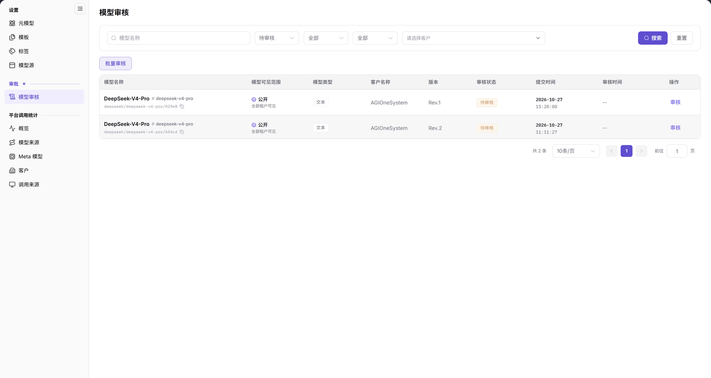
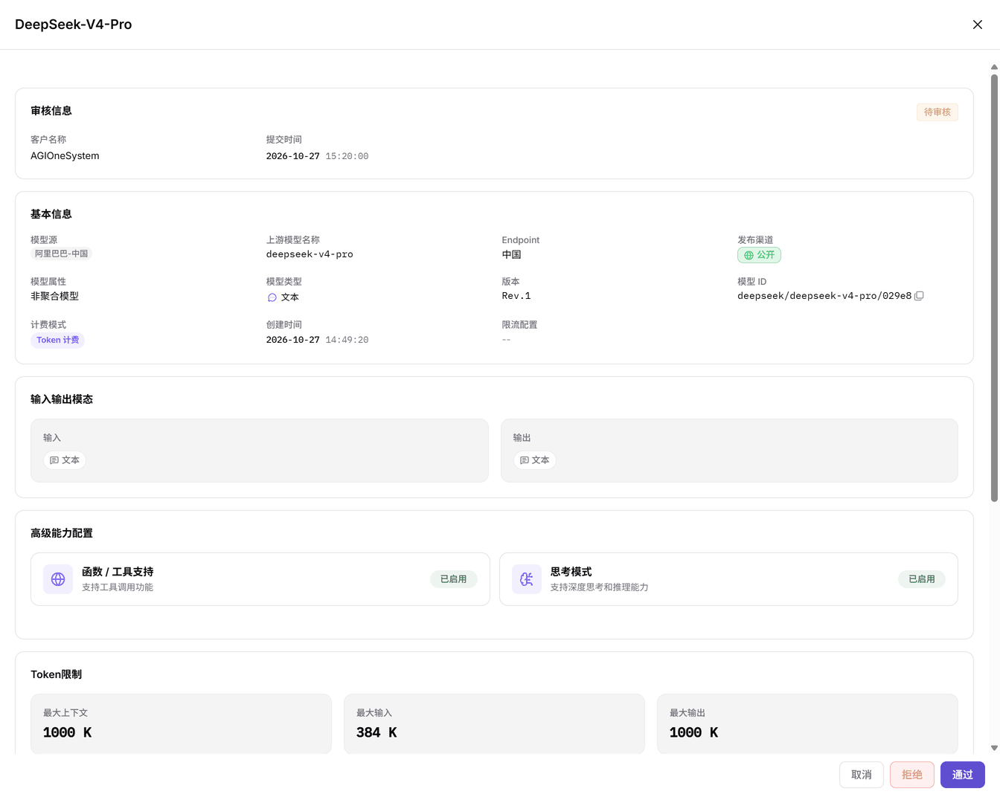

# 模型审核

::: info 文档信息
版本：v2.0
更新日期：2026-11-04
:::

## 功能概述

| 项目 | 内容 |
| --- | --- |
| 适用角色 | 运营管理员 |
| 导航路径 | **模型及AI服务** > **审批** > **模型审核** |
| 页面路由 | `/modelone/audit/model` |
| 管理对象 | 待审核模型记录、模型可见范围、模型类型、客户、版本、审核状态、提交时间和审核时间 |

**新手理解**：模型审核是模型进入上架或调用前的检查关卡。运营管理员在审核抽屉中核对模型来源、能力、模态、Token 限制、协议和计费信息，再选择通过或拒绝。

#### 术语速查

| 术语 | 说明 |
| --- | --- |
| 待审核模型 | 服务商或租户提交上架或变更申请、等待运营管理员审批的模型版本。 |
| 模型可见范围 | 模型审核通过并发布后允许访问的范围，如公开（全部租户）或指定客户私有。 |
| 上游模型 | 模型源所对接的原厂基础模型标识，用于底层 API 实际路由与鉴权。 |
| 计费配置 | 审核抽屉中核对的 Token/按次计费价格、缓存抵扣比例与计费模式。 |

## 前提条件

1. 当前账号具备**审批 > 模型审核**的查看和处理权限。
2. 列表中存在待审核记录；列表中至少有一条状态为 `待审核` 的记录。
3. 审核前已确认模型的来源、可见范围、版本和能力配置。

## 页面说明

页面顶部是筛选区，下方是审核记录表格：

- 筛选条件：`模型名称`、`待审核` 状态下拉、`全部`、`全部`、`请选择客户`。
- 操作按钮：**搜索**、**重置**、**批量审核**。
- 表格列：`模型名称`、`模型可见范围`、`模型类型`、`客户名称`、`版本`、`审核状态`、`提交时间`、`审核时间`、`操作`。
- 操作列当前提供 **审核**；列表没有单独的 **详情** 按钮。

| 区域 | 说明 |
| --- | --- |
| 顶部筛选栏 | 提供模型名称、审核状态下拉、可见范围、模型类型、客户筛选框，以及搜索、重置与批量审核按钮 |
| 模型审核列表 | 展示模型名称与标识、可见范围、类型、客户、版本、审核状态、提交与审核时间，以及操作列 |
| 审核详情抽屉 | 点击操作列“审核”后在右侧滑出，分区展示审核信息、基本信息、模态、能力、Token 限制与计费配置 |
| 底部操作栏 | 抽屉底部提供取消、拒绝与通过操作，批量模式下提供取消、拒绝与通过所选 |

图示为列表显示 `DeepSeek-V4-Pro` 的 Rev.1 和 Rev.2 两条 `待审核` 记录。`模型可见范围` 为 `公开 / 全部租户可见`，`客户名称` 为 `AGIOneSystem`，`审核时间` 显示 `--`，操作列为 `审核`。

## 主要操作

### 筛选审核记录

1. 在 `模型名称` 输入框输入名称关键字。
2. 在状态下拉中选择 `待审核` 等状态。
3. 按需选择可见范围、模型类型或客户。
4. 点击 **"搜索"** 执行查询；点击 **"重置"** 清空条件。
5. 列表底部显示 `共 N 条` 和分页控件。

### 单条审核

1. 在目标行点击 **"审核"**，右侧打开审核抽屉。
2. 抽屉标题显示模型名称，例如 `DeepSeek-V4-Pro`；`审核信息` 区显示客户名称、提交时间和 `待审核` 状态。
3. 在 `基本信息` 中核对模型源、上游模型名称、Endpoint、发布渠道、模型属性、模型类型、版本、模型 ID、计费模式、创建时间和限流配置。
4. 依次核对 `输入输出模态`、`高级能力配置`、`Token限制`、`官方原生协议与默认高级参数` 和 `计费配置`。
5. 底部分别提供 **"取消"**、**"拒绝"**、**"通过"** 三个按钮；点击前确认当前模型和版本。

图示为审核抽屉展示 `审核信息`、`基本信息`、`输入输出模态`、`高级能力配置` 和 `Token限制`。示例中 `发布渠道` 为 `公开`，`计费模式` 为 `Token 计费`，底部按钮为 `取消`、`拒绝`、`通过`。

### 批量审核

1. 勾选需要统一处理的记录。
2. 点击 **"批量审核"**，页面显示批量操作区。
3. 批量操作区提供 **"取消"**、**"拒绝"**、**"通过所选"** 按钮。
4. 提交前核对选中记录的数量、模型名称、版本和可见范围。

## 参数速查表

### 列表字段

| 字段名称 | 是否必填 | 字段类型 | 示例 | 说明 |
| --- | --- | --- | --- | --- |
| 模型名称 | 系统展示 | 文本 | `DeepSeek-V4-Pro` | 待审核模型名称，下方显示模型标识 |
| 模型可见范围 | 系统展示 | 标签 | `公开 / 全部租户可见` | 模型发布后的可见范围 |
| 模型类型 | 系统展示 | 标签 | `文本` | 模型能力类型 |
| 客户名称 | 系统展示 | 文本 | `AGIOneSystem` | 提交记录的客户 |
| 版本 | 系统展示 | 文本 | `Rev.1` | 当前提交审核的版本 |
| 审核状态 | 系统展示 | 枚举 | `待审核` | 当前审核状态 |
| 提交时间 | 系统展示 | 日期时间 | `2026-10-27 15:20:00` | 记录提交时间 |
| 审核时间 | 系统展示 | 日期时间 | `--` | 未审核时显示 `--` |
| 操作 | 按权限展示 | 按钮 | `审核` | 打开审核抽屉 |

### 审核抽屉字段

| 字段名称 | 是否必填 | 字段类型 | 示例 | 说明 |
| --- | --- | --- | --- | --- |
| 客户名称 | 系统展示 | 文本 | `AGIOneSystem` | 审核信息区的客户 |
| 提交时间 | 系统展示 | 日期时间 | `2026-10-27 15:20:00` | 审核信息区的提交时间 |
| 模型源 | 系统展示 | 文本 | `阿里巴巴-中国` | 上游模型来源 |
| 上游模型名称 | 系统展示 | 文本 | `deepseek-v4-pro` | 来源侧模型名称 |
| Endpoint | 系统展示 | 文本 | `中国` | 来源 Endpoint |
| 发布渠道 | 系统展示 | 标签 | `公开` | 当前发布渠道 |
| 模型属性 | 系统展示 | 文本 | `非聚合模型` | 模型属性 |
| 模型类型 | 系统展示 | 标签 | `文本` | 模型能力类型 |
| 版本 | 系统展示 | 文本 | `Rev.1` | 审核版本 |
| 模型 ID | 系统展示 | 文本 | `deepseek/deepseek-v4-pro/029e8` | 模型唯一标识 |
| 计费模式 | 系统展示 | 标签 | `Token 计费` | 当前计费模式 |
| 创建时间 | 系统展示 | 日期时间 | `2026-10-27 14:49:20` | 模型创建时间 |
| 限流配置 | 系统展示 | 文本 | `--` | 当前限流配置 |
| 输入 / 输出 | 系统展示 | 标签 | `文本` | 输入输出模态 |
| 高级能力配置 | 系统展示 | 标签 | `函数 / 工具支持`、`思考模式` | 已启用的高级能力 |
| Token限制 | 系统展示 | 数字 | `最大上下文 1000 K` | 上下文、输入和输出上限 |
| 官方原生协议与默认高级参数 | 系统展示 | 协议列表 | `OpenAI-ChatCompletions` | 支持的协议 |
| 计费配置 | 系统展示 | 数字 | `输入 1152.00 credits/M tokens` | 价格与缓存价格 |

## 踩坑提示

- 列表操作列当前只有 **审核**，没有单独的 **详情** 按钮；查看配置请打开审核抽屉。
- `审核时间` 为 `--` 表示该记录尚未审核；已处理的记录会显示审核时间。
- 批量审核会作用于已勾选的记录，提交前核对选中数量、模型名称、版本和可见范围。
- 审核抽屉中的 `模型 ID`、`计费配置` 和 `Token限制` 是判断当前版本的关键字段，不要只看模型名称。

## 结果校验

| 检查项 | 成功表现 | 异常时处理 |
| --- | --- | --- |
| 记录处于待审核 | `审核状态` 列显示 `待审核`，`审核时间` 列显示 `--` | 若状态显示已通过或已拒绝，说明已被其他管理员处理，刷新列表获取最新状态 |
| 审核抽屉已打开 | 右侧抽屉标题显示模型名称，并完整出现 `审核信息`、`基本信息` 等分区 | 若抽屉未滑出或字段空白，检查网络响应并重新点击操作列 **"审核"** |
| 单条操作入口 | 抽屉底部显示 `取消`、`拒绝`、`通过` 操作按钮 | 确认当前账号具备模型审核写权限，未授权时按钮可能置灰或不可见 |
| 批量操作入口 | 点击 `批量审核` 后出现 `取消`、`拒绝`、`通过所选` 操作栏 | 检查是否已在列表勾选至少一条记录，未勾选时批量按钮不可操作 |
| 列表总数与分页 | 底部显示 `共 N 条` 且分页控制器可正常翻页与切换条数 | 点击 **"重置"** 清空所有筛选条件，确认系统无隐性过滤 |

## 常见问题

#### 列表里找不到“详情”按钮

**问题现象：**

想查看模型配置，但在操作列只看到 `审核` 按钮，找不到单独的详情入口。

**可能原因：**

系统设计将只读核对与审批决策统一收敛在审核抽屉中，未单独设立详情页。

**处理方式：**

点击操作列 **"审核"** 打开右侧抽屉，核对信息后若暂不作结论，点击抽屉底部的 **"取消"** 关闭即可，不会对记录产生任何变更。

#### 筛选后列表为空

**问题现象：**

选择了模型名称、状态、可见范围或客户后，列表没有记录。

**可能原因：**

多重筛选条件之间为“且”关系产生过度过滤，或目标记录已被其他管理员审核流转。

**处理方式：**

1. 点击 **"重置"** 清空条件。
2. 先只保留 `待审核` 状态，再逐个添加模型名称、可见范围或客户条件。
3. 确认提交方已成功提审，或目标记录未被其他审核人提前处理。

#### 单条审核和批量审核怎么选

**问题现象：**

待处理记录较多时，不确定该使用逐条审核还是批量审核。

**可能原因：**

批量审核无法针对单条模型的特殊计费或 Token 限制单独调整与比对。

**处理方式：**

- 需要逐个核对模型版本、计费或能力配置时，使用行内 **"审核"** 打开抽屉核验。
- 多条记录来自同一批次且规则统一时，勾选记录后使用 **"批量审核"** 统一提交结论；提交前核对选中数量。

## 注意事项

- 审核前确认模型来源、可见范围、版本、计费模式和 Token 限制，避免只凭名称放行。
- 公开可见范围会扩大模型的可访问人群，通过前确认授权范围。
- 批量审核会同时处理多条记录，提交前核对选中项。
- 审核意见和截图中不要包含真实凭证、完整请求头或客户敏感数据。

## 后续操作

1. 进入模型源管理核对上游地址、协议配置与连通性。
2. 在元模型库中核对能力标签、Token 限制与支持的官方协议。
3. 进入模型发布页确认模型审核通过后的上架状态与租户可见性。

相关页面：
- [模型源](../../settings/model-source/)
- [元模型](../../settings/meta-models/)
- [模板](../../settings/model-templates/)
