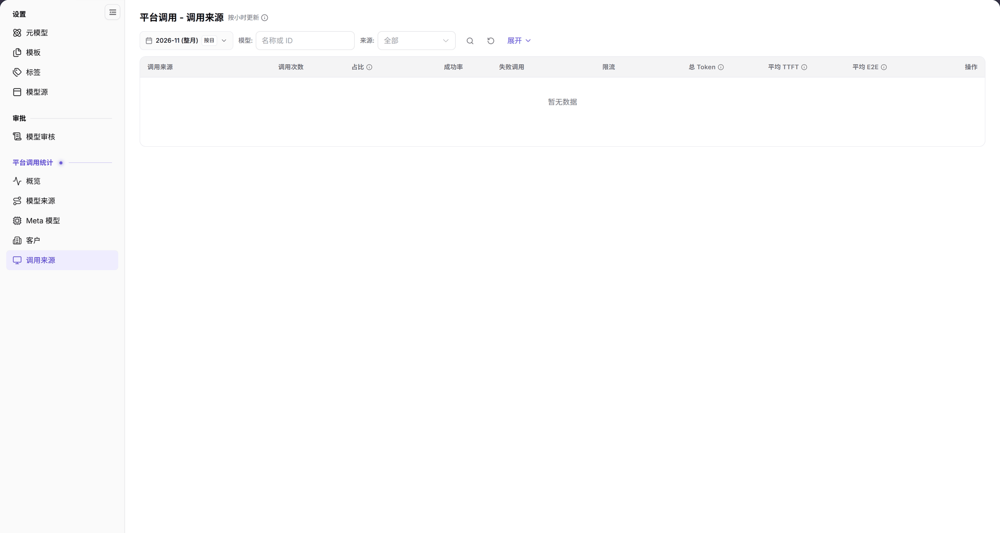

# 平台调用 - 调用来源

> 本页面在系统左侧菜单中显示为【调用来源】，页面标题为【平台调用 - 调用来源】。

## 功能概述

| 项目 | 内容 |
| --- | --- |
| 适用角色 | 运营管理员 |
| 导航路径 | **模型及AI服务** > **平台调用统计** > **调用来源** |
| 页面路由 | `/modelone/model-observation/operator/apps` |
| 管理对象 | 按调用来源统计的调用次数、占比、成功率、失败调用、限流、Token 和延迟 |

**新手理解**：这是按“调用来源”拆分的统计页。它回答“调用来自哪些客户端来源、调用量和成功率如何”。本页只读，不负责应用或来源配置。

#### 术语速查

| 术语 | 说明 |
| --- | --- |
| 调用来源 | 发起模型调用的客户端应用、系统服务或 API Key 所属源头标识。 |
| 平均 TTFT | 首字生成延迟（Time To First Token），即模型接收请求到输出首个 Token 的平均耗时。 |
| 平均 E2E | 端到端完整耗时（End-to-End Latency），包含网关路由、排队与模型完整推理输出。 |
| 限流调用 | 因并发或 QPS 超出预设流控阈值，被平台网关拒绝并返回限流错误的请求次数。 |

## 前提条件

1. 当前账号具备**平台调用统计 > 调用来源**的查看权限。
2. 平台已经产生调用数据；若当前范围无数据，列表显示 `暂无数据`。
3. 读取数据前已确认统计月份、模型和来源筛选。

## 页面说明

- 筛选区：月份 `2026-11 (整月)`、`按日`、`模型: 名称或 ID`、`来源: 全部`、搜索图标、重置图标、`展开`。
- 表格列：`调用来源`、`调用次数`、`占比`、`成功率`、`失败调用`、`限流`、`总 Token`、`平均 TTFT`、`平均 E2E`、`操作`。
- 与模型来源、Meta 模型、客户页不同，本页没有 `平均 TPOT` 列。
- 无数据时显示 `暂无数据`。

| 区域 | 说明 |
| --- | --- |
| 顶部时间与筛选栏 | 包含统计月份选择、按日粒度切换、模型名称/ID 过滤、来源下拉及展开按钮 |
| 状态与时效提示 | 页面标题旁标注“按小时更新”，提示统计数据的数据入库与聚合时效 |
| 调用来源统计表 | 呈现各调用来源的调用次数、占比、成功率、失败与限流数、总 Token 及延迟指标 |

图示为页面标题旁标注 `按小时更新`。筛选区包含月份、`按日`、`模型`、`来源` 和 `展开`；表格以 `调用来源` 为首列，并显示调用次数、占比、成功率、失败调用、限流、总 Token、平均 TTFT、平均 E2E 和操作，当前为 `暂无数据`。

## 主要操作

1. 选择统计月份，例如 `2026-11 (整月)`。
2. 使用 `按日` 切换统计粒度。
3. 在 `模型` 输入名称或 ID，在 `来源` 选择来源或保留 `全部`。
4. 点击 **"搜索"** 图标查询，点击 **"重置"** 图标清空，点击 **"展开"** 显示更多条件。
5. 在表格中按 `调用来源` 查看调用量、成功率、失败调用、限流、Token 和延迟。

## 参数速查表

| 字段名称 | 是否必填 | 字段类型 | 示例 | 说明 |
| --- | --- | --- | --- | --- |
| 月份 | 必填 | 月份选择 | `2026-11 (整月)` | 统计月份 |
| 按日 | 选填 | 切换 | `按日` | 统计粒度 |
| 模型 | 选填 | 文本 | `DeepSeek-V4-Pro` | 按名称或 ID 过滤 |
| 来源 | 选填 | 下拉 | `全部` | 按来源过滤 |
| 调用来源 | 系统展示 | 文本 | `AGIOne` | 客户端来源 |
| 调用次数 / 占比 / 成功率 | 系统展示 | 数字 / 百分比 | `1,024` / `32%` / `99.5%` | 调用量和质量指标 |
| 失败调用 / 限流 | 系统展示 | 数字 | `5` / `2` | 失败和限流数量 |
| 总 Token | 系统展示 | 数字 | `1,200,000` | Token 总量 |
| 平均 TTFT / 平均 E2E | 系统展示 | 时间 | `320 ms` | 延迟指标 |

## 踩坑提示

- 本页没有 `平均 TPOT` 列；需要 TPOT 时查看[模型来源](../model-sources/)或[Meta 模型](../meta-models/)。
- 页面标注 `按小时更新`，不是实时数据。
- `来源` 筛选与 `模型` 筛选可以叠加；结果为空时先清空条件。
- 页面显示 `暂无数据` 时，表示所选范围没有可展示的调用记录。

## 结果校验

| 检查项 | 成功表现 | 异常时处理 |
| --- | --- | --- |
| 页面已加载 | 标题显示 `平台调用 - 调用来源`，页面右上标注 `按小时更新`，筛选栏完整可用 | 刷新页面或检查运营管理员账户是否具备平台调用分析查看权限 |
| 表格结构完整 | 表头正确包含 `调用来源`、`调用次数`、`占比`、`成功率`、`失败调用`、`限流`、`总 Token`、`平均 TTFT`、`平均 E2E` 及 `操作` | 若表头字段错位或缺列，清理浏览器本地缓存后重新进入 |
| 筛选联动有效 | 切换月份或选择特定来源后，表格统计指标即时联动重算更新 | 点击 **"重置"** 排除组合过滤条件干扰，确认所选时间段内是否有调用流量 |
| 空数据提示正常 | 在无流量月份或无匹配来源时，表格正中显示 `暂无数据` | 切换统计月份至已有调用记录的周期，或进入平台概览确认全局调用量 |

## 常见问题

#### 页面没有数据

**问题现象：**

调用来源统计表格正中显示 `暂无数据`，各项指标为空。

**可能原因：**

当前所选统计月份内全平台暂无该来源调用产生，或来源名称输入存在偏差。

**处理方式：**

1. 切换至最近有调用业务产生的历史月份。
2. 点击 **"重置"** 图标清空模型与来源过滤条件后重新查询。
3. 进入 [概览](../overview/) 确认当月是否存在全局调用总量。

#### 为什么没有平均 TPOT 列

**问题现象：**

其他平台统计页面展示有 `平均 TPOT` 列，但调用来源页面未包含该指标。

**可能原因：**

调用来源侧重关注网关首字响应（TTFT）与端到端延迟（E2E），吞吐指标收敛在模型源与元模型维度。

**处理方式：**

若需深入分析模型输出吞吐速率（TPOT），请前往 [模型来源](../model-sources/) 或 [Meta 模型](../meta-models/) 页面查看。

## 注意事项

- 本页只读，不提供应用或来源配置入口。
- 统计结果受月份、模型和来源筛选影响。
- 延迟指标要结合样本量理解。

## 后续操作

1. 进入客户调用分析页面，比对不同租户在各调用来源上的分布。
2. 回到平台调用概览，掌握全局趋势与流量波峰。
3. 针对高频失败或限流的调用来源，核查客户端请求参数与流控配额。

相关页面：
- [客户分析](../customers/)
- [模型来源](../model-sources/)
- [Meta 模型](../meta-models/)
- [概览](../overview/)
