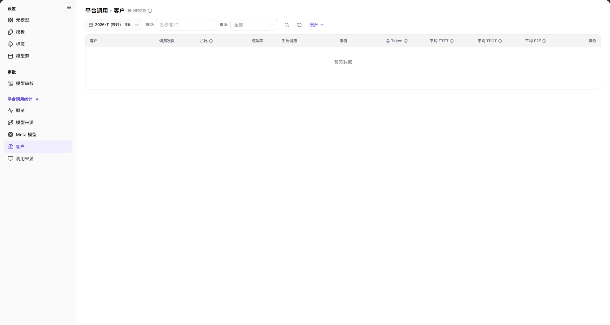

# 平台调用 - 客户

> 本页面在系统左侧菜单中显示为【客户】，页面标题为【平台调用 - 客户】。

## 功能概述

| 项目 | 内容 |
| --- | --- |
| 适用角色 | 运营管理员 |
| 导航路径 | **模型及AI服务** > **平台调用统计** > **客户** |
| 页面路由 | `/modelone/model-observation/operator/customers` |
| 管理对象 | 按客户统计的调用次数、占比、成功率、失败调用、限流、Token 和延迟 |

**新手理解**：这是按“客户”拆分的调用统计页。它回答“哪些客户在调用平台、调用量和成功率如何”。本页只读，不负责客户资料维护。

#### 术语速查

| 术语 | 说明 |
| --- | --- |
| 客户（租户） | 接入平台并发起模型推理的独立企业、组织或租户实体。 |
| 调用占比 | 该客户在所选时间周期内的调用总次数占全平台总调用量的百分比。 |
| 平均 TPOT | 输出阶段吞吐时间（Time Per Output Token），即生成阶段每个 Token 的平均耗时。 |
| 失败调用 | 因客户端传参异常（4xx）、鉴权失效或上游推理服务异常（5xx）导致的未成功请求数。 |

## 前提条件

1. 当前账号具备**平台调用统计 > 客户**的查看权限。
2. 平台已经产生调用数据；若当前范围无数据，列表显示 `暂无数据`。
3. 读取数据前已确认统计月份、模型和来源筛选。

## 页面说明

- 筛选区：月份 `2026-11 (整月)`、`按日`、`模型: 名称或 ID`、`来源: 全部`、搜索图标、重置图标、`展开`。
- 表格列：`客户`、`调用次数`、`占比`、`成功率`、`失败调用`、`限流`、`总 Token`、`平均 TTFT`、`平均 TPOT`、`平均 E2E`、`操作`。
- 无数据时显示 `暂无数据`。

| 区域 | 说明 |
| --- | --- |
| 顶部时间与筛选栏 | 提供统计月份选择、按日粒度切换、模型名称/ID 过滤、来源下拉及展开过滤条件 |
| 状态与时效提示 | 页面标题旁标注“按小时更新”，提示统计数据的数据入库与聚合时效 |
| 客户调用统计表 | 呈现各客户的调用次数、全网占比、成功率、失败与限流数、Token 总量及延迟吞吐指标 |

图示为页面标题旁标注 `按小时更新`。筛选区包含月份、`按日`、`模型`、`来源` 和 `展开`；表格以 `客户` 为首列，并显示调用次数、占比、成功率、失败调用、限流和延迟列，当前为 `暂无数据`。

## 主要操作

1. 选择统计月份，例如 `2026-11 (整月)`。
2. 使用 `按日` 切换统计粒度。
3. 在 `模型` 输入名称或 ID，在 `来源` 选择来源或保留 `全部`。
4. 点击 **"搜索"** 图标查询，点击 **"重置"** 图标清空，点击 **"展开"** 显示更多条件。
5. 在表格中按 `客户` 查看调用量、成功率、失败调用、限流、Token 和延迟。

## 参数速查表

| 字段名称 | 是否必填 | 字段类型 | 示例 | 说明 |
| --- | --- | --- | --- | --- |
| 月份 | 必填 | 月份选择 | `2026-11 (整月)` | 统计月份 |
| 按日 | 选填 | 切换 | `按日` | 统计粒度 |
| 模型 | 选填 | 文本 | `DeepSeek-V4-Pro` | 按名称或 ID 过滤 |
| 来源 | 选填 | 下拉 | `全部` | 按来源过滤 |
| 客户 | 系统展示 | 文本 | `AGIOneSystem` | 调用客户 |
| 调用次数 / 占比 / 成功率 | 系统展示 | 数字 / 百分比 | `1,024` / `32%` / `99.5%` | 调用量和质量指标 |
| 失败调用 / 限流 | 系统展示 | 数字 | `5` / `2` | 失败和限流数量 |
| 总 Token | 系统展示 | 数字 | `1,200,000` | Token 总量 |
| 平均 TTFT / TPOT / E2E | 系统展示 | 时间 | `320 ms` | 延迟指标 |

## 踩坑提示

- 本页只读，不提供客户资料的编辑入口。
- 页面标注 `按小时更新`，不是实时数据。
- `来源` 筛选与 `模型` 筛选可以叠加；结果为空时先清空条件。
- 页面显示 `暂无数据` 时，表示所选范围没有可展示的调用记录。

## 结果校验

| 检查项 | 成功表现 | 异常时处理 |
| --- | --- | --- |
| 页面已加载 | 标题显示 `平台调用 - 客户`，右上角标注 `按小时更新`，筛选控件完整显示 | 刷新页面或确认运营管理员是否具备平台级客户统计查看权限 |
| 表格结构完整 | 表头正确包含 `客户`、`调用次数`、`占比`、`成功率`、`失败调用`、`限流`、`总 Token`、`平均 TTFT`、`平均 TPOT`、`平均 E2E` 及 `操作` | 若吞吐指标缺失，确认所选时间段内的模型是否支持流式输出统计 |
| 筛选条件联动 | 切换月份或指定模型后，客户调用统计排名与质量指标实时联动刷新 | 点击 **"重置"** 清空条件，排除组合条件过度过滤 |
| 空数据状态 | 当月无客户调用产生时，表格正中明确展示 `暂无数据` | 切换到实际产生过调用流量的历史周期进行核验 |

## 常见问题

#### 页面没有数据

**问题现象：**

客户统计表正中显示 `暂无数据`，无租户记录。

**可能原因：**

当前所选月份内全平台暂无客户调用，或模型/来源过滤条件排除了所有客户。

**处理方式：**

1. 切换至有真实调用业务发生的月份。
2. 点击 **"重置"** 图标清空模型与来源过滤条件后重新查询。
3. 进入 [概览](../overview/) 确认当月是否存在调用流量基数。

#### 客户维度和调用来源维度有什么区别

**问题现象：**

客户页面与调用来源页面均展示调用统计指标，不确定应依据哪个页面进行业务核算。

**可能原因：**

二者聚合维度不同：客户按租户组织主体汇总，调用来源按接入的应用/服务源头汇总。

**处理方式：**

- 进行客户计费对账、多租户资源消耗排查时，以 `客户` 页面数据为准。
- 排查具体客户端、移动端或集成插件的请求健康度时，使用 [调用来源](../call-sources/)。
- 需要按物理模型源或上游供应商拆分性能时，使用 [模型来源](../model-sources/)。

## 注意事项

- 本页只读，不提供客户资料维护入口。
- 统计结果受月份、模型和来源筛选影响。
- 延迟指标要结合样本量理解。

## 后续操作

1. 进入调用来源页面，下钻分析该客户在各个客户端上的流量分布。
2. 进入模型来源页面，核验该客户高频调用的上游物理供应商健康度。
3. 针对高限流客户，评估并为其上调网关 QPS 与并发配额。

相关页面：
- [调用来源](../call-sources/)
- [模型来源](../model-sources/)
- [Meta 模型](../meta-models/)
- [概览](../overview/)
