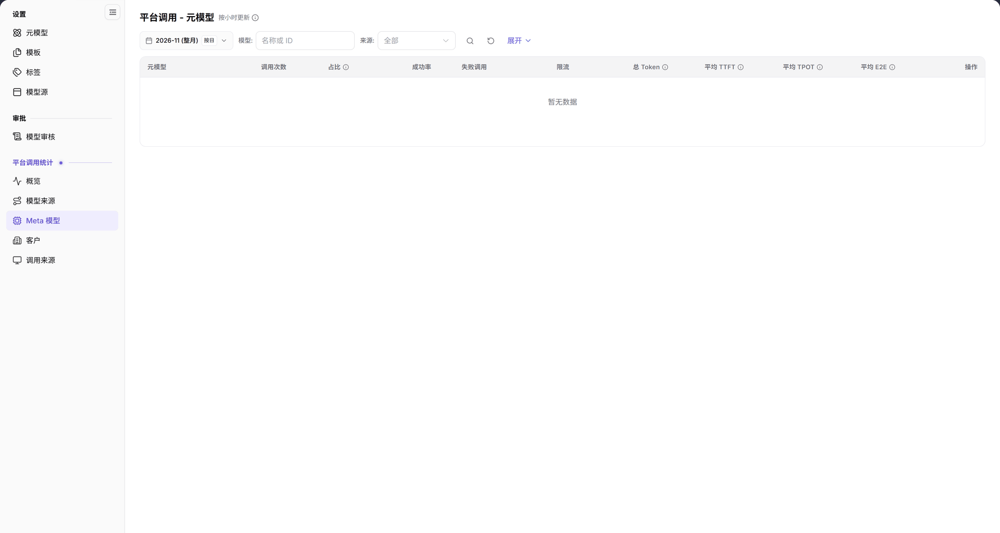

# Meta 模型

::: info 文档信息
版本：v2.0
更新日期：2026-11-04
:::

## 功能概述

| 项目 | 内容 |
| --- | --- |
| 适用角色 | 运营管理员 |
| 导航路径 | **模型及AI服务** > **平台调用统计** > **Meta 模型** |
| 页面路由 | `/modelone/model-observation/operator/meta-models` |
| 管理对象 | 按元模型统计的调用次数、占比、成功率、失败调用、限流、Token 和延迟 |

**新手理解**：这是按“元模型”拆分的调用统计页。它回答“哪个元模型被调用得最多、成功率和延迟如何”。元模型本身在 **设置 > 元模型** 中维护，本页只读。

#### 术语速查

| 术语 | 说明 |
| --- | --- |
| Meta 模型（元模型） | 平台统一抽象的模型核心资产，归集不同物理接入点上的相同模型推理请求。 |
| 调用占比 | 该元模型调用量占所选时间周期内全平台所有模型总调用量的百分比。 |
| 平均 TPOT | 输出阶段吞吐时间（Time Per Output Token），反映大模型逐字生成 token 的平均耗时。 |
| 平均 E2E | 端到端完整请求耗时，包含网络链路耗时、首字响应延迟以及全量内容生成时长。 |

## 前提条件

1. 当前账号具备**平台调用统计 > Meta 模型**的查看权限。
2. 平台已经产生调用数据；若当前范围无数据，列表显示 `暂无数据`。
3. 读取数据前已确认统计月份、模型和来源筛选。

## 页面说明

- 筛选区：月份 `2026-11 (整月)`、`按日`、`模型: 名称或 ID`、`来源: 全部`、搜索图标、重置图标、`展开`。
- 表格列：`元模型`、`调用次数`、`占比`、`成功率`、`失败调用`、`限流`、`总 Token`、`平均 TTFT`、`平均 TPOT`、`平均 E2E`、`操作`。
- 无数据时显示 `暂无数据`。

| 区域 | 说明 |
| --- | --- |
| 顶部时间与筛选栏 | 包含月份选择、按日统计切换、模型搜索框、来源下拉与展开按钮 |
| 状态与时效提示 | 页面标题旁标注“按小时更新”，提示统计数据的数据入库与聚合时效 |
| 元模型统计表 | 呈现各元模型的调用次数、全网占比、成功率、失败与限流数、Token 消耗及延迟吞吐指标 |

图示为页面标题旁标注 `按小时更新`。筛选区包含月份、`按日`、`模型`、`来源` 和 `展开`；表格以 `元模型` 为首列，并显示调用次数、占比、成功率、失败调用、限流和延迟列，当前为 `暂无数据`。

## 主要操作

1. 选择统计月份，例如 `2026-11 (整月)`。
2. 使用 `按日` 切换统计粒度。
3. 在 `模型` 输入名称或 ID，在 `来源` 选择来源或保留 `全部`。
4. 点击 **"搜索"** 图标查询，点击 **"重置"** 图标清空，点击 **"展开"** 显示更多条件。
5. 在表格中按 `元模型` 查看调用次数、占比、成功率、失败调用、限流、Token 和延迟。

## 参数速查表

| 字段名称 | 是否必填 | 字段类型 | 示例 | 说明 |
| --- | --- | --- | --- | --- |
| 月份 | 必填 | 月份选择 | `2026-11 (整月)` | 统计月份 |
| 按日 | 选填 | 切换 | `按日` | 统计粒度 |
| 模型 | 选填 | 文本 | `DeepSeek-V4-Pro` | 按名称或 ID 过滤 |
| 来源 | 选填 | 下拉 | `全部` | 按来源过滤 |
| 元模型 | 系统展示 | 文本 | `DeepSeek-V4-Pro` | 被调用的元模型 |
| 调用次数 / 占比 / 成功率 | 系统展示 | 数字 / 百分比 | `1,024` / `32%` / `99.5%` | 调用量和质量指标 |
| 失败调用 / 限流 | 系统展示 | 数字 | `5` / `2` | 失败和限流数量 |
| 总 Token | 系统展示 | 数字 | `1,200,000` | Token 总量 |
| 平均 TTFT / TPOT / E2E | 系统展示 | 时间 | `320 ms` | 延迟指标 |

## 踩坑提示

- 本页只读，不提供元模型编辑入口；需要修改能力配置时去 **设置 > 元模型**。
- 页面标注 `按小时更新`，不是实时数据。
- `来源` 筛选与 `模型` 筛选可以叠加；结果为空时先清空条件。
- 页面显示 `暂无数据` 时，表示所选范围没有可展示的调用记录。

## 结果校验

| 检查项 | 成功表现 | 异常时处理 |
| --- | --- | --- |
| 页面已加载 | 标题显示 `平台调用 - 元模型`，右上角标注 `按小时更新`，筛选工具栏正常显示 | 刷新页面或确认运营管理员是否具备平台级模型统计分析查看权限 |
| 表格结构完整 | 表头正确包含 `元模型`、`调用次数`、`占比`、`成功率`、`失败调用`、`限流`、`总 Token`、`平均 TTFT`、`平均 TPOT`、`平均 E2E` 及 `操作` | 若部分性能指标列缺失，确认被调用的模型是否上报了推理阶段指标 |
| 筛选条件联动 | 切换月份或指定来源后，元模型调用排名与指标实时联动刷新 | 点击 **"重置"** 清空条件，排除多重组合过滤干扰 |
| 空数据状态 | 所选周期内无该元模型调用流量时，表格正中明确显示 `暂无数据` | 切换到实际产生过调用业务的统计周期查看 |

## 常见问题

#### 页面没有数据

**问题现象：**

元模型统计表格正中显示 `暂无数据`。

**可能原因：**

当前选定月份内全平台暂无该元模型调用，或名称/ID 过滤条件未匹配到任何记录。

**处理方式：**

1. 切换至有真实调用业务发生的历史月份。
2. 点击 **"重置"** 图标清空模型与来源过滤条件后重新查询。
3. 进入 [概览](../overview/) 确认当月是否存在调用流量基数。

#### 元模型统计和设置里的元模型有什么区别

**问题现象：**

系统中有两个“元模型”入口，不确定各自分工与适用场景。

**可能原因：**

二者分属统计观测与资产管理两个不同功能模块。

**处理方式：**

- **平台调用统计 > Meta 模型** 用于事后观测各元模型的调用频次、成功率、延迟表现与 Token 消耗，属于只读分析看板。
- **设置 > 元模型** 用于事前定义元模型的基础信息、支持模态、能力标签、Token 上限与官方协议。

## 注意事项

- 本页只读，不提供编辑或删除入口。
- 统计结果受月份、模型和来源筛选影响。
- 延迟指标要结合样本量理解。

## 后续操作

1. 进入模型来源页面，查看该元模型在各个底层物理来源/供应方上的负载分摊。
2. 进入客户分析页面，排查主要调用该元模型的重点租户。
3. 发现高延迟或异常失败率时，前往设置核验对应元模型的 Endpoint 协议与限流配置。

相关页面：
- [模型来源](../model-sources/)
- [客户分析](../customers/)
- [调用来源](../call-sources/)
- [元模型设置](../../settings/meta-models/)
