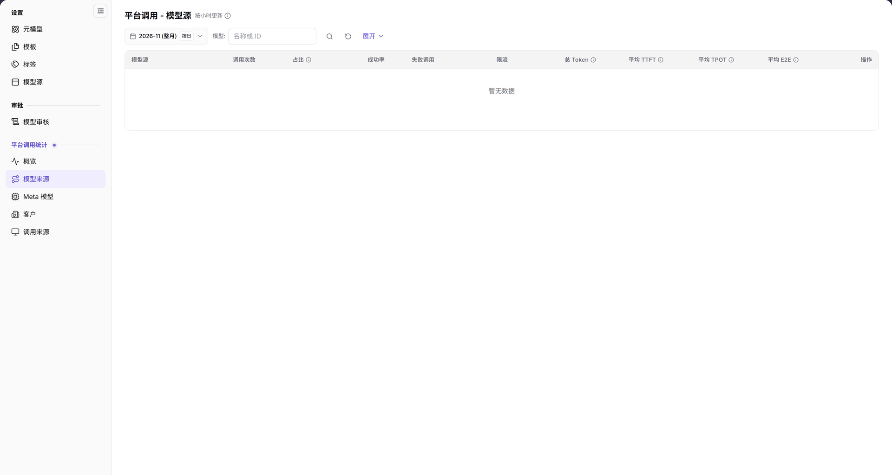

# 模型来源

::: info 文档信息
版本：v2.0
更新日期：2026-11-04
:::

## 功能概述

| 项目 | 内容 |
| --- | --- |
| 适用角色 | 运营管理员 |
| 导航路径 | **模型及AI服务** > **平台调用统计** > **模型来源** |
| 页面路由 | `/modelone/model-observation/operator/sources` |
| 管理对象 | 按模型源统计的调用次数、占比、成功率、失败调用、限流、Token 和延迟 |

**新手理解**：这是按“模型源”拆分的调用统计页。它回答“哪个上游来源被调用得最多、成功率和延迟如何”，不负责新增或修改模型源。需要配置模型源时，请使用 **设置 > 模型源**。

#### 术语速查

| 术语 | 说明 |
| --- | --- |
| 模型源（来源） | 提供物理模型算力与 API 推理接入的上游服务商或基础设施接入点。 |
| 调用占比 | 该模型源在统计周期内承担的调用量占全平台总调用量的百分比。 |
| 平均 TPOT | 输出阶段吞吐时间（Time Per Output Token），反映上游模型逐字生成输出的吞吐性能。 |
| 限流调用 | 因触达该上游渠道的并发或 QPS 上限，被平台流量控制网关拦截的调用总数。 |

## 前提条件

1. 当前账号具备**平台调用统计 > 模型来源**的查看权限。
2. 平台已经产生调用数据；若当前范围无数据，列表显示 `暂无数据`。
3. 读取数据前已确认统计月份和模型筛选条件。

## 页面说明

页面顶部是筛选区，下方是模型源统计表：

- 筛选区：月份 `2026-11 (整月)`、`按日`、`模型: 名称或 ID`、搜索图标、重置图标、`展开`。
- 表格列：`模型源`、`调用次数`、`占比`、`成功率`、`失败调用`、`限流`、`总 Token`、`平均 TTFT`、`平均 TPOT`、`平均 E2E`、`操作`。
- 无数据时表格显示 `暂无数据`。

| 区域 | 说明 |
| --- | --- |
| 顶部时间与筛选栏 | 包含统计月份选择、按日统计粒度切换、模型输入框及展开筛选按钮 |
| 状态与时效提示 | 页面标题旁标注“按小时更新”，提示统计数据的入库与聚合时效 |
| 模型源统计表 | 呈现各上游模型源的调用次数、全网占比、成功率、失败与限流数、Token 消耗及延迟吞吐指标 |

图示为页面标题旁标注 `按小时更新`。筛选区包含月份、`按日`、`模型` 和 `展开`；表格列出 `模型源`、`调用次数`、`占比`、`成功率`、`失败调用`、`限流`、`总 Token`、`平均 TTFT`、`平均 TPOT`、`平均 E2E` 和 `操作`，当前显示 `暂无数据`。

## 主要操作

### 选择统计范围

1. 选择统计月份，例如 `2026-11 (整月)`。
2. 使用 `按日` 切换统计粒度。
3. 在 `模型` 输入框中输入模型名称或 ID。
4. 点击 **"搜索"** 图标执行查询，点击 **"重置"** 图标清空条件，点击 **"展开"** 显示更多筛选。

### 读取模型源统计

1. 在表格中按 `模型源` 查看每个来源的调用次数。
2. 核对 `占比`、`成功率`、`失败调用` 和 `限流`。
3. 查看 `总 Token`、`平均 TTFT`、`平均 TPOT` 和 `平均 E2E`。
4. 需要进入总览时，回到[概览](../overview/)。

### 与“设置 > 模型源”区分

- **平台调用统计 > 模型来源**：只读统计，按来源查看调用数据。
- **设置 > 模型源**：维护模型源 Code、Endpoint、Base URL 和协议。

## 参数速查表

| 字段名称 | 是否必填 | 字段类型 | 示例 | 说明 |
| --- | --- | --- | --- | --- |
| 月份 | 必填 | 月份选择 | `2026-11 (整月)` | 统计月份 |
| 按日 | 选填 | 切换 | `按日` | 统计粒度 |
| 模型 | 选填 | 文本 | `DeepSeek-V4-Pro` | 按名称或 ID 过滤 |
| 展开 | 选填 | 按钮 | `展开` | 显示更多筛选 |
| 模型源 | 系统展示 | 文本 | `AGIOne` | 上游模型来源 |
| 调用次数 | 系统展示 | 数字 | `1,024` | 当前范围的调用量 |
| 占比 | 系统展示 | 百分比 | `32%` | 占全部调用的比例 |
| 成功率 | 系统展示 | 百分比 | `99.5%` | 成功调用占比 |
| 失败调用 | 系统展示 | 数字 | `5` | 失败调用数 |
| 限流 | 系统展示 | 数字 | `2` | 被限流的调用数 |
| 总 Token | 系统展示 | 数字 | `1,200,000` | 输入与输出 Token 总量 |
| 平均 TTFT / TPOT / E2E | 系统展示 | 时间 | `320 ms` | 延迟指标 |
| 操作 | 系统展示 | 列 | `--` | 当前无数据时不显示具体操作 |

## 踩坑提示

- 本页是统计页，不是配置页；找不到新建按钮时，请去 **设置 > 模型源**。
- 页面标注 `按小时更新`，数据不是实时秒级。
- 页面显示 `暂无数据` 时，表示所选范围没有可展示的调用记录。
- 筛选区只有 `模型` 和月份；不要把它与总览页的 `来源` 筛选混淆。

## 结果校验

| 检查项 | 成功表现 | 异常时处理 |
| --- | --- | --- |
| 页面已加载 | 标题显示 `平台调用 - 模型源`，右上角标注 `按小时更新`，筛选工具栏正常显示 | 刷新页面或确认运营管理员是否具备平台级模型源统计分析查看权限 |
| 表格结构完整 | 表头正确包含 `模型源`、`调用次数`、`占比`、`成功率`、`失败调用`、`限流`、`总 Token`、`平均 TTFT`、`平均 TPOT`、`平均 E2E` 及 `操作` | 若表头字段异常，清理浏览器缓存并重新打开 |
| 筛选条件联动 | 切换月份或输入模型名称过滤后，各模型源调用排名与指标实时联动刷新 | 点击 **"重置"** 清空条件，排除多重组合过滤干扰 |
| 空数据状态 | 所选周期内无该模型源调用流量时，表格正中明确显示 `暂无数据` | 切换到实际产生过调用业务的统计周期查看 |

## 常见问题

#### 页面没有数据

**问题现象：**

模型源统计表格正中显示 `暂无数据`。

**可能原因：**

当前选定月份内全平台暂无该模型源调用，或模型名称输入未匹配到任何物理来源记录。

**处理方式：**

1. 切换至有真实调用业务发生的历史月份。
2. 点击 **"重置"** 图标清空模型过滤条件后重新查询。
3. 进入 [概览](../overview/) 确认当月是否存在调用流量基数。

#### 为什么这里不能新增模型源

**问题现象：**

在模型来源页面找不到新建模型源或编辑 Endpoint 的操作按钮。

**可能原因：**

本页用于事后统计观测，不具备基础设施资源的管理写权限。

**处理方式：**

前往 **模型及AI服务 > 设置 > 模型源** 页面，在该页面可执行新建模型源、配置 Endpoint、维护 Base URL 与原生协议等操作。

## 注意事项

- 本页只读，不提供模型源配置入口。
- 统计结果受月份和模型筛选影响，汇报前确认条件。
- 延迟指标需要结合样本量理解，不要只看单个平均值。

## 后续操作

1. 进入 Meta 模型页面，查看该模型源下各元模型具体的流量构成。
2. 进入客户分析页面，排查主要消耗该模型源算力的租户。
3. 发现上游物理故障或大面积限流时，前往模型源设置核验 Endpoint 连通性或切换备用线路。

相关页面：
- [Meta 模型](../meta-models/)
- [客户分析](../customers/)
- [调用来源](../call-sources/)
- [模型源设置](../../settings/model-source/)
