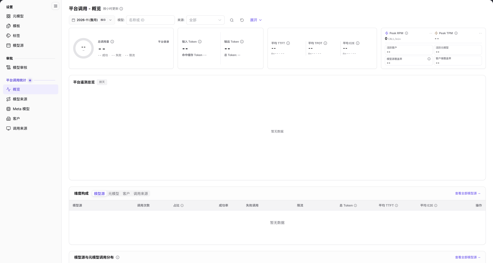

# 概览

::: info 文档信息
版本：v2.0
更新日期：2026-11-04
:::

## 功能概述

| 项目 | 内容 |
| --- | --- |
| 适用角色 | 运营管理员 |
| 导航路径 | **模型及AI服务** > **平台调用统计** > **概览** |
| 页面路由 | `/modelone/model-observation/operator/overview` |
| 管理对象 | 平台调用总量、平台健康、Token、延迟、Peak RPM/TPM、活跃客户、活跃元模型、模型源覆盖率、客户端覆盖率、维度构成和调用分布 |

#### 新手理解

这是平台调用统计的总仪表盘。先看顶部总量和健康指标，再按“模型源 / 元模型 / 客户 / 调用来源”切换维度，定位是哪一类对象产生了调用或异常。

#### 术语速查

| 术语 | 说明 |
| --- | --- |
| 平台健康 | 综合评估全平台请求成功、失败及限流触发比例的宏观运行状态指标。 |
| 模型源覆盖率 | 产生实际调用的活跃模型源数量占全平台已纳管模型源总数的比例。 |
| 客户端覆盖率 | 产生调用流量的应用标识（App ID）在已注册客户端总库中的占比。 |
| 维度构成 | 按模型源、元模型、租户客户与调用来源四种业务维度切分统计总量的分析视图。 |

## 前提条件

1. 当前账号具备**平台调用统计 > 概览**的查看权限。
2. 平台已经产生调用数据；若当前范围无数据，顶部指标显示 `--`，图表显示 `暂无数据` 或 `数据暂不可用，请稍后重试。`。
3. 读取指标前已确认统计月份和模型、来源筛选条件。

## 页面说明

页面自上而下分为四部分：

- **筛选区**：月份 `2026-11 (整月)`、`按日`、`模型: 名称或 ID`、`来源: 全部`、`展开`。
- **KPI 卡片**：`总调用量`、`平台健康`、`输入 Token`、`输出 Token`、`平均 TTFT`、`平均 TPOT`、`平均 E2E`、`Peak RPM`、`Peak TPM`、`活跃客户`、`活跃元模型`、`模型源覆盖率`、`客户端覆盖率`。
- **平台遥测总览**：右上角标注 `按天`；无数据时显示 `暂无数据` 或 `数据暂不可用，请稍后重试。`。
- **维度构成**：页签 `模型源`、`元模型`、`客户`、`调用来源`；下方是维度表格和 `模型源与元模型调用分布`。

图示为页面标题旁标注 `按小时更新`。筛选区包含月份、`按日`、`模型`、`来源` 和 `展开`；KPI 卡片显示 `--`，`平台遥测总览` 显示 `暂无数据`，维度表头包含 `模型源`、`调用次数`、`占比`、`成功率`、`失败调用`、`限流`、`总 Token`、`平均 TTFT`、`平均 E2E` 和 `操作`。

| 区域 | 说明 |
| --- | --- |
| 筛选与控制栏 | 支持切换统计月份、开启按日统计粒度，按模型名称/ID与来源筛选。 |
| 核心 KPI 卡片阵列 | 汇总展示平台总调用量、平台健康、Token 用量、端到端延迟与速率峰值。 |
| 平台遥测总览 | 以时序曲线图直观呈现全平台按日调用的流量波动与成功/失败走势。 |
| 多维度构成与分布 | 提供模型源、元模型、客户与调用来源四大页签及底层详细调用分布表。 |

## 主要操作

### 选择统计范围

1. 在月份选择器中选择统计月份，例如 `2026-11 (整月)`。
2. 使用 `按日` 切换统计粒度。
3. 在 `模型` 输入框中输入名称或 ID。
4. 在 `来源` 下拉框中选择来源，或保留 `全部`。
5. 点击 `展开` 显示更多筛选条件。

### 读取 KPI

1. 先看 `总调用量` 和 `平台健康`，确认当前范围是否有调用。
2. 查看 `输入 Token`、`输出 Token` 和 `总 Token`。
3. 查看 `平均 TTFT`、`平均 TPOT` 和 `平均 E2E`，判断延迟指标是否有值。
4. 查看 `Peak RPM`、`Peak TPM`、`活跃客户`、`活跃元模型`、`模型源覆盖率` 和 `客户端覆盖率`。

### 切换维度与下钻

1. 在 `维度构成` 中切换 `模型源`、`元模型`、`客户` 或 `调用来源`。
2. 读取对应维度表格的调用次数、占比、成功率、失败调用、限流、总 Token 和延迟。
3. 点击 `查看全部模型源` 进入模型来源统计页。
4. 在 `模型源与元模型调用分布` 中核对模型源、请求元模型、调用次数、成功调用、成功率、失败调用、限流和其他拒绝。

## 参数速查表

### 筛选条件

| 字段名称 | 是否必填 | 字段类型 | 示例 | 说明 |
| --- | --- | --- | --- | --- |
| 月份 | 必填 | 月份选择 | `2026-11 (整月)` | 统计月份 |
| 按日 | 选填 | 切换 | `按日` | 统计粒度 |
| 模型 | 选填 | 文本 | `DeepSeek-V4-Pro` | 按名称或 ID 过滤 |
| 来源 | 选填 | 下拉 | `全部` | 按来源过滤 |
| 展开 | 选填 | 按钮 | `展开` | 显示更多筛选条件 |

### KPI 与表头

| 指标 / 字段 | 类型 | 页面信息 |
| --- | --- | --- |
| 总调用量 | KPI | 当前筛选范围的调用总量 |
| 平台健康 | KPI | 显示成功、失败和限流计数 |
| 输入 Token / 输出 Token | KPI | Token 用量；另有 `总 Token` |
| 平均 TTFT / 平均 TPOT / 平均 E2E | KPI | 延迟指标，附带样本数 `n=` |
| Peak RPM / Peak TPM | KPI | 峰值请求/Token 速率 |
| 活跃客户 / 活跃元模型 | KPI | 当前范围的活跃对象数 |
| 模型源覆盖率 / 客户端覆盖率 | KPI | 覆盖率指标 |
| 调用次数 / 占比 / 成功率 / 失败调用 / 限流 / 总 Token | 表格列 | 维度构成表格 |
| 平均 TTFT / 平均 E2E | 表格列 | 维度构成表格 |

## 踩坑提示

- 页面标题旁标注 `按小时更新`，指标不是实时秒级数据。
- 筛选区显示 `模型` 和 `来源`，但当前范围没有调用数据时，KPI 显示 `--`，图表显示 `暂无数据`。
- `平台遥测总览` 还可能显示 `数据暂不可用，请稍后重试。`，这表示当前图表数据暂不可用，不等于筛选条件错误。
- 维度构成有四个页签；只看到 `模型源` 时，不代表其他维度没有入口。

## 结果校验

| 检查项 | 成功表现 | 异常时处理 |
| --- | --- | --- |
| 页面加载 | 标题显示 `平台调用 - 概览`，右上角标注 `按小时更新`，筛选控件正常渲染。 | 若页面空白，检查运营管理员权限配置并刷新浏览器重试。 |
| 筛选联动 | 切换月份或指定模型/来源后，KPI 卡片与下方图表及表格同步刷新。 | 若无刷新，核对是否按回车提交检索或点击了刷新按钮。 |
| 指标数值 | 存在调用数据时显示具体整数或浮点指标，健康度显示成功与失败计数。 | 若全为破折号，检查所选统计账期内平台是否确实承载过业务流量。 |
| 遥测图表 | 趋势折线图完整绘制各采样点，悬停可查看当日成功与失败请求明细。 | 若显示数据不可用，排查后端时序数据库同步延迟并稍后刷新。 |
| 维度切换 | 顺畅在 `模型源`、`元模型`、`客户`、`调用来源` 间切换，表格数据同步更新。 | 若表格不切换，检查网络连接是否正常，或重新选择页签。 |

## 常见问题

#### 页面 KPI 全部是 `--`

**问题现象：**

打开概览页后，所有 KPI 卡片均显示 `--`，图表显示 `暂无数据`。

**可能原因：**

当前所选统计月份内全平台尚无任何调用产生，或者筛选栏中填入了不存在的模型名称/来源导致全部过滤。

**处理方式：**

1. 确认月份下拉框选中的账期存在实际业务调用。
2. 检查并清空 `模型` 与 `来源` 筛选输入框，使其恢复全局聚合视图。
3. 若遥测图表提示 `数据暂不可用，请稍后重试。`，等待整点聚合任务执行完毕后刷新。

#### 想看某个模型源的明细

**问题现象：**

概览页展示的是全局汇总数据，需要排查特定上游模型源的详细调用量与健康指标。

**可能原因：**

概览页默认用平铺卡片展示整体情况，需按维度下钻查看单源明细。

**处理方式：**

1. 在页面下方的 `维度构成` 区域，切换至 `模型源` 页签。
2. 在模型源表格中找到目标源，或点击 **"查看全部模型源"** 按钮进入模型来源专项统计页。

## 注意事项

- 本页是只读统计页，不提供模型、模型源或客户的编辑入口。
- 统计范围受月份、模型和来源筛选影响，汇报数据前先确认筛选条件。
- 不要根据单个 KPI 判断整体健康度，应结合 `平台健康`、失败调用、限流和延迟一起看。

## 后续操作

1. 深入分析各上游模型源的调用分布与异常指标，进入 [模型来源](../model-sources/)。
2. 按基础底模标准审计各元模型的调用规模，进入 [Meta 模型](../meta-models/)。
3. 审查租户客户与客户端应用的调用排行与合规性，进入 [客户](../customers/) 与 [调用来源](../call-sources/)。
4. 如需调整上游模型源接入点或凭证，前往 [模型源](../../../operator/settings/model-source/)。

相关页面：
- [模型来源](../model-sources/)
- [Meta 模型](../meta-models/)
- [客户](../customers/)
- [调用来源](../call-sources/)
- [模型源](../../../operator/settings/model-source/)
