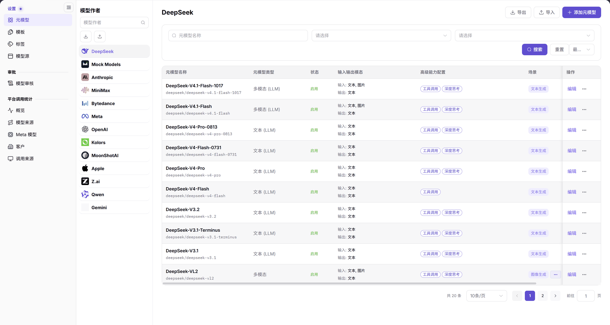
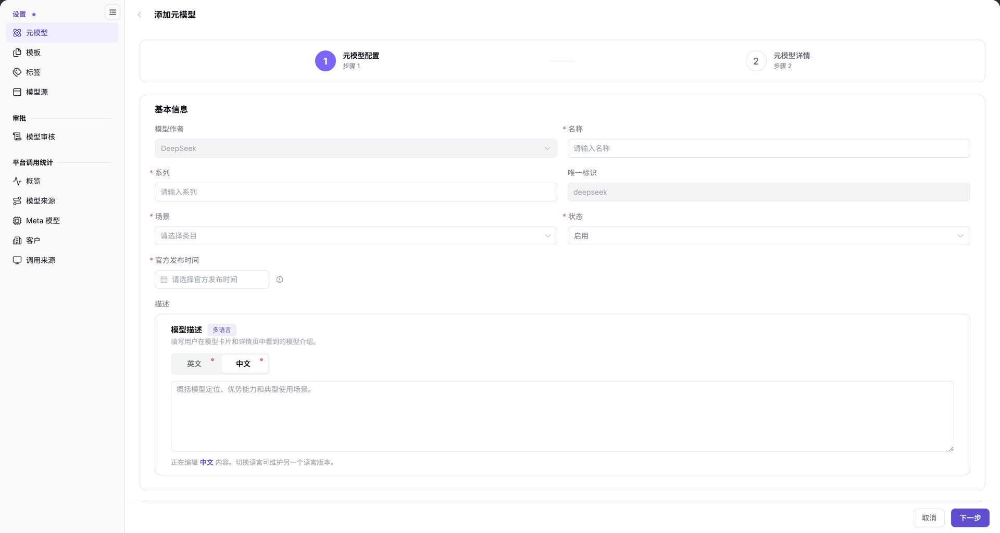

# 元模型

::: info 文档信息
版本：v2.1
更新日期：2026-11-12
:::

## 功能概述

| 项目 | 内容 |
| --- | --- |
| 适用角色 | 运营管理员 |
| 导航路径 | **模型及AI服务** > **设置** > **元模型** |
| 页面路由 | `/modelone/settings/meta`；添加页 `/modelone/settings/meta/addModel` |
| 管理对象 | 元模型名称、系列、唯一标识、场景、状态、模型类型、输入输出模态、高级能力、Token 限制和官方原生协议 |

#### 新手理解

元模型是“模型能力档案”。它说明一款模型能处理什么内容、支持哪些协议、上下文有多长；模型源则说明这项服务从哪里调用。先有元模型，模板和发布流程才能引用它。

#### 术语速查

| 术语 | 说明 |
| --- | --- |
| 模型作者 | 模型的研发厂商或开源组织（如 DeepSeek、OpenAI、Qwen）。 |
| 唯一标识 | 元模型在平台内部的全局唯一标识（如 `deepseek/deepseek-v4-pro`）。 |
| 官方原生协议 | 该元模型所兼容的底层网络交互协议集合（如 `openai/chat_completions`）。 |
| 高级能力配置 | 包含函数调用（Tool Calling）与深度思考模式（Thinking Mode）等扩展能力开关。 |

## 前提条件

1. 当前账号具备**设置 > 元模型**的查看和维护权限。
2. 左侧的模型作者已经存在；添加元模型时需要先选中对应作者。
3. 已确认模型名称、系列、唯一标识、场景、官方发布时间、模型类型与子模型、输入输出模态、Token 限制和协议信息。

## 页面说明

页面分为左右两部分：

- **左侧模型作者区**：顶部是“模型作者”搜索框，下面是作者列表，例如 DeepSeek、Mock Models、Anthropic、MiniMax、OpenAI、Qwen。当前作者以高亮行显示。
- **右侧列表区**：顶部显示当前作者名称，右上角是 **导出**、**导入**、**添加元模型**；筛选区包含 `元模型名称` 输入框、两个 `请选择` 下拉框、**搜索**、**重置**，以及右侧显示为 `...` 的更多操作入口；下方表格展示元模型记录和分页。

图示为 DeepSeek 作者的元模型列表，表格列为 `元模型名称`、`元模型类型`、`状态`、`输入输出模态`、`高级能力配置`、`场景`、`操作`。列表底部显示 `共 20 条` 和分页控件。

| 区域 | 说明 |
| --- | --- |
| 左侧模型作者栏 | 展示模型研发厂商列表，支持搜索作者并切换当前作者。 |
| 顶部操作与筛选 | 显示当前作者名称，提供导入、导出、添加元模型及名称/状态筛选栏。 |
| 元模型列表表格 | 呈现元模型名称、唯一标识、类型、状态、模态与高级能力标签。 |
| 行内操作入口 | 提供直接 **编辑** 入口，以及通过更多菜单进行详情查看、复制、启停与删除。 |

## 主要操作

### 切换与搜索模型作者

1. 在左侧 `模型作者` 搜索框输入作者名称或关键字。
2. 在作者列表中点击目标作者，右侧标题和元模型列表会切换到该作者。
3. 需要回到完整作者列表时，清空搜索框。

### 添加元模型

1. 选中目标模型作者后，点击右上角 **"添加元模型"**。
2. 页面进入 `添加元模型` 向导，顶部显示两个步骤：`1 元模型配置`、`2 元模型详情`。
3. 在步骤 1 的 `基本信息` 中核对 `模型作者`，填写 `名称`、`系列`、`唯一标识`、`场景`、`状态` 和 `官方发布时间`。
4. 在 `描述` 区域切换 `英文` / `中文` 页签，填写 `模型描述`。
5. 继续配置 `模型类型与子模型`、`输入输出模态`、`高级能力配置`、`Token限制` 和 `官方原生协议与默认高级参数`。
6. 点击 **"下一步"** 进入 `元模型详情`，按页面字段继续补充；需要返回时点击 **"取消"** 或左上角返回箭头。

图示为步骤 1 的 `基本信息` 和 `描述` 区域。带 `*` 的 `名称`、`系列`、`场景`、`官方发布时间` 等字段需要填写；`模型作者` 由入口带入，示例为 DeepSeek。

### 筛选与查看列表

1. 在 `元模型名称` 输入框输入名称关键字。
2. 使用两个 `请选择` 下拉框缩小列表范围。
3. 点击 **"搜索"** 执行查询；点击 **"重置"** 清空条件。
4. 列表按 `元模型名称`、`元模型类型`、`状态`、`输入输出模态`、`高级能力配置`、`场景`、`操作` 展示。名称下方显示唯一标识，操作列提供 **"编辑"** 和 **...**。

### 行内操作

目标行提供以下入口：

- **"编辑"**：进入元模型编辑表单。
- **...**：展开更多操作，可见 **"详情"**、**"复制并编辑"**、**"启用"**、**"禁用"**、**"删除"**。
- **"详情"**：查看当前元模型配置。

执行启用、禁用或删除前，先确认该元模型是否已被模板或发布流程引用。

### 导入与导出

1. 点击 **"导出"** 导出当前列表。
2. 点击 **"导出"** 旁的更多入口可使用 **"按条件导出"**。
3. 点击 **"导入"** 打开导入流程，按页面提示选择文件。

导入或导出的文件可能包含协议和能力配置，应存放在受控位置，不要提交到代码仓库或发送到未授权群组。

## 参数速查表

| 字段名称 | 是否必填 | 字段类型 | 示例 | 说明 |
| --- | --- | --- | --- | --- |
| 模型作者 | 入口带入 | 下拉 / 只读 | `DeepSeek` | 当前元模型归属的作者 |
| 名称 | 必填 | 文本 | `DeepSeek-V4-Pro` | 列表和模型卡片中展示的名称 |
| 系列 | 必填 | 文本 | `DeepSeek-V4` | 元模型所属系列 |
| 唯一标识 | 必填 | 文本 | `deepseek/deepseek-v4-pro` | 元模型的唯一识别值 |
| 场景 | 必填 | 下拉 | `文本生成` | 元模型适用的业务场景 |
| 状态 | 必填 | 下拉 | `启用` | 列表 `状态` 列展示的值 |
| 官方发布时间 | 必填 | 日期 | `2026-10-27` | 模型官方发布日期 |
| 模型描述 | 选填 | 多语言文本 | `旗舰级 MoE 大模型` | 模型卡片和详情页展示的说明 |
| 模型类型与子模型 | 按页面选择 | 卡片 / 单选 | `多模态`、`文本` | 定义模型能力分类 |
| 输入模态 / 输出模态 | 按页面选择 | 多选 | `文本`、`图像` | 声明模型支持的输入和输出类型 |
| 函数 / 工具支持 | 选填 | 开关 | `已启用` | 是否支持工具调用 |
| 思考模式 | 选填 | 开关 | `已启用` | 是否支持深度思考 |
| Token限制 | 按页面填写 | 数字 | `最大上下文 1000 K` | 上下文、输入和输出上限 |
| 官方原生协议与默认高级参数 | 按页面选择 | 协议列表 | `openai/chat_completions` | 元模型支持的协议和默认参数 |

## 踩坑提示

- 左侧选中的模型作者决定右侧列表范围。新增后先确认仍在目标作者下，再搜索新记录。
- `名称`、`系列`、`场景`、`官方发布时间` 等字段带 `*` 必填标记；提交前逐项核对。
- 元模型定义“模型能做什么”，模型源定义“服务从哪里调”。找不到调用地址时，应去 **设置 > 模型源**，而不是元模型页。
- 页面中的 Token 限制和协议需要与上游模型的实际能力一致；不要把真实凭证写入描述或协议字段。

## 结果校验

| 检查项 | 成功表现 | 异常时处理 |
| --- | --- | --- |
| 作者上下文切换 | 点击左侧不同作者后，右侧标题与元模型数据表格即时同步切换。 | 若页面未反应，检查网络连通性或重新点击左侧目标作者项。 |
| 元模型创建生成 | 提交向导后自动跳转列表，检索名称可见新增记录且状态为 `启用`。 | 若未出现，确认是否切换回了其他作者，或查看向导步骤中是否有必填字段遗漏。 |
| 筛选与检索 | 输入名称关键字并点击 **"搜索"** 后，表格精准展示匹配记录。 | 若无结果，检查关键字拼写并核实当前选中的模型作者是否匹配。 |
| 向导分步导航 | 进入添加向导后，清晰展示步骤 1 与步骤 2，能够正常流转并回退。 | 若在步骤 1 点击下一步无法前进，核对带红色星号必填项与协议配置。 |
| 行内操作反馈 | 点击启停状态或删除后，弹出二次确认并即时更新行内状态标签。 | 若提示被引用无法删除，前往模型模板与发布列表中排查并解绑依赖。 |

## 常见问题

#### 添加元模型后列表中没有看到目标记录

**问题现象：**

完成添加流程回到列表后，当前表格中未展示刚刚创建的新元模型。

**可能原因：**

当前选中的左侧模型作者与添加时指定的作者不一致、列表残留了筛选条件，或者记录排在了后序分页中。

**处理方式：**

1. 检查并确认左侧列表高亮的模型作者正是添加时选用的厂商。
2. 在 `元模型名称` 输入框旁点击 **"重置"** 清空所有筛选参数。
3. 检查列表底部分页控件，切换至末页或扩大每页展示条数。

#### 元模型和模型源有什么区别

**问题现象：**

需要维护底层调用地址或网关接入点时，不确定应在元模型还是模型源中配置。

**可能原因：**

两者分工不同：元模型关注能力规范，模型源关注物理路由。

**处理方式：**

1. 前往 **设置 > 元模型** 维护模型名称、能力、模态、Token 限制和官方协议。
2. 前往 **设置 > 模型源** 维护物理 Endpoint、Base URL、网络接入点及文档地址。

## 注意事项

- 元模型会影响模板引用和模型发布流程，修改能力、模态或 Token 限制前先确认依赖范围。
- 删除、禁用和批量导入属于高影响操作；执行前先确认引用关系和数据备份。
- 导入或导出的文件可能包含内部配置，不要提交到代码仓库或对外分享。

## 后续操作

1. 在预设模板中绑定该元模型以简化发布流程，进入 [模板](../model-templates/)。
2. 为该元模型关联物理网络接入点与服务地址，进入 [模型源](../model-source/)。
3. 审核下游租户基于该元模型提交的发布申请单，进入 [模型审核](../../approvals/model-reviews/)。

相关页面：
- [模板](../model-templates/)
- [模型源](../model-source/)
- [模型审核](../../approvals/model-reviews/)
