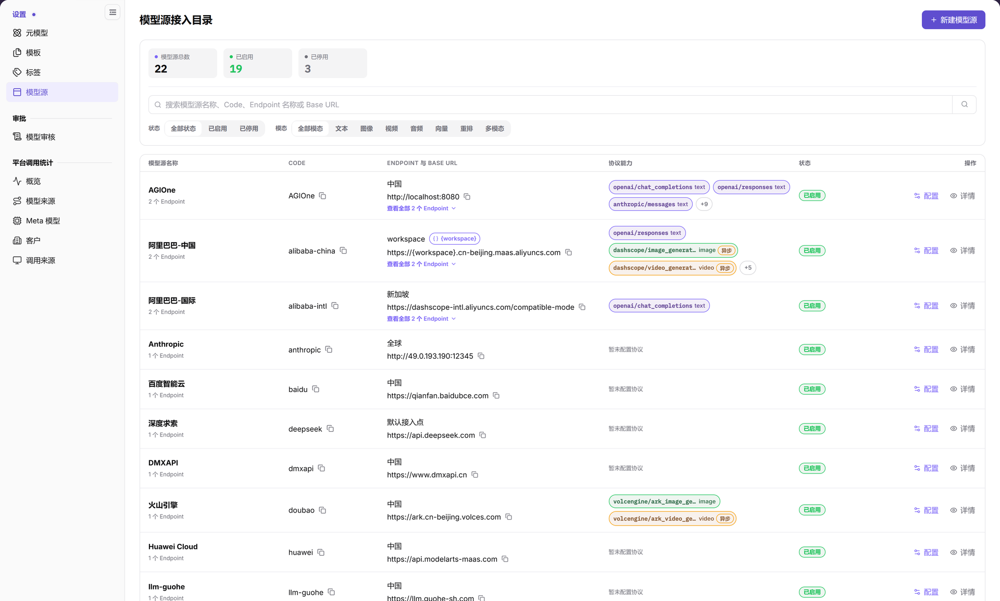
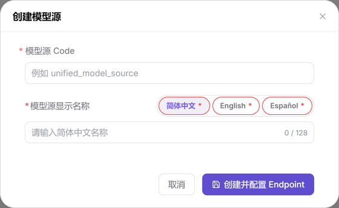
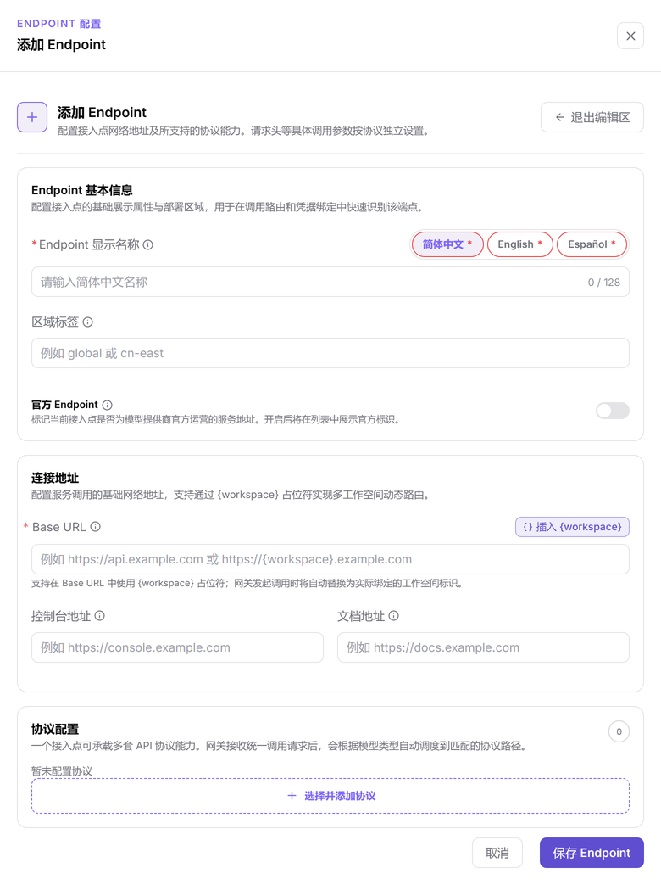
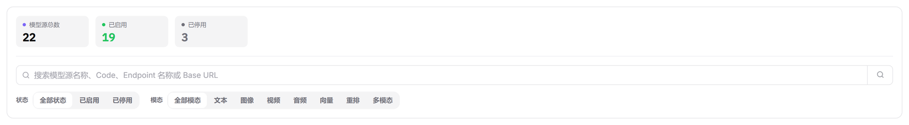
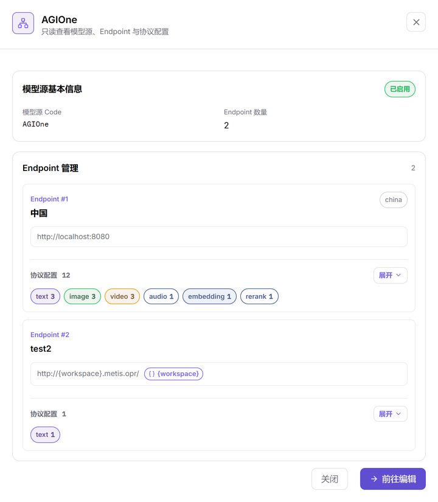
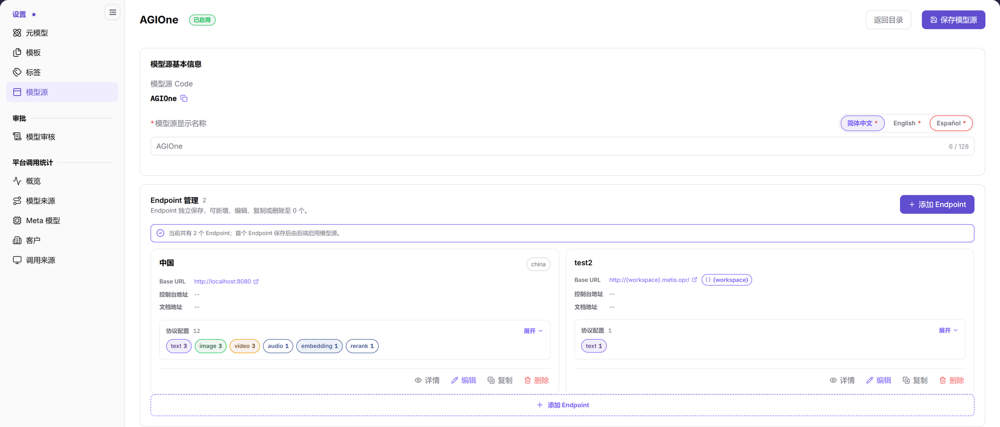

# 模型源

::: info 文档信息
版本：v2.0
更新日期：2026-10-29
:::

## 功能概述

| 项目 | 内容 |
| --- | --- |
| 适用角色 | 运营管理员 |
| 导航路径 | **模型及AI服务** > **设置** > **模型源** |
| 页面路由 | 列表 `/modelone/model-source`；配置页 `/modelone/model-source/{模型源ID}/edit` |
| 管理对象 | **模型源**（唯一 Code、多语言显示名称）、**Endpoint**（区域标签、Base URL、控制台地址、文档地址）、协议配置 |

#### 新手理解

模型源回答一个问题：**平台去哪里调用上游模型服务。**

一个模型源对应一个上游来源，例如 AGIOne、阿里云、深度求索。模型源本身不含调用地址，地址挂在下属的 **Endpoint** 上；一个模型源可以有多个 Endpoint，分别代表不同区域或不同接入点。每个 Endpoint 再挂若干 **协议**，说明这个接入点支持哪些调用方式和模态。

一句话对照：元模型说明"模型能做什么"，模型源说明"服务从哪里调、按什么协议调"。

#### 术语表

| 术语 | 说明 |
| --- | --- |
| 模型源 | 上游模型服务的登记记录，包含 Code、多语言显示名称和一组 Endpoint。 |
| 模型源 Code | 模型源自身的唯一标识，创建时填写，创建后只读。它标识的是某一个模型源，不是独立于模型源的另一类对象。 |
| Endpoint | 模型源下的一个接入点，拥有独立的区域标签和 Base URL。 |
| 区域标签 | Endpoint 的所属区域标识，如 `china`、`global`、`cn-east`。 |
| 官方 Endpoint | 标记该接入点是否为模型提供商官方运营的服务地址。 |
| Base URL | 调用上游服务的根地址，协议路径拼接在它后面。 |
| `{workspace}` | Base URL 中的工作空间占位符，网关调用时替换为实际绑定的工作空间标识。 |
| 协议配置 | Endpoint 支持的 API 协议清单，如 `openai/chat_completions`、`anthropic/messages`。 |
| 模态 | 协议对应的内容类型：文本、图像、视频、音频、向量、重排、多模态。 |

#### 新手速查

| 场景 | 先做 | 不要直接做 |
| --- | --- | --- |
| 第一次接入新上游服务 | 新建模型源，再给它添加第一个 Endpoint | 建完模型源就以为可以使用 |
| 同一上游有多个区域 | 在一个模型源下添加多个 Endpoint，分别填区域标签和 Base URL | 给每个区域单独建一个模型源 |
| 上游需要按租户走不同域名 | Base URL 中使用 `{workspace}` 占位符 | 在 Base URL 里写死某个租户的域名 |
| 只想核对配置，不想改动 | 用 **"详情"** 只读查看 | 直接进 **"配置"** 页手滑保存 |
| 找不到某个模型源 | 先确认打开的是 **模型及AI服务 > 设置 > 模型源** | 与 **平台调用统计 > 模型来源** 混为一谈 |

## 前提条件

1. 确认当前账号具备模型源维护权限（运营管理员）。
2. 向上游服务负责人获取：区域标签、Base URL、控制台地址、文档地址和协议清单。
3. 确认网络、证书与白名单要求。

## 页面说明

本页是一个"目录 + 配置页"的两级结构：

| 页面状态 | 主要职责 | 离开前确认 |
| --- | --- | --- |
| 模型源接入目录 | 查看总量统计，搜索与筛选模型源，进入配置或详情。 | 已确认目标行。 |
| 创建模型源弹窗 | 只填写 Code 与多语言显示名称。 | 三项名称已填，Code 未被占用。 |
| 配置页 | 维护模型源名称，新增、编辑、复制、删除 Endpoint 及协议。 | 名称改动已点 **"保存模型源"**，Endpoint 改动已点 **"保存 Endpoint"**。 |
| 添加 Endpoint 抽屉 | 填写区域标签、Base URL、控制台地址、文档地址和协议。 | 必填项与协议已核对。 |
| 详情抽屉 | 只读查看模型源、Endpoint 与协议配置。 | 已确认保存值。 |

模型源接入目录：

页面上方是三张统计卡与筛选区，下方是模型源表格；表格列为 `模型源名称`、`CODE`、`ENDPOINT 与 BASE URL`、`协议能力`、`状态`、`操作`。操作列只有 **"配置"** 与 **"详情"** 两个入口，列表不提供删除。

### 容易混淆的同名页面

左侧还有一处叫作"模型来源"的菜单，位于 **平台调用统计** 下，页面路由是 `/modelone/model-observation/operator/sources`。那是**调用量统计页**，用于查看各来源的调用数据，不能在这里新增或修改模型源。

## 主要操作

<!-- main-operation-title-exceptions: 新建,配置,筛选,编辑 -->

### 新建模型源

#### 适用场景

- 首次接入一个上游模型服务，需要在模型源接入目录里登记该来源。
- 已登记的模型源已停用，需要重新补一个来源记录。

#### 操作步骤

1. 进入 **模型及AI服务** > **设置** > **模型源**。
2. 点击页面右上方的 **"新建模型源"**，打开 **"创建模型源"** 弹窗。
3. 在 `模型源 Code` 中填写上游服务的唯一标识，例如 `unified_model_source`。该字段必填，创建后不可修改。
4. 在 `模型源显示名称` 的 **"简体中文"** 页签填写中文名称，上限 128 个字符。
5. 切换到 **"English"**、**"Español"** 页签，分别填写对应语言的名称。三个页签均带必填标记。
6. 点击 **"创建并配置 Endpoint"**。这个按钮会直接把你带到该模型源的配置页。
7. 不提交时点击 **"取消"** 或弹窗右上角的 **"×"**。

弹窗只有 `模型源 Code` 与 `模型源显示名称` 两项，主按钮文案是 **"创建并配置 Endpoint"**，不是 **"确定"**。

#### 注意事项

- 弹窗只有 `模型源 Code` 与 `模型源显示名称` 两项，均带必填标记；主按钮文案是 **"创建并配置 Endpoint"**。
- 界面提示逐字为「首个 Endpoint 保存后由后端启用模型源。」，即启用动作发生在 Endpoint 保存之后，不是创建模型源时。
- 模型源本身不含调用地址，调用地址在 Endpoint 上配置。

### 配置模型源 Endpoint

#### 适用场景

- 为模型源登记调用地址与协议能力，使它可以被模型模板选择。
- 一个模型源需要多个区域或多种接入地址时，重复添加 Endpoint。

#### 操作步骤

1. 在 **模型源** 目录的目标行点击 **"配置"**，进入该模型源的配置页。
2. 在 `Endpoint 管理` 区点击 **"添加 Endpoint"**，右侧打开 `ENDPOINT 配置` 抽屉。
3. 在 `Endpoint 基本信息` 的 `Endpoint 显示名称` 填写名称，并按需切换 **"简体中文"**、**"English"**、**"Español"** 页签。
4. 在 `区域标签` 填写区域标识，例如 `china`、`global`、`cn-east`。
5. 该地址由模型提供商官方运营时，打开 **"官方 Endpoint"** 开关。
6. 在 `连接地址` 填写必填的 `Base URL`。需要多工作空间动态路由时，点击右侧 **"插入 {workspace}"**。
7. 按需填写 `控制台地址` 与 `文档地址`，未填写时卡片上显示 `--`。
8. 在 `协议配置` 点击 **"选择并添加协议"**，勾选该 Endpoint 支持的协议。
9. 点击 **"保存 Endpoint"** 提交；放弃填写时点击 **"取消"** 或 **"退出编辑区"**。

抽屉自上而下分 `Endpoint 基本信息`、`连接地址`、`协议配置` 三段，`Base URL` 是其中唯一的必填项，右侧带 **"插入 {workspace}"** 按钮。

#### 结果校验

- `Endpoint 管理` 区的卡片以端点显示名称作标题，区域标签显示在标题行右侧。
- 卡片内 `Base URL` 以链接形式展示；`控制台地址`、`文档地址` 为空时显示 `--`。
- 卡片 `协议配置` 后的数字与展开后列出的协议条数一致，下方按模态汇总，如 `text 3`、`image 3`。
- 区顶部统计条逐字为「当前共有 N 个 Endpoint；首个 Endpoint 保存后由后端启用模型源。」

#### 注意事项

- 每张 Endpoint 卡片底部提供 `详情`、`编辑`、`复制`、`删除` 四个动作。
- 界面提示逐字为「Endpoint 独立保存，可新增、编辑、复制或删除至 0 个。」，保存动作在 Endpoint 级，与模型源级保存分开。
- 请求头等具体调用参数按协议独立设置，不在这个抽屉里填写。
- `{workspace}` 占位符在网关发起调用时替换为实际绑定的工作空间标识。

### 筛选模型源

#### 适用场景

- 目录中模型源较多，需要按启用状态或模态快速定位。
- 需要确认某个 Base URL 属于哪个模型源。

#### 操作步骤

1. 进入 **模型及AI服务** > **设置** > **模型源**。
2. 在搜索框输入模型源名称、Code、Endpoint 名称或 Base URL，点击右侧搜索图标。
3. 在 `状态` 组选择 `全部状态`、`已启用` 或 `已停用`。
4. 在 `模态` 组选择 `全部模态`、`文本`、`图像`、`视频`、`音频`、`向量`、`重排` 或 `多模态`。

列表顶部三张统计卡给出 `模型源总数`、`已启用`、`已停用`，其下是状态与模态两组筛选按钮。

#### 结果校验

- 列表按 `模型源名称`、`CODE`、`ENDPOINT 与 BASE URL`、`协议能力`、`状态`、`操作` 六列展示。
- 名称下方显示 `N 个 Endpoint`；Endpoint 多于一个的行给出 **"查看全部 N 个 Endpoint"**。
- 协议能力列显示协议名称与模态标记，未配置时显示 `暂未配置协议`；超出展示数量时显示 **"查看全部 N 个协议"**。
- 列表底部显示 `共 N 条` 与分页控件。

#### 注意事项

- 搜索与筛选可以叠加，清空搜索框后需重新点击搜索图标。
- 统计卡是全局口径，不是当前筛选结果的计数。

### 查看模型源详情

#### 适用场景

- 只读核对模型源 Code、Endpoint 数量与协议配置，不进入编辑。
- 维护前确认目标记录，或把配置截图给他人复核。

#### 操作步骤

1. 在 **模型源** 目录的目标行点击 **"详情"**。
2. 抽屉副标题逐字为「只读查看模型源、Endpoint 与协议配置」。
3. 在 `模型源基本信息` 区核对状态标记、`模型源 Code` 与 `Endpoint 数量`。
4. 在 `Endpoint 管理` 区逐个核对 `Endpoint #1`、`Endpoint #2` 等卡片。
5. 每张卡片显示区域名、区域标签、Base URL 与 `协议配置` 计数，点击 **"展开"** 查看各模态协议条数。
6. 需要修改时点击 **"前往编辑"**；仅核对时点击 **"关闭"**。

详情抽屉底部只有 **"关闭"** 与 **"前往编辑"**，没有保存类按钮。

#### 结果校验

- 抽屉内 Base URL 不可编辑。
- `Endpoint 数量` 与 `Endpoint 管理` 区标题后的数字一致。
- 卡片编号连续，`Endpoint #N` 与实际保存顺序一致。

#### 注意事项

- 详情为只读，修改仍需回到配置页，并且分别保存模型源与 Endpoint。
- 分享截图前检查 Base URL 中是否带有内网地址或租户信息。

### 编辑模型源

#### 适用场景

- 修改模型源在各语言界面下的显示名称。
- 维护该模型源下的 Endpoint 与协议配置。

#### 操作步骤

1. 在 **模型源** 目录的目标行点击 **"配置"**。
2. 核对 `模型源基本信息` 中只读的 `模型源 Code`，编辑时保持原值（旁边有 **"复制 Code"** 按钮）。
3. 在 `模型源显示名称` 的语言页签之间切换，修改对应语言的名称。
4. 需要维护调用地址时，按「配置模型源 Endpoint」新增或修改 Endpoint。
5. 点击 **"保存模型源"** 提交名称改动。
6. 点击 **"返回目录"** 回到列表，确认目标行显示新值。

配置页页头显示模型源名称与状态标记，右上角是 **"返回目录"** 与 **"保存模型源"**。

#### 注意事项

- `模型源 Code` 在配置页为只读且带复制按钮，不提供修改入口。
- 配置页右上角有两个独立按钮：**"返回目录"** 与 **"保存模型源"**；Endpoint 另有自己的 **"保存 Endpoint"**。

## 参数速查表

模型源与 Endpoint 是两层配置，字段要求分开看。

### 模型源层

| 字段名称 | 表单要求 | 字段类型 | 示例 | 说明 |
| --- | --- | --- | --- | --- |
| 模型源 Code | 必填，创建后只读 | 文本 | `aliyun` | 唯一标识，列表与搜索中按此值检索。 |
| 简体中文名称 | 必填 | 文本，上限 128 字符 | `阿里巴巴-中国` | 中文界面显示的名称。 |
| English 名称 | 必填 | 文本，上限 128 字符 | `Alibaba Cloud` | 英文界面显示的名称。 |
| Español 名称 | 必填 | 文本，上限 128 字符 | `Alibaba Cloud` | 西语界面显示的名称。 |
| 状态 | 系统维护 | 枚举 | `已启用` | 列表与页头展示，表单中不提供直接设置入口。 |

### Endpoint 层

| 字段名称 | 表单要求 | 字段类型 | 示例 | 说明 |
| --- | --- | --- | --- | --- |
| Endpoint 显示名称 | 必填 | 多语言文本，上限 128 字符 | `中国` | 作为卡片标题展示。 |
| 区域标签 | 选填 | 文本 | `china` | 显示在卡片标题右侧，用于区分接入区域。 |
| 官方 Endpoint | 选填 | 开关 | 关闭 | 标记当前接入点是否为模型提供商官方运营的服务地址。 |
| Base URL | 必填 | URL | `https://dashscope.aliyuncs.com` | 调用根地址，可含 `{workspace}` 占位符。 |
| 控制台地址 | 选填 | URL | `https://dashscope.console.aliyun.com` | 上游控制台入口，未填显示 `--`。 |
| 文档地址 | 选填 | URL | `https://help.aliyun.com/...` | 上游文档入口，未填显示 `--`。 |
| 协议配置 | 选填 | 多选列表 | `openai/chat_completions` | 该 Endpoint 支持的协议清单；为空时显示 `暂未配置协议`。 |

## 踩坑提示

- 模型源创建后不会自动具备调用地址：界面提示「首个 Endpoint 保存后由后端启用模型源。」，地址在 Endpoint 上配置。
- 模型源级与 Endpoint 级是两个独立的保存动作：配置页右上角是 **"保存模型源"**，Endpoint 卡片抽屉里是 **"保存 Endpoint"**。
- 需要按工作空间动态切换域名时，用 Base URL 右侧的 **"插入 {workspace}"** 按钮；界面说明为网关调用时替换为实际绑定的工作空间标识。

## 结果校验

| 核对项 | 界面上可直接看到 |
| --- | --- |
| 模型源标识 | 列表 `CODE` 列与详情抽屉「模型源 Code」显示同一个值 |
| Endpoint 数量 | 列表名称下方的 `N 个 Endpoint` 与详情抽屉「Endpoint 数量」一致 |
| 协议能力 | 列表协议列展示的标签与卡片「协议配置」后的数字对得上 |
| 详情只读 | 详情抽屉底部只有 **"关闭"** 与 **"前往编辑"**，Base URL 不可编辑 |

## 常见问题

#### 找不到删除整个模型源的入口

**问题现象：**

列表与配置页都找不到删除整个模型源的按钮。

**界面上可见的入口：**

- 列表操作列只有 **"配置"** 与 **"详情"** 两个动作。
- 配置页页头只有 **"返回目录"** 与 **"保存模型源"**。
- 删除动作出现在 Endpoint 卡片底部（`详情`、`编辑`、`复制`、`删除`）。

**处理方式：**

当前界面只提供 Endpoint 级删除，没有模型源级删除入口。

#### 误入"模型来源"页面

**问题现象：**

从左侧菜单点进"模型来源"后，页面只有调用统计，没有新建按钮。

**原因：**

- 打开的是 **平台调用统计 > 模型来源**（`/modelone/model-observation/operator/sources`）。

**处理方式：**

1. 回到 **模型及AI服务** > **设置** > **模型源**。
2. 该菜单的路由是 `/modelone/model-source`。

## 注意事项

- 模型源 Code 一旦创建不可修改，规划命名时留出扩展空间。
- 三个语言的显示名称均带必填标记。
- 真实认证信息按协议独立维护，不要写进 Base URL 或文档截图。
- 详情抽屉仅用于核对，所有修改都在配置页完成。

## 后续操作

模型源配置完成后，下一步是在模型模板中引用它。模板页的字段与操作步骤以[模板](../model-templates/)手册为准，本文档不重复描述。

模板配置好并发布模型后，按[发布模型](/zh-CN/userguide/scenarios/publish-model/)执行调用验证；调用验证不属于模型源页面操作。
