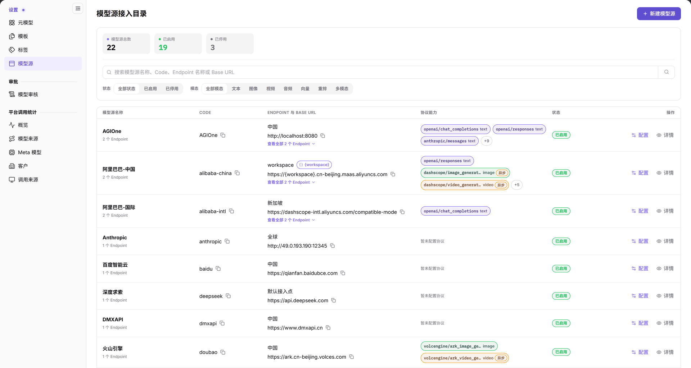
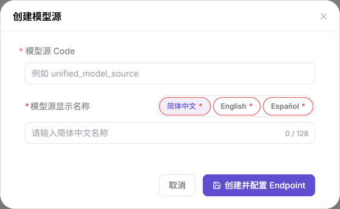

# 模型源

::: info 文档信息
版本：v2.0
更新日期：2026-11-04
:::

## 功能概述

| 项目 | 内容 |
| --- | --- |
| 适用角色 | 运营管理员 |
| 导航路径 | **模型及AI服务** > **设置** > **模型源** |
| 页面路由 | 列表 `/modelone/model-source`；配置页 `/modelone/model-source/{模型源ID}/edit` |
| 管理对象 | **模型源**（唯一 Code、多语言显示名称）、**Endpoint**（区域标签、Base URL、控制台地址、文档地址）和协议配置 |

#### 新手理解

模型源回答“平台去哪里调用上游模型服务”。一个模型源对应一个上游来源，例如 AGIOne、阿里巴巴或 DeepSeek；模型源本身不含调用地址，地址挂在下属的 **Endpoint** 上。元模型说明“模型能做什么”，模型源说明“服务从哪里调、按什么协议调”。

#### 术语速查

| 术语 | 说明 |
| --- | --- |
| 模型源 Code | 上游厂商服务源的全局唯一英文代码标识（如 `aliyun`、`openai`），不可重复。 |
| Endpoint | 模型源下的物理网络接入节点，包含具体的 Base URL、区域标签与网络协议映射。 |
| 官方 Endpoint | 标识接入点是否由模型原厂官方直接运营维护，区别于私有部署或第三方中转代理。 |
| {workspace} | Base URL 中支持的动态路由占位符，网关调用时自动替换为具体的租户或项目工作空间 ID。 |

## 前提条件

1. 当前账号具备**设置 > 模型源**的查看和维护权限。
2. 已向上游服务负责人获取区域标签、Base URL、控制台地址、文档地址和协议清单。
3. 已确认网络、证书和白名单要求。

## 页面说明

页面顶部是统计卡和筛选区，下方是模型源表格：

- 统计卡：`模型源总数`、`已启用`、`已停用`。
- 搜索框：`搜索模型源名称、Code、Endpoint 名称或 Base URL`。
- 筛选组：`状态`（`全部状态`、`已启用`、`已停用`）和 `模态`（`全部模态`、`文本`、`图像`、`视频`、`音频`、`向量`、`重排`、`多模态`）。
- 表格列：`模型源名称`、`CODE`、`ENDPOINT 与 BASE URL`、`协议能力`、`状态`、`操作`。
- 行内操作：**配置**、**详情**；列表不提供删除入口。

图示为统计卡显示当前 `模型源总数 22`、`已启用 19`、`已停用 3`。表格中每条记录显示 Endpoint 数量、Code、Endpoint 名称与 Base URL、协议标签和状态；操作列提供 `配置` 与 `详情`。

| 区域 | 说明 |
| --- | --- |
| 顶部统计看板 | 汇总呈现全平台模型源总数、已启用模型源数与已停用模型源数。 |
| 综合检索过滤栏 | 支持按名称、Code、Endpoint 或 URL 检索，支持按启用状态与支持模态筛选。 |
| 模型源目录表格 | 展示模型源多语言名称、Code、下属 Endpoint 数量、Base URL 概览与支持协议。 |
| 行内操作入口 | 提供进入 Endpoint 维护的 **配置** 入口与只读查看的 **详情** 抽屉入口。 |

### 容易混淆的“模型来源”

左侧 **平台调用统计 > 模型来源** 是调用统计页（`/modelone/model-observation/operator/sources`），用于查看各来源的调用数据，不能在这里新增或修改模型源。配置模型源请使用本页 **设置 > 模型源**。

## 主要操作

### 新建模型源

1. 进入 **"模型及AI服务"** > **"设置"** > **"模型源"**。
2. 点击右上角 **"新建模型源"**，打开 `创建模型源` 弹窗。
3. 在 `模型源 Code` 中填写唯一标识，例如 `unified_model_source`。该字段必填。
4. 在 `模型源显示名称` 的 `简体中文` 页签填写中文名称；右侧显示 `0 / 128` 字符计数。
5. 切换到 `English`、`Español` 页签，分别填写对应语言的名称；三个页签均带 `*` 必填标记。
6. 点击 **"创建并配置 Endpoint"** 进入该模型源的配置页；不提交时点击 **"取消"** 或右上角 `×`。

图示为弹窗只有 `模型源 Code` 和 `模型源显示名称` 两项。三个语言页签都带必填标记；主按钮文案是 `创建并配置 Endpoint`，不是“确定”。

### 配置模型源 Endpoint

1. 在模型源列表的目标行点击 **"配置"**，进入配置页。
2. 在 `Endpoint 管理` 区点击 **"添加 Endpoint"**，右侧打开 `ENDPOINT 配置` 抽屉。
3. 在 `Endpoint 基本信息` 填写 `Endpoint 显示名称`，并按需切换 `简体中文`、`English`、`Español` 页签。
4. 在 `区域标签` 填写区域标识，例如 `china`、`global`、`cn-east`。
5. 地址由模型提供商官方运营时，打开 **"官方 Endpoint"** 开关。
6. 在 `连接地址` 填写必填的 `Base URL`；需要多工作空间动态路由时，点击右侧 **"插入 {workspace}"**。
7. 按需填写 `控制台地址` 与 `文档地址`；未填写时卡片显示 `--`。
8. 在 `协议配置` 点击 **"选择并添加协议"**，勾选该 Endpoint 支持的协议。
9. 点击 **"保存 Endpoint"** 提交；放弃填写时点击 **"取消"** 或 **"退出编辑区"**。

抽屉自上而下分为 `Endpoint 基本信息`、`连接地址`、`协议配置` 三段；`Base URL` 是其中唯一的必填项。

### 筛选模型源

1. 在搜索框输入模型源名称、Code、Endpoint 名称或 Base URL，点击右侧搜索图标。
2. 在 `状态` 组选择 `全部状态`、`已启用` 或 `已停用`。
3. 在 `模态` 组选择 `全部模态`、`文本`、`图像`、`视频`、`音频`、`向量`、`重排` 或 `多模态`。

使用搜索框或 `状态`、`模态` 筛选缩小列表范围。统计卡显示 `模型源总数`、`已启用`、`已停用`，读取时与筛选结果分开核对。

### 查看详情与编辑

1. 在目标行点击 **"详情"**，抽屉以只读方式展示 `模型源基本信息` 和 `Endpoint 管理`。
2. 核对 `模型源 Code`、`Endpoint 数量`、区域、Base URL 和 `协议配置` 计数。
3. 需要修改时点击 **"前往编辑"**；仅查看时点击 **"关闭"**。
4. 编辑页页头提供 **"返回目录"** 与 **"保存模型源"**；Endpoint 另有自己的 **"保存 Endpoint"**。

## 参数速查表

### 模型源层

| 字段名称 | 是否必填 | 字段类型 | 示例 | 说明 |
| --- | --- | --- | --- | --- |
| 模型源 Code | 必填 | 文本 | `aliyun` | 唯一标识，列表与搜索中按此值检索 |
| 简体中文名称 | 必填 | 文本，上限 128 字符 | `阿里巴巴-中国` | 中文界面显示的名称 |
| English 名称 | 必填 | 文本，上限 128 字符 | `Alibaba Cloud` | 英文界面显示的名称 |
| Español 名称 | 必填 | 文本，上限 128 字符 | `Alibaba Cloud` | 西语界面显示的名称 |
| 状态 | 系统维护 | 枚举 | `已启用` | 列表与页头展示，表单中不提供直接设置入口 |

### Endpoint 层

| 字段名称 | 是否必填 | 字段类型 | 示例 | 说明 |
| --- | --- | --- | --- | --- |
| Endpoint 显示名称 | 必填 | 多语言文本，上限 128 字符 | `中国` | 作为卡片标题展示 |
| 区域标签 | 选填 | 文本 | `china` | 显示在卡片标题右侧，用于区分接入区域 |
| 官方 Endpoint | 选填 | 开关 | 关闭 | 标记当前接入点是否为模型提供商官方运营 |
| Base URL | 必填 | URL | `https://dashscope.aliyuncs.com` | 调用根地址，可含 `{workspace}` 占位符 |
| 控制台地址 | 选填 | URL | `https://dashscope.console.aliyun.com` | 上游控制台入口，未填显示 `--` |
| 文档地址 | 选填 | URL | `https://help.aliyun.com/...` | 上游文档入口，未填显示 `--` |
| 协议配置 | 选填 | 多选列表 | `openai/chat_completions` | 该 Endpoint 支持的协议清单；为空时显示 `暂未配置协议` |

## 踩坑提示

- 模型源创建后不会自动具备调用地址：界面提示「首个 Endpoint 保存后由后端启用模型源。」，地址在 Endpoint 上配置。
- 模型源级与 Endpoint 级是两个独立的保存动作：配置页右上角是 **保存模型源**，Endpoint 抽屉里是 **保存 Endpoint**。
- 需要按工作空间动态切换域名时，使用 Base URL 右侧的 **插入 {workspace}** 按钮；界面说明为网关调用时替换为实际绑定的工作空间标识。
- 列表操作列只有 **配置** 和 **详情**；找不到“删除模型源”是因为当前列表不提供该入口。

## 结果校验

| 检查项 | 成功表现 | 异常时处理 |
| --- | --- | --- |
| 模型源创建 | 提交弹窗后成功创建并跳转配置页，返回列表可见新 Code 记录。 | 若创建失败，检查 Code 是否在平台内全局唯一，多语言名称是否填齐。 |
| Endpoint 绑定 | 列表记录显示 `N 个 Endpoint`，展开或查看详情可见新增的区域接入点。 | 若数量未增加，检查 Endpoint 抽屉中是否点击了 **"保存 Endpoint"**。 |
| 协议映射匹配 | 列表中 `协议能力` 列展示的标签与在抽屉中勾选的协议清单完全一致。 | 进入详情抽屉复核协议列表，必要时点击 **"前往编辑"** 重新勾选。 |
| 状态联动生效 | 保存首个有效 Endpoint 后，模型源状态由系统后端自动联动置为 `已启用`。 | 确认 Endpoint 中 Base URL 是否合法且至少绑定了一种有效网络协议。 |
| 搜索过滤重绘 | 输入 Code 或 Endpoint 关键字后，表格精准过滤并重绘匹配的模型源记录。 | 若无结果，核对输入拼写或将状态与模态过滤器恢复为 `全部`。 |

## 常见问题

#### 找不到删除整个模型源的入口

**问题现象：**

在模型源列表及配置页中均找不到删除整个模型源的按钮或菜单项。

**可能原因：**

系统为防止因误删模型源导致关联发布模型及线上业务调用雪崩，未在列表提供模型源级的物理删除入口。

**处理方式：**

1. 若需要清理废弃接入点，在配置页的 Endpoint 管理列表中，针对单个 Endpoint 卡片执行删除。
2. 若需停止使用该模型源，停用或删除其名下的全部 Endpoint 接入点即可。

#### 误入“模型来源”页面

**问题现象：**

从左侧菜单点击“模型来源”后，页面仅展示调用数据图表与统计列表，找不到新建或配置按钮。

**可能原因：**

误点击了监控审计组下的 **平台调用统计 > 模型来源**（`/modelone/model-observation/operator/sources`）。

**处理方式：**

1. 确认当前所在菜单路径，该页面仅用于调用量与指标审计。
2. 通过左侧导航栏重新进入 **模型及AI服务** > **设置** > **模型源**（`/modelone/model-source`）执行管理。

## 注意事项

- 模型源 Code 用于列表检索和配置页识别，规划命名时留出扩展空间。
- 三个语言的显示名称均带必填标记。
- 真实认证信息按协议独立维护，不要写进 Base URL 或文档截图。
- 详情抽屉仅用于核对，所有修改都在配置页完成。

## 后续操作

1. 在预设模板中关联该模型源及其 Endpoint，进入 [模板](../model-templates/)。
2. 核对该模型源对应底模的能力标准与协议规范，进入 [元模型](../meta-models/)。
3. 监控各租户对该模型源发起的调用量与延迟指标，进入 [模型来源](../../platform-calls/model-sources/)。

相关页面：
- [模板](../model-templates/)
- [元模型](../meta-models/)
- [模型来源](../../platform-calls/model-sources/)
