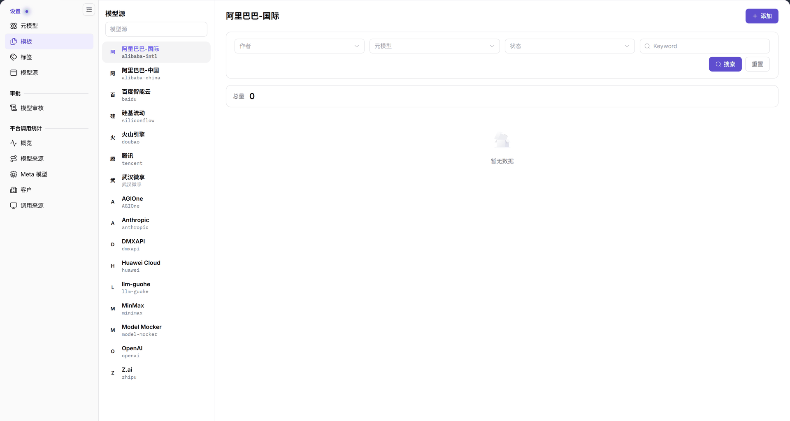
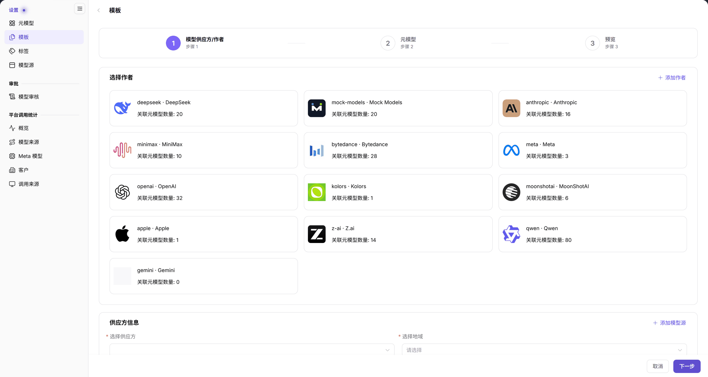

# 模板

::: info 文档信息
版本：v2.0
更新日期：2026-11-04
:::

## 功能概述

| 项目 | 内容 |
| --- | --- |
| 适用角色 | 运营管理员 |
| 导航路径 | **模型及AI服务** > **设置** > **模板** |
| 页面路由 | `/modelone/settings/provider-template`；添加页 `/modelone/settings/provider-template/add` |
| 管理对象 | 模型源模板、模型作者、供应方、地域、元模型和发布预览 |

**新手理解**：模板是模型发布时的“预设表单”。它把模型作者、供应方、地域和元模型组合起来，减少提供方重复填写。先有模型作者、元模型和模型源，模板才有可选项。

#### 术语速查

| 术语 | 说明 |
| --- | --- |
| 模型模板 | 预设的模型发布配置方案，固化了供应方、地域、作者与元模型的默认组合。 |
| 模型作者 | 模型的研发设计原厂或机构，例如 DeepSeek、OpenAI、Anthropic 等。 |
| 供应方 | 提供模型物理算力或 API 托管的云服务商或基础设施接入点。 |
| 元模型 | 平台定义的抽象模型资产，定义了模态、参数规格、Token 限制与标准协议。 |

## 前提条件

1. 当前账号具备**设置 > 模板**的查看和维护权限。
2. 模型作者和元模型已经存在，并可在添加流程中选择。
3. 模型源已维护；如果供应方或地域还不在列表中，需要先补充模型源。

## 页面说明

页面分为左右两部分：

- **左侧模型源区**：`模型源` 搜索框和模型源列表，例如阿里巴巴-国际、阿里巴巴-中国、百度智能云、硅基流动、火山引擎、腾讯、OpenAI、Z.ai。
- **右侧列表区**：顶部显示当前模型源名称，右上角是 **添加**；筛选区包含 `作者`、`元模型`、`状态` 三个下拉框和 `Keyword` 输入框，下面是 **搜索**、**重置**；列表上方显示 `总量`，无记录时显示 `暂无数据`。

| 区域 | 说明 |
| --- | --- |
| 左侧模型源列表 | 支持输入关键词检索模型源，并切换当前管理的模型供应方与地域 |
| 右侧顶部栏 | 展示当前选中的模型源名称，并在右上角提供“添加”模板向导入口 |
| 筛选与检索区 | 提供作者、元模型、状态下拉框、Keyword 关键字输入框以及搜索和重置按钮 |
| 模板数据列表 | 展示当前模型源下纳管的模板卡片或行记录，顶部显示总量统计 |

图示为以“阿里巴巴-国际”为例，筛选区提供 `作者`、`元模型`、`状态` 和 `Keyword`；当前 `总量` 为 0，列表显示 `暂无数据`。

## 主要操作

### 选择模型源与筛选

1. 在左侧 `模型源` 搜索框输入模型源名称。
2. 点击目标模型源，右侧标题和模板列表切换。
3. 在 `作者`、`元模型`、`状态` 下拉框中选择条件，或输入 `Keyword`。
4. 点击 **"搜索"** 执行查询；点击 **"重置"** 清空条件。

### 添加模板

1. 点击右上角 **"添加"**，进入添加模板向导。
2. 向导顶部显示三个步骤：`1 模型供应方/作者`、`2 元模型`、`3 预览`。
3. 在步骤 1 的 `选择作者` 区域点击目标作者卡片；卡片显示作者标识和 `关联元模型数量`。
4. 在 `供应方信息` 中选择 `选择供应方` 和 `选择地域`；需要新增来源时点击 **"添加模型源"**。
5. 点击 **"下一步"** 进入步骤 2，按页面字段继续选择元模型，并核对页面展示的模态、能力、Token 限制和协议。
6. 在步骤 3 `预览` 中核对完整配置，再提交。
7. 需要退出时点击 **"取消"** 或左上角返回箭头。

图示为步骤 1 展示 `选择作者` 卡片和 `供应方信息`。作者卡片显示 `关联元模型数量`；`供应方信息` 包含 `选择供应方`、`选择地域` 和 `添加模型源`。

### 查看模板列表

1. 选择模型源后，在筛选区缩小范围。
2. 列表上方显示 `总量`；没有匹配记录时显示 `暂无数据`。
3. 添加或修改后，回到列表重新搜索目标模板，核对它是否出现在当前模型源下。

## 参数速查表

### 筛选字段

| 字段名称 | 是否必填 | 字段类型 | 示例 | 说明 |
| --- | --- | --- | --- | --- |
| 模型源 | 必填 | 左侧列表选择 | `阿里巴巴-国际` | 决定右侧模板列表范围 |
| 作者 | 选填 | 下拉 | `DeepSeek` | 按模型作者筛选 |
| 元模型 | 选填 | 下拉 | `DeepSeek-V4-Pro` | 按元模型筛选 |
| 状态 | 选填 | 下拉 | `启用` | 按模板状态筛选 |
| Keyword | 选填 | 文本 | `deepseek` | 关键字搜索 |

### 添加模板步骤 1

| 字段名称 | 是否必填 | 字段类型 | 示例 | 说明 |
| --- | --- | --- | --- | --- |
| 模型作者 | 必填 | 卡片选择 | `deepseek · DeepSeek` | 选择模板归属的作者 |
| 供应方 | 必填 | 下拉 | `阿里巴巴-国际` | 模板对应的模型源供应方 |
| 地域 | 必填 | 下拉 | `中国` | 供应方所在地域 |

步骤 2 和步骤 3 的字段以页面实际展示为准；选择元模型后，按页面提示核对输入输出模态、高级能力、Token 限制和协议。

## 踩坑提示

- 模板列表按左侧选中的模型源展示；添加后找不到模板时，先确认左侧模型源是否与添加时一致。
- 步骤 1 的 `选择供应方` 和 `选择地域` 需要与目标模型源匹配；不确定时先到 **设置 > 模型源** 核对。
- 向导顶部三个步骤是顺序关系；步骤 1 未完成时不要直接期待步骤 2 或 3 出现完整字段。
- `总量` 为 0 且显示 `暂无数据` 表示当前筛选范围没有模板，不代表模板功能不可用。

## 结果校验

| 检查项 | 成功表现 | 异常时处理 |
| --- | --- | --- |
| 当前模型源匹配 | 右侧主标题与左侧高亮选中的模型源名称完全一致 | 检查左侧模型源列表滚动位置，重新点击目标模型源条目 |
| 向导步骤指示 | 顶部步骤条高亮显示当前处于 `1 模型供应方/作者`、`2 元模型` 或 `3 预览` | 若步骤无法流转，核查当前步骤必填项（作者、供应方、地域）是否已完整勾选 |
| 作者卡片展示 | `选择作者` 区域出现作者卡片，并显示 `关联元模型数量` | 若作者列表空白，先前往系统设置或元模型管理中确认是否已录入基础作者资产 |
| 列表结果与总量 | 列表上方显示 `总量` 统计，有记录时展示模板明细，无记录时显示 `暂无数据` | 点击 **"重置"** 排除多重筛选交叉影响，确认该模型源下是否已发布过模板 |

## 常见问题

#### 模板列表为空

**问题现象：**

选择模型源后，右侧列表显示 `暂无数据`，`总量` 显示为 0。

**可能原因：**

当前模型源下尚未创建任何模板，或筛选区填写的作者、元模型或关键词排除了已有记录。

**处理方式：**

1. 点击 **"重置"** 清空作者、元模型、状态和 Keyword 等筛选条件。
2. 切换到左侧其他模型源，排查是否仅特定供应方暂无模板。
3. 点击右上角 **"添加"**，按照向导完成该模型源下首个模板的配置与发布。

#### 模板和元模型有什么区别

**问题现象：**

在运营配置时，不确定应该先维护元模型还是先维护模板。

**可能原因：**

二者在平台模型生命周期中分属不同层级：元模型定义抽象能力，模板定义发布预设。

**处理方式：**

1. 前往 **设置 > 元模型** 维护模型能力类型、模态、Token 上限和支持的原生协议。
2. 前往 **设置 > 模板** 将已维护的元模型与作者、模型源供应方和物理地域组装。
3. 遵循“先有元模型，后有发布模板”的顺序进行初始化。

## 注意事项

- 模板会影响模型发布流程，修改供应方、地域或元模型前先确认引用范围。
- 添加模板前先核对模型源、作者和元模型是否已经维护。
- 不要把真实凭证写入模板名称、关键字或备注。

## 后续操作

1. 在元模型库中核对能力标签、Token 限制和支持的协议。
2. 在模型源中维护供应方、接入地域和 Endpoint 基础配置。
3. 模板就绪后，在模型审核中核对提审记录是否正确匹配预设。

相关页面：
- [元模型](../meta-models/)
- [模型源](../model-source/)
- [模型审核](../../approvals/model-reviews/)
- [标签管理](../tags/)
