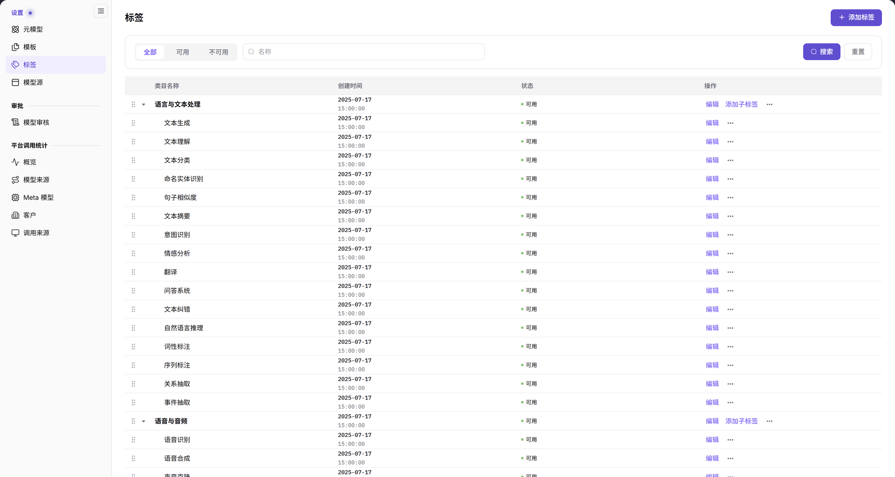
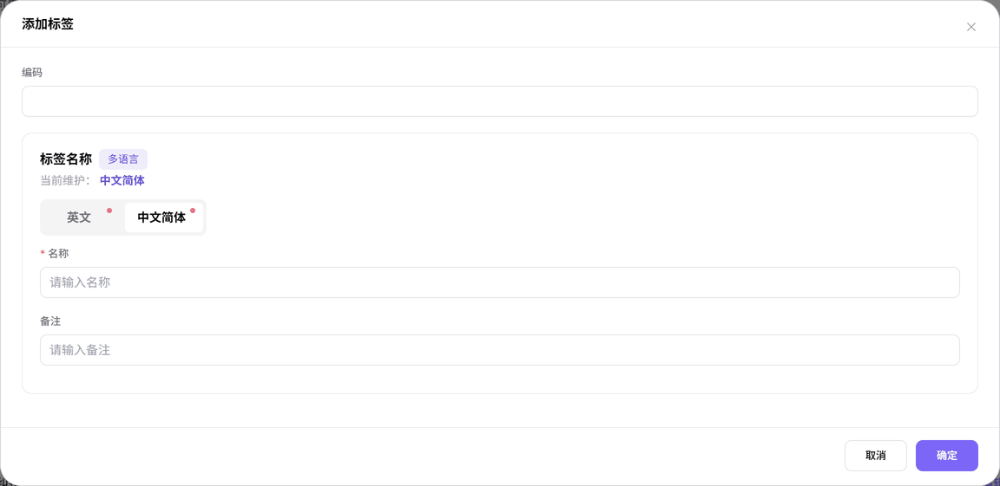

# 标签

::: info 文档信息
版本：v2.0
更新日期：2026-11-04
:::

## 功能概述

| 项目 | 内容 |
| --- | --- |
| 适用角色 | 运营管理员 |
| 导航路径 | **模型及AI服务** > **设置** > **标签** |
| 页面路由 | `/modelone/settings/tags` |
| 管理对象 | 标签类目、子标签、多语言名称、备注、状态和层级 |

**新手理解**：标签是模型市场里的分类货架。先建立一级类目，再在类目下添加子标签；用户筛选模型时看到的就是这些名称。类目负责分组，子标签负责具体能力或场景。

#### 术语速查

| 术语 | 说明 |
| --- | --- |
| 标签类目 | 标签体系的一级父级节点，用于按领域或基础大类（如语音与音频、语言与文本）进行宏观聚类。 |
| 子标签 | 一级类目下的二级能力或场景节点，是模型卡片与探索筛选绑定的原子标签。 |
| 标签编码 | 平台全局唯一的字符串标识，用于系统底层索引、API 过滤与国际化映射。 |
| 多语言名称 | 分别在英文与简体中文下维护的展示文本，支持界面在多语种切换时自适应呈现。 |

## 前提条件

1. 当前账号具备**设置 > 标签**的查看和维护权限。
2. 已确认标签的类目层级、编码规则和英文/中文名称。
3. 新增或调整标签前，已确认它不会被误用于无关的能力或行业分类。

## 页面说明

页面顶部是筛选区和 **添加标签** 按钮，下方是以树形结构展示的标签表格：

- 状态页签：`全部`、`可用`、`不可用`。
- 搜索框：`名称`，右侧是 **搜索** 和 **重置**。
- 表格列：`类目名称`、`创建时间`、`状态`、`操作`。
- 一级类目左侧有展开箭头；行内操作提供 **编辑**、**添加子标签** 和 **...**。

| 区域 | 说明 |
| --- | --- |
| 状态切换页签 | 提供全部、可用、不可用三个过滤页签，支持快速隔离已废弃或生效中的标签 |
| 顶部操作与筛选 | 包含名称关键词搜索框、搜索与重置按钮，以及右上角“添加标签”主入口 |
| 树形标签列表 | 以树形表格呈现一级类目与二级子标签，展示类目名称、创建时间、状态及操作列 |
| 弹窗编辑面板 | 点击添加或编辑后弹出，用于录入编码、多语言名称切换页签及业务备注 |

图示为`类目名称` 列以树形展示“语言与文本处理”“语音与音频”等类目及其子标签；`状态` 列显示 `可用`，操作列提供 `编辑`、`添加子标签` 和更多操作入口。

## 主要操作

### 筛选标签

1. 在 `全部`、`可用`、`不可用` 之间切换状态。
2. 在 `名称` 输入框输入标签名称或关键字。
3. 点击 **"搜索"** 执行查询；点击 **"重置"** 清空条件。
4. 使用类目左侧的展开箭头查看子标签。

### 添加标签

1. 点击右上角 **"添加标签"**，打开 `添加标签` 弹窗。
2. 在 `编码` 中填写标签的唯一编码。
3. 在 `标签名称` 区域切换 `英文` / `中文简体` 页签，填写 `名称`。
4. 按需填写 `备注`。
5. 点击 **"确定"** 保存；点击 **"取消"** 或右上角 `×` 关闭弹窗。

图示为弹窗包含 `编码`、多语言 `标签名称` 和 `备注`。`名称` 带 `*` 必填标记；`英文` 和 `中文简体` 两个页签都带必填标记，示例当前维护语言为中文简体。

### 添加子标签

1. 在目标一级类目行点击 **"添加子标签"**。
2. 在打开的弹窗中填写子标签 `编码`、`名称` 和 `备注`。
3. 点击 **"确定"** 保存，展开父级类目核对新子标签的层级。

### 编辑与更多操作

- 点击行内 **"编辑"** 修改编码、名称或备注。
- 点击 **...** 展开更多操作，可见 **"禁用"** 和 **"删除"**。
- 执行禁用或删除前，先确认该标签是否仍被模型或筛选入口使用。

## 参数速查表

| 字段名称 | 是否必填 | 字段类型 | 示例 | 说明 |
| --- | --- | --- | --- | --- |
| 编码 | 必填 | 文本 | `text-generation` | 标签或类目的唯一编码 |
| 标签名称 | 必填 | 多语言文本 | `文本生成` | 用户在列表和筛选中看到的名称 |
| 名称（英文页签） | 必填 | 文本 | `Text Generation` | 英文界面展示的名称 |
| 名称（中文简体页签） | 必填 | 文本 | `文本生成` | 中文界面展示的名称 |
| 备注 | 选填 | 文本 | `适用于文本生成模型` | 说明标签用途或边界 |
| 状态 | 系统展示 | 枚举 | `可用` / `不可用` | 列表 `状态` 列的值 |
| 创建时间 | 系统展示 | 日期时间 | `2025-07-17 15:00:00` | 标签创建时间 |
| 层级 | 系统展示 | 树形结构 | `语言与文本处理 > 文本生成` | 类目与子标签的归属关系 |

## 踩坑提示

- 一级类目和子标签不是同一层级：类目用于分组，子标签才是更具体的筛选项。
- `英文` 和 `中文简体` 两个名称页签都带必填标记，切换语言后要分别核对。
- 状态页签 `全部`、`可用`、`不可用` 会影响列表结果；新增后找不到记录时先切回 `全部`。
- 删除父级类目前先展开确认其下是否仍有需要保留的子标签。

## 结果校验

| 检查项 | 成功表现 | 异常时处理 |
| --- | --- | --- |
| 新标签已生成 | 在 `名称` 中搜索后列表展示对应行记录，`状态` 列显示为 `可用` | 若列表未显示，切换到 `全部` 页签并确认搜索关键字无前后多余空格 |
| 子标签层级正确 | 展开对应的一级父级类目后，新添加的子标签正确缩进挂载在该类目下方 | 若挂载错位，点击行内 **"编辑"** 或重新打开向导核对父级关联 |
| 多语言名称已保存 | 重新点击 **"编辑"** 打开弹窗，`英文` 和 `中文简体` 页签下均保留有名称 | 确认保存前已逐个页签输入对应语言名称，未填写的语言项会触发必填校验 |
| 状态筛选生效 | 切换到 `可用` 或 `不可用` 页签后，列表仅展示与该状态一致的标签节点 | 点击 **"重置"** 排除多重筛选条件干扰，刷新页面核验节点状态更新 |

## 常见问题

#### 新增标签后列表中没有看到

**问题现象：**

保存标签后返回列表，当前页面未找到刚刚添加的标签或子标签。

**可能原因：**

当前停留在 `不可用` 状态页签，或新建的子标签挂载在折叠状态的一级类目下方。

**处理方式：**

1. 切换到 `全部` 状态页签。
2. 点击 **"重置"** 清空搜索输入框中的名称关键词。
3. 找到目标一级类目并点击左侧折叠箭头展开，核验其下的子标签列表。

#### 中英文界面显示的标签名称不一致

**问题现象：**

在系统切换为 English 或中文时，发现标签展示为代码、空白或与预期含义脱节。

**可能原因：**

新建或编辑标签时，仅填写了单侧语言（如仅填了中文简体），英文页签使用了默认编码占位或未保存。

**处理方式：**

1. 在列表找到目标标签行，点击操作列的 **"编辑"**。
2. 逐一点击 `英文` 和 `中文简体` 两个多语言页签，核对并补全对应的本土化名称。
3. 确认无误后点击 **"确定"** 重新保存并生效。

## 注意事项

- 标签会影响模型市场和筛选结果，调整前确认影响范围。
- 编码、名称和备注应面向用户理解，避免内部项目代号或临时活动名称。
- 删除、禁用标签前先确认是否有模型或筛选项仍在使用。

## 后续操作

1. 前往元模型库，为新纳管的模型能力绑定配置好的标签。
2. 在模型模板中核对默认标签分类是否符合业务上架规范。
3. 进入用户侧模型探索中心，验证前台筛选器中的标签层级与联动效果。

相关页面：
- [元模型](../meta-models/)
- [模型模板](../model-templates/)
- [模型源](../model-source/)
- [我的模型](../../../user/studio/my-models/)
