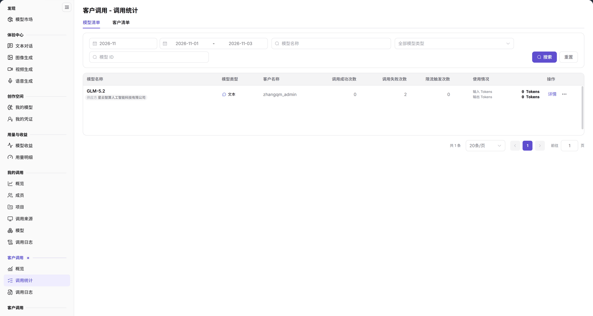

# 调用统计

::: info 文档信息
版本：v2.0
更新日期：2026-11-04
:::

## 功能概述

| 项目 | 内容 |
| --- | --- |
| 适用角色 | 模型提供方&用户 |
| 导航路径 | **模型及AI服务** > **客户调用** > **调用统计** |
| 页面路由 | `/modelone/monitoring/monitor/list` |
| 管理对象 | 按模型或客户维度统计的调用成功、失败和限流次数 |

#### 新手理解

调用统计把客户调用按模型清单或客户清单汇总。先选清单类型，再按模型类型、名称或客户筛选，最后核对成功、失败和限流次数。

#### 术语速查

| 术语 | 说明 |
| --- | --- |
| 模型清单 | 以发布的模型为第一聚合主键，展开呈现不同客户对该模型的调用指标。 |
| 客户清单 | 以调用租户/客户为第一聚合主键，汇总展示该客户跨模型的调用量与分布。 |
| 限流触发次数 | 请求因达到 QPS、并发或 Token 频控阈值而被网关拒绝的频次统计。 |
| 模型 ID | 模型在网关中注册的全局唯一英文路由标识（如 `openai/gpt-6.1-sol`）。 |

## 前提条件

1. 当前账号具备 **客户调用 > 调用统计** 的查看权限。
2. 当前统计周期内已有客户调用数据。
3. 已确认清单类型和筛选条件。

## 页面说明

页面标题为 `客户调用 - 调用统计`，提供 `模型清单` 与 `客户清单` 两个页签。

筛选区顶部提供月份和日期范围选择；下方包含 `全部模型类型`、`模型名称`、`模型 ID`，以及 **搜索**、**重置**。

`模型清单` 表格列为 `模型名称`、`模型类型`、`客户名称`、`调用成功次数`、`调用失败次数`、`限流触发次数`、`使用情况`、`操作`。

`客户清单` 表格列为 `客户名称`、`模型`、`调用成功次数`、`调用失败次数`、`限流触发次数`、`操作`。没有数据时两个页签都显示 `暂无数据`，底部显示 `共 0 条` 和分页。

图示为页面提供 `模型清单` 与 `客户清单` 页签；筛选区包含 `全部模型类型`、`模型名称`、`模型 ID`；表头为 `模型名称`、`模型类型`、`客户名称`、`调用成功次数`、`调用失败次数`、`限流触发次数`、`使用情况`、`操作`。

| 区域 | 说明 |
| --- | --- |
| 顶部页签 | 提供 `模型清单` 与 `客户清单` 两种统计聚合视角的切换。 |
| 筛选与检索栏 | 支持选择统计月份与起止日期，按模型类型、模型名称或模型 ID 检索。 |
| 数据统计表格 | 展示模型/客户、成功调用数、失败调用数、限流触发次数及用量概况。 |
| 底部分页与统计 | 显示当前筛选结果总记录条数，并支持切换每页条数与翻页。 |

## 主要操作

### 选择清单类型

1. 点击 `模型清单` 或 `客户清单` 页签。
2. 页签切换后表头和分组维度随之变化。

### 筛选记录

1. 在 `全部模型类型` 中选择模型类型。
2. 在 `模型名称` 和 `模型 ID` 中输入检索条件。
3. 点击 **"搜索"** 查询，或点击 **"重置"** 清空条件。

### 读取统计

1. 核对每行的 `调用成功次数`、`调用失败次数` 和 `限流触发次数`。
2. 查看 `使用情况` 列了解调用量或 Token 概况。
3. 通过 `操作` 列进入对应记录。

## 参数速查表

| 字段名称 | 是否必填 | 字段类型 | 示例 | 说明 |
| --- | --- | --- | --- | --- |
| 月份 / 日期范围 | 是 | 选择项 / 日期范围 | `2026-11`；`2026-11-01` 至 `2026-11-03` | 统计周期 |
| 模型类型 | 否 | 选择项 | `全部模型类型` | 按模型类型筛选 |
| 模型名称 | 否 | 文本 | `GPT-6.1 Sol` | 按模型名称筛选 |
| 模型 ID | 否 | 文本 | `openai/gpt-6.1-sol` | 按模型标识筛选 |
| 模型名称（列） | 系统统计 | 文本 | `GPT-6.1 Sol` | 模型清单中的模型 |
| 客户名称（列） | 系统统计 | 文本 | `客户 A` | 客户清单中的客户 |
| 模型（列） | 系统统计 | 数值 | `1` | 客户清单中该客户调用的模型数 |
| 模型类型 | 系统统计 | 标签 | `文本` | 模型分类 |
| 客户名称 | 系统统计 | 文本 | `客户 A` | 调用客户 |
| 调用成功次数 | 系统统计 | 数值 | `0` | 成功调用数 |
| 调用失败次数 | 系统统计 | 数值 | `0` | 失败调用数 |
| 限流触发次数 | 系统统计 | 数值 | `0` | 触发限流次数 |
| 使用情况 | 系统统计 | 文本 | — | 调用量或 Token 概况 |

## 踩坑提示

- `模型清单` 与 `客户清单` 的表头和聚合维度不同，切换后不要按原列名核对。
- 当前范围没有数据时表格显示 `暂无数据`，底部显示 `共 0 条`。
- `模型名称` 与 `模型 ID` 是两个检索条件，模型 ID 更精确。

## 结果校验

| 检查项 | 成功表现 | 异常时处理 |
| --- | --- | --- |
| 页签切换 | `模型清单` 与 `客户清单` 自由切换，表头与数据列相应切换适配。 | 若表格未刷新，尝试手动重新点击目标页签或刷新页面。 |
| 筛选生效 | 输入模型名称或 ID 后点击 **"搜索"**，表格即时按条件重绘结果。 | 若无结果，检查关键字大小写或点击 **"重置"** 放宽模型类型限制。 |
| 统计指标 | 每一行清晰呈现调用成功、失败及限流触发的具体数值而非破折号。 | 若出现异常计数值，结合调用日志核对具体时间段内的网关拦截日志。 |
| 分页控制 | 底部总记录数与分页按钮正常显示，支持点击页码跳转。 | 若翻页无响应，检查网络连接是否正常，或刷新页面后重新查询。 |

## 常见问题

#### 表格为空

**问题现象：**

表格显示 `暂无数据`，底部分页栏显示 `共 0 条`。

**可能原因：**

当前所选月份及日期区间内没有客户发起真实调用，或者设置了过于严格的模型类型、名称或 ID 过滤条件。

**处理方式：**

1. 确认选中的月份与日期范围内确实有外部客户正在使用模型。
2. 点击 **"重置"** 清空所有筛选输入框，将模型类型恢复为 `全部模型类型`。

#### 搜索结果与预期不符

**问题现象：**

在搜索框输入模型名称后，列表中未展示预期的调用记录。

**可能原因：**

模型名称包含模糊匹配歧义、输入有空格或错别字，或者该模型在该统计周期内仅有内部测试调用而无客户调用。

**处理方式：**

1. 改用全局唯一的模型 ID（如 `openai/gpt-6.1-sol`）进行精确检索。
2. 确认上方的模型类型下拉框未被错误限定为其他不匹配的类型。

## 注意事项

- 页面包含客户名称和调用数据，不要截图外发。
- 统计结果按当前筛选条件计算，跨条件比较前先固定口径。

## 后续操作

1. 宏观分析客户调用总量与 TOP 客户消耗排行，进入 [概览](../overview/)。
2. 下钻排查调用失败或限流请求的具体原因，进入 [调用日志](../call-logs/)。
3. 结算并核算各客户调用产生的实际收入与分成，进入 [模型收益](../../usage-earnings/model-earnings/)。

相关页面：
- [概览](../overview/)
- [调用日志](../call-logs/)
- [模型收益](../../usage-earnings/model-earnings/)
