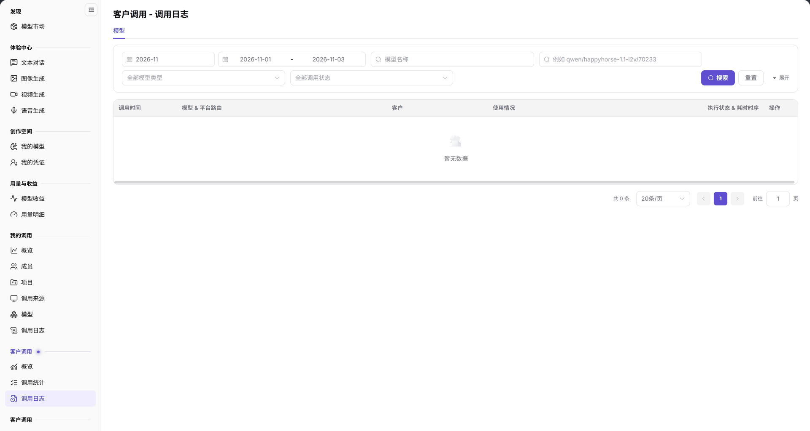

# 客户调用（监控） - 调用日志

::: info 文档信息
版本：v2.0
更新日期：2026-11-04
:::

## 功能概述

| 项目 | 内容 |
| --- | --- |
| 适用角色 | 模型提供方&用户 |
| 导航路径 | **模型及AI服务** > **客户调用** > **调用日志** |
| 页面路由 | `/modelone/monitoring/monitor/log` |
| 管理对象 | 客户调用的单次记录、客户、使用情况和执行状态 |

**新手理解**：客户调用日志逐条记录客户请求。先按模型类型和调用状态筛选，再在表格中核对客户、Token 用量和耗时。

#### 术语速查

| 术语 | 说明 |
| --- | --- |
| 客户调用日志（监控） | 面向服务消费方或运营方逐条记录的入站 API 请求流水，记录单次调用的时序与执行状态。 |
| 平台路由 | 网关将外部标准模型请求（如 `openai/gpt-6.1-sol`）映射并分发至底层物理模型实例的内部转发路径。 |
| 使用情况 | 单次 API 调用所消耗的 Token 用量详情（包含输入 Prompt Tokens 与输出 Completion Tokens）。 |
| 执行状态 & 耗时时序 | 单次调用的最终执行结果（成功/失败/限流）以及整个网络调用周期的端到端耗时毫秒值。 |

## 前提条件

1. 当前账号具备 **客户调用 > 调用日志** 的查看权限。
2. 当前统计周期内已有客户调用记录。
3. 已确认模型类型和调用状态筛选条件。

## 页面说明

页面标题为 `客户调用 - 调用日志`，提供 `模型` 页签。

| 区域 | 说明 |
| --- | --- |
| 顶部周期与复合筛选区 | 提供统计月份、日期范围选择器、模型类型/状态下拉框、模型名称搜索框与搜索/重置按钮 |
| 单次调用流水明细表格 | 呈现调用时间、模型与平台路由、调用客户、Token 用量、执行状态及端到端耗时时序 |
| 分页与条目统计栏 | 显示符合当前过滤条件的日志总条数（如“共 0 条”）、每页条数选择器与翻页控制器 |
| 操作与详情抽屉入口 | 提供点击进入单次调用详情弹窗的入口，可进一步排查输入输出 Payload 与错误堆栈 |

- 筛选区顶部提供月份和日期范围选择；下方包含 `全部模型类型`、`全部调用状态`、`模型名称` 搜索框、**搜索**、**重置** 和 **展开**。
- 表格列为 `调用时间`、`模型 & 平台路由`、`客户`、`使用情况`、`执行状态 & 耗时时序`、`操作`。没有数据时显示 `暂无数据`，底部显示 `共 0 条` 和分页。

图示为筛选区包含 `全部模型类型`、`全部调用状态`、`模型名称`（提示 `例如 qwen/happyhorse-1.1-i2v/70233`）和 **展开**；表头为 `调用时间`、`模型 & 平台路由`、`客户`、`使用情况`、`执行状态 & 耗时时序`、`操作`。

## 主要操作

### 筛选调用记录

1. 在 `全部模型类型` 中选择模型类型。
2. 在 `全部调用状态` 中选择调用状态。
3. 在模型名称搜索框输入模型名称或路由标识。
4. 点击 **"搜索"** 查询，或点击 **"重置"** 清空条件。

### 查看记录

1. 在表格中定位目标调用。
2. 核对 `调用时间`、`模型 & 平台路由`、`客户`。
3. 查看 `使用情况` 和 `执行状态 & 耗时时序`。
4. 通过 `操作` 列进入记录详情。

## 参数速查表

| 字段名称 | 是否必填 | 字段类型 | 示例 | 说明 |
| --- | --- | --- | --- | --- |
| 月份 / 日期范围 | 是 | 选择项 / 日期范围 | `2026-11`；`2026-11-01` 至 `2026-11-03` | 统计周期 |
| 模型类型 | 否 | 选择项 | `全部模型类型` | 按模型类型筛选 |
| 调用状态 | 否 | 选择项 | `全部调用状态` | 按执行状态筛选 |
| 模型名称 | 否 | 文本 | `qwen/happyhorse-1.1-i2v/70233` | 按模型名称或路由筛选 |
| 调用时间 | 系统记录 | 时间 | `2026-11-03 10:00:00` | 调用发生时间 |
| 模型 & 平台路由 | 系统记录 | 文本 | `openai/gpt-6.1-sol` | 请求模型与平台路由 |
| 客户 | 系统记录 | 文本 | `客户 A` | 调用客户 |
| 使用情况 | 系统记录 | 数值 | 输入/输出 Token | 本次调用用量 |
| 执行状态 & 耗时时序 | 系统记录 | 状态 | `成功`、`失败` | 执行结果与耗时 |

## 踩坑提示

- `全部调用状态` 只筛选状态，不改变模型类型；两个条件会同时生效。
- 当前范围没有记录时显示 `暂无数据`，底部显示 `共 0 条`。
- 模型名称搜索框支持路由标识示例 `qwen/happyhorse-1.1-i2v/70233`，按该格式输入更精确。

## 结果校验

| 检查项 | 成功表现 | 异常时处理 |
| --- | --- | --- |
| 条件过滤生效 | 切换模型类型或调用状态并点击搜索后，表格记录即时根据过滤条件精确收窄 | 若未刷新，确认是否点击了**"搜索"**按钮 |
| 关键信息完整 | 表格每行清晰显示调用时间、模型路由标识、客户名称、Token 用量与执行状态 | 若客户列显示为空或乱码，检查客户 API 访问凭据是否规范绑定了租户身份 |
| 耗时时序可视化 | 执行状态列以标签回显成功或具体失败类型，并附带精确到毫秒级的端到端耗时 | 若耗时异常偏大，核查后端模型实例网络延迟或客户长上下文 Prompt 处理负载 |
| 路由标识检索 | 在模型名称框输入完整平台路由标识（如 `qwen/happyhorse-1.1-i2v/70233`）并搜索，精准命中目标记录 | 若未找到记录，改用模型短名称或清除前后空格后重新搜索 |
| 详情抽屉展开 | 点击操作列中的详情按钮，正常弹出单次调用的完整请求头、请求体与响应状态详情抽屉 | 检查当前登录账号是否具备单次日志查看脱敏明细权限 |

## 常见问题

#### 调用日志为空

**问题现象：** 表格显示 `暂无数据`，底部显示 `共 0 条`。

**可能原因：** 所选时间范围内没有发生客户调用，或者当前的复合筛选条件（模型类型、状态、模型名称）过于严苛导致无匹配项。

**处理方式：**

1. 点击 **"重置"** 按钮恢复所有筛选条件至默认状态。
2. 检查顶部月份和日期范围，切换至有调用记录的日期。
3. 确认客户调用的服务是否属于本平台托管的模型范围。

#### 找不到某次调用

**问题现象：** 客户反馈调用失败，但在日志中输入模型名称无法搜索到该条失败记录。

**可能原因：** 请求在进入模型路由层之前已被全局网关鉴权拒绝（例如使用了无效 API Key），或者输入的模型名称与实际平台路由标识存在字符大小写差异。

**处理方式：**

1. 改用复制客户请求体中传入的完整模型路由标识进行精确检索。
2. 将调用状态切换为 `全部调用状态`，避免仅筛选 `成功` 过滤掉了失败记录。
3. 核实该请求是否到达了网关路由层。

## 注意事项

- 日志包含客户名称和调用数据，不要截图外发。
- 排查时只记录必要字段，避免泄露请求内容和密钥。

## 后续操作

1. 针对失败或限流的调用记录，点击操作列查看具体错误码与网关拦截原因。
2. 在[概览](../overview/)中查看该时间段内客户调用的宏观趋势与 TOP5 分布。
3. 在[模型收益](../../usage-earnings/model-earnings/)中核实成功计费调用的结算数据。

相关页面：
- [客户调用概览](../overview/)
- [客户调用 - 调用统计](../call-analytics/)
- [客户调用（模型提供方）日志](../../provider-calls/call-logs/)
- [模型用量](../../usage-earnings/model-usage/)
- [模型收益](../../usage-earnings/model-earnings/)
