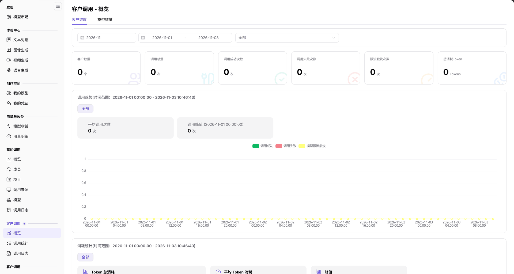

# 客户调用（监控） - 概览

::: info 文档信息
版本：v2.0
更新日期：2026-11-04
:::

## 功能概述

| 项目 | 内容 |
| --- | --- |
| 适用角色 | 模型提供方&用户 |
| 导航路径 | **模型及AI服务** > **客户调用** > **概览** |
| 页面路由 | `/modelone/monitoring/monitor/overview` |
| 管理对象 | 客户调用总量、成功率、Token 消耗、调用趋势和 TOP5 排行 |

**新手理解**：客户调用概览从客户视角汇总调用情况。先看客户数量、调用总量和成功率，再看调用趋势与消耗统计，最后用 TOP5 定位调用量或限流最高的客户。

#### 术语速查

| 术语 | 说明 |
| --- | --- |
| 客户维度监控 | 从客户租户实体视角汇总全量 API 调用流量、Token 消耗与 SLA 表现的聚合监控视图。 |
| 限流触发次数 | 外部客户发起的请求因突破网关 QPS/TPM 阈值被 429 拦截的累计事件次数。 |
| 输入/输出 Token 峰值 | 在统计粒度时间窗口内，单个采样点所达到的最大输入或输出 Token 吞吐量。 |
| 客户调用 TOP5 | 按调用总请求量倒序排列的前 5 名重点客户列表，支持快速识别核心租户。 |

## 前提条件

1. 当前账号具备 **客户调用 > 概览** 的查看权限。
2. 当前统计周期内已有客户调用数据。
3. 已确认统计时间范围和维度。

## 页面说明

页面标题为 `客户调用 - 概览`，提供 `客户维度` 与 `模型维度` 两个页签。

| 区域 | 说明 |
| --- | --- |
| 顶部页签与过滤栏 | 提供客户维度/模型维度切换页签、时间范围控件、筛选下拉框与“更多”展开按钮 |
| 核心指标概览卡片 | 呈现客户数量、调用总量、成功/失败次数、限流触发次数及总消耗 Token 关键指标 |
| 调用走势与消耗统计 | 绘制调用请求时序走势折线图，并量化展示 Token 输入/输出/峰值统计图谱 |
| 双 TOP5 聚焦排行表 | 提供“客户调用 TOP5”与“限流触发 TOP5”两个榜单，快速锁定重载与异常客户 |

`客户维度` 包含：

- 时间与范围：顶部提供时间范围选择、`全部` 筛选和 **更多**。
- 指标卡：`客户数量`、`调用总量`、`调用成功次数`、`调用失败次数`、`限流触发次数`、`总消耗Token`。
- `调用趋势`：显示时间范围和 `全部` 筛选，提供 **更多**。
- `消耗统计`：显示 `Token 总消耗`（`总量`、`输入`、`输出`）、`平均 Token 消耗`（`输入Token`、`输出Token`）、`峰值`（`输入峰值`、`输出峰值`）。
- `客户调用TOP5`：列为 `序号`、`用户名称`、`调用总量`、`成功次数`、`失败次数`、`操作`。
- `限流触发TOP5`：列为 `序号`、`用户名称`、`触发模型限流数量`、`限流触发次数`、`操作`。

图示为页面提供 `客户维度` 与 `模型维度` 页签；指标卡显示 `客户数量`、`调用总量`、`调用成功次数`、`调用失败次数`、`限流触发次数`、`总消耗Token`；下方为 `调用趋势`、`消耗统计`、`客户调用TOP5` 和 `限流触发TOP5`。

## 主要操作

### 查看客户维度

1. 进入 **客户调用 > 概览**，默认打开 `客户维度`。
2. 选择时间范围和 `全部` 筛选。
3. 读取 `客户数量`、`调用总量`、成功/失败次数、限流触发次数和 `总消耗Token`。
4. 在 `调用趋势` 和 `消耗统计` 中查看走势与 Token 构成。
5. 在 `客户调用TOP5` 和 `限流触发TOP5` 中定位重点客户。

### 切换模型维度

1. 点击 `模型维度` 页签。
2. 按页面提供的模型维度条件查看对应统计。

### 查看更多

1. 点击指标区或趋势区的 **"更多"**。
2. 按展开的选项查看扩展信息或进入明细。

## 参数速查表

| 字段名称 | 是否必填 | 字段类型 | 示例 | 说明 |
| --- | --- | --- | --- | --- |
| 时间范围 | 是 | 日期范围 | `2026-11-01` 至 `2026-11-03` | 统计时间范围 |
| 客户数量 | 系统统计 | 数值 | `0` | 产生调用的客户数 |
| 调用总量 | 系统统计 | 数值 | `0` | 客户调用总量 |
| 调用成功次数 | 系统统计 | 数值 | `0` | 成功调用数 |
| 调用失败次数 | 系统统计 | 数值 | `0` | 失败调用数 |
| 限流触发次数 | 系统统计 | 数值 | `0` | 触发限流的次数 |
| 总消耗Token | 系统统计 | 数值 | `0` | 客户消耗的 Token 总量 |
| Token 总消耗 | 系统统计 | 数值 | `0 Tokens` | 总量、输入、输出 |
| 平均 Token 消耗 | 系统统计 | 数值 | `0 Tokens` | 输入与输出平均数 |
| 峰值 | 系统统计 | 数值 | `0 Tokens` | 输入与输出峰值 |
| 用户名称 | 系统统计 | 文本 | `客户 A` | TOP5 中的客户名称 |
| 触发模型限流数量 | 系统统计 | 数值 | `0` | 触发限流的模型数 |
| 限流触发次数 | 系统统计 | 数值 | `0` | TOP5 中的限流次数 |

## 踩坑提示

- `客户维度` 与 `模型维度` 的统计口径不同，切换后不要直接比较同名指标。
- `总消耗Token` 是 Token 总量，不是金额；金额与收益请到模型收益页面查看。
- 当前范围没有数据时 TOP5 显示 `暂无数据`，趋势图可能为空。
- 页面时间范围由当前日期决定，跨天查看时先确认范围。

## 结果校验

| 检查项 | 成功表现 | 异常时处理 |
| --- | --- | --- |
| 页签无缝切换 | 点击客户维度与模型维度页签，页面图表与统计卡片迅速重载且结构完整 | 若切换卡顿或报错，刷新页面并核对当前账号监控权限 |
| 核心指标呈现 | 指标卡完整回显客户数、总量、成功/失败数及 Token 消耗数值 | 若全部显示为 0，核实统计时间范围是否有实际调用，或适当拉宽起止时间 |
| 走势图表连续 | 调用走势与消耗统计图表线条平滑，悬浮显示具体时间点的请求数与 Token 分布 | 若图表显示空白，清除顶部特定过滤条件 |
| TOP5 排行交互 | 客户调用 TOP5 与限流触发 TOP5 表格展示前 5 行明细或合规空状态 | 若客户名称异常缺失，检查平台租户命名服务连通性 |
| 更多与明细下钻 | 点击指标或趋势区域中的“更多”按钮，顺利跳转或展开至[调用统计](../call-analytics/) | 检查浏览器是否拦截了页面跳转或弹窗 |

## 常见问题

#### 指标和排行都是 0 或空

**问题现象：** 客户数量、调用总量显示为 0，且双 TOP5 表格均显示 `暂无数据`。

**可能原因：** 所选统计时间跨度内客户未产生有效调用，或者数据仍在准实时整点聚合流水线中计算中。

**处理方式：**

1. 检查顶部时间选择器，拉长统计周期至最近 7 天或上个月。
2. 等待下一个整点聚合批次后刷新页面。
3. 检查客户 API 访问网关是否正常转发了监控打点指标。

#### 客户维度与模型维度数据不一致

**问题现象：** 客户维度页签下的调用总量与模型维度页签下的总量存在微小差异。

**可能原因：** 客户维度聚合以租户鉴权记录为基准，而模型维度聚合以网关路由到的目标模型实例为基准，部分在网关鉴权通过后但未匹配到合法模型实例的请求会产生聚合口径偏差。

**处理方式：**

1. 涉及租户结算与并发配额审计时，以客户维度数据为准。
2. 涉及模型算力调度与后端负载评估时，以模型维度数据为准。

## 注意事项

- 页面包含客户名称和调用数据，不要截图外发。
- 统计数据按时间范围汇总，跨范围比较前先固定口径。

## 后续操作

1. 在[调用统计](../call-analytics/)中按客户或模型下钻查看明细时序指标。
2. 在[调用日志](../call-logs/)中检索高频限流客户的具体请求上下文与触发规则。
3. 在[模型收益](../../usage-earnings/model-earnings/)中核对高用量客户对应的结算收益。

相关页面：
- [客户调用 - 调用统计](../call-analytics/)
- [客户调用 - 调用日志](../call-logs/)
- [客户调用（模型提供方）概览](../../provider-calls/overview/)
- [模型用量](../../usage-earnings/model-usage/)
- [模型收益](../../usage-earnings/model-earnings/)
