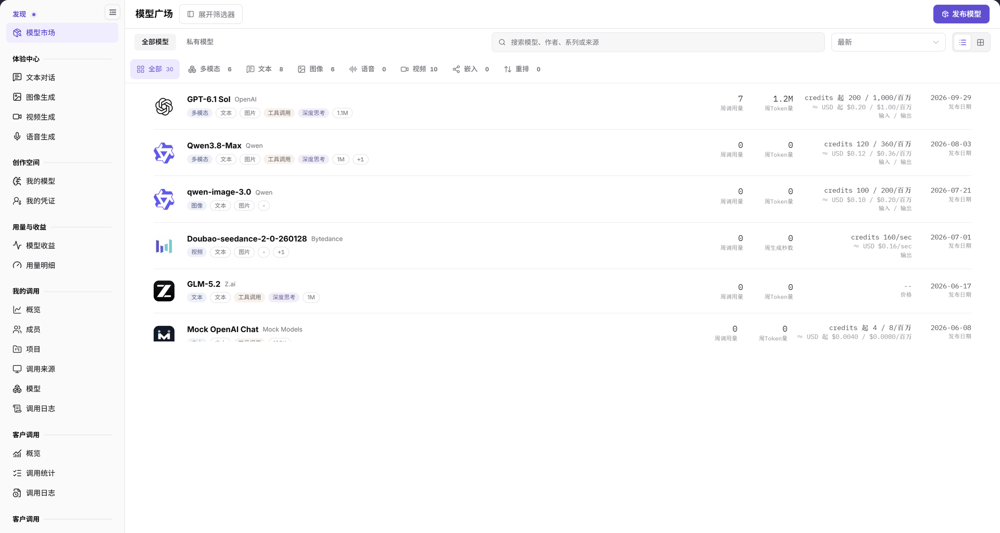

# 模型市场

## 功能概述

| 项目 | 内容 |
| --- | --- |
| 适用角色 | 模型提供方&用户 |
| 导航路径 | **模型及AI服务** > **发现** > **模型市场** |
| 页面路由 | 列表 `/modelone/store/model`；详情 `/modelone/store/model/{模型ID}` |
| 管理对象 | 平台上架的模型、模型作者、供应方实例、调用价格与接入信息 |

**新手理解**：模型市场是平台的可调用模型目录。先按能力、作者或来源缩小范围，再打开模型详情比较供应方与价格，最后进入体验中心试调用，或复制快速开始信息接入自己的应用。

#### 术语速查

| 术语 | 说明 |
| --- | --- |
| 模型市场 | 面向租户与开发者展示已上架、可直接调用的大模型与 AI 服务目录中心。 |
| 模型作者 | 模型的研发设计原厂或开源组织，例如 DeepSeek、OpenAI、Qwen、Anthropic。 |
| 供应方（Provider） | 实际提供该模型托管算力、API 端点与 SLA 质量保障的基础设施服务商。 |
| Playground | 平台内置的可视化调试与体验中心，支持免代码直接测试文本、图像、音视频等模态。 |

## 前提条件

1. 当前账号可以打开 **发现 > 模型市场**。
2. 目标模型已上架，且对当前账号或所在租户可见。
3. 调用前已确认账户余额、模型价格、上下文限制和协议。

## 页面说明

页面由筛选区、模型广场标题区和模型列表组成：

- 筛选区：搜索框、`输入能力`、`输出能力`、`模型系列`、`上下文长度`、`计费`、`模型作者`、`模型源`、`场景`，窄屏时通过 **展开筛选器** 显示全部条件。
- 标题区：`模型广场`、**发布模型**（模型提供方可见）、`全部模型` / `私有模型` 页签、排序 `最新`、列表与卡片视图切换。
- 能力统计：`全部`、`多模态`、`文本`、`图像`、`语音`、`视频`、`嵌入`、`重排`，每个分类后显示当前数量。
- 模型行：模型名称、作者、类型标签、能力标签、上下文长度、`周调用量`、`周Token量`、`credits ... / 百万` 或按图/秒计价、`≈ USD ...`、`发布日期` 和 `Released` 状态。

| 区域 | 说明 |
| --- | --- |
| 顶部检索与筛选栏 | 包含多模态能力多选、模型作者/来源/系列过滤，以及搜索输入框与展开筛选按钮 |
| 广场标题与范围切换 | 展示模型广场主标题、全部/私有模型页签、发布模型按钮、排序方式及卡片/列表视图切换 |
| 模态分类统计栏 | 分类展示多模态、文本、图像、语音、视频、嵌入、重排等模型的实时数量 |
| 模型卡片与数据行 | 呈现模型名称、作者、标签、上下文长度、周调用/Token 量、价格及上架状态 |

图示为搜索框提示为 `搜索模型、作者、系列或来源`；能力统计显示 `全部 30`、`多模态 6`、`文本 8`、`图像 6`、`视频 10`。每行右侧依次展示周调用量、周 Token 量、输入/输出价格和发布日期。

### 模型详情

打开模型后，页面顶部展示模型名称、作者、发布日期、模型标识、价格、上下文、最大输入/输出、输入输出模态、能力标签和协议。下方提供 `Providers`、`Quick Start`、`Performance`、`Overview`、`Best Practices` 五个页签。

在 `Providers` 页签中，可按 `All`、`Public`、`Private`、`Aggregate` 过滤供应方，也可切换 `All`、`By Provider`、`By Model Source` 分组。供应方卡片展示模型路由标识、供应方、价格、上下文、`TTFT`、`Throughput`、`Success Rate`、`Weekly Calls`、`Weekly Tokens`、`Uptime`，并提供 **Playground** 与 **Quick Start** 按钮。

## 主要操作

### 筛选模型

1. 在搜索框输入模型名称、作者、系列或来源。
2. 展开 `输入能力`、`输出能力` 等筛选项，按业务需要勾选条件。
3. 使用 `全部模型` / `私有模型` 切换模型范围。
4. 使用排序下拉选择 `最新`，或在列表/卡片视图之间切换。

### 查看模型详情

1. 点击目标模型名称，进入模型详情。
2. 核对顶部模型标识、价格、上下文和协议。
3. 在 `Providers` 页签比较供应方的价格、延迟、成功率与周调用量。
4. 按需切换 `Quick Start`、`Performance`、`Overview`、`Best Practices` 页签。

### 进入体验或接入

1. 在供应方卡片点击 **"Playground"**，进入对应模态的体验中心。
2. 或在供应方卡片点击 **"Quick Start"**，查看该供应方的接入信息。
3. 接入示例中的地址、模型标识和密钥使用占位符替换，不保存真实凭据。

### 发布模型

模型提供方可点击右上角 **"发布模型"**，进入发布入口。发布范围与流程见[我的模型](../../studio/my-models/)。

## 参数速查表

| 字段名称 | 是否必填 | 字段类型 | 示例 | 说明 |
| --- | --- | --- | --- | --- |
| 搜索 | 否 | 文本 | `GPT-6.1` | 按模型名称、作者、系列或来源检索 |
| 输入能力 / 输出能力 | 否 | 多选 | `文本`、`图片` | 按模型支持的输入输出模态筛选 |
| 模型系列 | 否 | 单选 | `Qwen3.8` | 按模型系列筛选 |
| 上下文长度 | 否 | 单选 | `≥128K` | 按上下文窗口筛选 |
| 计费 | 否 | 单选 | `免费`、`付费` | 按计费方式筛选 |
| 模型作者 | 否 | 单选 | `OpenAI` | 按模型作者筛选 |
| 模型源 | 否 | 单选 | `AGIOne` | 按模型来源筛选 |
| 场景 | 否 | 单选 | `文本生成` | 按业务场景筛选 |
| 模型范围 | 否 | 页签 | `全部模型` / `私有模型` | 切换可见模型范围 |
| 排序 | 否 | 下拉 | `最新` | 控制模型列表排序 |
| 周调用量 | 系统统计 | 数值 | `7` | 模型近一周调用量 |
| 周Token量 | 系统统计 | 数值 | `1.2M` | 模型近一周 Token 用量 |
| 价格 | 系统维护 | 文本 | `credits 200 / 1,000/M` | 输入/输出单价或按图/秒计价 |
| 状态 | 系统维护 | 标签 | `Released` | 模型当前发布状态 |

## 踩坑提示

- 读取模型数量前先确认当前筛选条件和页签，避免把分类数字当作总量。
- 同一模型可能对应多个供应方，价格、延迟和成功率以供应方卡片为准，不要只看模型行。
- 不同模态的计价单位不同：文本按 Token、图像按张、视频按秒；比较价格时先对齐单位。
- `全部模型` 与 `私有模型` 是两个范围页签；读取数量前先确认当前页签。

## 结果校验

| 检查项 | 成功表现 | 异常时处理 |
| --- | --- | --- |
| 筛选条件生效 | 勾选模态或输入名称后，模型卡片数量与上方能力统计数字同步刷新 | 点击 **"重置"** 排除多重条件冲突，确认所选条件范围下是否存在上架模型 |
| 详情匹配正确 | 点击卡片后详情页标题、模型标识与所选模型完全一致 | 若页面报 404 或无权限，核实当前账号租户是否在该模型的可见范围之内 |
| 供应方卡片完整 | `Providers` 页签正确呈现各供应方的价格、上下文限制、TTFT、吞吐量与可用率 | 若供应方列表为空，说明该模型暂无可用实例接入，可向运营管理员反馈 |
| 体验与接入入口 | 供应方卡片右下角提供 **"Playground"** 与 **"Quick Start"** 按钮 | 若按钮不可点击，确认当前模型是否具备对应模态的体验支持 |
| 空结果恢复 | 无匹配结果时显示空白提示，清空条件后立即恢复全量模型列表 | 检查搜索框是否有不可见多余空格或未闭合过滤项 |

## 常见问题

#### 搜索不到目标模型

**问题现象：**

在模型广场输入模型名称后，列表中未找到预期的目标模型。

**可能原因：**

当前停留在 `私有模型` 页签，或左侧模态/作者筛选条件形成了过度过滤。

**处理方式：**

1. 切换至 `全部模型` 范围页签。
2. 清除 `输入能力`、`输出能力`、作者与来源等高级筛选条件后重新检索。
3. 若仍无法找到，联系运营管理员核实该模型是否已审核发布并对当前租户开放可见。

#### 价格显示为 `--`

**问题现象：**

模型卡片或供应方列表中价格字段显示为 `--`。

**可能原因：**

该模型为免费公测模型，或供应方尚未在模板中录入具体的 Token 计费标准。

**处理方式：**

核对详情页中的计费模式描述；若确实需要商用付费结算，建议以卡片当前展示为准，暂缓大规模接入并咨询平台支持。

#### 同一模型有多个价格

**问题现象：**

在模型详情的 `Providers` 页签中，同一元模型展示了多个不同单价的卡片。

**可能原因：**

同一模型由不同的物理供应方或不同地域的 Endpoint 托管，各厂商的基建成本与加速服务等级不同。

**处理方式：**

综合比较各供应方卡片上的延迟（TTFT）、吞吐率（Throughput）与单价，选择最匹配业务 SLA 要求的供应方。

## 注意事项

- 体验或调用会产生调用记录和额度消耗，提交前核对模型、供应方与价格。
- 快速开始中的模型标识、地址和密钥按实际环境替换，不把真实凭据写入文档或截图。
- 模型能力、价格、上下文和协议以详情页当前展示为准。

## 后续操作

1. 在体验中心选择对应模态调试模型效果与提示词工程。
2. 复制 Quick Start 代码片段，将模型接入业务系统或自主研发的应用中。
3. 进入调用统计模块，实时跟踪实际调用耗时与额度账单。

相关页面：
- [文本对话](../../playground/text/)
- [图像生成](../../playground/images/)
- [视频生成](../../playground/video/)
- [语音生成](../../playground/audio/)
- [我的调用](../../my-calls/overview/)
- [我的模型](../../studio/my-models/)
