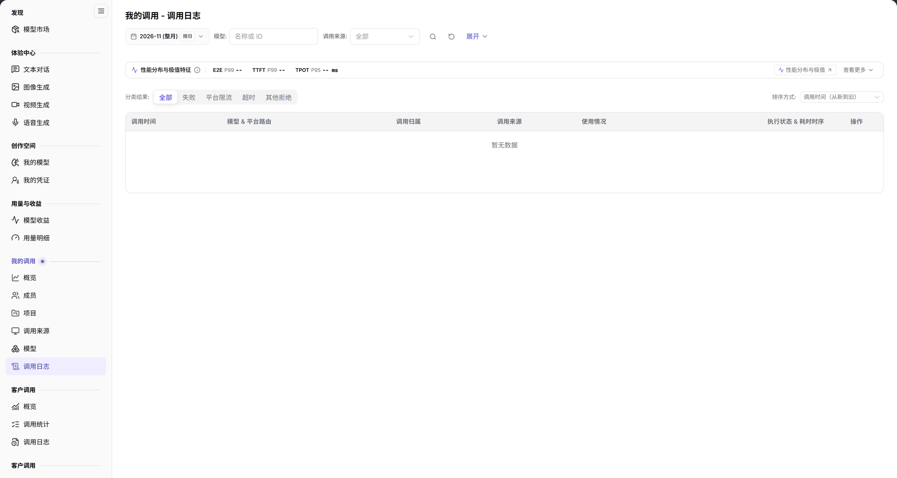

# 我的调用 - 调用日志

> 本页面在系统左侧菜单中显示为【调用日志】。

> 统计口径：顶部月份选择器决定统计范围；`按日` 切换按天聚合粒度，日期范围以选择器当前显示的起止日期为准。

## 功能概述

| 项目 | 内容 |
| --- | --- |
| 适用角色 | 模型提供方&用户 |
| 导航路径 | **模型及AI服务** > **我的调用** > **调用日志** |
| 页面路由 | `/modelone/model-observation/eu/calls` |
| 管理对象 | 单次调用记录、调用归属、调用来源、执行状态和延迟 |

**新手理解**：调用日志是逐条调用记录。上方先看性能分布与极值，再按结果分类和排序定位异常调用，最后在表格中核对单次调用的模型、来源、Token 和耗时。

#### 术语速查

| 术语 | 说明 |
| --- | --- |
| 调用日志 | 记录租户成员与关联应用向平台模型发起请求的单次全生命周期流水记录。 |
| E2E P99 | 99% 的请求在此端到端耗时（End-to-End Latency）内完成，反映长尾请求的系统延迟。 |
| TTFT P99 | 99% 的流式输出首个 Token 延迟（Time to First Token）阈值，反映模型冷启动与排队开销。 |
| TPOT P95 | 95% 的每 Token 输出耗时（Time Per Output Token）阈值，反映模型流式输出过程的平稳吞吐速率。 |

## 前提条件

1. 当前账号具备 **我的调用 > 调用日志** 的查看权限。
2. 当前统计周期内已有调用记录。
3. 已确认统计月份、模型和调用来源筛选条件。

## 页面说明

页面标题为 `我的调用 - 调用日志`。页面自上而下分为：

| 区域 | 说明 |
| --- | --- |
| 顶部时间与组合筛选区 | 提供月份选择器、按日颗粒度开关、模型与调用来源下拉框、名称/ID 搜索框与展开项 |
| 性能分布与极值特征看板 | 汇聚展示 E2E P99、TTFT P99 与 TPOT P95 核心指标，提供查看更多极值入口 |
| 结果分类与排序工具条 | 支持按全部、失败、平台限流、超时、其他拒绝快速过滤，并支持自定义升降序规则 |
| 明细流水表格区 | 展示调用时间、模型与路由、调用归属、调用来源、输入输出 Token、状态与时序耗时 |

- 筛选区：月份、`按日`、`模型`、`调用来源`、**展开** 和 `名称或 ID` 搜索框。
- `性能分布与极值特征`：显示 `E2E P99`、`TTFT P99`、`TPOT P95`，并提供 **查看更多**。
- `性能分布与极值`：列出 P99/P95 排序、最小延迟和最长调用等查看入口。
- 分类与排序：`分类结果`（`全部`、`失败`、`平台限流`、`超时`、`其他拒绝`）和 `排序方式`（默认 `调用时间（从新到旧）`）。
- 表格：`调用时间`、`模型 & 平台路由`、`调用归属`、`调用来源`、`使用情况`、`执行状态 & 耗时时序`、`操作`。

图示为页面顶部显示 `性能分布与极值特征`，包含 `E2E P99`、`TTFT P99`、`TPOT P95`；`分类结果` 提供 `全部`、`失败`、`平台限流`、`超时`、`其他拒绝`；表格列为 `调用时间`、`模型 & 平台路由`、`调用归属`、`调用来源`、`使用情况`、`执行状态 & 耗时时序`、`操作`。

## 主要操作

### 筛选调用记录

1. 选择统计月份。
2. 使用 `按日` 切换统计粒度。
3. 在 `模型` 和 `调用来源` 中限定范围。
4. 在搜索框输入 `名称或 ID`。

### 查看性能分布

1. 查看 `性能分布与极值特征` 中的 `E2E P99`、`TTFT P99`、`TPOT P95`。
2. 点击 **"查看更多"** 展开 `性能分布与极值` 的排序入口。

### 按结果筛选与排序

1. 在 `分类结果` 中选择 `全部`、`失败`、`平台限流`、`超时` 或 `其他拒绝`。
2. 在 `排序方式` 中选择排序规则，默认 `调用时间（从新到旧）`。

### 查看单次调用

1. 在表格中定位目标记录。
2. 查看 `模型 & 平台路由`、`调用归属`、`调用来源`、`使用情况` 和 `执行状态 & 耗时时序`。
3. 通过 `操作` 列进入该条记录的详情。

## 参数速查表

| 字段名称 | 是否必填 | 字段类型 | 示例 | 说明 |
| --- | --- | --- | --- | --- |
| 月份 | 是 | 选择项 | `2026-11` | 统计月份 |
| 按日 | 否 | 切换项 | 按日 | 统计粒度 |
| 模型 | 否 | 文本 | `名称或 ID` | 按模型筛选 |
| 调用来源 | 否 | 选择项 | `全部` | 按来源筛选 |
| E2E P99 | 系统统计 | 时长 | `--` | 端到端耗时 P99 |
| TTFT P99 | 系统统计 | 时长 | `--` | 首 Token 延迟 P99 |
| TPOT P95 | 系统统计 | 时长 | `-- ms` | 每 Token 输出时间 P95 |
| 分类结果 | 否 | 单选 | `全部` | 按调用结果筛选 |
| 排序方式 | 否 | 下拉 | `调用时间（从新到旧）` | 控制记录排序 |
| 调用时间 | 系统记录 | 时间 | `2026-11-03 10:00:00` | 调用发生时间 |
| 模型 & 平台路由 | 系统记录 | 文本 | `openai/gpt-6.1-sol` | 请求模型与平台路由 |
| 调用归属 | 系统记录 | 文本 | 成员或项目 | 调用归属对象 |
| 调用来源 | 系统记录 | 文本 | App 名称 | 调用来源 |
| 使用情况 | 系统记录 | 数值 | `输入 / 输出 Token` | 本次调用 Token 用量 |
| 执行状态 & 耗时时序 | 系统记录 | 状态 | `成功`、`失败` | 执行结果与耗时 |

## 踩坑提示

- `性能分布与极值特征` 在无数据时显示 `--`，不代表性能为 0。
- `分类结果` 只筛选调用结果，不改变统计月份；切换后表格记录会减少。
- `调用归属` 与 `调用来源` 是两个维度，前者是成员/项目，后者是应用来源。
- 表格默认按 `调用时间（从新到旧）` 排序；切换排序后核对表头状态。

## 结果校验

| 检查项 | 成功表现 | 异常时处理 |
| --- | --- | --- |
| 组合筛选生效 | 切换月份、选择模型或指定来源后，表格记录与上方极值指标联动刷新 | 若列表为空，点击重置清除过滤条件，检查该月份是否有实际调用产生 |
| 极值卡片呈现 | 顶部指标卡回显毫秒（ms）或秒（s）级的 P99/P95 延迟数值 | 若显示 `--`，说明当前筛选范围内的调用样本量不足以计算分位数 |
| 状态分类过滤 | 切换至 `失败` 或 `平台限流`，表格立即过滤并仅显示对应异常状态的流水条目 | 若分类后无数据，说明当前统计周期内该类异常未发生 |
| 详情抽屉可查 | 点击操作列详情按钮，可展开查看单次调用的请求头、完整响应参数与各阶段耗时打点 | 若无法查看详情，核实当前登录账号是否具备审计查看权限 |
| 排序规则切换 | 切换至按耗时倒序或 Token 量排序，表格记录自上而下严格按指标重新排列 | 核实表头字段是否有锁定的默认排序覆盖 |

## 常见问题

#### 调用日志为空

**问题现象：** 表格显示 `暂无数据`，上方性能极值指标全部为 `--`。

**可能原因：** 所选统计月份尚未产生任何模型调用；或者筛选条件过于严苛导致无匹配结果。

**处理方式：**

1. 切换至有实际业务流量调用的月份。
2. 清空模型、调用来源和名称/ID 搜索框，重置分类结果为 `全部`。
3. 进入[我的调用概览](../overview/)核验该统计周期的总调用次数基数。

#### 性能指标显示 `--`

**问题现象：** 表格有少量调用数据，但顶部的 E2E P99、TTFT P99、TPOT P95 均显示 `--`。

**可能原因：** 系统计算 P99/P95 分位数需要一定数量的有效采样基数（如至少数十条）；或者该统计周期数据刚入库尚未完成小时级聚合。

**处理方式：**

1. 扩大查询时间跨度或移除模型细分过滤。
2. 系统指标标注为按小时更新，等待整点聚合任务执行完毕后刷新页面。

## 注意事项

- 调用日志包含成员、项目和来源信息，不要截图外发。
- 排查时只记录必要字段，避免泄露请求内容。
- 统计数据按小时更新，刚产生的调用可能延迟出现。

## 后续操作

1. 在概览面板中核对当月宏观调用量、成功率走势与模型分布。
2. 切换至成员维度或项目维度，排查高频调用或异常消耗的具体归属方。
3. 若存在大量被限流或失败记录，前往平台路由或服务商卡片评估扩容策略。

相关页面：
- [我的调用概览](../overview/)
- [按成员统计](../members/)
- [按项目统计](../projects/)
- [按模型统计](../models/)
- [按来源统计](../client-sources/)
