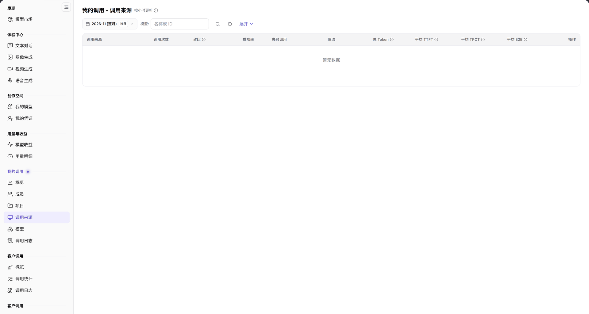

# 调用来源

::: info 文档信息
版本：v2.0
更新日期：2026-11-04
:::

## 功能概述

| 项目 | 内容 |
| --- | --- |
| 适用角色 | 模型提供方&用户 |
| 导航路径 | **模型及AI服务** > **我的调用** > **调用来源** |
| 页面路由 | `/modelone/model-observation/eu/apps` |
| 管理对象 | 按调用来源聚合的调用次数、占比、成功率、Token 和延迟 |

**新手理解**：调用来源页回答“调用是从哪个应用或来源发出的”。先选月份和模型，再比较各来源的调用量、成功率和延迟。

#### 术语速查

| 术语 | 说明 |
| --- | --- |
| 调用来源 | 发起大模型 API 调用的上游客户端实体，如特定应用名称、SDK 标识或业务系统模块。 |
| 调用占比 | 单个调用来源在所选周期内产生的请求次数占当前租户总调用量的百分比。 |
| 限流调用 | 因请求频次突破平台流控配额或网关 QPS/TPM 阈值而被拦截拒绝的调用次数。 |
| 平均 TPOT | 每 Token 输出的平均消耗时长（Time Per Output Token），反映各业务应用感知到的生成流畅度。 |

## 前提条件

1. 当前账号具备 **我的调用 > 调用来源** 的查看权限。
2. 当前统计周期内已有带来源标识的调用。
3. 已确认统计月份和筛选条件。

## 页面说明

页面标题为 `我的调用 - 调用来源`，右侧标注 `按小时更新`。

| 区域 | 说明 |
| --- | --- |
| 顶部时间与过滤栏 | 提供统计月份、按日颗粒度开关、模型筛选框、展开按钮与来源名称/ID 搜索框 |
| 统计时效状态标识 | 标明“按小时更新”，提示指标数据为准实时整点聚合结果 |
| 来源汇总数据表格 | 呈现调用来源名称、请求次数、占比、成功率、失败/限流数、Token 总量与 TTFT/TPOT/E2E 延迟指标 |
| 操作与下钻列 | 提供下钻查看该应用来源关联日志明细的入口 |

- 筛选区包含月份、`按日`、`模型`、**展开** 和 `名称或 ID` 搜索框。
- 表格列为 `调用来源`、`调用次数`、`占比`、`成功率`、`失败调用`、`限流`、`总 Token`、`平均 TTFT`、`平均 TPOT`、`平均 E2E`、`操作`。没有数据时显示 `暂无数据`。

图示为筛选项为月份、`按日`、`模型`、**展开** 和 `名称或 ID`；表头为 `调用来源`、`调用次数`、`占比`、`成功率`、`失败调用`、`限流`、`总 Token`、`平均 TTFT`、`平均 TPOT`、`平均 E2E`、`操作`。

## 主要操作

1. 选择统计月份。
2. 使用 `按日` 切换统计粒度。
3. 在 `模型` 中限定模型范围，必要时点击 **"展开"** 查看扩展条件。
4. 在搜索框输入来源名称或 ID。
5. 对比各来源的调用次数、占比、成功率和延迟。

## 参数速查表

| 字段名称 | 是否必填 | 字段类型 | 示例 | 说明 |
| --- | --- | --- | --- | --- |
| 月份 | 是 | 选择项 | `2026-11` | 统计月份 |
| 按日 | 否 | 切换项 | 按日 | 统计粒度 |
| 模型 | 否 | 文本 | `名称或 ID` | 按模型筛选 |
| 调用来源 | 系统统计 | 文本 | `App A` | 调用来源名称 |
| 调用次数 | 系统统计 | 数值 | `0` | 来源调用总量 |
| 占比 | 系统统计 | 百分比 | `0%` | 来源调用占总量比例 |
| 成功率 | 系统统计 | 百分比 | `--` | 成功调用占比 |
| 失败调用 / 限流 | 系统统计 | 数值 | `0` | 失败与限流调用数 |
| 总 Token | 系统统计 | 数值 | `0` | 来源 Token 总量 |
| 平均 TTFT / TPOT / E2E | 系统统计 | 时长 | `--` | 来源平均延迟指标 |

## 踩坑提示

- 没有来源标识的调用不会出现在本页，概览中的总调用量可能大于来源合计。
- 当前范围没有数据时显示 `暂无数据`，不代表来源不可用。
- 切换 `按日` 会改变聚合粒度，比较前先固定粒度。

## 结果校验

| 检查项 | 成功表现 | 异常时处理 |
| --- | --- | --- |
| 统计条件联动 | 切换统计月份或指定模型后，表格内来源行列表与各项数据同步更新 | 若整表变为空白，点击重置清除过滤条件，核实当前统计周期是否有流量 |
| 指标数值准确 | 调用次数大于 0 时，占比、成功率及总 Token 正确呈现具体数值 | 若成功率为 `--` 或 0%，检查失败与限流列分析是否有应用端鉴权错误 |
| 延迟指标完整 | 平均 TTFT、TPOT、E2E 呈现毫秒或秒级耗时指标 | 若显示 `--`，说明对应来源的有效流式采样样本不足 |
| 搜索精准定位 | 在名称或 ID 输入框填入特定应用标识，表格即时过滤定位目标来源 | 清除搜索框多余空白字符或改用来源 ID 检索 |
| 空态提示友好 | 无匹配数据时表格正中呈现 `暂无数据` | 确认客户端请求 Header 中是否规范注入了来源标识字段 |

## 常见问题

#### 来源列表为空

**问题现象：** 表格显示 `暂无数据`，无法查看各应用的调用统计。

**可能原因：** 所选月份未产生调用流量；或者客户端调用模型时未在 HTTP 请求中携带来源标识 Header，导致调用均落入未分类状态。

**处理方式：**

1. 切换至有稳定业务流量调用的月份。
2. 规范客户端调用方式，在请求 Header 中注入标准来源标识字段。
3. 清除模型或搜索过滤条件后重试。

#### 来源合计与总调用量不一致

**问题现象：** 来源列表中所有应用的调用次数加和小于[我的调用概览](../overview/)中的总调用量。

**可能原因：** 部分由直连 SDK 或匿名脚手架发起的调用缺少来源标识字段，概览页统计全部请求，而本页仅聚合已具名来源。

**处理方式：**

1. 检查客户端 API 请求配置，统一为所有调用链路配置来源归属。
2. 业务对账与审计时，以概览页的总调用量为准，来源页用于分析已知应用的内部占比。

## 注意事项

- 来源名称可能包含内部应用信息，不要截图外发。
- 统计数据按小时更新，刚产生的调用可能延迟出现。

## 后续操作

1. 在调用日志中下钻检索特定高负载来源的单次调用时序与报错详情。
2. 切换至按成员或按项目统计页面，交叉分析应用来源与业务团队的映射关系。
3. 对限流较多的来源应用，评估为其调整限流策略或升级模型配额。

相关页面：
- [我的调用概览](../overview/)
- [调用日志](../call-logs/)
- [按成员统计](../members/)
- [按项目统计](../projects/)
- [按模型统计](../models/)
