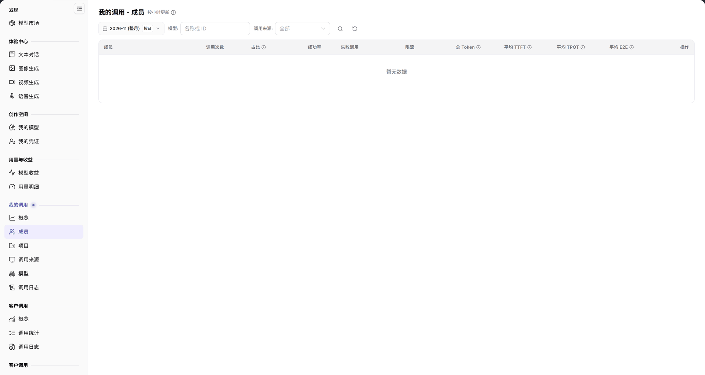

# 成员

::: info 文档信息
版本：v2.0
更新日期：2026-11-04
:::

## 功能概述

| 项目 | 内容 |
| --- | --- |
| 适用角色 | 模型提供方&用户 |
| 导航路径 | **模型及AI服务** > **我的调用** > **成员** |
| 页面路由 | `/modelone/model-observation/eu/members` |
| 管理对象 | 按成员聚合的调用次数、占比、成功率、Token 和延迟 |

**新手理解**：成员页回答“谁在用模型”。先选月份，再按模型或调用来源筛选，最后比较成员的调用量、成功率和延迟。

#### 术语速查

| 术语 | 说明 |
| --- | --- |
| 成员调用 | 明确绑定到具体组织成员或子账号凭证（User Key）发起的大模型 API 请求。 |
| 调用占比 | 单个成员所发起的调用量占当前租户全部可归因成员调用总量的百分比。 |
| Project Key 调用 | 使用项目级共享凭证发起、未绑定具体自然人账号的调用，不计入成员统计。 |
| 平均 TTFT | 成员发起的流式请求从发出到收到首个 Token 的平均耗时（Time to First Token）。 |

## 前提条件

1. 当前账号具备 **我的调用 > 成员** 的查看权限。
2. 当前统计周期内已有可归因到成员的调用。
3. 已确认统计月份和筛选条件。

## 页面说明

页面标题为 `我的调用 - 成员`，右侧标注 `按小时更新`。

| 区域 | 说明 |
| --- | --- |
| 顶部时间与过滤栏 | 提供统计月份、按日颗粒度开关、模型与调用来源筛选框、名称/ID 搜索框 |
| 统计时效标识 | 标明“按小时更新”，提示数据为整点聚合结果 |
| 成员调用统计表格 | 呈现成员名称、调用次数、占比、成功率、失败/限流数、总 Token 与平均 TTFT/TPOT/E2E 延迟 |
| 操作与下钻列 | 支持下钻查看具体成员的调用日志明细 |

- 筛选区包含月份、`按日`、`模型`、`调用来源` 和 `名称或 ID` 搜索框。
- 表格列为 `成员`、`调用次数`、`占比`、`成功率`、`失败调用`、`限流`、`总 Token`、`平均 TTFT`、`平均 TPOT`、`平均 E2E`、`操作`。没有数据时表格显示 `暂无数据`。

图示为筛选项为月份、`按日`、`模型`、`调用来源` 和 `名称或 ID`；表头为 `成员`、`调用次数`、`占比`、`成功率`、`失败调用`、`限流`、`总 Token`、`平均 TTFT`、`平均 TPOT`、`平均 E2E`、`操作`。

## 主要操作

1. 选择统计月份。
2. 使用 `按日` 切换统计粒度。
3. 在 `模型` 和 `调用来源` 中限定范围。
4. 在搜索框输入成员名称或 ID。
5. 对比成员的调用次数、占比、成功率和延迟。

## 参数速查表

| 字段名称 | 是否必填 | 字段类型 | 示例 | 说明 |
| --- | --- | --- | --- | --- |
| 月份 | 是 | 选择项 | `2026-11` | 统计月份 |
| 按日 | 否 | 切换项 | 按日 | 统计粒度 |
| 模型 | 否 | 文本 | `名称或 ID` | 按模型筛选 |
| 调用来源 | 否 | 选择项 | `全部` | 按来源筛选 |
| 成员 | 系统统计 | 文本 | `provider_admin` | 调用成员 |
| 调用次数 | 系统统计 | 数值 | `0` | 成员调用总量 |
| 占比 | 系统统计 | 百分比 | `0%` | 成员调用占总量比例 |
| 成功率 | 系统统计 | 百分比 | `--` | 成功调用占比 |
| 失败调用 | 系统统计 | 数值 | `0` | 失败调用数 |
| 限流 | 系统统计 | 数值 | `0` | 限流调用数 |
| 总 Token | 系统统计 | 数值 | `0` | 成员 Token 总量 |
| 平均 TTFT / TPOT / E2E | 系统统计 | 时长 | `--` | 成员平均延迟指标 |

## 踩坑提示

- 成员排行只统计可归因到成员的调用；`Project Key` 调用不进入成员维度。
- 当前范围没有数据时表格显示 `暂无数据`，不代表成员没有权限。
- 切换 `按日` 会改变聚合粒度，比较前先固定粒度。

## 结果校验

| 检查项 | 成功表现 | 异常时处理 |
| --- | --- | --- |
| 成员列表呈现 | 统计月份内有可归因调用的成员全部罗列在表中，按调用次数降序排列 | 若整表显示 `暂无数据`，核实成员是否使用了个人 User Key 还是共享 Project Key |
| 统计指标准确 | 各成员的调用次数、占比、成功率及总 Token 正确呈现具体数值 | 若成功率偏低，核对失败调用列定位是否存在密钥权限失效或欠费限制 |
| 延迟指标完整 | 表格回显毫秒或秒级的平均 TTFT、TPOT、E2E 耗时数值 | 若显示 `--`，说明该成员调用的模型未开启流式传输或样本过少 |
| 成员搜索定位 | 在搜索框输入成员用户名或子账号 ID，表格精确匹配定位到该成员行 | 清除输入框多余字符重新检索 |
| 操作下钻可用 | 点击操作列详情，跳转至[调用日志](../call-logs/)并自动带入该成员的筛选条件 | 确认当前账号是否有权限查看其他成员的审计明细 |

## 常见问题

#### 成员列表为空

**问题现象：** 切换至当前月份后，成员统计表格显示 `暂无数据`。

**可能原因：** 当前组织成员全部使用统一的项目级凭据（Project Key）或匿名服务进行调用，导致请求未关联具体自然人账号；或者当月暂无模型调用。

**处理方式：**

1. 在[我的调用概览](../overview/)或[项目](../projects/)中核实总调用量是否存在。
2. 引导成员在个人中心创建独立的 User Key 进行身份标识。
3. 清除模型与调用来源筛选后重试。

#### 成员调用量与概览不一致

**问题现象：** 将所有成员行的调用次数相加，总和显著小于概览页的租户总调用量。

**可能原因：** 概览页统计的是全租户所有入口发起的全部请求，包含后台守护服务、自动化流水线及 Project Key 调用，而本页仅聚合已归因到具体成员的调用。

**处理方式：**

1. 概览页作为财务对账与宏观账单口径。
2. 成员页用于内部团队人员绩效评估、用量配额审计与成本分摊分析。

## 注意事项

- 成员名称属于账号信息，不要截图外发。
- 统计数据按小时更新，刚产生的调用可能延迟出现。

## 后续操作

1. 在调用日志中下钻核验特定成员异常高频调用的提示词与错误响应。
2. 切换至项目维度，查看不同业务项目组的算力配额消耗。
3. 结合成员用量排行，在用户中心评估是否需要为高消耗成员配置单人流控上限。

相关页面：
- [我的调用概览](../overview/)
- [调用日志](../call-logs/)
- [按项目统计](../projects/)
- [按模型统计](../models/)
- [按来源统计](../client-sources/)
