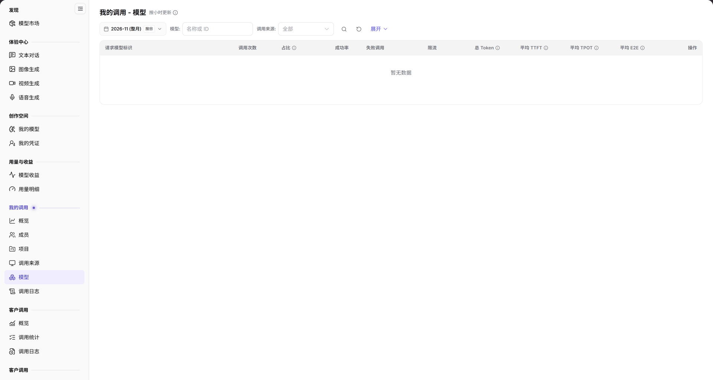

# 模型

::: info 文档信息
版本：v2.0
更新日期：2026-11-04
:::

## 功能概述

| 项目 | 内容 |
| --- | --- |
| 适用角色 | 模型提供方&用户 |
| 导航路径 | **模型及AI服务** > **我的调用** > **模型** |
| 页面路由 | `/modelone/model-observation/eu/models` |
| 管理对象 | 按请求模型标识聚合的调用次数、占比、成功率、Token 和延迟 |

**新手理解**：模型页回答“调用了哪些模型”。先选月份，再按来源筛选，最后比较各模型的调用量、成功率和延迟。

#### 术语速查

| 术语 | 说明 |
| --- | --- |
| 请求模型标识 | 客户端发起 API 调用时在请求体中明确传入的 `model` 字段字符串（如 `openai/gpt-6.1-sol`）。 |
| 调用占比 | 该模型标识在所选统计周期内产生的调用量占当前租户全部模型调用总量的百分比。 |
| 平均 TTFT | 该模型对流式请求的首字吐出耗时（Time to First Token）均值，评估模型的交互响应敏捷度。 |
| 平均 TPOT | 该模型输出生成阶段每个 Token 的平均耗时（Time Per Output Token），评估模型的持续吐字吞吐速率。 |

## 前提条件

1. 当前账号具备 **我的调用 > 模型** 的查看权限。
2. 当前统计周期内已有模型调用数据。
3. 已确认统计月份和筛选条件。

## 页面说明

页面标题为 `我的调用 - 模型`，右侧标注 `按小时更新`。

| 区域 | 说明 |
| --- | --- |
| 顶部时间与过滤栏 | 提供统计月份、按日颗粒度开关、模型/来源下拉过滤、展开按钮与名称/ID 搜索框 |
| 统计时效标识 | 标明“按小时更新”，提示数据为整点聚合结果 |
| 模型维度统计表格 | 呈现请求模型标识、调用次数、占比、成功率、失败/限流数、总 Token 与 TTFT/TPOT/E2E 延迟 |
| 操作与明细下钻 | 提供下钻查看针对该特定模型调用的单次日志明细入口 |

- 筛选区包含月份、`按日`、`模型`、`调用来源`、**展开** 和 `名称或 ID` 搜索框。
- 表格第一列为 `请求模型标识`，其余列为 `调用次数`、`占比`、`成功率`、`失败调用`、`限流`、`总 Token`、`平均 TTFT`、`平均 TPOT`、`平均 E2E`、`操作`。没有数据时显示 `暂无数据`。

图示为筛选项为月份、`按日`、`模型`、`调用来源`、**展开** 和 `名称或 ID`；表头第一列为 `请求模型标识`，其余为 `调用次数`、`占比`、`成功率`、`失败调用`、`限流`、`总 Token`、`平均 TTFT`、`平均 TPOT`、`平均 E2E`、`操作`。

## 主要操作

1. 选择统计月份。
2. 使用 `按日` 切换统计粒度。
3. 在 `模型` 和 `调用来源` 中限定范围，必要时点击 **"展开"**。
4. 在搜索框输入模型名称或 ID。
5. 对比各模型的调用次数、占比、成功率和延迟。

## 参数速查表

| 字段名称 | 是否必填 | 字段类型 | 示例 | 说明 |
| --- | --- | --- | --- | --- |
| 月份 | 是 | 选择项 | `2026-11` | 统计月份 |
| 按日 | 否 | 切换项 | 按日 | 统计粒度 |
| 模型 | 否 | 文本 | `名称或 ID` | 按模型筛选 |
| 调用来源 | 否 | 选择项 | `全部` | 按来源筛选 |
| 请求模型标识 | 系统统计 | 文本 | `openai/gpt-6.1-sol` | 请求中携带的模型标识 |
| 调用次数 | 系统统计 | 数值 | `0` | 模型调用总量 |
| 占比 | 系统统计 | 百分比 | `0%` | 模型调用占总量比例 |
| 成功率 | 系统统计 | 百分比 | `--` | 成功调用占比 |
| 失败调用 / 限流 | 系统统计 | 数值 | `0` | 失败与限流调用数 |
| 总 Token | 系统统计 | 数值 | `0` | 模型 Token 总量 |
| 平均 TTFT / TPOT / E2E | 系统统计 | 时长 | `--` | 模型平均延迟指标 |

## 踩坑提示

- `请求模型标识` 是调用请求中的标识，可能与应用侧展示名称不同。
- 同一模型可能以多个标识被调用，本页会按标识分别统计。
- 当前范围没有数据时显示 `暂无数据`，不代表模型不可用。

## 结果校验

| 检查项 | 成功表现 | 异常时处理 |
| --- | --- | --- |
| 模型行汇总完整 | 统计周期内所有被实际调用过的模型标识全部呈现在表格中，按调用量降序排列 | 若显示 `暂无数据`，核实所选月份是否已产生模型调用，并清除其他筛选项 |
| 关键指标准确 | 调用次数大于 0 时，对应模型的调用占比、成功率及总 Token 正确呈现具体数值 | 若成功率为 `--` 或偏低，检查失败调用与限流列分析是否为端点异常 |
| 延迟时序回显 | 平均 TTFT、TPOT、E2E 完整显示毫秒或秒级数值，支持性能横向对比 | 若部分字段显示 `--`，说明该模型暂无流式传输调用或样本量不足 |
| 模型快速搜索 | 输入模型标识关键字或厂商前缀，表格即时过滤定位目标模型行 | 确认输入的模型字符串与实际请求中的 `model` 字段保持一致 |
| 日志下钻关联 | 点击操作列中的详情按钮，跳转至[调用日志](../call-logs/)并自动带入该模型筛选条件 | 若跳转后日志为空，核对该模型调用的保留周期与当前时间范围 |

## 常见问题

#### 模型列表为空

**问题现象：** 切换至当前月份后，模型统计表格显示 `暂无数据`。

**可能原因：** 所选统计月份尚未产生任何模型调用流量；或者在筛选栏中输入了不存在的模型标识导致无匹配结果。

**处理方式：**

1. 切换至有实际业务流量调用的月份。
2. 清空模型和调用来源筛选框，重置搜索输入。
3. 进入[我的调用概览](../overview/)核验该统计周期的总调用次数基数。

#### 请求标识与应用名称不一致

**问题现象：** 业务客户端配置的模型显示名称与表格中呈现的 `请求模型标识` 不一致。

**可能原因：** 业务应用对模型做了别名映射或聚合封装，而统计报表只按实际经过平台网关的底层模型路由标识或端点标识统计。

**处理方式：**

1. 检查客户端 SDK 或 API 请求报文，以 HTTP Body 中实际传输的 `model` 字段值为准。
2. 前往[模型市场](../../discover/models/)查看该模型的规范别名与路由映射关系。

## 注意事项

- 模型标识可能包含内部路由信息，不要截图外发。
- 统计数据按小时更新，刚产生的调用可能延迟出现。

## 后续操作

1. 在调用日志中下钻检索该特定模型调用失败或高延迟的异常记录。
2. 切换至按调用来源或按项目统计页面，了解各业务方对该模型的消耗占比。
3. 前往模型市场横向比对其他同类型模型的单价与性能指标，优化选型。

相关页面：
- [我的调用概览](../overview/)
- [调用日志](../call-logs/)
- [按来源统计](../client-sources/)
- [按项目统计](../projects/)
- [模型市场](../../discover/models/)
