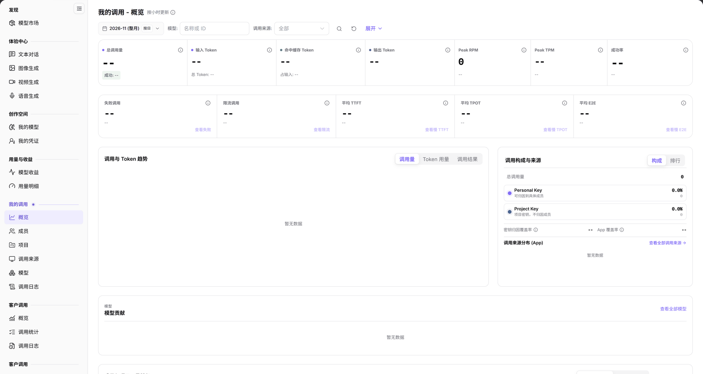

# 概览

> 本页面在系统左侧菜单中显示为【概览】，页面标题为【我的调用 - 概览】。

## 1. 功能概述

| 项目 | 内容 |
| --- | --- |
| 适用角色 | 模型提供方&用户 |
| 导航路径 | **模型及AI服务** > **我的调用** > **概览** |
| 页面路由 | `/modelone/model-observation/eu/overview` |
| 管理对象 | 自身调用量、Token 消耗、成功率、延迟、调用构成和成员/项目排行 |

**新手理解**：我的调用概览是调用方的总仪表盘。先选统计月份和筛选条件，再看调用量、Token、成功率和延迟，最后用趋势与排行判断调用集中在哪里。

## 2. 前提条件

1. 当前账号具备 **我的调用 > 概览** 的查看权限。
2. 当前统计周期内已有调用数据；没有数据时指标显示 `--` 或 `0`。
3. 已确认统计月份、模型和调用来源筛选条件。

## 3. 页面说明

页面标题为 `我的调用 - 概览`，右侧标注 `按小时更新`。页面自上而下分为筛选区、指标卡、趋势区和构成/排行区：

- 筛选区：月份 `2026-11 (整月)`、`按日`、`模型`（`名称或 ID`）、`调用来源`（`全部`）和 **展开**。
- 指标卡：`总调用量`、`输入 Token`、`命中缓存 Token`、`输出 Token`、`Peak RPM`、`Peak TPM`、`成功率`、`失败调用`、`限流调用`、`平均 TTFT`、`平均 TPOT`、`平均 E2E`。
- 趋势区：`调用与 Token 趋势`，可切换 `调用量`、`Token 用量`、`调用结果`。
- 构成区：`调用构成与来源`，可切换 `构成`、`排行`；显示 `Personal Key`、`Project Key`、`密钥归因覆盖率`、`App 覆盖率` 和 `调用来源分布 (App)`。
- 模型区：`模型贡献`，提供 **查看全部模型**。
- 排行区：`成员与项目用量排行`，可切换 `成员 Top 10`、`项目 Top 10`。

**图注**：筛选区包含月份、`按日`、`模型`、`调用来源` 和 **展开**；指标卡显示 `总调用量`、`输入 Token`、`命中缓存 Token`、`输出 Token`、`Peak RPM`、`Peak TPM`、`成功率`、`失败调用`、`限流调用`、`平均 TTFT`、`平均 TPOT`、`平均 E2E`；下方为 `调用与 Token 趋势` 和 `调用构成与来源`。

## 4. 主要操作

### 4.1 设置统计范围

1. 选择统计月份，例如 `2026-11 (整月)`。
2. 使用 `按日` 切换统计粒度。
3. 在 `模型` 中输入 `名称或 ID`，在 `调用来源` 中选择 `全部` 或目标来源。
4. 点击 **展开** 查看扩展筛选条件。

### 4.2 读取指标

1. 查看 `总调用量` 及其下方的成功数。
2. 查看 `输入 Token`、`命中缓存 Token`、`输出 Token` 和 `Peak RPM`、`Peak TPM`。
3. 查看 `成功率`、`失败调用`、`限流调用`。
4. 查看 `平均 TTFT`、`平均 TPOT`、`平均 E2E`。

### 4.3 定位异常与来源

1. 点击 `失败调用` 下的 **查看失败**、`限流调用` 下的 **查看限流** 查看对应记录。
2. 点击 **查看慢 TTFT**、**查看慢 TPOT**、**查看慢 E2E** 查看慢调用。
3. 在 `调用构成与来源` 中查看 `Personal Key` 与 `Project Key` 的调用占比。
4. 点击 **查看全部调用来源**、**查看全部模型**、**查看全部成员** 进入对应明细页。

## 5. 参数速查表

| 字段名称 | 是否必填 | 字段类型 | 示例 | 说明 |
| --- | --- | --- | --- | --- |
| 月份 | 是 | 选择项 | `2026-11 (整月)` | 统计月份 |
| 按日 | 否 | 切换项 | 按日 | 统计粒度 |
| 模型 | 否 | 文本 | `名称或 ID` | 按模型筛选 |
| 调用来源 | 否 | 选择项 | `全部` | 按调用来源筛选 |
| 总调用量 | 系统统计 | 数值 | `--` | 当前范围内调用总量 |
| 输入 Token | 系统统计 | 数值 | `--` | 输入 Token 总量 |
| 命中缓存 Token | 系统统计 | 数值 | `--` | 命中缓存的 Token 数及占输入比例 |
| 输出 Token | 系统统计 | 数值 | `--` | 输出 Token 总量 |
| Peak RPM | 系统统计 | 数值 | `0` | 分钟峰值请求数 |
| Peak TPM | 系统统计 | 数值 | `--` | 分钟峰值 Token 数 |
| 成功率 | 系统统计 | 百分比 | `--` | 成功调用占比 |
| 失败调用 | 系统统计 | 数值 | `--` | 失败调用数及占比 |
| 限流调用 | 系统统计 | 数值 | `--` | 限流调用数及占比 |
| 平均 TTFT | 系统统计 | 时长 | `--` | 平均首 Token 延迟 |
| 平均 TPOT | 系统统计 | 时长 | `--` | 平均每 Token 输出时间 |
| 平均 E2E | 系统统计 | 时长 | `--` | 平均端到端耗时 |
| Personal Key | 系统统计 | 占比 | `0.0%` | 可归因到具体成员的调用 |
| Project Key | 系统统计 | 占比 | `0.0%` | 项目密钥，不归因成员 |
| 密钥归因覆盖率 | 系统统计 | 百分比 | `--` | 密钥可归因比例 |
| App 覆盖率 | 系统统计 | 百分比 | `--` | 调用来源覆盖比例 |

## 6. 踩坑提示

- `按小时更新` 表示页面数据按小时刷新，刚产生的调用可能还未进入当前统计。
- `Personal Key` 可归因到具体成员，`Project Key` 不归因成员；成员排行只统计可归因部分。
- 筛选条件过窄时，`成员与项目用量排行` 会显示 `当前筛选条件下暂无排行数据`。
- 指标显示 `--` 表示当前范围内没有可计算的数据，不等同于调用失败。

## 7. 结果校验

| 核对项 | 界面上可直接看到 |
| --- | --- |
| 筛选生效 | 指标卡和图表随月份、模型、调用来源变化 |
| 趋势可切换 | `调用量`、`Token 用量`、`调用结果` 可切换 |
| 构成可切换 | `构成`、`排行` 可切换 |
| 排行可切换 | `成员 Top 10`、`项目 Top 10` 可切换 |
| 下钻入口 | `查看失败`、`查看限流`、`查看慢 TTFT`、`查看慢 TPOT`、`查看慢 E2E` 可见 |

## 8. 常见问题

#### 指标全部显示 `--`

**现象**：总调用量、Token 和延迟指标均为 `--`。

**处理方式**：确认当前月份和筛选范围内是否有调用；刚产生的调用等待下一次按小时刷新。

#### 排行区域为空

**现象**：成员或项目排行显示 `当前筛选条件下暂无排行数据`。

**处理方式**：扩大统计周期或清除模型、调用来源筛选后重试。

## 9. 注意事项

- 页面展示的是当前账号范围内的调用数据，不等同于全平台调用统计。
- 调用量、Token 和延迟指标会随筛选条件变化，比较前先固定口径。
- 不要截图或外发包含成员姓名、项目名称和调用明细的页面。

## 10. 后续操作

- 在[成员](../members/)中按成员查看调用。
- 在[项目](../projects/)中按项目查看调用。
- 在[调用来源](../client-sources/)中查看来源分布。
- 在[调用日志](../call-logs/)中查看单次调用详情。
