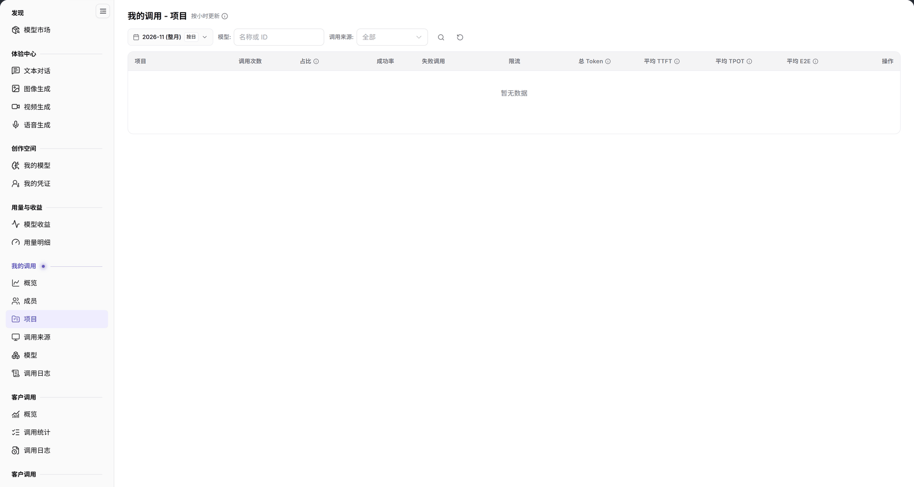

# 我的调用 - 项目

> 本页面在系统左侧菜单中显示为【项目】。

> 统计口径：顶部月份选择器决定统计范围；`按日` 切换按天聚合粒度，日期范围以选择器当前显示的起止日期为准。

## 1. 功能概述

| 项目 | 内容 |
| --- | --- |
| 适用角色 | 模型提供方&用户 |
| 导航路径 | **模型及AI服务** > **我的调用** > **项目** |
| 页面路由 | `/modelone/model-observation/eu/projects` |
| 管理对象 | 按项目聚合的调用次数、占比、成功率、Token 和延迟 |

**新手理解**：项目页回答“哪个项目在调用模型”。先选月份和模型，再比较各项目的调用量、成功率和 Token 消耗。

## 2. 前提条件

1. 当前账号具备 **我的调用 > 项目** 的查看权限。
2. 当前统计周期内已有项目维度的调用。
3. 已确认统计月份和筛选条件。

## 3. 页面说明

页面标题为 `我的调用 - 项目`，右侧标注 `按小时更新`。筛选区包含月份、`按日`、`模型`、`调用来源` 和 `名称或 ID` 搜索框。

表格列为 `项目`、`调用次数`、`占比`、`成功率`、`失败调用`、`限流`、`总 Token`、`平均 TTFT`、`平均 TPOT`、`平均 E2E`、`操作`。没有数据时显示 `暂无数据`。

**图注**：筛选项为月份、`按日`、`模型`、`调用来源` 和 `名称或 ID`；表头为 `项目`、`调用次数`、`占比`、`成功率`、`失败调用`、`限流`、`总 Token`、`平均 TTFT`、`平均 TPOT`、`平均 E2E`、`操作`。

## 4. 主要操作

1. 选择统计月份。
2. 使用 `按日` 切换统计粒度。
3. 在 `模型` 和 `调用来源` 中限定范围。
4. 在搜索框输入项目名称或 ID。
5. 对比项目的调用次数、占比、成功率和延迟。

## 5. 参数速查表

| 字段名称 | 是否必填 | 字段类型 | 示例 | 说明 |
| --- | --- | --- | --- | --- |
| 月份 | 是 | 选择项 | `2026-11` | 统计月份 |
| 按日 | 否 | 切换项 | 按日 | 统计粒度 |
| 模型 | 否 | 文本 | `名称或 ID` | 按模型筛选 |
| 调用来源 | 否 | 选择项 | `全部` | 按来源筛选 |
| 项目 | 系统统计 | 文本 | `Project A` | 调用所属项目 |
| 调用次数 | 系统统计 | 数值 | `0` | 项目调用总量 |
| 占比 | 系统统计 | 百分比 | `0%` | 项目调用占总量比例 |
| 成功率 | 系统统计 | 百分比 | `--` | 成功调用占比 |
| 失败调用 / 限流 | 系统统计 | 数值 | `0` | 失败与限流调用数 |
| 总 Token | 系统统计 | 数值 | `0` | 项目 Token 总量 |
| 平均 TTFT / TPOT / E2E | 系统统计 | 时长 | `--` | 项目平均延迟指标 |

## 6. 踩坑提示

- 项目维度只统计带项目归属的调用；未归属项目的调用不会出现在本页。
- 当前范围没有数据时显示 `暂无数据`，不代表项目不存在。
- 切换 `按日` 会改变聚合粒度，比较前先固定粒度。

## 7. 结果校验

| 核对项 | 界面上可直接看到 |
| --- | --- |
| 筛选生效 | 表格行随月份、模型、来源变化 |
| 统计完整 | 每行显示调用次数、占比、成功率和 Token |
| 延迟指标 | 显示平均 TTFT、TPOT、E2E |
| 空状态 | 无数据时显示 `暂无数据` |

## 8. 常见问题

#### 项目列表为空

**现象**：表格显示 `暂无数据`。

**处理方式**：确认当前月份有项目维度调用，并清除模型和来源筛选后重试。

#### 找不到某个项目

**现象**：搜索后没有目标项目。

**处理方式**：确认项目名称或 ID 输入正确，并检查项目是否在当前统计范围内产生调用。

## 9. 注意事项

- 项目名称和成员信息属于账号数据，不要截图外发。
- 统计数据按小时更新，刚产生的调用可能延迟出现。

## 10. 后续操作

- 在[成员](../members/)中按成员查看调用。
- 在[调用来源](../client-sources/)中查看来源分布。
- 在[调用日志](../call-logs/)中查看单次调用记录。
