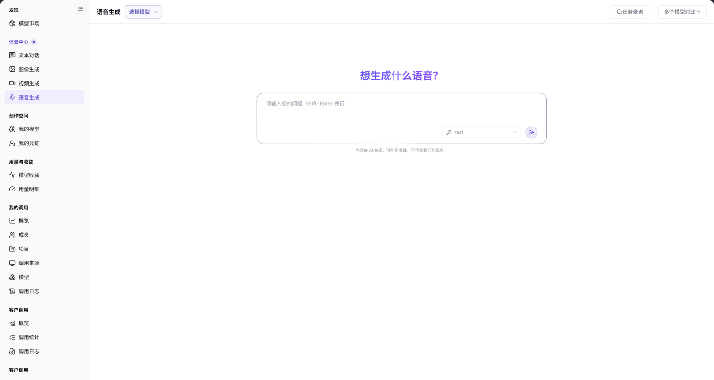

# 语音生成

::: info 文档信息
版本：v2.0
更新日期：2026-11-04
:::

## 功能概述

| 项目 | 内容 |
| --- | --- |
| 适用角色 | 模型提供方&用户 |
| 导航路径 | **模型及AI服务** > **体验中心** > **语音生成** |
| 页面路由 | `/modelone/exploration/audio` |
| 管理对象 | 语音模型、输入文本、生成任务 |

**新手理解**：语音生成把文字转换成语音。先选语音模型，再输入要朗读的内容；生成按任务执行，可在 **任务查询** 中回看。

#### 术语速查

| 术语 | 说明 |
| --- | --- |
| 文本转语音（TTS） | 将输入纯文本合成逼真人类自然语音的有声合成技术（Text-to-Speech / Speech Synthesis）。 |
| 任务查询 | 异步音频渲染队列看板，记录语音合成任务 ID、音频时长、状态及在线试听/下载链接。 |
| 音色与语速 | 模型支持的声音特征预设（如男声、女声、新闻播音、情感有声书）及播放速率调整。 |
| 字符计费 | 语音模型通常基于输入有效字符数或合成音频秒数计价，与通用大语言模型的 Token 计费不同。 |

## 前提条件

1. 当前账号可以打开 **体验中心 > 语音生成**。
2. 账户有可用额度或对应模型的免费额度。
3. 已确认目标语音模型的输入限制和计费单位。

## 页面说明

页面分为模型区、操作区和输入区：

| 区域 | 说明 |
| --- | --- |
| 顶部模型与操作栏 | 提供选择模型下拉项、任务查询入口与多个模型对比按钮 |
| 中央文案输入控制台 | 多行输入框接收待朗读文字，支持 Shift+Enter 换行与实时字数统计 |
| 音频试听与结果区 | 异步渲染音频播放器控件（含波形/播放/暂停/倍速），支持导出 WAV/MP3 文件 |
| 底部免责声明区 | 呈现 AI 合成内容合规提示与防诈/反合成声明 |

- 模型区：**选择模型** 打开模型列表。
- 操作区：**任务查询** 查看历史生成任务，**多个模型对比** 打开对比配置。
- 输入区：多行输入框，提示 `请输入您的问题, Shift+Enter 换行`；标题为 `想生成什么语音？`。

图示为页面顶部提供 **选择模型**、**任务查询**、**多个模型对比**；输入框提示 `请输入您的问题, Shift+Enter 换行`，下方显示 `内容由 AI 生成，可能不准确，不代表我们的观点。`。

## 主要操作

### 选择语音模型

1. 点击 **"选择模型"**。
2. 在模型列表中选择目标语音模型，核对供应方。

### 生成语音

1. 在输入框填写需要朗读的文本。
2. 使用 `Shift+Enter` 换行，确认后提交。
3. 在结果区查看生成音频。

### 查询任务

1. 点击 **"任务查询"**。
2. 在任务列表中定位当前或历史生成任务。

### 对比多个模型

1. 点击 **"多个模型对比"**。
2. 选择参与对比的语音模型，使用同一文本分别生成。

## 参数速查表

| 字段名称 | 是否必填 | 字段类型 | 示例 | 说明 |
| --- | --- | --- | --- | --- |
| 模型 | 是 | 选择项 | `Mock MiniMax Speech T2A` | 当前语音生成模型 |
| 文本内容 | 是 | 多行文本 | `欢迎使用 AGIOne` | 需要转换为语音的文字 |
| 任务查询 | 否 | 按钮 | — | 查看历史生成任务 |
| 多个模型对比 | 否 | 按钮 | — | 打开多模型对比 |

## 踩坑提示

- 不同语音模型支持的文本长度和音色不同，长文本先分段测试。
- 语音模型可能按字符、秒或请求计费，提交前确认计价单位。
- 生成结果受模型能力影响，重要播报内容需人工试听。

## 结果校验

| 检查项 | 成功表现 | 异常时处理 |
| --- | --- | --- |
| 语音模型选中 | 顶部模型区准确回显模型名称（如 `Mock MiniMax Speech T2A`）与提供方信息 | 若列表无可选模型，前往[模型市场](../../discover/models/)核对是否已开通对应语音生成模型 |
| 文本提交合规 | 点击提交后页面提示“任务已创建”，输入框保持可用且生成任务进入后台渲染 | 若提示字符超限，将长篇文稿按标点符号分段切分后多次提交 |
| 播放器与试听正常 | 结果区渲染出音频播放控件，点击播放可清晰试听合成语音且无卡顿或电音杂音 | 若合成失败，打开**任务查询**查看详细报错信息（如内容审核未通过） |
| 任务列表回溯 | 点击 **"任务查询"** 成功加载历史语音任务清单，包含音频时长与创建时间 | 检查所选租户环境与查询时间范围是否正确 |
| 多模型对比试听 | 打开 **"多个模型对比"** 后，多路模型分别合成音频并并列展示播放器进行音质比对 | 确认对比模型是否均配置了对应的语音合成算力资源 |

## 常见问题

#### 没有可选的语音模型

**问题现象：** 点击 **"选择模型"** 后弹出的列表为空，或找不到目标语音模型。

**可能原因：** 当前租户未被授予该语音模型的可见或调用权限；该模型尚未通过平台运营审核；或者当前平台暂无在线的语音推理节点。

**处理方式：**

1. 进入[模型市场](../../discover/models/)，筛选“语音”模态确认模型是否存在并上架。
2. 确认当前账号是否具备对应的访问权限或项目配额。
3. 联系运营管理员或服务商核验该模型的发布状态。

#### 生成失败

**问题现象：** 提交文字后结果区提示任务生成失败或状态异常终止。

**可能原因：** 输入文本单次长度突破模型最大字符限制；文本中包含敏感词触发了内容安全过滤规则；或者账户额度不足导致扣费失败。

**处理方式：**

1. 检查输入文本字符数，建议控制在 500 字符以内分批次合成。
2. 检查文本内容是否包含涉政、违规或敏感违禁词汇。
3. 打开**任务查询**核实失败原因，并在账户中心确认可用额度充裕。

## 注意事项

- 不要输入他人隐私或未授权的文本内容。
- 语音生成按模型计费，批量转换前确认额度。
- 生成音频商用前需自行确认版权与合规要求。

## 后续操作

1. 在调用日志与用量明细中核验语音生成按字数或秒数扣除的计费流水。
2. 试听满意后，前往模型详情页复制 Quick Start API 代码集成到智能客服或播报应用。
3. 前往文本对话或图像生成中心体验其他多模态 AI 能力。

相关页面：
- [模型市场](../../discover/models/)
- [文本对话](../text/)
- [图像生成](../images/)
- [视频生成](../video/)
- [用量明细](../../usage-earnings/model-usage/)
- [我的调用概览](../../my-calls/overview/)
