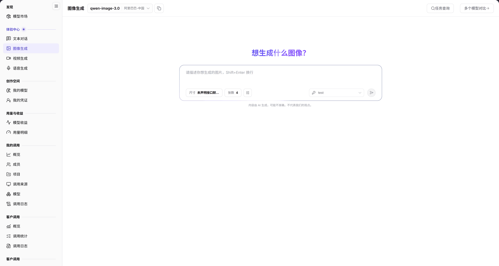

# 图像生成

::: info 文档信息
版本：v2.0
更新日期：2026-11-04
:::

## 功能概述

| 项目 | 内容 |
| --- | --- |
| 适用角色 | 模型提供方&用户 |
| 导航路径 | **模型及AI服务** > **体验中心** > **图像生成** |
| 页面路由 | `/modelone/exploration/image` |
| 管理对象 | 图像模型、尺寸、生成张数和生成任务 |

**新手理解**：图像生成把文字描述转换成图片。先选图像模型，再设置尺寸和张数，输入描述后提交；结果按任务生成，可在 **任务查询** 中回看。

#### 术语速查

| 术语 | 说明 |
| --- | --- |
| 文生图（Text-to-Image） | 依据自然语言 Prompt 描述，由图像扩散或自回归生成模型生成对应静态画面的 AI 技术。 |
| 任务查询 | 异步任务状态看板，可回溯图像生成任务的进度、成功状态与产出图片 URL。 |
| 图像尺寸（Resolution） | 生成图片的分辨率宽高规格（如 1024x1024、768x1024 等），受模型权重与算力显存约束。 |
| 生成张数（Batch Size） | 单次请求触发模型并行或串行产出的图像样本总数，消耗额度与张数线性成正比。 |

## 前提条件

1. 当前账号可以打开 **体验中心 > 图像生成**。
2. 账户有可用额度或对应模型的免费额度。
3. 已确认目标图像模型的计费单位和张数限制。

## 页面说明

页面分为模型区、参数区和输入区：

| 区域 | 说明 |
| --- | --- |
| 顶部模型与操作栏 | 展示当前选中的图像模型名称、供应方全称，提供任务查询、多个模型对比入口 |
| 参数配置面板 | 提供图片生成尺寸选择下拉项与单次生成张数调节输入框 |
| 底部提示词输入区 | 多行文本框接收画面主体/风格/细节描述，支持 Shift+Enter 换行与提交生成 |
| 结果与画布展示区 | 异步加载并网格平铺呈现生成的图像预览卡片，支持放大查阅与下载 |

- 模型区：当前模型 `qwen-image-3.0`、供应方 `阿里巴巴-中国`；右侧提供 **任务查询** 和 **多个模型对比**。
- 参数区：`尺寸`（当前显示 `未声明接口默认值`）和 `张数`（当前为 `4`）。
- 输入区：多行输入框，提示 `请描述你想生成的图片，Shift+Enter 换行`。
- 重置入口：**全部重置** 恢复模型与参数默认值。

图示为当前模型为 `qwen-image-3.0`、供应方为 `阿里巴巴-中国`；参数区显示 `尺寸` 与 `张数 4`，顶部提供 **任务查询** 和 **多个模型对比**。

## 主要操作

### 选择图像模型

1. 点击模型区，选择目标图像模型。
2. 核对供应方和当前模型状态。

### 设置生成参数

1. 打开 `尺寸` 下拉，选择接口支持的尺寸；保持 `未声明接口默认值` 时由模型决定。
2. 在 `张数` 中设置本次生成数量。

### 提交生成

1. 在输入框填写图片描述。
2. 使用 `Shift+Enter` 换行，确认描述后提交。
3. 在结果区域查看生成图片。

### 查询历史任务

1. 点击 **"任务查询"**。
2. 在任务列表中定位历史生成记录。

### 对比多个模型

1. 点击 **"多个模型对比"**。
2. 选择参与对比的图像模型，使用同一描述分别生成。

## 参数速查表

| 字段名称 | 是否必填 | 字段类型 | 示例 | 说明 |
| --- | --- | --- | --- | --- |
| 模型 | 是 | 选择项 | `qwen-image-3.0` | 当前图像生成模型 |
| 供应方 | 系统生成 | 文本 | `阿里巴巴-中国` | 当前模型的提供方 |
| 尺寸 | 否 | 下拉 | `未声明接口默认值` | 生成图片尺寸；默认由接口决定 |
| 张数 | 是 | 数字 | `4` | 单次生成图片数量 |
| 图片描述 | 是 | 多行文本 | `一只橘猫坐在窗台上` | 生成图片的提示词 |

## 踩坑提示

- `尺寸` 显示 `未声明接口默认值` 时，实际尺寸由模型接口决定，不同模型结果可能不同。
- 张数增加会成倍增加生成时间和计费，提交前核对数量。
- 图像模型按张或按次计费，与文本模型的 Token 计价不同。

## 结果校验

| 检查项 | 成功表现 | 异常时处理 |
| --- | --- | --- |
| 模型选定成功 | 顶部正确展示图像模型标识（如 `qwen-image-3.0`）与供应方信息 | 若下拉框为空，前往[模型市场](../../discover/models/)核对是否已授权对应生图模型 |
| 参数调整生效 | 切换尺寸或变更张数后，配置面板实时显示最新设定数值 | 若超出模型支持的尺寸范围，系统将自动回退至默认推荐规格 |
| 任务提交与生成 | 点击提交后进入任务渲染队列，并在结果区正常输出高清图片预览 | 若提示超时或扣费失败，检查账户剩余额度并在**任务查询**中定位任务错误码 |
| 任务查询与回溯 | 点击 **"任务查询"** 成功打开侧边或弹窗列表，包含历史生成的图片与耗时 | 若列表为空，核实上方检索的时间范围与筛选状态 |
| 模型对比并行呈现 | 打开 **"多个模型对比"** 后，多款图像模型针对同一 Prompt 并排输出生成图像 | 检查参与对比的各模型是否已分别分配可用算力配额 |

## 常见问题

#### 生成结果与描述差异较大

**问题现象：** 模型生成的图片与提示词描述的主题、风格或细节偏差严重。

**可能原因：** 提示词过于抽象或中英文语义理解偏差；模型基础权重更偏向某种特定艺术风格；关键负向提示词缺失。

**处理方式：**

1. 丰富提示词结构，明确补充画面主体、艺术风格（如写实、插画、赛博朋克）、光影与视角。
2. 保持提示词不变，切换至其他主流生图模型横向比对生成效果。
3. 调整画面分辨率以适配画面主体构图（如竖版人物、横版风景）。

#### 找不到历史任务

**问题现象：** 点击 **"任务查询"** 后未能找到刚刚提交生成的图片任务。

**可能原因：** 任务仍处于后台 GPU 调度排队中尚未落库；页面筛选条件锁定了特定的历史时间区间或模型标识。

**处理方式：**

1. 稍等数秒后点击任务列表右上角刷新按钮。
2. 清空模型过滤条件，将时间跨度调整为“今天”或“最近 1 小时”。
3. 检查是否有因风控拦截或敏感词过滤而导致的任务静默终止。

## 注意事项

- 不要生成侵权、违法或涉及他人隐私的内容。
- 生成结果按模型计费，批量生成前确认额度。
- 模型输出仅供参考，商用前需自行确认版权与合规要求。

## 后续操作

1. 在调用日志与用量明细中核验生图产生的调用次数与单价扣费记录。
2. 将满意的提示词与参数配置记录至生产环境，或复制快速开始接入客户端。
3. 前往文本对话或视频生成体验中心尝试多模态串联。

相关页面：
- [模型市场](../../discover/models/)
- [文本对话](../text/)
- [视频生成](../video/)
- [用量明细](../../usage-earnings/model-usage/)
- [我的调用概览](../../my-calls/overview/)
