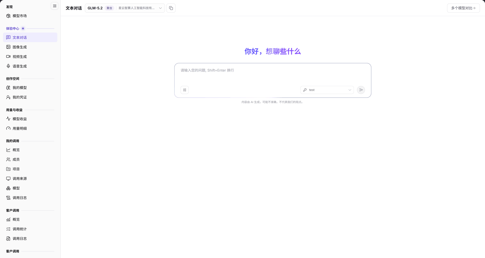

# 文本对话

## 功能概述

| 项目 | 内容 |
| --- | --- |
| 适用角色 | 模型提供方&用户 |
| 导航路径 | **模型及AI服务** > **体验中心** > **文本对话** |
| 页面路由 | `/modelone/exploration/chat` |
| 管理对象 | 当前选择的多模态或聚合模型、会话输入和对比结果 |

**新手理解**：文本对话是模型市场的在线试用入口。选好模型后直接提问，页面返回模型响应；需要比较时可以打开 **多个模型对比**。

#### 术语速查

| 术语 | 说明 |
| --- | --- |
| 文本对话 | 平台提供的可视化对话调试界面，模拟客户端向大语言模型发送 Prompt 并实时流式接收回复。 |
| 聚合模型 | 由平台路由层动态调度至多个不同基础设施后端或提供方的虚拟模型，提升高并发下的可用性与吞吐量。 |
| 模型对比 | 支持同屏并行向 2 个或多个不同大模型发送完全相同的 Prompt，直观比对输出质量、延迟与回答偏好。 |
| 上下文限制 | 模型单次对话能承载的最大输入（Prompt）与输出（Completion）Token 长度上限。 |

## 前提条件

1. 当前账号可以打开 **体验中心 > 文本对话**。
2. 账户有可用额度或对应模型的免费额度。
3. 已明确目标模型、上下文限制和计费方式。

## 页面说明

页面自上而下分为模型选择区、欢迎区和输入区：

| 区域 | 说明 |
| --- | --- |
| 顶部模型与配置栏 | 展示当前选定模型名称、供应方归属、能力标签，提供模型切换下拉框与多模型对比入口 |
| 中央对话交互区 | 呈现会话欢迎提示、历史问答气泡流，支持流式渲染文本与 Markdown 格式 |
| 底部输入控制台 | 多行文本输入框、Shift+Enter 换行提示、发送按钮与全部重置操作项 |
| 底部免责声明区 | 标明 AI 生成内容局限性提示，提示使用者人工核验关键输出结果 |

- 模型选择区：显示当前模型名称、标签和供应方，例如 `GLM-5.2`、`聚合`、`星云智算人工智能科技有限公司`；右侧提供 **多个模型对比**。
- 欢迎区：首次进入显示 `你好，想聊些什么`。
- 输入区：多行输入框，提示 `请输入您的问题, Shift+Enter 换行`；底部显示免责声明 `内容由 AI 生成，可能不准确，不代表我们的观点。`。
- 重置入口：**全部重置** 用于清空当前会话配置。

图示为当前模型显示为 `GLM-5.2`，标签为 `聚合`；输入框提示 `请输入您的问题, Shift+Enter 换行`，右侧提供 **多个模型对比**。

## 主要操作

### 选择模型

1. 点击模型选择区，打开模型选择列表。
2. 选择目标模型或聚合模型，核对标签和供应方。

### 发起对话

1. 在输入框填写问题。
2. 按 `Shift+Enter` 换行，或直接提交。
3. 在返回区域查看模型响应。

### 对比多个模型

1. 点击 **"多个模型对比"**。
2. 选择参与对比的模型。
3. 使用同一输入分别提交，比较响应结果。

### 重置会话

1. 点击 **"全部重置"**。
2. 确认模型选择和输入内容已清空。

## 参数速查表

| 字段名称 | 是否必填 | 字段类型 | 示例 | 说明 |
| --- | --- | --- | --- | --- |
| 模型 | 是 | 选择项 | `GLM-5.2` | 当前对话使用的模型或聚合模型 |
| 模型标签 | 系统生成 | 标签 | `聚合` | 标识模型类型或组合方式 |
| 供应方 | 系统生成 | 文本 | `星云智算人工智能科技有限公司` | 当前模型的提供方 |
| 输入内容 | 是 | 多行文本 | `你好` | 提交给模型的提示词 |
| 多个模型对比 | 否 | 按钮 | 对比入口 | 打开多模型对比配置 |

## 踩坑提示

- 提交前核对模型标签；`聚合` 模型由多个模型路由组成，响应可能来自不同后端。
- `Shift+Enter` 是换行，不是提交；提交前确认输入内容完整。
- 体验调用会产生调用记录和 Token 消耗，长对话会增加计费。

## 结果校验

| 检查项 | 成功表现 | 异常时处理 |
| --- | --- | --- |
| 模型选择生效 | 顶部准确显示目标模型名称、聚合标签及对应供应方全称 | 若下拉列表无目标模型，前往[模型市场](../../discover/models/)确认模型是否已上架并对当前租户开放 |
| 消息正常提交 | 输入内容后按 Enter 或点击发送，输入框内容清空并转为用户问答气泡 | 若提示发送失败，检查网络连接或确认当前账号是否有充足账户额度 |
| 流式响应呈现 | 对话区逐步渲染模型生成的文本内容，打字机光标自然推进直至输出完毕 | 若长达数十秒无响应或输出截断，检查输入是否超出该模型的上下文限制或提供方服务异常 |
| 多模型对比生效 | 启用对比后，页面分栏并行展示多个模型的回复内容，便于横向评估 | 若对比列加载失败，确认选中的各模型是否均处于可用状态 |
| 全部重置清空 | 点击 **"全部重置"** 并确认后，屏幕历史问答流立即清空并恢复至初始欢迎态 | 刷新浏览器页面重新建立纯净会话上下文 |

## 常见问题

#### 输入后没有返回内容

**问题现象：** 提交问题后对话区域空白，长时间停留在等待状态或提示生成失败。

**可能原因：** 当前账号额度已耗尽；后端提供方实例负载过高或临时离线；提示词长度突破单次上下文窗口阈值。

**处理方式：**

1. 检查账户余额与额度状态，确认账户未处于欠费锁定状态。
2. 适当删减提示词长度或清空历史长轮次上下文后再试。
3. 切换至其他可用模型或稍后重试。

#### 找不到目标模型

**问题现象：** 在模型选择下拉列表中搜索不到期望体验的模型。

**可能原因：** 模型尚未通过审核发布；模型设置为指定租户私有，当前账号无可见权限；或者该模型为非对话类模态（如仅支持生图或视频）。

**处理方式：**

1. 打开[模型市场](../../discover/models/)，按模态筛选确认该模型是否支持文本对话。
2. 确认当前租户账号与权限角色分配。
3. 联系运营管理员或模型提供方核实可见性授权。

## 注意事项

- 不要输入密钥、客户隐私或未脱敏的业务数据。
- 体验调用按模型价格计费，长文本和高频调用会快速消耗额度。
- 模型输出仅供参考，重要结论需人工复核。

## 后续操作

1. 在调用日志与统计报表中核验体验产生的 Token 消耗明细与延迟分布。
2. 对比评估满意后，复制快速开始代码接入业务客户端或自建应用。
3. 前往其他模态体验中心探索图像、视频或语音生成能力。

相关页面：
- [模型市场](../../discover/models/)
- [我的调用概览](../../my-calls/overview/)
- [图像生成](../images/)
- [语音生成](../audio/)
- [视频生成](../video/)
