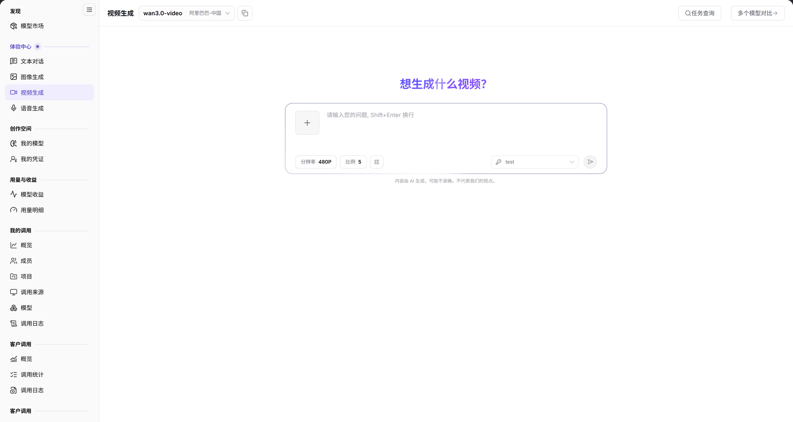

# 视频生成

## 功能概述

| 项目 | 内容 |
| --- | --- |
| 适用角色 | 模型提供方&用户 |
| 导航路径 | **模型及AI服务** > **体验中心** > **视频生成** |
| 页面路由 | `/modelone/exploration/video` |
| 管理对象 | 视频模型、分辨率、画面比例、生成任务 |

**新手理解**：视频生成把文字或图片描述转换成短视频。先选视频模型和分辨率，再输入画面描述；生成通常按任务执行，可在 **任务查询** 中回看进度与结果。

#### 术语速查

| 术语 | 说明 |
| --- | --- |
| 文生视频（Text-to-Video） | 将文本画面脚本或动态描述转化为包含连续时序帧序列的高清视频片段的技术。 |
| 分辨率与比例 | 视频画面的清晰度档位（如 480P、720P、1080P）与宽高构图（如 16:9 横屏、9:16 竖屏短视频）。 |
| 异步任务流 | 视频渲染需要大量 GPU 显存与计算耗时（通常 1–5 分钟），系统采用队列排队与异步任务机制进行生命周期追踪。 |
| 时长计费 | 视频模型通常依据生成的视频帧数、秒数或档位套餐计费，与 Token 计价机制不同。 |

## 前提条件

1. 当前账号可以打开 **体验中心 > 视频生成**。
2. 账户有可用额度或对应模型的免费额度。
3. 已确认视频模型的时长、分辨率和计费单位。

## 页面说明

页面分为模型区、参数区和输入区：

| 区域 | 说明 |
| --- | --- |
| 顶部模型与操作栏 | 展示当前选定的视频模型标识与供应方，提供任务查询入口与全部重置功能 |
| 视频参数配置区 | 提供清晰度分辨率下拉选择（如 480P、720P）与画面比例下拉选项 |
| 提示词脚本输入区 | 多行文本框接收镜头推进、运镜动作、光影氛围与场景细节，支持 Shift+Enter 换行 |
| 任务渲染与视频回放区 | 呈现排队进度环、渲染倒计时与完成后的视频播放卡片，支持全屏预览与 MP4 下载 |

- 模型区：当前模型 `wan3.0-video`、供应方 `阿里巴巴-中国`；右侧提供 **任务查询**。
- 参数区：`分辨率`（当前 `480P`）和 `比例`（当前 `5`）。
- 输入区：多行输入框，提示 `请输入您的问题, Shift+Enter 换行`。
- 重置入口：**全部重置** 恢复模型与参数默认值。

图示为当前模型为 `wan3.0-video`、供应方为 `阿里巴巴-中国`；参数区显示 `分辨率 480P`、`比例 5`，顶部提供 **任务查询**。

## 主要操作

### 选择视频模型

1. 点击模型区，选择目标视频模型。
2. 核对供应方与模型支持的输入类型。

### 设置生成参数

1. 在 `分辨率` 中选择目标清晰度。
2. 在 `比例` 中选择画面比例。

### 提交生成

1. 在输入框填写视频画面描述。
2. 使用 `Shift+Enter` 换行，确认后提交。
3. 在结果区查看生成任务状态。

### 查询任务

1. 点击 **"任务查询"**。
2. 在任务列表中定位当前或历史生成任务。

## 参数速查表

| 字段名称 | 是否必填 | 字段类型 | 示例 | 说明 |
| --- | --- | --- | --- | --- |
| 模型 | 是 | 选择项 | `wan3.0-video` | 当前视频生成模型 |
| 供应方 | 系统生成 | 文本 | `阿里巴巴-中国` | 当前模型的提供方 |
| 分辨率 | 是 | 下拉 | `480P` | 生成视频清晰度 |
| 比例 | 是 | 下拉 | `5` | 画面比例选项 |
| 画面描述 | 是 | 多行文本 | `海边日落，镜头缓慢推进` | 视频生成的提示词 |

## 踩坑提示

- 视频生成耗时通常长于文本和图像，提交后通过 **任务查询** 查看进度。
- 分辨率和比例会影响生成时间与价格，提交前确认参数。
- 视频模型可能只支持特定输入类型（文本或图片），以模型详情中的模态为准。

## 结果校验

| 检查项 | 成功表现 | 异常时处理 |
| --- | --- | --- |
| 视频模型就绪 | 顶部准确显示模型名称（如 `wan3.0-video`）与供应方信息 | 若模型未列出，在[模型市场](../../discover/models/)确认当前租户是否被授权该视频模型 |
| 参数配置有效 | 分辨率与比例下拉项显示具体数值，且输入框允许输入场景脚本 | 若提示参数不支持，核对所选模型是否支持高分辨率档位 |
| 任务创建成功 | 提交后弹出任务创建成功 Toast，结果区显示进度卡片并在**任务查询**中留痕 | 若提示余额不足或提交超时，核对账户余额并在任务查询中查看拦截原因 |
| 异步进度可查 | 点击 **"任务查询"** 成功加载当前任务渲染百分比或排队位次 | 任务排队可能需要 1–3 分钟，保持页面或通过任务查询回溯无需重复提交 |
| 视频播放与导出 | 任务完成后结果区内嵌视频播放器，可流畅播放生成的视频并支持下载 MP4 | 若播放黑屏或编码错误，检查本地浏览器解码器或点击下载后本地播放 |

## 常见问题

#### 任务长时间没有结果

**问题现象：** 提交画面脚本后，页面长时间停留在排队或处理状态，结果区未出现视频。

**可能原因：** 视频生成属计算密集型任务，当前算力集群排队任务量大；或者复杂运镜生成超时触发了重试。

**处理方式：**

1. 打开 **任务查询** 查看当前任务的确切进度百分比与排队状态。
2. 保持会话等待渲染完成，无需重复点击提交以免造成重复扣费。
3. 若任务状态显示为 Failed，查看具体错误码并适当降低分辨率重试。

#### 模型不支持当前输入

**问题现象：** 提交提示词后提示参数不合法、格式不兼容或生成拦截。

**可能原因：** 所选模型仅支持图生视频（Image-to-Video）而暂不支持纯文本提示词；或者提示词触发了平台敏感词与合规审核红线。

**处理方式：**

1. 前往[模型市场](../../discover/models/)查看该视频模型的详细规格与输入模态定义。
2. 检查提示词是否存在涉政、涉暴或违规表述并调整文案。
3. 更换为通用的纯文本驱动视频模型再进行尝试。

## 注意事项

- 不要生成侵权、违法或涉及他人隐私的视频内容。
- 视频生成按时长、分辨率或秒数计费，批量生成前确认额度。
- 生成结果商用前需自行确认版权与合规要求。

## 后续操作

1. 在调用日志与用量明细中核验视频生成的秒数扣费与算力账单。
2. 下载满意的生成视频用于演示汇报，或提取参数配置接入服务端 API。
3. 探索图像生成中心，结合文生图模型尝试“先图后视频”的连贯工作流。

相关页面：
- [模型市场](../../discover/models/)
- [图像生成](../images/)
- [文本对话](../text/)
- [用量明细](../../usage-earnings/model-usage/)
- [我的调用概览](../../my-calls/overview/)
