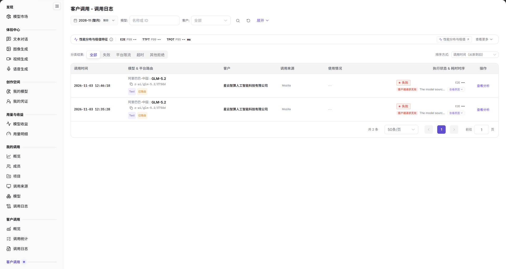

# 客户调用（模型提供方） - 调用日志

> 本页面在系统左侧菜单中显示为【调用日志】（系统同名第二组，本手册标注为【客户调用（模型提供方）】）。

> 统计口径：顶部月份和日期范围决定统计范围；`按日` 切换按天聚合粒度，日期范围以控件当前显示的起止日期为准。

## 1. 功能概述

| 项目 | 内容 |
| --- | --- |
| 适用角色 | 模型提供方 |
| 导航路径 | **模型及AI服务** > **客户调用**（第二组）> **调用日志** |
| 页面路由 | `/modelone/model-observation/provider/calls` |
| 管理对象 | 客户调用的单次记录、客户、调用来源、执行状态和延迟 |

**新手理解**：客户调用日志从模型提供方视角逐条记录客户请求。先看性能分布与极值，再按结果分类和排序定位异常，最后核对单次调用的客户、来源和耗时。

## 2. 前提条件

1. 当前账号具备模型提供方视角的 **客户调用 > 调用日志** 权限。
2. 当前统计周期内已有客户调用记录。
3. 已确认统计月份、模型和客户筛选条件。

## 3. 页面说明

页面标题为 `客户调用 - 调用日志`。页面包含：

- 筛选区：月份、`按日`、`模型`、`客户`（`全部`）、**展开** 和 `名称或 ID` 搜索框。
- `性能分布与极值特征`：显示 `E2E P99`、`TTFT P99`、`TPOT P95`，并提供 **查看更多**。
- `性能分布与极值`：列出 P99/P95 排序、最小延迟和最长调用等查看入口。
- 分类与排序：`分类结果`（`全部`、`失败`、`平台限流`、`超时`、`其他拒绝`）和 `排序方式`（默认 `调用时间（从新到旧）`）。
- 表格：`调用时间`、`模型 & 平台路由`、`客户`、`调用来源`、`使用情况`、`执行状态 & 耗时时序`、`操作`。

**图注**：筛选区包含月份、`按日`、`模型`、`客户`、**展开** 和 `名称或 ID`；顶部显示 `性能分布与极值特征`；`分类结果` 提供 `全部`、`失败`、`平台限流`、`超时`、`其他拒绝`；表格列为 `调用时间`、`模型 & 平台路由`、`客户`、`调用来源`、`使用情况`、`执行状态 & 耗时时序`、`操作`。

## 4. 主要操作

### 4.1 筛选记录

1. 选择统计月份。
2. 使用 `按日` 切换统计粒度。
3. 在 `模型` 和 `客户` 中限定范围。
4. 在搜索框输入 `名称或 ID`。

### 4.2 查看性能分布

1. 查看 `性能分布与极值特征` 中的 `E2E P99`、`TTFT P99`、`TPOT P95`。
2. 点击 **查看更多** 展开 `性能分布与极值` 的排序入口。

### 4.3 按结果筛选与排序

1. 在 `分类结果` 中选择 `全部`、`失败`、`平台限流`、`超时` 或 `其他拒绝`。
2. 在 `排序方式` 中选择排序规则，默认 `调用时间（从新到旧）`。

### 4.4 查看单次调用

1. 在表格中定位目标记录。
2. 核对 `模型 & 平台路由`、`客户`、`调用来源`、`使用情况` 和 `执行状态 & 耗时时序`。
3. 通过 `操作` 列进入记录详情。

## 5. 参数速查表

| 字段名称 | 是否必填 | 字段类型 | 示例 | 说明 |
| --- | --- | --- | --- | --- |
| 月份 | 是 | 选择项 | `2026-11` | 统计月份 |
| 按日 | 否 | 切换项 | 按日 | 统计粒度 |
| 模型 | 否 | 文本 | `名称或 ID` | 按模型筛选 |
| 客户 | 否 | 选择项 | `全部` | 按客户筛选 |
| E2E P99 / TTFT P99 | 系统统计 | 时长 | `--` | 端到端与首 Token 延迟 P99 |
| TPOT P95 | 系统统计 | 时长 | `-- ms` | 每 Token 输出时间 P95 |
| 分类结果 | 否 | 单选 | `全部` | 按调用结果筛选 |
| 排序方式 | 否 | 下拉 | `调用时间（从新到旧）` | 控制记录排序 |
| 调用时间 | 系统记录 | 时间 | `2026-11-03 10:00:00` | 调用发生时间 |
| 模型 & 平台路由 | 系统记录 | 文本 | `openai/gpt-6.1-sol` | 请求模型与平台路由 |
| 客户 | 系统记录 | 文本 | `客户 A` | 调用客户 |
| 调用来源 | 系统记录 | 文本 | `App A` | 调用来源 |
| 使用情况 | 系统记录 | 数值 | 输入/输出 Token | 本次调用用量 |
| 执行状态 & 耗时时序 | 系统记录 | 状态 | `成功`、`失败` | 执行结果与耗时 |

## 6. 踩坑提示

- 本页是模型提供方视角；左侧另一组【客户调用】的日志口径不同。
- `性能分布与极值特征` 在无数据时显示 `--`，不代表性能为 0。
- `分类结果` 只筛选调用结果，不改变月份和客户范围。
- `客户` 与 `调用来源` 是两个维度，前者是客户，后者是应用来源。

## 7. 结果校验

| 核对项 | 界面上可直接看到 |
| --- | --- |
| 筛选生效 | 表格记录随月份、模型、客户变化 |
| 性能指标 | 顶部显示 `E2E P99`、`TTFT P99`、`TPOT P95` |
| 分类生效 | 选择 `失败`、`平台限流`、`超时` 或 `其他拒绝` 后记录减少 |
| 排序生效 | 表格顺序随 `排序方式` 变化 |
| 空状态 | 无记录时显示 `暂无数据` |

## 8. 常见问题

#### 调用日志为空

**现象**：表格显示 `暂无数据`。

**处理方式**：确认当前月份有客户调用，并清除模型、客户和分类筛选后重试。

#### 性能指标显示 `--`

**现象**：`E2E P99`、`TTFT P99`、`TPOT P95` 均为 `--`。

**处理方式**：当前范围没有足够样本；扩大统计周期或清除筛选后再查看。

## 9. 注意事项

- 日志包含客户名称和调用数据，不要截图外发。
- 排查时只记录必要字段，避免泄露请求内容和密钥。
- 统计数据按小时更新，刚产生的调用可能延迟出现。

## 10. 后续操作

- 在[概览](../overview/)中查看客户调用总量与分布。
- 在[模型](../models/)、[客户](../customers/)、[调用来源](../client-sources/)中按维度聚合。
- 在[模型收益](../../usage-earnings/model-earnings/)中查看收益。
