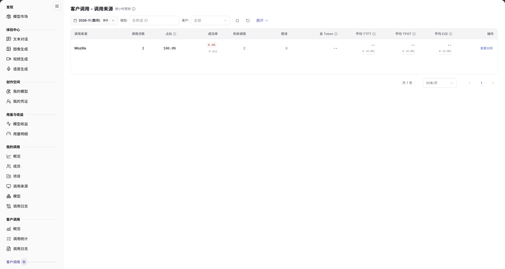

# 调用来源

::: info 文档信息
版本：v2.0
更新日期：2026-11-04
:::

## 功能概述

| 项目 | 内容 |
| --- | --- |
| 适用角色 | 模型提供方 |
| 导航路径 | **模型及AI服务** > **客户调用** > **调用来源** |
| 页面路由 | `/modelone/model-observation/provider/apps` |
| 管理对象 | 按调用来源聚合的客户调用次数、占比、成功率、Token 和延迟 |

**新手理解**：调用来源页从模型提供方视角回答“客户通过哪些应用调用我的模型”。先选月份和客户，再比较各来源的调用量、成功率和延迟。

#### 术语速查

| 术语 | 说明 |
| --- | --- |
| 调用来源（提供方） | 外部客户在请求头中注入的应用归属标识（如业务 App、集成中间件或终端 Agent 标识）。 |
| 调用占比 | 某个特定调用来源在该统计周期内向本方模型发起的请求量占总客户请求量的比例。 |
| 限流调用 | 客户应用因超出并发限额被平台流控网关阻断的次数，反映应用端的流量突发冲击。 |
| 平均 TPOT | 该来源应用在流式接收模型输出时感知的每 Token 平均传输耗时（Time Per Output Token）。 |

## 前提条件

1. 当前账号具备模型提供方视角的 **客户调用 > 调用来源** 权限。
2. 当前统计周期内已有带来源标识的客户调用。
3. 已确认统计月份、模型和客户筛选条件。

## 页面说明

页面标题为 `客户调用 - 调用来源`，右侧标注 `按小时更新`。

| 区域 | 说明 |
| --- | --- |
| 顶部时间与客户过滤栏 | 提供统计月份、按日颗粒度开关、模型/客户下拉过滤框、展开按钮与名称/ID 搜索框 |
| 统计时效标识 | 标明“按小时更新”，提示数据为准实时整点聚合结果 |
| 来源汇总数据表格 | 呈现调用来源名称、请求次数、占比、成功率、失败/限流数、总 Token 与 TTFT/TPOT/E2E 延迟 |
| 操作与下钻列 | 提供下钻查看针对该特定调用来源的单次客户调用日志入口 |

- 筛选区包含月份、`按日`、`模型`、`客户`（`全部`）、**展开** 和 `名称或 ID` 搜索框。
- 表格第一列为 `调用来源`，其余列为 `调用次数`、`占比`、`成功率`、`失败调用`、`限流`、`总 Token`、`平均 TTFT`、`平均 TPOT`、`平均 E2E`、`操作`。没有数据时显示 `暂无数据`。

图示为筛选项为月份、`按日`、`模型`、`客户`、**展开** 和 `名称或 ID`；表头第一列为 `调用来源`，其余为 `调用次数`、`占比`、`成功率`、`失败调用`、`限流`、`总 Token`、`平均 TTFT`、`平均 TPOT`、`平均 E2E`、`操作`。

## 主要操作

1. 选择统计月份。
2. 使用 `按日` 切换统计粒度。
3. 在 `模型` 和 `客户` 中限定范围。
4. 在搜索框输入来源名称或 ID。
5. 对比各来源的调用次数、占比、成功率和延迟。

## 参数速查表

| 字段名称 | 是否必填 | 字段类型 | 示例 | 说明 |
| --- | --- | --- | --- | --- |
| 月份 | 是 | 选择项 | `2026-11` | 统计月份 |
| 按日 | 否 | 切换项 | 按日 | 统计粒度 |
| 模型 | 否 | 文本 | `名称或 ID` | 按模型筛选 |
| 客户 | 否 | 选择项 | `全部` | 按客户筛选 |
| 调用来源 | 系统统计 | 文本 | `App A` | 调用来源名称 |
| 调用次数 | 系统统计 | 数值 | `0` | 来源调用总量 |
| 占比 | 系统统计 | 百分比 | `0%` | 来源调用占总量比例 |
| 成功率 | 系统统计 | 百分比 | `--` | 成功调用占比 |
| 失败调用 / 限流 | 系统统计 | 数值 | `0` | 失败与限流调用数 |
| 总 Token | 系统统计 | 数值 | `0` | 来源 Token 总量 |
| 平均 TTFT / TPOT / E2E | 系统统计 | 时长 | `--` | 来源平均延迟指标 |

## 踩坑提示

- 未带来源标识的客户调用不会出现在本页，概览总调用量可能大于来源合计。
- 当前范围没有数据时显示 `暂无数据`，不代表来源不可用。
- 本页是模型提供方视角；左侧另一组【客户调用】的统计口径不同。

## 结果校验

| 检查项 | 成功表现 | 异常时处理 |
| --- | --- | --- |
| 过滤联动正常 | 切换月份或指定客户后，表格行与调用次数、占比等各项数据同步刷新 | 若整表变为空白，点击重置清除过滤条件，检查当前统计周期内是否有带来源的调用 |
| 指标数值准确 | 调用次数大于 0 时，对应来源的占比、成功率及总 Token 正确呈现具体数值 | 若成功率为 `--` 或偏低，核对失败/限流列分析客户应用是否存在接口传参错误 |
| 延迟时钟完整 | 表格回显毫秒或秒级的平均 TTFT、TPOT、E2E 耗时数值 | 若显示 `--`，说明对应来源调用的有效流式采样样本不足 |
| 来源快速检索 | 在输入框输入特定 App 名称或来源 ID，表格即时过滤定位目标行 | 清除输入框多余字符重新检索 |
| 操作下钻可用 | 点击操作列中的详情按钮，跳转至[调用日志](../call-logs/)并自动带入该来源筛选条件 | 检查当前登录账号是否具备模型提供方的跨客户审计权限 |

## 常见问题

#### 来源列表为空

**问题现象：** 切换至当前月份后，调用来源表格显示 `暂无数据`。

**可能原因：** 所选统计月份尚未产生任何带来源标识的客户调用；或者客户发起 API 调用时未在 Header 中传入来源标识。

**处理方式：**

1. 切换至有实际客户业务流量调用的月份。
2. 建议客户在 API 调用时规范传入标准 Client/App 标识 Header。
3. 清除模型与客户细分筛选条件后重试。

#### 来源合计与总调用量不一致

**问题现象：** 来源列表中所有应用的调用次数加和小于[概览](../overview/)中的客户总调用量。

**可能原因：** 概览页统计全部入站调用，包含未携带来源标识的匿名请求，而本页仅聚合已识别的具名应用来源。

**处理方式：**

1. 宏观算力承载与结算以概览页的总调用量为准。
2. 本页用于分析各知名外部集成应用的流量构成与 SLA 履约质量。

## 注意事项

- 来源名称可能包含内部应用信息，不要截图外发。
- 统计数据按小时更新，刚产生的调用可能延迟出现。

## 后续操作

1. 在调用日志中下钻检索高用量或高报错来源的单次调用时序与请求体。
2. 切换至客户维度，分析该来源应用背后的具体企业客户实体。
3. 结合 Token 消耗分布，核对各来源产生的结算分成与收益账单。

相关页面：
- [客户调用概览](../overview/)
- [客户调用日志](../call-logs/)
- [客户调用 - 客户](../customers/)
- [客户调用 - 模型](../models/)
- [模型收益](../../usage-earnings/model-earnings/)
