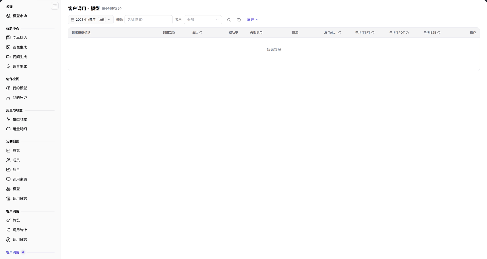

# 客户调用（模型提供方） - 模型

::: info 文档信息
版本：v2.0
更新日期：2026-11-04
:::

## 功能概述

| 项目 | 内容 |
| --- | --- |
| 适用角色 | 模型提供方 |
| 导航路径 | **模型及AI服务** > **客户调用**（第二组）> **模型** |
| 页面路由 | `/modelone/model-observation/provider/models` |
| 管理对象 | 按请求模型标识聚合的客户调用次数、成功率、Token 和延迟 |

**新手理解**：模型页从模型提供方视角回答“哪些模型在被客户调用”。先选月份和客户，再比较各模型的调用量、成功率和延迟。

#### 术语速查

| 术语 | 说明 |
| --- | --- |
| 请求模型标识 | 外部客户在 API 请求体或 URL 中指定的具体模型路由标识（如 `openai/gpt-6.1-sol`）。 |
| 调用占比 | 外部客户调用该模型标识的请求量占本方所有发布模型总调用量的比例。 |
| 命中缓存 Token | 客户请求中命中模型上下文缓存、无需重复全量计算的输入 Token 数量。 |
| 平均 TTFT | 该模型从接收完客户请求到输出首个 Token 的平均延迟（Time to First Token）。 |

## 前提条件

1. 当前账号具备模型提供方视角的 **客户调用 > 模型** 权限。
2. 当前统计周期内已有客户调用数据。
3. 已确认统计月份、模型和客户筛选条件。

## 页面说明

页面标题为 `客户调用 - 模型`，右侧标注 `按小时更新`。

| 区域 | 说明 |
| --- | --- |
| 顶部时间与客户过滤栏 | 提供统计月份、按日粒度切换开关、模型/客户下拉过滤框、展开按钮与名称/ID 搜索框 |
| 统计时效标识 | 标明“按小时更新”，提示指标数据为准实时整点聚合结果 |
| 模型汇总数据表格 | 呈现请求模型标识、调用次数、占比、成功率、失败/限流数、总 Token 与 TTFT/TPOT/E2E 延迟 |
| 操作与日志下钻列 | 提供针对该特定模型单次调用记录的下钻审计入口 |

- 筛选区包含月份、`按日`、`模型`、`客户`（`全部`）、**展开** 和 `名称或 ID` 搜索框。
- 表格第一列为 `请求模型标识`，其余列为 `调用次数`、`占比`、`成功率`、`失败调用`、`限流`、`总 Token`、`平均 TTFT`、`平均 TPOT`、`平均 E2E`、`操作`。没有数据时显示 `暂无数据`。

图示为筛选项为月份、`按日`、`模型`、`客户`、**展开** 和 `名称或 ID`；表头第一列为 `请求模型标识`，其余为 `调用次数`、`占比`、`成功率`、`失败调用`、`限流`、`总 Token`、`平均 TTFT`、`平均 TPOT`、`平均 E2E`、`操作`。

## 主要操作

1. 选择统计月份。
2. 使用 `按日` 切换统计粒度。
3. 在 `模型` 和 `客户` 中限定范围。
4. 在搜索框输入模型名称或 ID。
5. 对比各模型的调用次数、占比、成功率和延迟。

## 参数速查表

| 字段名称 | 是否必填 | 字段类型 | 示例 | 说明 |
| --- | --- | --- | --- | --- |
| 月份 | 是 | 选择项 | `2026-11` | 统计月份 |
| 按日 | 否 | 切换项 | 按日 | 统计粒度 |
| 模型 | 否 | 文本 | `名称或 ID` | 按模型筛选 |
| 客户 | 否 | 选择项 | `全部` | 按客户筛选 |
| 请求模型标识 | 系统统计 | 文本 | `openai/gpt-6.1-sol` | 请求携带的模型标识 |
| 调用次数 | 系统统计 | 数值 | `0` | 客户调用总量 |
| 占比 | 系统统计 | 百分比 | `0%` | 模型调用占总量比例 |
| 成功率 | 系统统计 | 百分比 | `--` | 成功调用占比 |
| 失败调用 / 限流 | 系统统计 | 数值 | `0` | 失败与限流调用数 |
| 总 Token | 系统统计 | 数值 | `0` | 模型 Token 总量 |
| 平均 TTFT / TPOT / E2E | 系统统计 | 时长 | `--` | 模型平均延迟指标 |

## 踩坑提示

- 本页是模型提供方视角；左侧另一组【客户调用】的统计口径不同。
- `请求模型标识` 可能与应用侧展示名称不同，按标识核对更准确。
- 当前范围没有数据时显示 `暂无数据`，不代表模型不可用。

## 结果校验

| 检查项 | 成功表现 | 异常时处理 |
| --- | --- | --- |
| 过滤联动正常 | 切换月份或指定客户后，表格行与调用次数、占比同步刷新 | 若整表变为空白，点击重置清除过滤条件，检查当前统计周期内是否有客户调用本方模型 |
| 业务指标完整 | 每行模型数据准确呈现调用次数、占比、成功率及总 Token | 若成功率偏低，核对失败/限流列并下钻到调用日志排查后端模型实例健康度 |
| 延迟时钟呈现 | 表格完整回显平均 TTFT、TPOT、E2E 耗时数值 | 若显示 `--`，表明样本不足或均为非流式调用导致 TPOT 无法计算 |
| 模型快速检索 | 在输入框输入模型名称或路径标识，表格即时过滤定位目标行 | 清除输入框多余字符重新检索 |
| 跨维审计下钻 | 点击操作列中的详情按钮，跳转至[调用日志](../call-logs/)并自动带入该模型筛选条件 | 检查当前账号是否具备模型提供方的跨客户审计权限 |

## 常见问题

#### 模型列表为空

**问题现象：** 切换至当前月份后，模型列表显示 `暂无数据`。

**可能原因：** 所选统计月份尚未产生针对本方发布模型的客户调用，或者所选客户在当前周期未调用过任何模型。

**处理方式：**

1. 切换至有实际业务流量的统计月份。
2. 清除客户细分筛选条件，恢复为查看所有客户对本方模型的调用汇总。
3. 检查模型接入与发布状态是否处于正常上线状态。

#### 调用量与概览不一致

**问题现象：** 模型列表中各模型调用次数加和小于[概览](../overview/)中的客户总调用量。

**可能原因：** 概览页统计全部请求（包含网关路由未匹配、模型名拼写错误在网关层即被拦截拒绝的非法请求），而本页仅聚合成功解析到合法模型标识的调用。

**处理方式：**

1. 整体流量压力评估以概览页的总调用量为准。
2. 本页专用于分析各模型的客户采纳度、实际推理负载与收益分配。

## 注意事项

- 模型标识和客户数据属于敏感信息，不要截图外发。
- 统计数据按小时更新，刚产生的调用可能延迟出现。

## 后续操作

1. 在调用日志中下钻检索高报错或长耗时模型的单次推理时序与网络往返详情。
2. 切换至客户维度，分析调用该模型的主要企业客户分布。
3. 在[模型收益](../../usage-earnings/model-earnings/)中查看各发布模型的实际结算收益与消耗分成。

相关页面：
- [客户调用概览](../overview/)
- [客户调用日志](../call-logs/)
- [客户调用 - 客户](../customers/)
- [客户调用 - 调用来源](../client-sources/)
- [模型收益](../../usage-earnings/model-earnings/)
