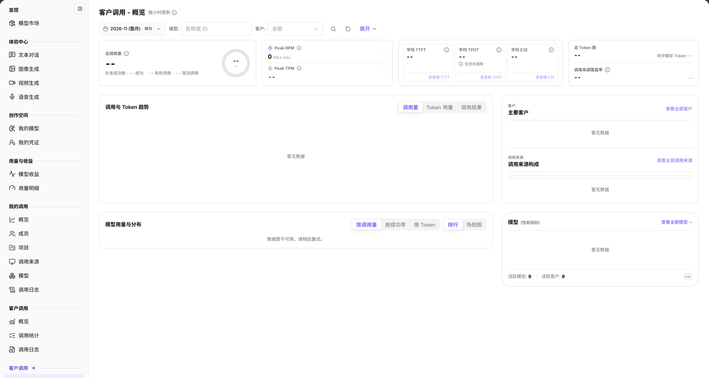

# 概览

> 本页面在系统左侧菜单中显示为【概览】（第二组【客户调用】），页面标题为【客户调用 - 概览】。

## 1. 功能概述

| 项目 | 内容 |
| --- | --- |
| 适用角色 | 模型提供方 |
| 导航路径 | **模型及AI服务** > **客户调用**（第二组）> **概览** |
| 页面路由 | `/modelone/model-observation/provider/overview` |
| 管理对象 | 模型提供方视角的客户调用量、Token、延迟、主要客户、调用来源和模型分布 |

**新手理解**：这是模型提供方看客户调用的总仪表盘。先选月份和模型，再看调用量、成功/失败、延迟和 Token，最后用主要客户、调用来源和模型分布判断调用来自哪里。

## 2. 前提条件

1. 当前账号具备模型提供方视角的 **客户调用 > 概览** 权限。
2. 当前统计周期内已有客户调用数据。
3. 已确认统计月份、模型和客户筛选条件。

## 3. 页面说明

系统左侧菜单中存在两组【客户调用】；本页属于第二组，路由前缀为 `/modelone/model-observation/provider`，另一组使用 `/modelone/monitoring/monitor`。

页面标题为 `客户调用 - 概览`，右侧标注 `按小时更新`。页面包含：

- 筛选区：月份、`按日`、`模型`、`客户`（`全部`）、**展开** 和 `名称或 ID` 搜索框。
- 指标卡：`总调用量`（含外发成功数、失败调用、限流调用）、`Peak RPM`、`Peak TPM`、`平均 TTFT`、`平均 TPOT`（`仅流式调用`）、`平均 E2E`、`总 Token 数`（含命中缓存 Token）、`调用来源覆盖率`。
- `调用与 Token 趋势`：可切换 `调用量`、`Token 用量`、`调用结果`。
- `客户`：显示 `主要客户`，提供 **查看全部客户**。
- `调用来源`：显示 `调用来源构成`，提供 **查看全部调用来源**。
- `模型用量与分布`：可切换 `按调用量`、`按成功率`、`按 Token` 和 `排行`、`场视图`；显示 `活跃模型`、`活跃客户` 和 **查看全部模型**。

**图注**：筛选区包含月份、`按日`、`模型`、`客户`、**展开** 和 `名称或 ID`；指标卡显示 `总调用量`、`Peak RPM`、`Peak TPM`、`平均 TTFT`、`平均 TPOT`、`平均 E2E`、`总 Token 数`、`调用来源覆盖率`；下方为 `客户`、`调用来源` 和 `模型用量与分布`。

## 4. 主要操作

### 4.1 设置统计范围

1. 选择统计月份。
2. 使用 `按日` 切换统计粒度。
3. 在 `模型` 和 `客户` 中限定范围。
4. 点击 **展开** 查看扩展筛选条件。

### 4.2 读取指标

1. 查看 `总调用量` 及外发成功数、失败调用、限流调用。
2. 查看 `Peak RPM`、`Peak TPM`。
3. 查看 `平均 TTFT`、`平均 TPOT`、`平均 E2E`。
4. 查看 `总 Token 数`、`命中缓存 Token` 和 `调用来源覆盖率`。

### 4.3 定位客户与模型

1. 在 `客户` 区域查看 `主要客户`，或点击 **查看全部客户**。
2. 在 `调用来源` 区域查看 `调用来源构成`，或点击 **查看全部调用来源**。
3. 在 `模型用量与分布` 中切换 `按调用量`、`按成功率`、`按 Token` 和 `排行`、`场视图`。
4. 点击 **查看全部模型** 进入模型维度明细。

## 5. 参数速查表

| 字段名称 | 是否必填 | 字段类型 | 示例 | 说明 |
| --- | --- | --- | --- | --- |
| 月份 | 是 | 选择项 | `2026-11` | 统计月份 |
| 按日 | 否 | 切换项 | 按日 | 统计粒度 |
| 模型 | 否 | 文本 | `名称或 ID` | 按模型筛选 |
| 客户 | 否 | 选择项 | `全部` | 按客户筛选 |
| 总调用量 | 系统统计 | 数值 | `--` | 客户调用总量 |
| 外发成功数 | 系统统计 | 数值 | `--` | 成功外发的调用数 |
| 失败调用 / 限流调用 | 系统统计 | 数值 | `--` | 失败与限流调用数 |
| Peak RPM / TPM | 系统统计 | 数值 | `--` | 分钟峰值请求数与 Token 数 |
| 平均 TTFT / TPOT / E2E | 系统统计 | 时长 | `--` | 平均延迟指标；TPOT 仅统计流式调用 |
| 总 Token 数 | 系统统计 | 数值 | `--` | 客户调用 Token 总量 |
| 命中缓存 Token | 系统统计 | 数值 | `--` | 命中缓存的 Token 数 |
| 调用来源覆盖率 | 系统统计 | 百分比 | `--` | 有来源标识的调用占比 |
| 主要客户 | 系统统计 | 列表 | — | 调用量靠前的客户 |
| 调用来源构成 | 系统统计 | 图表 | — | 不同来源的调用占比 |
| 活跃模型 / 活跃客户 | 系统统计 | 数值 | `0` | 当前有调用的模型与客户数 |

## 6. 踩坑提示

- 左侧有两组【客户调用】；本页指标按模型提供方视角统计，与另一组客户维度监控的口径不同。
- `平均 TPOT` 仅统计流式调用，非流式调用不会进入该指标。
- 当前范围没有数据时，模型分布显示 `数据暂不可用，请稍后重试。`，活跃模型和活跃客户为 `0`。
- `调用来源覆盖率` 显示来源标识的覆盖情况，不能据此推断客户数量。

## 7. 结果校验

| 核对项 | 界面上可直接看到 |
| --- | --- |
| 筛选生效 | 指标卡和图表随月份、模型、客户变化 |
| 趋势可切换 | `调用量`、`Token 用量`、`调用结果` 可切换 |
| 分布可切换 | `按调用量`、`按成功率`、`按 Token` 与 `排行`、`场视图` 可切换 |
| 下钻入口 | **查看全部客户**、**查看全部调用来源**、**查看全部模型** 可见 |
| 空状态 | 无数据时模型分布显示 `数据暂不可用，请稍后重试。` |

## 8. 常见问题

#### 指标显示 `--`

**现象**：总调用量、Token 和延迟指标均为 `--`。

**处理方式**：确认当前月份和筛选范围内有客户调用；刚产生的调用等待按小时刷新。

#### 活跃模型和活跃客户为 0

**现象**：`模型用量与分布` 显示 `活跃模型: 0`、`活跃客户: 0`。

**处理方式**：扩大统计周期或清除模型、客户筛选后重试。

## 9. 注意事项

- 页面包含客户名称、调用量和来源信息，不要截图外发。
- 两组【客户调用】的路由不同，排查时先确认当前页面路由。
- 指标按筛选条件计算，跨条件比较前先固定口径。

## 10. 后续操作

- 在[模型](../models/)中按模型查看客户调用。
- 在[客户](../customers/)中按客户查看调用。
- 在[调用来源](../client-sources/)中查看来源分布。
- 在[调用日志](../call-logs/)中查看单次调用记录。
