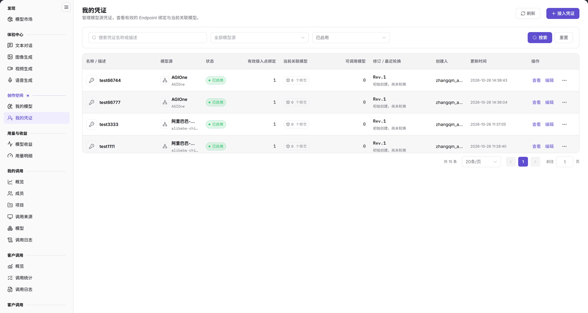
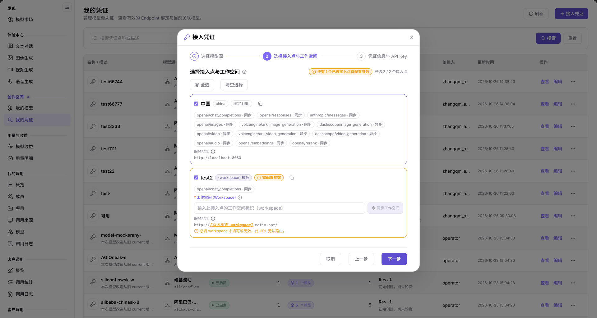
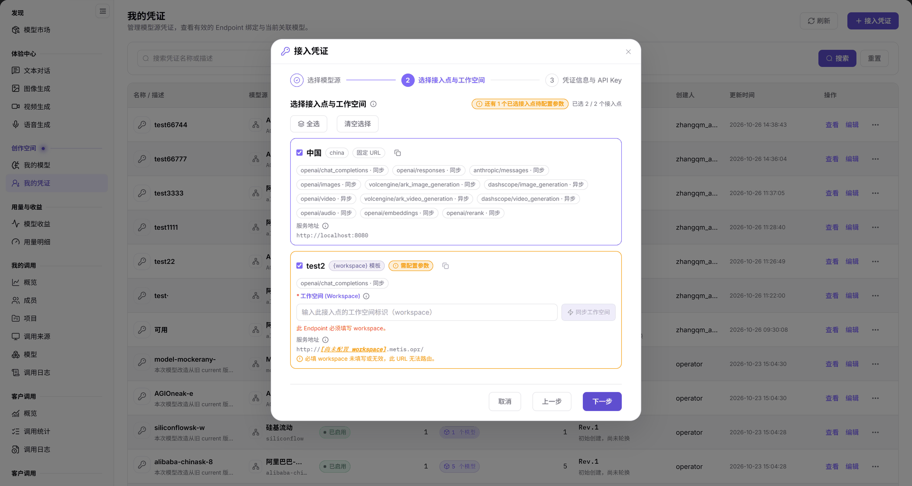

# 我的凭证

## 功能概述

| 项目 | 内容 |
| --- | --- |
| 适用角色 | 模型提供方 |
| 导航路径 | **模型及AI服务** > **创作空间** > **我的凭证** |
| 页面路由 | `/modelone/credentials` |
| 管理对象 | 模型源凭证、Endpoint 绑定、关联模型和凭证修订版本 |

#### 新手理解

我的凭证管理模型提供方接入上游模型源时使用的凭证。每条凭证绑定一个模型源和有效接入点，并显示当前关联了多少个模型；修改名称或轮换凭证都在这里完成。

#### 术语速查

| 术语 | 说明 |
| --- | --- |
| 模型源凭证 | 访问特定上游厂商服务（如 AGIOne、OpenAI）的身份凭据，包含 API Key 等密文。 |
| 有效接入点绑定 | 凭证已授权并打通网络调用的 Endpoint 数量，直接决定该凭证可部署的地域范围。 |
| 凭证轮换 | 在不改变凭证 ID 与模型绑定的前提下更新底层 API Key，版本号递增（如 Rev.1 -> Rev.2）。 |
| 关联模型 | 当前正在使用该凭证向上游转发请求的已发布模型集合。 |

## 前提条件

1. 当前账号具备 **创作空间 > 我的凭证** 的访问权限。
2. 已确认目标模型源和 Endpoint。
3. 创建凭证前已准备好上游 API Key。

## 页面说明

页面顶部为标题 `我的凭证` 和说明 `管理模型源凭证，查看有效的 Endpoint 绑定与当前关联模型。`，右侧提供 **刷新** 与 **接入凭证**。

筛选区包含搜索框 `搜索凭证名称或描述`、模型源下拉（当前 `全部模型源`）、状态下拉（当前 `已启用`），以及 **搜索**、**重置**。

表格列为 `名称 / 描述`、`模型源`、`状态`、`有效接入点绑定`、`当前关联模型`、`可调用模型`、`修订 / 最近轮换`、`创建人`、`更新时间`、`操作`。操作列提供 **查看**、**编辑** 和更多操作入口。

图示为表格显示 `名称 / 描述`、`模型源`、`状态`、`有效接入点绑定`、`当前关联模型`、`可调用模型`、`修订 / 最近轮换`、`创建人`、`更新时间` 和 `操作`。示例记录状态为 `已启用`，有效接入点绑定为 `1`，当前关联模型为 `0 个模型`。

| 区域 | 说明 |
| --- | --- |
| 顶部操作栏 | 包含当前页面功能说明、列表刷新与 **接入凭证** 向导入口。 |
| 筛选与检索区 | 支持按凭证名称/描述模糊搜索，并可按归属模型源与启用状态筛选。 |
| 凭证列表表格 | 展示凭证名称、模型源、状态、有效接入点绑定、当前关联模型与更新时间。 |
| 行内与更多操作 | 提供 **查看** 详情、**编辑** 元数据，以及 Endpoint 绑定、关联模型、轮换与停用入口。 |

## 主要操作

### 接入凭证

1. 点击右上角 **"接入凭证"**，打开三步向导。
2. 在 `1 选择模型源` 选择凭证归属的模型源。
3. 点击 **"下一步"**，在 `2 选择接入点与工作空间` 选择有效接入点。
4. 在 `2 选择接入点与工作空间` 勾选目标 Endpoint；页面显示 `已选择 N / 共 M 个接入点`、Endpoint 区域、固定 URL、协议和服务地址。需要工作空间参数时，同时填写 `Workspace`。
5. 点击 **"下一步"**，在 `3 凭证信息与 API Key` 填写 `名称`、`API Key` 和可选的 `描述`。
6. 点击 **"保存并连接"** 提交；提交前核对模型源、接入点、名称和 API Key。

图示为`2 选择接入点与工作空间` 显示 `已选择 1 / 共 2 个接入点`；China 接入点标注 `中国`、`china`、`固定 URL`，并列出 `openai/chat_completions` 等协议和服务地址；带 `{workspace}` 的接入点需要填写 `Workspace`。

图示为`3 凭证信息与 API Key` 提供必填的 `名称`、`API Key` 和可选的 `描述`，底部按钮为 **"返回"**、**"保存并连接"**。

### 查看凭证详情

1. 在目标行点击 **"查看"**。
2. 在 `凭证详情` 中核对 `凭证显示名称`、`模型源`、`Rev.` 版本和 `描述`。
3. 在 `已绑定 Endpoint 与网络调用配置` 中核对 `已绑定 N / 共 M 个接入点` 及接入点地址。
4. 阅读完成后点击 **"关闭"**。

### 编辑凭证元数据

1. 在目标行点击 **"编辑"**。
2. 在 `编辑凭证元数据` 中修改 `凭证显示名称` 或 `描述`。
3. 点击 **"保存元数据"** 提交；只查看时点击 **"关闭"**。

### 轮换或停用凭证

1. 在目标行点击行尾更多操作，菜单包含 `Endpoint`、`模型`、`审计`、`轮换`、`停用`。
2. 选择 `轮换`，在 `轮换 API Key` 中核对所属模型源、`Rev.`、`有效接入点绑定` 和 `当前关联模型`。
3. 填写 `新 API Key`，点击 **"确认轮换"**；不操作时点击 **"关闭"**。
4. 需要停用时选择 `停用`，先核对影响范围再确认。

### 筛选凭证

1. 在搜索框输入凭证名称或描述。
2. 选择模型源和状态。
3. 点击 **"搜索"** 查询，或点击 **"重置"** 恢复默认条件。

## 参数速查表

| 字段名称 | 是否必填 | 字段类型 | 示例 | 说明 |
| --- | --- | --- | --- | --- |
| 凭证显示名称 | 是 | 文本，1–128 字符 | `test66744` | 去除首尾空格后在同一模型源下唯一 |
| 描述 | 否 | 文本 | `文本对话测试凭证` | 用于识别凭证用途 |
| 模型源 | 是 | 选择项 | `AGIOne` | 凭证归属的上游模型源 |
| 接入点 | 是 | 选择项 | `中国` | 凭证绑定的有效 Endpoint |
| API Key | 是 | 密文 | — | 上游访问密钥，保存后不回显 |
| 状态 | 系统维护 | 标签 | `已启用` | 凭证当前可用状态 |
| 有效接入点绑定 | 系统统计 | 数值 | `1` | 当前绑定的有效接入点数量 |
| 当前关联模型 | 系统统计 | 数值 | `0 个模型` | 使用该凭证的模型数量 |
| 可调用模型 | 系统统计 | 数值 | `0` | 当前可调用的模型数量 |
| 修订 / 最近轮换 | 系统维护 | 版本 | `Rev.1` / `初始创建，尚未轮换` | 凭证修订记录 |
| 创建人 | 系统维护 | 文本 | `provider_admin` | 凭证创建账号 |
| 更新时间 | 系统维护 | 时间 | `2026-10-26 14:38:43` | 最近一次更新时间 |

## 踩坑提示

- 凭证显示名称在当前租户的同一模型源下必须唯一；重名会被拒绝。
- 详情中的 `已绑定 1 / 共 1 个接入点` 表示当前只绑定了一个 Endpoint；修改绑定前确认模型调用不受影响。
- 表格中的 `当前关联模型` 为 `0 个模型` 不代表凭证不可用，只表示当前没有模型引用它。
- API Key 只在创建或轮换时录入，保存后页面不回显完整值。

## 结果校验

| 检查项 | 成功表现 | 异常时处理 |
| --- | --- | --- |
| 凭证创建 | 列表出现新凭证记录，状态显示 `已启用`。 | 若列表无记录，检查筛选条件是否设置了其他状态，或查看创建报错提示。 |
| 接入点绑定 | `有效接入点绑定` 正确显示已绑定的 Endpoint 数量。 | 若显示为 0，点击行内更多操作进入 `Endpoint` 检查网络调用配置。 |
| 模型关联 | `当前关联模型` 准确统计并显示引用该凭证的模型总数。 | 若发布模型后未统计，刷新页面或检查模型发布向导中是否选定该凭证。 |
| 元数据更新 | 列表中的凭证显示名称或描述即时更新为修改后的内容。 | 检查修改内容是否超出 128 字符限制，或同一模型源下是否存在重名冲突。 |
| 轮换版本 | `修订 / 最近轮换` 显示最新的 `Rev.` 版本号及轮换时间。 | 若版本未变化，检查新 API Key 格式是否合法及确认轮换是否提交成功。 |

## 常见问题

#### 无法保存凭证名称

**问题现象：**

点击 **"保存元数据"** 后系统提示失败或名称未更新。

**可能原因：**

凭证名称长度超出 1–128 个字符限制、前后包含空格后为空白，或者在当前租户的同一模型源下已存在同名凭证。

**处理方式：**

1. 检查输入名称是否在 1–128 个字符范围内，且去除首尾空格后具有唯一辨识度。
2. 确认当前模型源下没有重复的凭证名称。

#### 列表没有目标凭证

**问题现象：**

进入页面后列表为空，或搜索凭证名称后显示无匹配结果。

**可能原因：**

搜索关键词有误、模型源下拉被限定为其他源、状态被过滤为已停用，或当前凭证属于其他租户。

**处理方式：**

1. 点击 **"重置"** 清空搜索关键字及所有筛选下拉框。
2. 核对当前登录租户上下文，确认凭证是否由当前租户管理员创建。

## 注意事项

- API Key 属于敏感信息，不要截图、复制到文档或发送到外部工具。
- 修改凭证绑定或轮换密钥会影响使用该凭证的模型调用，操作前确认影响范围。
- 变更绑定或轮换凭证前，先确认依赖该凭证的模型和调用。

## 后续操作

1. 在模型发布向导中绑定该凭证，进入 [我的模型](../my-models/)。
2. 在模型广场验证绑定该凭证的模型是否可正常调通，进入 [模型市场](../../discover/models/)。
3. 检查模型发起调用后的连通性与消耗明细，进入 [我的调用](../../my-calls/overview/)。

相关页面：
- [我的模型](../my-models/)
- [模型市场](../../discover/models/)
- [我的调用](../../my-calls/overview/)
