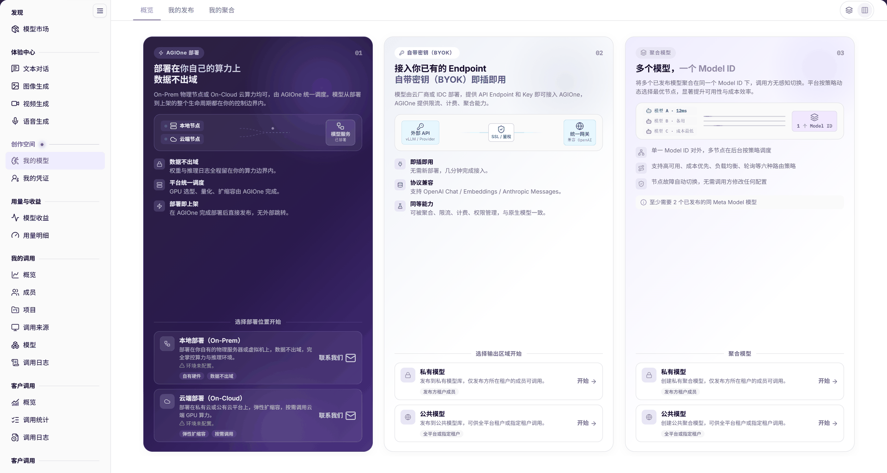
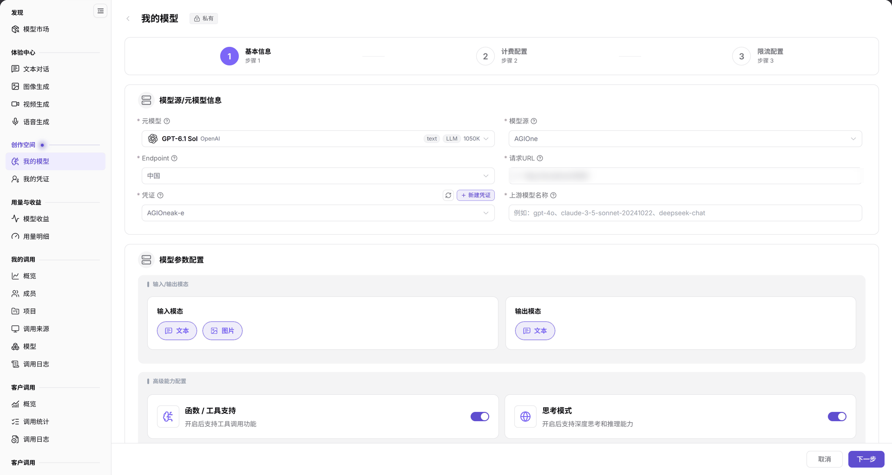

# 我的模型

::: info 文档信息
版本：v2.0
更新日期：2026-11-04
:::

## 功能概述

| 项目 | 内容 |
| --- | --- |
| 适用角色 | 模型提供方 |
| 导航路径 | **模型及AI服务** > **创作空间** > **我的模型** |
| 页面路由 | 概览 `/modelone/model/my/overview`；发布配置 `/modelone/model/create?isPublic=0` |
| 管理对象 | 已发布模型、聚合模型、模型部署入口和发布配置 |

#### 新手理解

我的模型是模型提供方的工作台。`概览` 说明部署、自带密钥接入和聚合三种上线方式；`我的发布` 管理直接发布的模型；`我的聚合` 管理多个模型组合后的统一 Model ID。

#### 术语速查

| 术语 | 说明 |
| --- | --- |
| 元模型 | 模型能力与交互协议的基础定义，作为发布上游模型的底模标准。 |
| Endpoint | 模型源下的物理网络接入点，与请求 URL 及凭证绑定。 |
| Access Mode | 访问控制模式，包含全局可用（Global）与租户授权（Authorized）。 |
| 聚合模型 | 将多个底层模型绑定至统一 Model ID 并通过路由策略分发的服务形态。 |

## 前提条件

1. 当前账号具备 **创作空间 > 我的模型** 的访问权限。
2. 已确认元模型、模型源、Endpoint、请求 URL 和凭证。
3. 发布前已确认计费方式、价格、限流策略和发布范围。

## 页面说明

页面顶部为 `概览`、`我的发布`、`我的聚合` 三个页签。

`概览` 按三种上线方式分区：

- `01 AGIOne 部署`：说明本地节点、云端节点、模型服务和部署即上架；下方提供 `本地部署（On-Prem）` 与 `云端部署（On-Cloud）` 两张卡片。当前两张卡片均显示 `环境未配置。`，操作入口为 **联系我们**。
- `02 自带密钥（BYOK）`：说明接入已有 Endpoint，提供 `私有模型` 与 `公共模型` 两个发布入口。
- `03 聚合模型（多个模型，一个 Model ID）`：说明一个 Model ID 调度多个模型，提供 `私有模型` 与 `公共模型` 两个聚合入口。

图示为顶部为三个页签；部署区显示 On-Prem/On-Cloud（环境未配置），BYOK 和聚合区各提供私有/公共入口。

| 区域 | 说明 |
| --- | --- |
| 顶部页签 | 包含 `概览`、`我的发布`、`我的聚合` 三个功能视图切换。 |
| 01 AGIOne 部署 | 展示本地与云端部署卡片及状态，支持联系官方开通环境。 |
| 02 自带密钥 (BYOK) | 提供接入已有物理 Endpoint 并发布为私有或公共模型的入口。 |
| 03 聚合模型 | 提供聚合多个底层已发布模型至统一 Model ID 的配置入口。 |
| 我的发布列表 | 管理直接发布的模型实例，支持检索、查看详情与版本编辑。 |
| 我的聚合列表 | 管理多模型聚合调度实例，支持按类型过滤、检索与展开拓扑。 |

### 我的发布

`我的发布` 以表格展示直接发布的模型，表头为 `模型名称`、`模型类型`、`计费模式`、`计费规则`、`状态`、`生效版本`、`待生效版本`、`更新时间`、`操作`。表格上方提供 **发布模型**、搜索和 **重置**；行内操作提供 **查看详情** 与 **编辑**。

### 我的聚合

`我的聚合` 使用相同表头，提供 **创建聚合模型**、`公共模型` / `私有模型` 筛选、`全部模型类型` 筛选、搜索、**重置** 和 **展开**。

## 主要操作

### 发布模型

1. 进入 **"我的模型"**，切换到 `我的发布` 或从 `概览` 的 `02 自带密钥（BYOK）` 区域开始。
2. 点击 **"发布模型"**，在 `选择发布类型` 弹窗选择 `私有模型` 或 `公共模型`。
3. 点击 **"发布为私有模型"** 或 **"发布为公共模型"**，进入三步配置。
4. 在 `步骤 1 基本信息` 选择元模型、模型源和 Endpoint，填写请求 URL、凭证、上游模型名称和输入/输出模态。
5. 按需开启 `函数 / 工具支持`、`思考模式`，填写最大上下文、最大输入和最大输出。
6. 在 `官方原生协议与默认高级参数` 至少选择一个协议，并先完成连通性测试。
7. 填写个性化标识（最多 20 个字符），核对模型名称预览，选择 `发布方式` 和 `Access Mode`。
8. 点击 **"下一步"** 进入 `步骤 2 计费配置`，再完成 `步骤 3 限流配置` 后提交。

图示为向导左侧显示 `1 基本信息`、`2 计费配置`、`3 限流配置`。画面包含 `元模型`、`模型源`、`Endpoint`、`请求URL`、`凭证`、`上游模型名称`、输入/输出模态、高级能力配置、Token 限制和协议选择；`Access Mode` 位于下方基本信息区。

### 创建聚合模型

1. 切换到 `我的聚合`，点击 **"创建聚合模型"**。
2. 选择 `私有模型` 或 `公共模型`。
3. 按要求选择参与聚合的已发布模型，配置路由策略、计费与限流。
4. 提交后回到 `我的聚合` 核对记录和状态。

### 查看与编辑已发布模型

1. 在 `我的发布` 使用搜索或 **"重置"** 定位模型。
2. 点击 **"查看详情"** 核对计费规则、版本和状态。
3. 点击 **"编辑"** 修改配置。

## 参数速查表

| 字段名称 | 是否必填 | 字段类型 | 示例 | 说明 |
| --- | --- | --- | --- | --- |
| 发布类型 | 是 | 单选卡片 | `私有模型` / `公共模型` | 决定模型可见与调用范围 |
| 元模型 | 是 | 选择项 | `GPT-6.1 Sol` | 模型能力与协议的基础定义 |
| 模型源 | 是 | 选择项 | `AGIOne` | 上游服务来源 |
| Endpoint | 是 | 选择项 | `中国` | 模型源下的接入点 |
| 请求URL | 是 | 文本 | `<BASE_URL><ENDPOINT_PATH>` | 上游调用地址 |
| 凭证 | 是 | 选择项 | `example-credential` | 上游访问凭证，可点击 **新建凭证** |
| 上游模型名称 | 是 | 文本 | `openai/gpt-6.1-sol` | 发送给上游的模型标识 |
| 输入/输出模态 | 是 | 勾选 | `文本`、`图片` | 模型支持的输入输出类型 |
| 函数 / 工具支持 | 否 | 开关 | 开启 | 开启后支持工具调用 |
| 思考模式 | 否 | 开关 | 开启 | 开启后支持深度思考 |
| 最大上下文 / 最大输入 / 最大输出 | 否 | 数字 | `1050K` | Token 边界 |
| 官方原生协议 | 是 | 多选 | `OpenAI-ChatCompletions` | 至少选择一个协议 |
| 个性化标识 | 否 | 文本，最多 20 字符 | `#High Speed` | 展示在同一元模型下的差异标签 |
| 发布方式 | 是 | 单选 | `立即发布` | 控制发布生效时机 |
| Access Mode | 是 | 单选 | `Global` / `Authorized` | 控制是否需要按租户授权 |
| 计费方式 | 是 | 选择项 | `按Token计费` | 计费口径 |
| 计价维度 | 是 | 选择项 | `输入 / 输出` | 价格矩阵维度 |
| 是否启用限流 | 是 | 开关 | `启用限流` / `不启用` | 控制限流配置 |
| 模型名称 | 系统生成 | 文本 | `GPT-6.1 Sol` | 列表与供应方卡片展示名称 |
| 模型类型 | 系统生成 | 标签 | `文本`、`多模态` | 模型模态分类 |
| 计费模式 | 系统生成 | 标签 | `Token 计费`、`按秒计费` | 当前计费方式 |
| 状态 | 系统生成 | 标签 | `已上架`、`预约下架中`、`已下架` | 模型当前状态 |
| 生效版本 / 待生效版本 | 系统生成 | 版本标签 | `Rev.1` | 当前与待生效版本 |

## 踩坑提示

- 发布向导第一步要求先完成协议连通性测试，未测试时页面提示 `请先进行协议连通性测试，连通性测试完成后，可执行后续操作`。
- `Access Mode` 的 `Global` 表示所有租户和用户无需额外授权即可访问；`Authorized` 表示模型广场可见但调用需要按租户授权。
- `我的发布` 中同时存在 `生效版本` 和 `待生效版本`；状态为 `预约下架中` 时，记录仍会出现在列表中。
- 个性化标识最多 20 个字符，只影响展示，不改变模型能力。

## 结果校验

| 检查项 | 成功表现 | 异常时处理 |
| --- | --- | --- |
| 发布记录 | `我的发布` 表格出现目标模型，显示模型类型、计费模式、状态和更新时间。 | 若记录缺失，检查搜索筛选条件是否清空，或核实是否处于审核流程中。 |
| 聚合记录 | `我的聚合` 表格出现目标聚合模型记录且状态正常。 | 刷新页面核对；若未生成，检查子模型依赖与路由策略配置是否完整。 |
| 版本状态 | `生效版本` 与 `待生效版本` 正确显示版本号（如 Rev.1）与审核标识。 | 若版本未更新，检查编辑提交是否成功或是否存在待审核发布单。 |
| 向导流转 | 发布向导各步骤校验通过，顺利推进至步骤 2 计费配置与步骤 3 限流配置。 | 若停留在步骤 1，检查协议连通性测试是否已通过及必填字段是否完整。 |

## 常见问题

#### 发布入口无法继续

**问题现象：**

在 `步骤 1 基本信息` 点击 **下一步** 没有进入计费配置。

**可能原因：**

未完成协议连通性测试、必填字段（元模型、模型源、Endpoint、请求 URL、凭证等）缺失，或网络无法联通上游地址。

**处理方式：**

1. 检查元模型、模型源、Endpoint、请求 URL、凭证和上游模型名称是否均已完整填写。
2. 确保至少勾选一个官方原生协议，并点击进行连通性测试直至显示通过。

#### 我的发布中没有目标模型

**问题现象：**

发布模型提交后，在 `我的发布` 列表中找不到目标记录。

**可能原因：**

列表存在历史搜索/筛选条件过滤、模型仍处于审核待生效状态，或发布流程提交失败。

**处理方式：**

1. 确认当前停留在 `我的发布` 页签，点击 **"重置"** 清空搜索与过滤条件。
2. 核对发布审核单状态，确认是否处于审核中或被驳回。

#### 部署卡片无法操作

**问题现象：**

`本地部署（On-Prem）` 或 `云端部署（On-Cloud）` 卡片显示 `环境未配置。`，无法直接发起部署。

**可能原因：**

当前租户未开通算力节点部署环境或未绑定底层计算集群。

**处理方式：**

点击卡片上的 **"联系我们"** 提交算力开通申请，待平台管理员配置好环境后再行进入部署流程。

## 注意事项

- 发布和编辑会影响客户调用和计费，操作前确认影响范围。
- 凭证和请求地址属于敏感配置，不要写入文档、截图或外部聊天工具。
- 价格、计费方式和限流策略会直接影响真实调用成本，提交前核对。

## 后续操作

1. 核对模型上架后的调用收益与账单，进入 [模型收益](../../usage-earnings/model-earnings/)。
2. 监控外部客户对已发布模型的调用流量与健康度，进入 [客户调用](../../customer-calls/overview/)。
3. 维护上游服务凭证与物理 Endpoint 关联，进入 [我的凭证](../../studio/credentials/)。

相关页面：
- [模型收益](../../usage-earnings/model-earnings/)
- [客户调用](../../customer-calls/overview/)
- [我的凭证](../../studio/credentials/)
