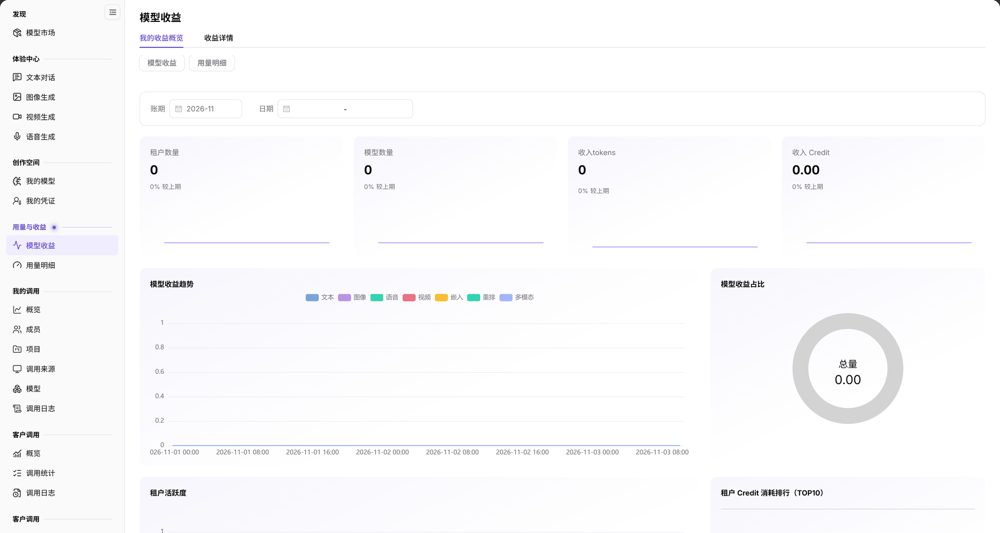

# 模型收益

::: info 文档信息
版本：v2.0
更新日期：2026-11-04
:::

## 功能概述

| 项目 | 内容 |
| --- | --- |
| 适用角色 | 模型提供方 |
| 导航路径 | **模型及AI服务** > **用量与收益** > **模型收益** |
| 页面路由 | `/modelone/accounting/useage/overview/model` |
| 管理对象 | 模型收益、租户数量、模型数量、收入 Token 和收入 Credit |

**新手理解**：模型收益是发布方的收入看板。先选账期，再看租户数、模型数、收入 Token 和收入 Credit，最后用趋势图和排行定位收益来源。

#### 术语速查

| 术语 | 说明 |
| --- | --- |
| 收入 Credit | 外部租户客户调用本方发布的模型后，按计费规则结算划转至本方账户的收益总额。 |
| 收入 Tokens | 产生计费结算的有效推理 Token 总量（包含输入与输出 Token）。 |
| 租户活跃度 | 统计周期内产生实际 API 请求和商业扣费的付费租户分布与调用频次。 |
| 租户 Credit 消耗排行（TOP10） | 按为本方贡献的收益金额倒序排列的前 10 名核心企业租户榜单。 |

## 前提条件

1. 当前账号具备 **用量与收益 > 模型收益** 的查看权限。
2. 已有模型发布并产生客户调用或计费记录。
3. 已确认统计账期和日期范围。

## 页面说明

页面顶部为 `模型收益` 标题和 `我的收益概览`、`收益详情` 两个页签；页签下方还提供 `模型收益`、`用量明细` 快速切换，左侧菜单同样提供这两项。

| 区域 | 说明 |
| --- | --- |
| 顶部页签与跳转导航 | 提供我的收益概览/详情页签切换，以及模型收益与用量明细的横向快捷切换入口 |
| 账期与核算过滤栏 | 提供收益核算账期（月份）下拉选择框与自然日粒度的精确起止日期筛选器 |
| 核心收益 KPI 卡片 | 展示租户数量、模型数量、收入 Tokens、收入 Credit，并附带与上期环比增减标记 |
| 收益分析图表矩阵 | 呈现模型收益趋势折线图、收益占比饼图、租户活跃度分布与 TOP10 租户贡献排行榜 |

`我的收益概览` 包含：

- 筛选区：`账期`、`日期`。
- 指标卡：`租户数量`、`模型数量`、`收入tokens`、`收入 Credit`，每项下方显示 `较上期` 变化比例。
- 图表区：`模型收益趋势`、`模型收益占比`（`总量`）、`租户活跃度`、`租户 Credit 消耗排行（TOP10）`、`模型调用次数趋势`、`模型调用次数分布`。

图示为页面提供 `我的收益概览` 与 `收益详情` 页签；指标卡显示 `租户数量`、`模型数量`、`收入tokens`、`收入 Credit`，每项下方标注 `较上期`；图表区包含 `模型收益趋势`、`模型收益占比`、`租户活跃度` 和 `租户 Credit 消耗排行（TOP10）`。

## 主要操作

### 查看收益概览

1. 进入 **用量与收益 > 模型收益**，默认打开 `我的收益概览`。
2. 在筛选区选择 `账期` 和 `日期`。
3. 读取 `租户数量`、`模型数量`、`收入tokens`、`收入 Credit` 及 `较上期` 变化。
4. 在图表区查看收益趋势、收益占比和租户消耗排行。

### 查看收益详情

1. 点击 `收益详情` 页签。
2. 按页面提供的账期和日期条件核对明细。

### 跳转用量明细

1. 在左侧 `用量与收益` 组点击 `用量明细`。
2. 或在本页切换后继续查看消耗明细概览。

## 参数速查表

| 字段名称 | 是否必填 | 字段类型 | 示例 | 说明 |
| --- | --- | --- | --- | --- |
| 账期 | 是 | 选择项 | `2026-11` | 统计账期 |
| 日期 | 否 | 日期范围 | `2026-11-01` 至 `2026-11-03` | 统计日期范围 |
| 租户数量 | 系统统计 | 数值 | `0` | 产生收益的租户数量 |
| 模型数量 | 系统统计 | 数值 | `0` | 产生收益的模型数量 |
| 收入tokens | 系统统计 | 数值 | `0` | 计费 Token 总量 |
| 收入 Credit | 系统统计 | 金额 | `0.00` | 收益金额 |
| 较上期 | 系统统计 | 百分比 | `0%` | 与上一统计周期对比 |
| 模型收益趋势 | 系统统计 | 图表 | — | 按时间展示收益变化 |
| 模型收益占比 | 系统统计 | 图表 | — | 不同模型的收益占比 |
| 租户活跃度 | 系统统计 | 图表 | — | 租户调用或消耗活跃情况 |
| 租户 Credit 消耗排行（TOP10） | 系统统计 | 排行 | — | 消耗 Credit 最多的租户 |

## 踩坑提示

- 指标卡同时显示当前值和 `较上期`；判断趋势时先确认账期和日期范围一致。
- 当前范围没有收益数据时，指标显示 `0` 或 `0.00`，图表为空，不代表页面不可用。
- `模型收益` 与 `用量明细` 是两个菜单页面，统计口径不同，不要混用。

## 结果校验

| 检查项 | 成功表现 | 异常时处理 |
| --- | --- | --- |
| 账期联动刷新 | 切换统计月份或调整起止日期后，四大 KPI 卡片与下方的收益趋势、排行图表同步刷新 | 若无数据，点击重置或切换至已产生实际客户调用的账期 |
| 环比涨跌计算 | KPI 卡片中的“较上期”准确显示正负百分比或持平标记 | 若上期无基准数据，显示 `--` 属于正常现象 |
| 图表联动交互 | 鼠标悬浮在收益趋势或占比图上，清晰呈现各模型贡献的具体金额与百分比 | 若图表渲染重叠，调整浏览器窗口宽度或刷新重绘 |
| TOP10 租户榜单 | 准确列出贡献收益前 10 名的企业租户名称与消耗 Credit 数值 | 若租户名称显示为脱敏占位符，检查当前账号查看敏感客户名称权限 |
| 收益明细穿透 | 点击“收益详情”页签，顺利进入按订单或按调用批次的明细结算流水表格 | 检查账号是否拥有明细级别的财务对账权限 |

## 常见问题

#### 指标全部为 0

**问题现象：** 租户数量、模型数量、收入 Tokens 与收入 Credit 均显示为 0 或 0.00。

**可能原因：** 所选统计账期内本方发布的模型尚未被外部付费客户调用，或者模型处于免费推广期未配置计费规则。

**处理方式：**

1. 检查[我的模型](../../studio/my-models/)中各模型的商业化计费策略是否已配置并生效。
2. 切换至有客户实际付费调用的月份。
3. 核实外部客户调用是否使用了免费赠送的额度抵扣。

#### 图表没有数据

**问题现象：** 核心指标卡有数值，但下方的收益趋势和占比图均为空白。

**可能原因：** 筛选日期跨度过短导致无法生成时序采样点，或者仅有单日单笔结算记录无法形成趋势曲线。

**处理方式：**

1. 扩大日期范围至整月或选择全量日期跨度。
2. 检查浏览器广告拦截插件是否阻止了图表 Canvas/SVG 脚本的正常执行。

## 注意事项

- 收益数据按账期统计，跨账期比较前先统一口径。
- 页面只展示汇总与趋势，不对账；对账请结合费用与结算页面。
- 不要截图或外发包含客户名称、金额和合同信息的页面。

## 后续操作

1. 在[用量明细](../model-usage/)中核对本方自身作为消费者消耗的 Token 与扣费。
2. 在[客户调用概览](../../provider-calls/overview/)中分析高收益模型的客户调用来源与流量走势。
3. 在[我的模型](../../studio/my-models/)中调整热度模型的定价策略或流控限制。

相关页面：
- [用量明细](../model-usage/)
- [客户调用概览](../../provider-calls/overview/)
- [客户调用概览](../../provider-calls/overview/)
- [我的模型](../../studio/my-models/)
