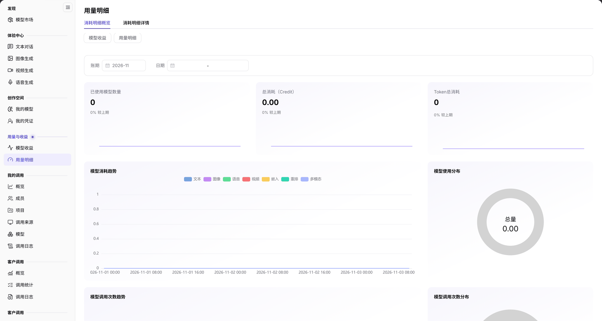

# 用量明细

::: info 文档信息
版本：v2.0
更新日期：2026-11-04
:::

## 功能概述

| 项目 | 内容 |
| --- | --- |
| 适用角色 | 模型提供方 |
| 导航路径 | **模型及AI服务** > **用量与收益** > **用量明细** |
| 页面路由 | `/modelone/accounting/deduction/overview/model` |
| 管理对象 | 模型消耗、已使用模型数量、总消耗 Credit 和 Token 总量 |

**新手理解**：用量明细是发布方的消耗账本。先选账期，再看用了多少模型、扣了多少 Credit、消耗了多少 Token，最后用趋势和分布判断消耗集中在哪些模型。

#### 术语速查

| 术语 | 说明 |
| --- | --- |
| 账期 | 平台进行用量汇总与费用扣减的自然月度时间区间（如 `2026-11`）。 |
| 总消耗（Credit） | 当前统计周期内因调用模型服务而扣减的平台点数或信用额度总量。 |
| Token 总消耗 | 所选统计范围内模型推理实际消耗的输入 Prompt 与输出 Completion Token 之和。 |
| 较上期 | 当前周期的指标数值与上一相邻统计周期同等时间跨度对比的环比涨跌幅百分比。 |

## 前提条件

1. 当前账号具备 **用量与收益 > 用量明细** 的查看权限。
2. 已有模型调用或扣费记录。
3. 已确认统计账期和日期范围。

## 页面说明

页面顶部为 `用量明细` 标题和 `消耗明细概览`、`消耗明细详情` 两个页签；页签下方还提供 `模型收益`、`用量明细` 快速切换，左侧菜单同样提供这两项。

| 区域 | 说明 |
| --- | --- |
| 顶部页签与快捷跳转栏 | 包含消耗明细概览/详情页签切换，以及模型收益与用量明细的横向快捷导航链接 |
| 账期与日期过滤区 | 提供核算账期（月份）选择下拉框及自然日粒度的起止日期范围筛选器 |
| 核心消耗 KPI 卡片 | 展示已使用模型数量、总消耗 Credit、Token 总消耗，并附带与上期环比增减标记 |
| 趋势与分布图表群 | 呈现模型消耗趋势、消耗分布饼图、调用频次趋势折线图以及调用次数占比环形图 |

`消耗明细概览` 包含：

- 筛选区：`账期`、`日期`。
- 指标卡：`已使用模型数量`、`总消耗（Credit）`、`Token总消耗`，每项下方显示 `较上期` 变化比例。
- 图表区：`模型消耗趋势`、`模型使用分布`（`总量`）、`模型调用次数趋势`、`模型调用次数分布`。

图示为页面提供 `消耗明细概览` 与 `消耗明细详情` 页签；指标卡显示 `已使用模型数量`、`总消耗（Credit）`、`Token总消耗`，每项下方标注 `较上期`；图表区包含 `模型消耗趋势`、`模型使用分布`、`模型调用次数趋势` 和 `模型调用次数分布`。

## 主要操作

### 查看消耗概览

1. 进入 **用量与收益 > 用量明细**，默认打开 `消耗明细概览`。
2. 在筛选区选择 `账期` 和 `日期`。
3. 读取 `已使用模型数量`、`总消耗（Credit）`、`Token总消耗` 及 `较上期` 变化。
4. 在图表区查看消耗趋势和模型使用分布。

### 查看消耗详情

1. 点击 `消耗明细详情` 页签。
2. 按账期和日期条件核对明细记录。

### 跳转模型收益

1. 在左侧 `用量与收益` 组点击 `模型收益`。
2. 或在本页切换后查看收益概览。

## 参数速查表

| 字段名称 | 是否必填 | 字段类型 | 示例 | 说明 |
| --- | --- | --- | --- | --- |
| 账期 | 是 | 选择项 | `2026-11` | 统计账期 |
| 日期 | 否 | 日期范围 | `2026-11-01` 至 `2026-11-03` | 统计日期范围 |
| 已使用模型数量 | 系统统计 | 数值 | `0` | 产生消耗的模型数量 |
| 总消耗（Credit） | 系统统计 | 金额 | `0.00` | 消耗的 Credit 总量 |
| Token总消耗 | 系统统计 | 数值 | `0` | 输入与输出 Token 总量 |
| 较上期 | 系统统计 | 百分比 | `0%` | 与上一统计周期对比 |
| 模型消耗趋势 | 系统统计 | 图表 | — | 按时间展示消耗变化 |
| 模型使用分布 | 系统统计 | 图表 | — | 不同模型的消耗占比 |
| 模型调用次数趋势 | 系统统计 | 图表 | — | 按时间展示调用次数 |
| 模型调用次数分布 | 系统统计 | 图表 | — | 不同模型的调用次数占比 |

## 踩坑提示

- 指标卡同时显示当前值和 `较上期`；判断趋势时先确认账期和日期范围一致。
- 当前范围没有消耗数据时，指标显示 `0` 或 `0.00`，图表为空，不代表页面不可用。
- `用量明细` 与 `模型收益` 是两个菜单页面，分别看消耗与收入，不要混用。

## 结果校验

| 检查项 | 成功表现 | 异常时处理 |
| --- | --- | --- |
| 账期联动刷新 | 切换账期或调整日期范围后，KPI 卡片数值与四大图表无闪烁平滑更新 | 若无数据，点击重置或切换至已产生实际扣费的月份 |
| 环比涨跌计算 | KPI 卡片中的“较上期”准确显示正负百分比或持平标记 | 若上期无基准数据，该位通常显示 `--` 属于正常现象 |
| 图表联动交互 | 鼠标悬浮在趋势折线或分布扇区上，精准呈现对应模型名称、消耗金额及占比 | 若图表渲染重叠，调整浏览器窗口宽度或刷新重绘 |
| 双页签切换 | 点击“消耗明细详情”可进入按请求或天级维度的表格流水清单 | 检查账号是否拥有明细级别的财务审计权限 |
| 跨模块快速跳转 | 点击“模型收益”按钮顺利切换至对应的收益核算看板 | 检查是否保存了当前页面未提交的筛选操作 |

## 常见问题

#### 指标全部为 0

**问题现象：** 已使用模型数量、总消耗 Credit 与 Token 总量均显示为 0 或 0.00。

**可能原因：** 所选账期内尚未发生实际计费的模型调用，或者平台计费扣费出账任务处于月末批处理排队中。

**处理方式：**

1. 切换至有实际推理扣费发生的历史账期进行对比核验。
2. 检查租户账户是否配置了免扣费测试额度或特权配额。
3. 前往账单管理页面确认账户当前扣费状态与扣费规则。

#### 图表没有数据

**问题现象：** 核心指标有数值，但下方的趋势图和分布图均显示空白。

**可能原因：** 筛选日期范围跨度过短（如仅选单日），不足以生成时序趋势采样点；或者单一模型消耗垄断导致饼图无分布切片。

**处理方式：**

1. 扩大日期范围至整月或至少连续 7 天以上。
2. 检查浏览器广告拦截插件是否阻止了图表 Canvas/SVG 脚本的正常执行。

## 注意事项

- 消耗数据按账期统计，跨账期比较前先统一口径。
- 页面只展示汇总与趋势，不对账；对账请结合费用与结算页面。
- 不要截图或外发包含客户名称、金额和调用明细的页面。

## 后续操作

1. 在[模型收益](../model-earnings/)中查看本方发布模型产生的收益与外部租户充值分成。
2. 在[我的调用](../../my-calls/overview/)中按成员和项目核对消费明细归属。
3. 在[我的模型](../../studio/my-models/)中优化各模型服务的计费单价与免费额度策略。

相关页面：
- [模型收益](../model-earnings/)
- [我的调用概览](../../my-calls/overview/)
- [客户调用概览](../../customer-calls/overview/)
- [我的模型](../../studio/my-models/)
