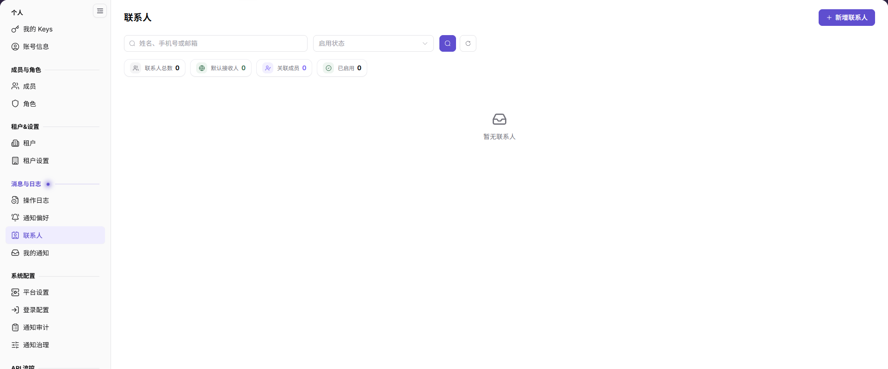

# 联系人

## 功能概述

| 项目 | 内容 |
| --- | --- |
| 适用角色 | 运营管理员 |
| 导航路径 | 设置 > 消息与日志 > 联系人 |
| 页面路由 | `/user/user-space/notification/contacts` |
| 管理对象 | 联系人姓名、职位、手机号、邮箱、关联平台用户、租户通用联系人、启用状态和更新时间 |

#### 新手理解

联系人页是租户的通知联系人名册，用于维护通知接收对象。租户通用联系人会作为默认接收人；业务负责人可作为具体业务的联系人。

#### 术语速查

| 术语 | 说明 |
| --- | --- |
| 联系人 | 通知接收对象的姓名和联系方式。 |
| 租户通用联系人 | 租户通知的默认接收人。 |
| 关联平台用户 | 与联系人关联的平台账号。 |
| 业务负责人 | 具体业务的通知联系人。 |

## 前提条件

1. 当前账号可以进入 `设置 > 消息与日志 > 联系人`。
2. 新增或修改联系人前，已获得联系人信息使用授权。
3. 已确认联系人需要接收的通知范围。

## 页面说明

页面提供联系人搜索、启用状态筛选、新增联系人和联系人列表。

| 区域 | 说明 |
| --- | --- |
| 搜索 | 按姓名、手机号或邮箱搜索。 |
| 启用状态 | 筛选启用或停用的联系人。 |
| 新增联系人 | 打开联系人新增表单。 |
| 列表 | 展示联系人、手机号、邮箱、关联平台用户、启用状态、更新时间和操作。 |

## 主要操作

### 查看联系人

1. 进入 `设置 > 消息与日志 > 联系人`。
2. 按姓名、手机号或邮箱搜索，或按启用状态筛选。
3. 查看联系人的手机号、邮箱、关联平台用户和启用状态。
4. 点击 `重置` 清空筛选条件。

### 新增联系人

1. 点击 `新增联系人`。
2. 填写 `姓名`、`职位`、`手机号`、`邮箱`，选择 `关联平台用户`。
3. 按需要开启 `租户通用联系人`；开启后该联系人可作为租户通知的默认接收人。
4. 点击 `保存` 前核对联系方式；只读核对时点击 `取消`，不提交。

### 编辑联系人

1. 在列表中找到目标联系人。
2. 点击 `编辑`。
3. 修改联系方式、关联平台用户或租户通用联系人状态。
4. 保存后返回列表，核对更新时间和启用状态。

## 参数速查表

| 字段名称 | 是否必填 | 字段类型 | 示例 | 说明 |
| --- | --- | --- | --- | --- |
| 姓名 | 是 | 文本 | 示例联系人 | 联系人展示名称。 |
| 职位 | 否 | 枚举 | 业务负责人 | 联系人在业务中的角色。 |
| 手机号 | 否 | 文本 | 188****8888 | 通知或联系使用。 |
| 邮箱 | 否 | 文本 | user@example.com | 邮件通知使用。 |
| 关联平台用户 | 否 | 下拉选择 | 示例用户 | 关联的平台账号。 |
| 租户通用联系人 | 否 | 开关 | 开启 | 作为租户通知的默认接收人。 |

## 踩坑提示

- 租户通用联系人会影响默认接收范围，开启前确认影响。
- 手机号和邮箱格式错误会导致通知无法送达。
- 重复联系人会造成重复通知或接收责任不清。
- 不在文档或截图中写真实姓名、手机号、邮箱、租户 ID 或平台账号。

## 结果校验

| 检查项 | 成功表现 | 异常时处理 |
| --- | --- | --- |
| 搜索联系人 | 列表按姓名、手机号或邮箱刷新。 | 检查关键词和筛选条件。 |
| 新增联系人 | 保存后联系人出现在列表中。 | 检查必填项、格式和保存提示。 |
| 编辑联系人 | 列表显示更新后的联系方式和状态。 | 刷新页面并确认保存结果。 |
| 租户通用联系人 | 目标联系人显示为通用联系人。 | 检查开关状态和保存结果。 |

## 常见问题

#### 联系人收不到通知

**问题现象：**

联系人已配置，但未收到邮件或站内信。

**可能原因：**

联系人未启用、邮箱格式错误、租户通用联系人未开启，或通知类型和渠道未启用。

**处理方式：**

核对联系人启用状态和邮箱，再检查通知偏好与通知审计。

#### 为什么不能新增联系人？

**问题现象：**

`新增联系人` 入口不可用或保存失败。

**可能原因：**

当前账号缺少联系人管理权限，或必填字段、联系方式格式不符合要求。

**处理方式：**

确认账号权限和表单必填项；仍失败时联系租户管理员。

## 注意事项

- 联系人信息属于敏感数据，只在授权范围内使用。
- 修改租户通用联系人会影响默认通知接收范围。
- 不写真实姓名、手机号、邮箱、租户 ID 或平台账号。

## 后续操作

1. 配置通知接收方式，进入 [通知偏好](../notification-settings/)。
2. 查看通知投递结果，进入 [通知审计](../../system-settings/notification-center/)。
