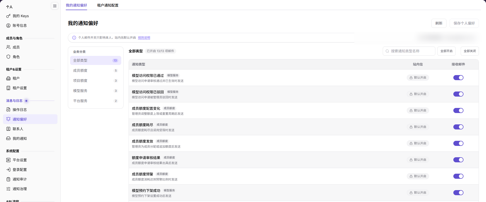

# 通知偏好

## 功能概述

| 项目 | 内容 |
| --- | --- |
| 适用角色 | 运营管理员 |
| 导航路径 | 设置 > 消息与日志 > 通知偏好 |
| 页面路由 | `/user/user-space/notification/receiving` |
| 管理对象 | 个人通知偏好、租户通知接收设置、通知类型、接收渠道和接收人 |

#### 新手理解

通知偏好页分为“我的通知偏好”和“租户通知配置”两个页签。前者只影响当前账号的邮件接收选择；后者用于查看租户内各通知类型的接收渠道和接收人。站内信在个人层面不可关闭。

#### 术语速查

| 术语 | 说明 |
| --- | --- |
| 个人通知偏好 | 当前账号对各类通知是否接收邮件的选择。 |
| 站内信 | 平台内通知；个人层面不可关闭。 |
| 租户通知配置 | 租户内通知类型的接收渠道和接收人设置。 |
| 默认联系人 | 租户通知的默认接收对象。 |

## 前提条件

1. 当前账号可以进入 `设置 > 消息与日志 > 通知偏好`。
2. 调整个人偏好前，已确认需要接收邮件的通知类型。
3. 调整租户通知配置前，已确认影响的租户和接收人范围。

## 页面说明

页面包含两个页签：

| 页签 | 说明 |
| --- | --- |
| 我的通知偏好 | 按通知类型展示站内信和接收邮件开关；站内信不可关闭。 |
| 租户通知配置 | 按通知类型展示业务主题、消息级别、接收渠道、接收人和设置入口。 |

个人偏好页提供 `刷新` 和 `保存个人偏好`；租户配置页提供通知名称、接收渠道、消息级别筛选和业务主题按钮。

## 主要操作

### 查看个人通知偏好

1. 进入 `设置 > 消息与日志 > 通知偏好`。
2. 保持 `我的通知偏好` 页签选中。
3. 按通知类型查看站内信和接收邮件状态；站内信开关固定为开启。
4. 需要刷新时点击 `刷新`。

### 调整个人邮件接收

1. 在 `我的通知偏好` 页签找到目标通知类型。
2. 切换该类型的 `接收邮件` 开关。
3. 确认变更后点击 `保存个人偏好`。
4. 返回页面核对开关状态；未保存时按钮保持不可用属于正常现象。

### 查看租户通知配置

1. 切换到 `租户通知配置` 页签。
2. 按通知名称、接收渠道或消息级别筛选。
3. 使用业务主题按钮缩小范围，例如账户资金消息、产品消息、安全消息、异常通知、活动消息、服务消息。
4. 查看各通知类型的接收渠道和接收人。

### 设置租户通知接收

1. 在 `租户通知配置` 页签找到目标通知类型。
2. 点击该行的 `设置`。
3. 按页面提供的渠道和接收人选项调整配置。
4. 保存前确认影响的租户成员范围；只读核对时取消退出，不提交变更。

## 参数速查表

| 字段名称 | 是否必填 | 字段类型 | 示例 | 说明 |
| --- | --- | --- | --- | --- |
| 通知类型 | 系统展示 | 文本 | 账户余额不足 | 通知的业务事件名称。 |
| 站内信 | 系统固定 | 开关 | 开启 | 个人层面不可关闭。 |
| 接收邮件 | 否 | 开关 | 开启 | 控制当前账号是否接收该类型邮件。 |
| 业务主题 | 系统展示 | 枚举 | 账户资金消息 | 通知所属业务分类。 |
| 消息级别 | 系统展示 | 枚举 | 普通 | 通知严重程度。 |
| 接收渠道 | 系统展示 | 多选 | 站内信、邮件 | 租户通知使用的投递渠道。 |
| 接收人 | 系统展示 | 文本 | 默认联系人 | 租户通知的默认接收对象。 |

## 踩坑提示

- 个人邮件开关只影响当前账号；站内信在个人层面不可关闭。
- 实际投递还受平台渠道配置、类型启用状态、模板和收件资格约束。
- 默认配置后续变化不会覆盖已经保存的个人选择。
- 租户通知配置会影响租户成员，变更前确认接收范围。
- 不在文档或截图中写真实邮箱、手机号、租户 ID 或通知内容中的业务数据。

## 结果校验

| 检查项 | 成功表现 | 异常时处理 |
| --- | --- | --- |
| 页签切换 | `我的通知偏好` 与 `租户通知配置` 可以正常切换。 | 刷新页面；仍失败时检查账号权限。 |
| 个人偏好保存 | 保存后开关状态与选择一致。 | 检查是否有未保存变更和页面提示。 |
| 租户配置筛选 | 列表按通知名称、渠道或消息级别刷新。 | 清空筛选后重新查询。 |
| 设置入口 | 目标通知类型可以打开 `设置`。 | 检查当前账号的租户通知配置权限。 |

## 常见问题

#### 为什么收不到邮件通知？

**问题现象：**

个人偏好中已开启接收邮件，但未收到邮件。

**可能原因：**

平台邮件渠道未配置、该通知类型未启用、模板或收件资格不满足，或邮件被判为垃圾邮件。

**处理方式：**

先确认个人偏好已保存，再检查平台通知配置和邮件设置，最后查看通知审计中的投递状态。

#### 为什么站内信开关不能关闭？

**问题现象：**

站内信开关呈禁用状态。

**可能原因：**

站内信在个人层面被设计为不可关闭，用于保证关键通知可达。

**处理方式：**

保留站内信开启；如不希望接收某类通知，联系管理员调整平台通知配置。

#### 保存个人偏好按钮为什么不可用？

**问题现象：**

进入页面后 `保存个人偏好` 按钮为禁用状态。

**可能原因：**

当前没有未保存的变更。

**处理方式：**

修改任一邮件开关后再查看按钮状态；不要为了启用按钮而提交无关变更。

## 注意事项

- 通知偏好涉及个人偏好和租户范围，变更前确认影响对象。
- 站内信不可在个人层面关闭；不要尝试通过页面以外的配置绕过。
- 租户通知配置变更会影响成员接收行为，建议记录变更原因。
- 不写真实邮箱、手机号、租户 ID、通知正文或内部业务数据。

## 后续操作

1. 查看个人通知，进入 [我的通知](../inbox/)。
2. 查看平台通知类型和渠道，进入 [通知治理](../../system-settings/notification-config/)。
