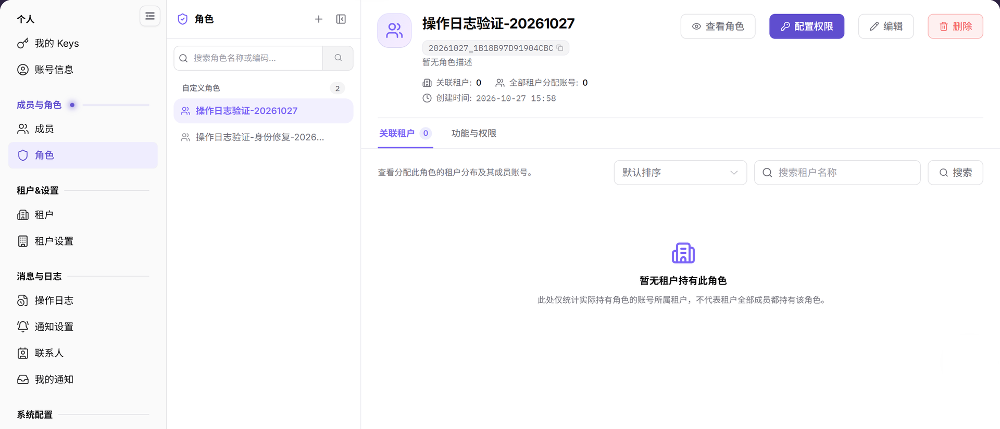
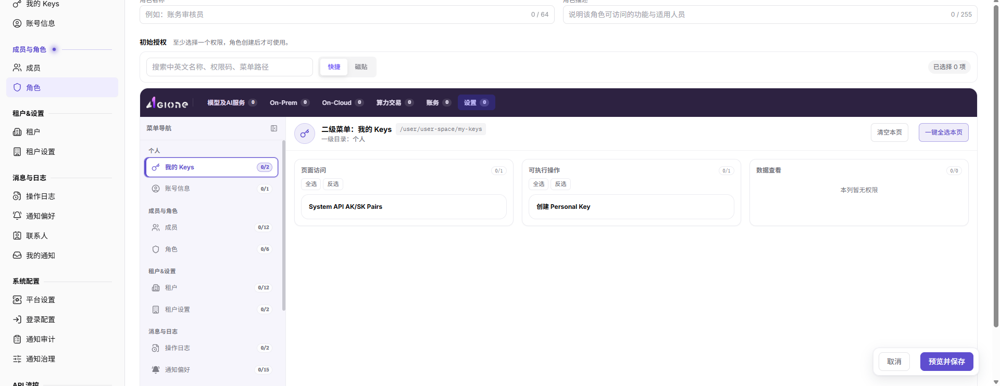

# 角色

::: info 文档信息
版本：v2.0
更新日期：2026-11-04
:::

## 功能概述

| 项目 | 内容 |
| --- | --- |
| 适用角色 | 运营管理员 |
| 导航路径 | 设置 > 成员与角色 > 角色 |
| 页面路由 | `/user/user-space/roles` |
| 管理对象 | 角色名称、角色标识、角色描述、关联租户数、全部租户分配账号数和功能权限 |

#### 新手理解

运营侧角色像平台后台的权限模板，用来定义管理员能看哪些系统模块、能改哪些配置、能处理哪些审批。它关注平台治理边界，不是项目内协作角色。

#### 术语速查

| 术语 | 说明 |
| --- | --- |
| 平台角色 | 运营管理员权限集合；按职责拆分。 |
| 角色标识 | 角色的稳定编码；被引用后修改可能影响权限识别和审计。 |
| 配置权限 | 为角色选择可访问的服务、菜单和操作；变更会影响成员可见范围。 |
| 关联租户 | 实际持有该角色的租户及其成员账号；删除前需要核对。 |
| 功能与权限 | 角色当前拥有的功能范围和权限明细页签。 |

## 前提条件

1. 当前账号具备角色管理权限。
2. 已进入 `设置 > 成员与角色 > 角色`。
3. 配置权限或删除角色前，已确认受影响的成员和租户范围。

## 页面说明

页面左侧是角色列表，右侧是当前选中角色的详情。

图示为角色列表与详情，右侧显示角色标识、关联租户数、分配账号数以及查看角色/配置权限/编辑/删除入口。

| 区域 | 说明 |
| --- | --- |
| 角色列表 | 按角色名称或编码搜索，展示自定义角色数量。 |
| 添加角色 | 新建角色入口。 |
| 角色详情 | 展示角色名称、角色标识、关联租户数、全部租户分配账号数和创建时间。 |
| 操作按钮 | `查看角色`、`配置权限`、`编辑`、`删除`。 |
| 页签 | `关联租户` 展示实际持有该角色的租户和成员账号；`功能与权限` 展示角色权限范围。 |

## 主要操作

### 查看角色

1. 进入 `设置 > 成员与角色 > 角色`。
2. 在左侧列表按角色名称或编码搜索，选择目标角色。
3. 在右侧核对角色名称、角色标识、关联租户数、全部租户分配账号数和创建时间。
4. 切换 `关联租户` 与 `功能与权限` 页签，确认角色实际使用范围和权限边界。

### 添加角色

1. 点击页面右上角的 `添加角色`。
2. 在添加角色表单中填写 `角色名称`、必填的 `角色标识` 和可选的 `角色描述`。

图示为添加角色表单，包含角色名称、角色标识、角色描述和初始权限区域；创建前确认最小权限范围。
3. 点击 `确定` 前，确认角色命名、标识和后续权限范围符合最小权限原则。
4. 如仅学习或截图，查看字段后点击 `取消` 关闭窗口，不提交真实角色配置。

### 编辑角色

1. 在左侧列表选择目标角色。
2. 点击详情区的 `编辑`。
3. 修改允许变更的角色名称或描述，确认影响范围后保存。
4. 返回角色详情，核对名称、描述和创建时间是否更新。

### 配置权限

1. 在左侧列表选择目标角色。
2. 点击详情区的 `配置权限`。
3. 按页面提供的服务、菜单和操作项选择权限，确认已选权限总数和影响范围。
4. 保存前核对权限变化；如仅查看，使用 `取消` 返回，不提交权限变更。
5. 保存后回到角色详情，通过 `功能与权限` 页签核对结果。

### 删除角色

1. 先在 `关联租户` 页签确认没有成员或租户仍在使用该角色。
2. 点击详情区的 `删除`。
3. 在确认对话框中核对角色名称和影响范围，再执行删除。
4. 删除后确认角色从左侧列表消失，相关成员菜单和操作权限符合预期。

## 参数速查表

| 字段名称 | 是否必填 | 字段类型 | 示例 | 说明 |
| --- | --- | --- | --- | --- |
| 角色名称 | 是 | 文本 | 审计管理员 | 运营角色展示名称。 |
| 角色标识 | 是 | 文本 | audit_admin | 角色唯一标识，建议稳定、可读、便于审计。 |
| 角色描述 | 否 | 文本 | 查看审计日志和基础运营信息 | 说明角色用途和权限边界。 |
| 权限点 | 是 | 多选 | 操作日志查看 | 控制角色可访问的服务、菜单和操作。 |
| 关联租户数 | 系统展示 | 数字 | 0 | 展示实际持有该角色的租户数量。 |
| 全部租户分配账号数 | 系统展示 | 数字 | 0 | 展示实际分配该角色的账号数量。 |
| 操作 | 系统生成 | 按钮 | 查看角色 / 配置权限 / 编辑 / 删除 | 提供角色维护入口。 |

## 踩坑提示

- 不要直接修改高权限角色，先复制或新增低风险角色验证权限范围。
- 删除角色前必须确认没有成员或租户仍在使用；以 `关联租户` 页签为准。
- 权限点变更会影响平台级操作入口，建议记录变更原因和审批依据。
- 添加角色会创建新的平台权限模板，后续权限配置和成员绑定会影响平台管理权限。
- `确定` 属于最终提交动作；学习或截图时只查看字段并使用 `取消` 退出。
- `角色标识` 一旦被引用，后续修改可能影响权限识别、审计和自动化配置。
- 不写真实内部角色编码、账号、成员 ID、客户名或内部测试数据。

## 结果校验

| 检查项 | 成功表现 | 异常时处理 |
| --- | --- | --- |
| 角色筛选 | 左侧列表按角色名称或编码刷新。 | 检查名称或编码是否准确。 |
| 角色详情 | 右侧显示角色名称、标识、关联租户数和创建时间。 | 重新选择角色；仍为空时检查角色管理权限。 |
| 添加角色 | 点击 `添加角色` 后可打开添加表单。 | 检查当前账号是否具备角色创建权限。 |
| 配置权限 | 目标角色可进入配置权限页面。 | 检查当前账号角色管理权限。 |
| 删除入口 | 删除入口按权限展示。 | 删除前确认角色未被成员或租户依赖。 |

## 常见问题

#### 成员看不到菜单

**问题现象：**

成员登录后看不到某个菜单或按钮。

**可能原因：**

成员绑定的角色未授予对应菜单或操作权限。

**处理方式：**

进入角色的 `配置权限` 入口核对权限范围，再确认成员是否绑定正确角色。

#### 角色是否可以直接删除

**问题现象：**

角色详情中存在删除入口。

**可能原因：**

角色可能仍被成员或租户使用，直接删除会影响访问能力。

**处理方式：**

先通过 `关联租户` 页签确认角色使用范围，再按权限变更流程处理。

#### 运营侧角色列表为什么为空？

**问题现象：**

运营侧角色页没有平台管理员、审计员或配置管理员角色。

**可能原因：**

当前账号没有运营角色管理权限，角色归属其他管理租户，或系统角色不允许在列表中编辑。

**处理方式：**

确认当前入口为运营侧设置；检查角色管理权限；系统内置角色异常时联系超级管理员核查。

## 注意事项

- 权限配置变更会影响菜单可见性和按钮可用性。
- 删除角色前应确认没有关键成员或租户依赖该角色。
- `确定` 属于最终提交动作，添加角色前必须确认角色命名、角色标识和后续权限范围。
- `角色标识` 一旦被引用，后续修改可能影响权限识别、审计和自动化配置。
- 学习或截图时只打开表单查看字段，使用 `取消` 退出。
- 不写真实内部角色编码、账号、成员 ID、客户名或内部测试数据。

## 后续操作

1. 需要查看角色绑定成员，进入 [成员](../members/)。
2. 需要追踪权限变更，进入 [操作日志](../../activity-notifications/operation-logs/)。
