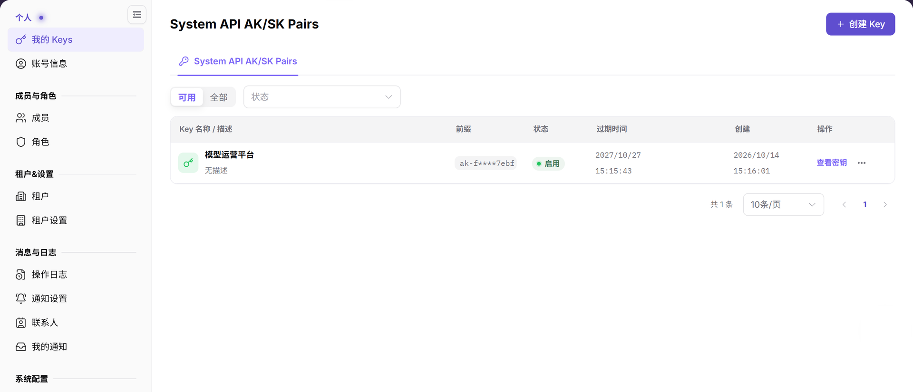
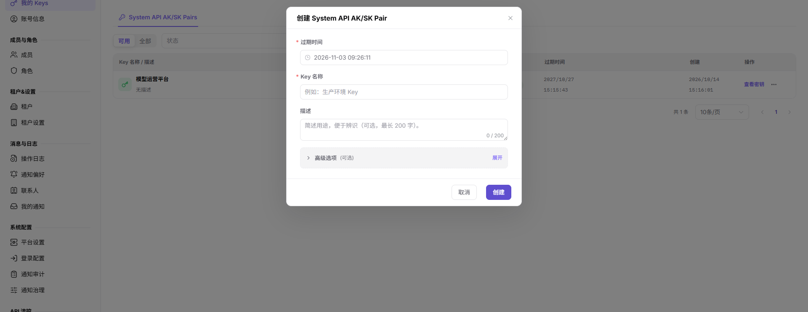

# 我的 Keys

::: info 文档信息
版本：v2.1
更新日期：2026-11-12
:::

## 功能概述

| 项目 | 内容 |
| --- | --- |
| 适用角色 | 运营管理员（Operator） |
| 导航路径 | 设置 > 个人 > 我的 Keys |
| 页面路由 | `/user/user-space/my-keys/system` |
| 管理对象 | System API AK/SK Pairs、状态、过期时间和创建记录 |

#### 新手理解

AK/SK 对是平台 API 调用凭据。它属于高敏感信息：创建前要明确调用方、用途和过期计划；生成后只能通过批准的安全渠道保存和交接，不能把完整 AK/SK 写入文档、截图或工单。

#### 术语速查

| 术语 | 说明 |
| --- | --- |
| System API AK/SK Pair | 一组用于平台 API 的访问标识和密钥；只用于已确认的系统集成场景。 |
| 前缀 | 列表中显示的非敏感识别信息；可用于识别凭据，不等同于完整密钥。 |
| 过期时间 | AK/SK 对失效的时间点；在自动化任务到期前安排轮换。 |
| 状态 | 当前凭据是否可用的状态；排查调用失败时先核对状态。 |

## 前提条件

1. 当前账号具备查看和创建系统凭据的权限。
2. 已从运营方菜单进入 `设置 > 个人 > 我的 Keys`。
3. 创建前已确认调用方、用途、过期计划和安全交接方式。

## 页面说明

当前运营方页面只展示 `System API AK/SK Pairs` 页签；本角色页面没有 `Model API Keys` 页签。

图示为 System API AK/SK 列表，包含 `Key 名称 / 描述`、`前缀`、`状态`、`过期时间`、`创建` 和 `操作`。本流程不打开密钥值。

| 区域 | 说明 |
| --- | --- |
| 顶部按钮 | `+ 创建 Key`，用于打开 System API AK/SK Pair 创建窗口。 |
| 页签 | `System API AK/SK Pairs` 是当前运营方可见的页签。 |
| 可用范围 | `可用` 和 `全部` 用于切换列表范围。 |
| 状态筛选 | 按凭据状态筛选列表。 |
| 凭据列表 | 显示 `Key 名称 / 描述`、`前缀`、`状态`、`过期时间`、`创建` 和 `操作`。 |
| 空列表 | 没有凭据时显示 `尚未创建 Personal Key`，并提示点击右上角 `+ 创建 Key`。 |

## 主要操作

### 查看 System API 密钥

1. 进入 `设置 > 个人 > 我的 Keys`。
2. 确认 `System API AK/SK Pairs` 页签处于选中状态。
3. 使用 `可用` 或 `全部`，并按需选择 `状态` 筛选条件。
4. 查看 `Key 名称 / 描述`、`前缀`、`状态`、`过期时间`、`创建` 和 `操作` 列；本流程不点击 `查看密钥`。

### 打开 System API 密钥创建窗口

1. 单击右上角 `+ 创建 Key`。
2. 核对 `过期时间`（默认 `1 年`），查看必填的 `Key 名称` 和可选的 `描述`；`描述` 最长 200 个字符。
3. 展开 `高级选项`（可选），查看 `启用 IP 白名单` 及其说明：默认关闭，不限制访问 IP；启用后仅允许指定的 IP 地址或网段（CIDR）调用。本流程不启用该开关。
4. 单击 **"取消"** 关闭窗口，不点击 `创建`，不生成真实凭据。

图示为创建 System API AK/SK Pair 弹窗，基础字段为 `过期时间`、`Key 名称` 和 `描述`。本流程只核对表单，不提交 `创建`。

## 参数速查表

| 字段名称 | 是否必填 | 字段类型 | 示例 | 说明 |
| --- | --- | --- | --- | --- |
| 过期时间 | 是 | 日期时间 | `2026-12-31 23:59` | 设置 System API AK/SK Pair 的失效时间；表单默认 `1 年`。 |
| Key 名称 | 是 | 文本 | `Backend job credential` | 用于识别该凭据的用途。 |
| 描述 | 否 | 文本 | `Model service administration` | 可选的用途说明，最多 200 个字符。 |
| 高级选项 | 否 | 可展开区域 | `展开` / `收起` | 标注为可选；展开后可查看 IP 白名单开关及说明。 |
| 启用 IP 白名单 | 否 | 开关 | 默认关闭 | 页面说明：默认不限制访问 IP；启用后仅允许指定 IP 地址或网段（CIDR）调用。本流程不启用。 |
| 前缀 | 系统生成 | 文本 | `<ACCESS_KEY_ID>` | 列表中的脱敏识别信息，不是完整凭据。 |
| 状态 | 系统生成 | 枚举 | `启用` | 表示凭据当前是否可用。 |
| 创建 | 系统生成 | 日期时间 | `2026-08-26` | 列表中显示凭据创建记录的列。 |
| 操作 | 系统生成 | 按钮 / 菜单 | `查看密钥` | 提供该行可用的操作入口；本流程不打开密钥值。 |

## 踩坑提示

- 当前运营方页面没有 `Model API Keys` 页签，不要用该页面证明 Provider 或 End User 的 Model API Key 行为。
- 基础字段之外还有 `高级选项`（可选）。其中 `启用 IP 白名单` 默认关闭；本次只核对其 IP 地址或网段（CIDR）说明，不启用或提交。不要补写未显示的权限范围、额度、重置周期或预警阈值。
- `创建` 是最终凭据生成动作。学习、截图或核查页面时停在 `取消`，不要提交真实凭据。
- 完整 AK/SK 必须通过受控安全流程保存和交接，不能写入文档、截图、工单或聊天；本流程不生成或查看密钥值。
- 前缀只是列表中的识别信息，不是完整凭据。

## 结果校验

| 检查项 | 成功表现 | 异常时处理 |
| --- | --- | --- |
| 页面入口 | 从 `设置 > 个人 > 我的 Keys` 打开页面。 | 核对当前角色和可见菜单，不从其他角色页面推断。 |
| 页签 | 可见 `System API AK/SK Pairs`。 | 先确认当前是否位于运营方页面。 |
| 列表字段 | 可见 `Key 名称 / 描述`、`前缀`、`状态`、`过期时间`、`创建`、`操作`。 | 核对当前表头，不打开密钥值。 |
| 基础表单 | 创建窗口显示 `过期时间`、`Key 名称`、`描述`，过期默认 `1 年`，描述计数为 `0 / 200`。 | 停在表单核对字段与提示，不提交 `创建`。 |
| 可选区域 | 展开 `高级选项` 后可见 `启用 IP 白名单`，默认关闭，并有 IP 地址或网段说明。 | 核对是否已展开可选区域，不启用开关。 |
| 安全退出 | `取消` 关闭窗口；本流程不点击 `创建` 或 `查看密钥`。 | 停止本次核查，请管理员确认环境。 |

## 常见问题

#### 为什么看不到 Model API Keys？

**问题现象：**

当前页面只显示 `System API AK/SK Pairs`。

**可能原因：**

本次核对的是运营方页面；已观察到的页签不包含 `Model API Keys`。

**处理方式：**

确认当前角色与页面。其他角色的个人 Key 必须到其对应页面核对，不从本页推断。

#### 如何查看可选的 IP 白名单设置？

**问题现象：**

基础字段下方可见 `高级选项`（可选）。

**可能原因：**

IP 白名单位于可选高级区域；其中 `启用 IP 白名单` 默认关闭。

**处理方式：**

展开该区域，只核对 IP 地址或网段（CIDR）说明，不启用开关；点击 `取消` 关闭窗口，不提交 `创建`。

## 注意事项

- 不要在文档、截图、工单或聊天中暴露完整 AK、SK、Key、Token、账号或内部标识。
- 截图只保留页面功能区域；不要保留真实凭据、账号或业务数据。
- `创建` 会生成真实系统凭据，属于最终高风险动作；本手册流程只验证表单，不执行提交。
- 轮换或停用凭据前，确认依赖该凭据的调用方已完成切换。

## 后续操作

1. 点击 `取消` 返回列表，确认本流程未提交 `创建` 或启用 IP 白名单。
2. 需要核对账号信息时，进入 [账号信息](../profile/)。
3. 需要核对成员权限时，进入 [成员](../../members-roles/members/)。
