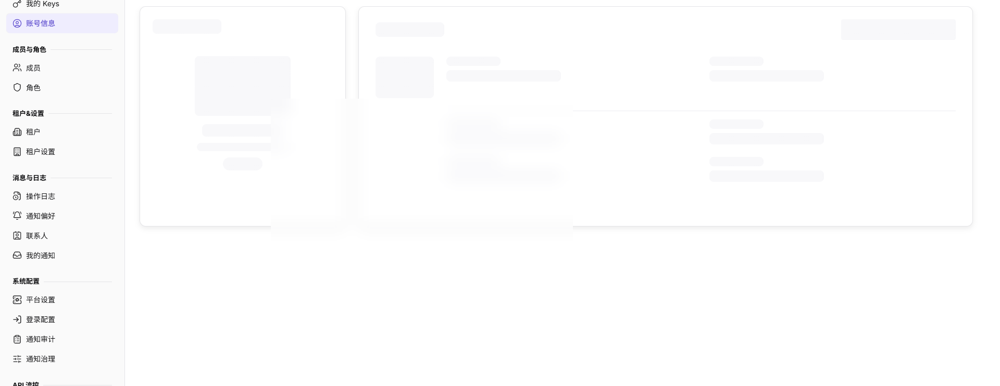
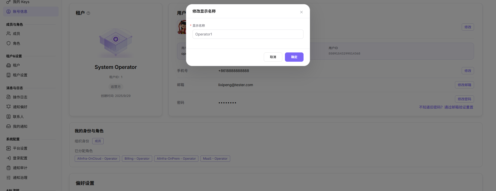

# 账号信息

::: info 文档信息
版本：v2.0
更新日期：2026-11-04
:::

## 功能概述

| 项目 | 内容 |
| --- | --- |
| 适用角色 | 运营管理员 |
| 导航路径 | 设置 > 个人 > 账号信息 |
| 页面路由 | `/user/user-space/profile` |
| 管理对象 | 租户信息、用户设置、联系方式、密码状态、身份角色和语言偏好 |

#### 新手理解

运营账号信息像平台管理员身份卡，用来确认当前管理员的租户归属、登录身份、联系方式、角色范围和界面语言。它关注平台管理身份，不是模型调用方的租户资料。

#### 术语速查

| 术语 | 说明 |
| --- | --- |
| 租户 | 当前账号所属的业务与资金主体；页面展示租户名称、租户 ID、业务身份和创建时间。 |
| 显示名称 | 页面中展示的管理员名称；可点击“修改”调整。 |
| 用户名 | 登录标识；通常只读，变更需走账号管理流程。 |
| 身份来源 | 账号来自本地创建或统一身份源同步；字段不可编辑时先看身份来源。 |
| 偏好设置 | 当前账号使用的界面语言；保存到当前账号。 |

## 前提条件

1. 当前账号已登录平台。
2. 已进入 `设置 > 个人 > 账号信息`。
3. 修改联系方式或密码前，已确认当前账号和影响范围。

## 页面说明

页面按“租户、用户设置、我的身份与角色、偏好设置”分区展示当前账号信息。

图示为账号信息页，按租户、用户设置、我的身份与角色、偏好设置分区；手机号、邮箱和密码通过各自入口修改。

| 区域 | 说明 |
| --- | --- |
| 租户 | 展示租户名称、租户 ID、业务身份和创建时间。 |
| 用户设置 | 展示头像、显示名称、用户名、用户 ID、手机号、邮箱和密码状态。 |
| 我的身份与角色 | 展示组织身份和已分配角色。 |
| 偏好设置 | 设置当前账号使用的界面语言。 |

用户设置区提供的入口包括：`更换头像`、显示名称旁的 `修改`、手机号旁的 `修改`、`修改邮箱`、`修改密码`，以及 `不知道旧密码？通过邮箱验证重置`。

## 主要操作

### 查看账号信息

1. 进入 `设置 > 个人 > 账号信息`。
2. 核对租户名称、租户 ID、业务身份和创建时间。
3. 核对显示名称、用户名、用户 ID、手机号、邮箱和密码状态。
4. 在“我的身份与角色”区确认组织身份和已分配角色是否符合当前职责。
5. 截图或外发前隐藏邮箱、手机号、用户 ID 等敏感信息。

### 修改显示名称

1. 在“用户设置”区找到显示名称。
2. 点击显示名称旁的 `修改`。

图示为账号资料编辑弹窗，可修改显示名称等允许编辑的字段；用户名、用户 ID 等受保护字段保持只读。
3. 按窗口提示填写新的显示名称，确认影响范围后保存。
4. 返回账号信息页，核对显示名称是否更新；未生效时刷新页面或重新登录。

### 修改手机号

1. 在“用户设置”区找到手机号。
2. 点击手机号旁的 `修改`。
3. 按窗口提示完成验证并填写新的手机号，确认后保存。
4. 返回账号信息页，核对手机号显示是否符合预期。

### 修改邮箱

1. 在“用户设置”区找到邮箱。
2. 点击 `修改邮箱`。
3. 按窗口提示完成邮箱验证并提交新邮箱。
4. 返回账号信息页，核对邮箱是否更新；未生效时检查验证邮件和账号状态。

### 修改密码

1. 在“用户设置”区找到密码。
2. 点击 `修改密码`。
3. 按窗口提示输入当前密码和新密码，确认后提交。
4. 如果不知道旧密码，使用 `不知道旧密码？通过邮箱验证重置` 进入邮箱验证流程。
5. 修改后重新登录，确认新密码可用。

### 修改界面语言

1. 进入“偏好设置”区。
2. 在 `语言设置` 中选择目标语言。
3. 确认控制台、登录页和宣传页的显示语言变化。
4. 语言选择保存到当前账号，不改变其他账号的设置。

## 参数速查表

| 字段名称 | 是否必填 | 字段类型 | 示例 | 说明 |
| --- | --- | --- | --- | --- |
| 显示名称 | 是 | 文本 | 示例管理员 | 账号在页面中的展示名称，可通过“修改”调整。 |
| 用户名 | 系统展示 | 文本 | operator | 登录标识，通常只读。 |
| 用户 ID | 系统展示 | 文本 | 示例用户 ID | 当前账号的系统标识。 |
| 手机号 | 否 | 文本 | 188****8888 | 用于账号联系、通知或安全校验。 |
| 邮箱 | 系统展示 | 文本 | user@example.com | 当前账号绑定邮箱，可通过“修改邮箱”调整。 |
| 密码 | 系统展示 | 密码 | ****** | 展示密码状态，通过“修改密码”调整。 |
| 语言设置 | 是 | 枚举 | 中文简体 | 当前账号使用的界面语言。 |

## 踩坑提示

- 运营账号字段可能由统一身份源同步，本页不可编辑不代表页面异常。
- 排查登录问题时要同时看登录配置、身份来源和账号状态。
- 截图不要暴露管理员邮箱、手机号、用户 ID、登录 IP 或安全状态细节。
- `修改`、`修改邮箱`、`修改密码` 会改变真实账号信息，操作前确认影响范围。
- 修改邮箱或密码后需要重新验证，验证未完成时旧信息可能仍然生效。
- 不在文档中写真实手机号、邮箱、用户 ID、账号名、客户名或内部测试数据。

## 结果校验

| 检查项 | 成功表现 | 异常时处理 |
| --- | --- | --- |
| 信息展示 | 租户、用户设置、身份角色和偏好设置正常展示。 | 刷新页面或重新登录。 |
| 账号一致 | 页面账号与当前操作人一致。 | 退出后重新确认登录账号。 |
| 显示名称修改 | 保存后账号信息页显示新的显示名称。 | 检查必填项、格式和保存提示。 |
| 邮箱修改 | 验证完成后账号信息页显示新邮箱。 | 检查验证邮件、验证码和账号状态。 |
| 密码修改 | 使用新密码可以重新登录。 | 检查旧密码、新密码规则和验证流程。 |
| 语言切换 | 控制台、登录页和宣传页显示目标语言。 | 刷新页面；仍不生效时重新登录。 |

## 常见问题

#### 安全联系方式不正确

**问题现象：**

页面展示的手机号或邮箱与预期不一致。

**可能原因：**

账号资料未更新，验证流程未完成，或当前登录账号不是目标账号。

**处理方式：**

先确认登录账号，再通过手机号旁的 `修改`、`修改邮箱` 或邮箱验证流程更新。

#### 运营账号信息为什么没有显示完整资料？

**问题现象：**

运营侧账号信息页缺少安全信息、登录方式或联系信息。

**可能原因：**

运营账号资料由统一身份源同步，敏感字段被权限隐藏，或账号信息尚未完成初始化。

**处理方式：**

确认账号来源和同步状态；可编辑字段按平台账号流程补齐；敏感字段缺失时联系平台管理员核查。

#### 为什么运营账号资料不能编辑？

**问题现象：**

运营账号信息可见，但联系方式、用户名或身份角色无法修改。

**可能原因：**

运营账号由统一身份源管理，敏感字段需要管理员审批，或当前登录方式不支持自助修改。

**处理方式：**

按平台账号管理流程申请变更；身份源字段到统一身份平台维护，修改后重新登录确认同步。

## 注意事项

- 账号信息中可能包含手机号、邮箱、用户 ID 等敏感信息。
- 不要将完整账号信息截图直接发送到外部沟通渠道。
- `修改`、`修改邮箱`、`修改密码` 属于真实账号变更，操作前确认影响范围。
- 用户名、用户 ID 和身份角色通常由身份源管理，不要在本页反复尝试修改。
- 不在文档中写真实手机号、邮箱、用户 ID、账号名、客户名或内部测试数据。

## 后续操作

1. 需要管理个人 Key，进入 [我的 Keys](../my-keys/)。
2. 需要管理成员，进入 [成员](../../members-roles/members/)。
