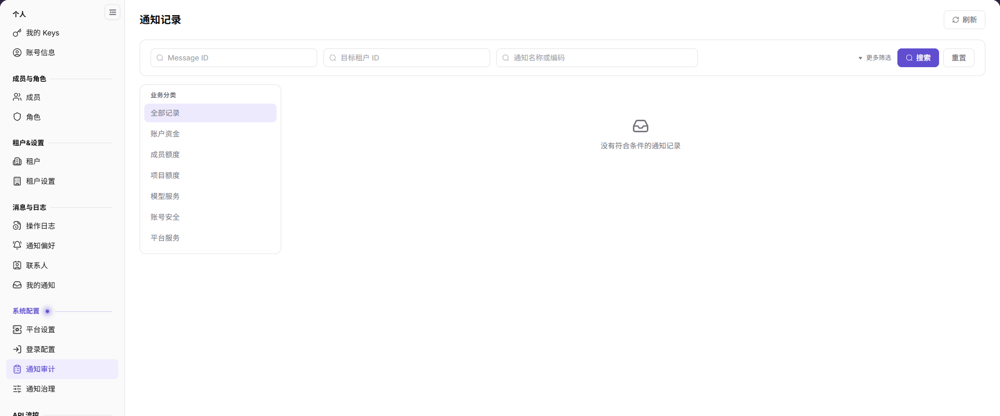

# 通知审计

## 功能概述

| 项目 | 内容 |
| --- | --- |
| 适用角色 | 运营管理员 |
| 导航路径 | 设置 > 系统配置 > 通知审计 |
| 页面路由 | `/user/system/notification/center` |
| 管理对象 | 通知名称、业务主题、目标租户、来源服务、投递渠道、派发状态和触发时间 |

#### 新手理解

通知审计是平台通知的投递台账，用来排查某条通知是否生成、发给了哪个租户、通过哪些渠道投递以及最终状态。它关注投递结果，不替代业务页面的实时状态。

#### 术语速查

| 术语 | 说明 |
| --- | --- |
| Message ID | 通知消息的唯一标识。 |
| 目标租户 | 通知实际发送到的租户。 |
| 来源服务 | 生成通知的后台服务。 |
| 投递渠道 | 站内信、邮件等发送渠道。 |
| 派发状态 | 通知投递的最终状态。 |

## 前提条件

1. 当前账号可以进入 `设置 > 系统配置 > 通知审计`。
2. 排查前已确认通知名称、目标租户或大致触发时间。

## 页面说明

页面提供 Message ID、目标租户 ID、通知名称或编码、更多筛选和业务主题筛选。

| 区域 | 说明 |
| --- | --- |
| 搜索 | 按 Message ID、目标租户 ID、通知名称或编码查询。 |
| 更多筛选 | 展开额外筛选条件。 |
| 业务主题 | 全部记录、账户资金消息、产品消息、安全消息、异常通知、活动消息、服务消息。 |
| 列表 | 展示通知、业务主题、目标租户、来源服务、投递渠道、派发状态、触发时间和操作。 |

## 主要操作

### 查询通知记录

1. 进入 `设置 > 系统配置 > 通知审计`。
2. 输入 Message ID、目标租户 ID 或通知名称/编码。
3. 按需展开 `更多筛选`，选择业务主题。
4. 点击 `搜索`；点击 `重置` 清空条件。

### 查看通知记录详情

1. 在列表中找到目标记录。
2. 点击 `详情`。
3. 查看通知内容、目标租户、来源服务、投递渠道、派发状态和触发时间。
4. 需要继续排查时，结合通知治理、联系人和业务模块状态判断。

## 参数速查表

| 字段名称 | 是否必填 | 字段类型 | 示例 | 说明 |
| --- | --- | --- | --- | --- |
| 通知 | 系统展示 | 文本 | 平台更新完成 | 通知名称。 |
| 业务主题 | 系统展示 | 枚举 | 服务消息 | 通知所属分类。 |
| 目标租户 | 系统展示 | 文本 | 示例租户 | 通知实际发送到的租户。 |
| 来源服务 | 系统展示 | 文本 | 示例服务 | 生成通知的后台服务。 |
| 投递渠道 | 系统展示 | 多选 | 站内信、邮件 | 通知使用的渠道。 |
| 派发状态 | 系统展示 | 枚举 | 已完成 | 通知投递结果。 |
| 触发时间 | 系统展示 | 日期时间 | 2026-10-28 17:34:38 | 通知触发时间。 |

## 踩坑提示

- 目标租户 ID 必须精确匹配，模糊名称可能查不到记录。
- 通知记录展示投递结果，不代表业务数据当前仍然一致。
- 同一通知可能因渠道不同出现多条记录，核对时结合 Message ID 和渠道。
- 记录中可能包含租户、账号和业务数据，截图和外发前必须脱敏。

## 结果校验

| 检查项 | 成功表现 | 异常时处理 |
| --- | --- | --- |
| 搜索 | 列表按 Message ID、租户或通知名称刷新。 | 检查条件格式和是否叠加筛选。 |
| 业务主题 | 列表范围与所选主题一致。 | 清空其他筛选后重试。 |
| 详情 | 点击 `详情` 可以查看通知投递信息。 | 刷新页面；仍失败时检查权限。 |
| 分页 | 可以翻页查看历史记录。 | 缩小时间或条件范围。 |

## 常见问题

#### 为什么查不到通知记录？

**问题现象：**

按通知名称或租户查询不到预期记录。

**可能原因：**

通知未触发、目标租户 ID 不匹配、筛选条件过窄，或记录已超过保留范围。

**处理方式：**

清空筛选并使用 Message ID 或精确租户 ID 查询；仍无记录时检查通知治理和来源服务。

#### 派发状态为失败怎么办？

**问题现象：**

记录显示投递失败或未完成。

**可能原因：**

渠道未配置、联系人缺失、收件资格不满足或外部服务异常。

**处理方式：**

检查通知治理、联系人和渠道状态，必要时联系平台管理员。

## 注意事项

- 通知记录属于审计数据，不要修改或伪造记录。
- 截图和外发前脱敏租户、账号和业务内容。
- 不用通知记录替代业务页面的实时状态。

## 后续操作

1. 检查通知类型和渠道，进入 [通知治理](../notification-config/)。
2. 检查联系人，进入 [联系人](../../activity-notifications/contacts/)。
