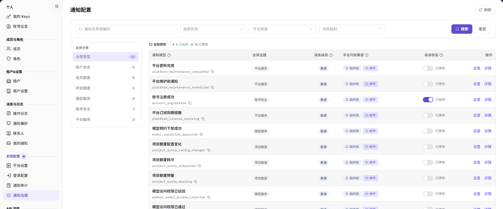

# 通知治理

::: info 文档信息
版本：v2.0
更新日期：2026-11-04
:::

## 功能概述

| 项目 | 内容 |
| --- | --- |
| 适用角色 | 运营管理员 |
| 导航路径 | 设置 > 系统配置 > 通知治理 |
| 页面路由 | `/user/system/notification/business-config` |
| 管理对象 | 通知类型、类型编码、业务主题、消息级别、平台开放渠道、启用状态和租户渠道策略 |

#### 新手理解

通知配置定义平台支持哪些通知类型、属于什么业务主题、使用哪些渠道，以及是否允许租户调整接收方式。未分类的通知类型不能启用。

#### 术语速查

| 术语 | 说明 |
| --- | --- |
| 通知类型 | 平台可发送的通知事件。 |
| 类型编码 | 通知类型的稳定标识。 |
| 业务主题 | 通知所属业务分类。 |
| 平台开放渠道 | 平台允许使用的站内信、邮件等渠道。 |
| 强制统一渠道 | 开启后租户不能自定义接收渠道。 |

## 前提条件

1. 当前账号可以进入 `设置 > 系统配置 > 通知治理`。
2. 修改前已确认影响的业务主题、渠道和租户范围。

## 页面说明

页面提供通知名称/编码、启用状态、平台渠道、消息级别和业务主题筛选。

| 区域 | 说明 |
| --- | --- |
| 搜索 | 按通知名称或编码查询。 |
| 启用状态 | 筛选启用或停用类型。 |
| 平台渠道 | 筛选站内信、邮件等渠道。 |
| 消息级别 | 筛选普通、警告等级别。 |
| 业务主题 | 全部类型、未分类、账户资金消息、产品消息、安全消息、异常通知、活动消息、服务消息。 |
| 列表 | 展示通知类型、编码、业务主题、消息级别、平台开放渠道、启用状态和操作。 |

## 主要操作

### 查看通知类型

1. 进入 `设置 > 系统配置 > 通知治理`。
2. 按名称、编码、状态、渠道、级别或业务主题筛选。
3. 查看通知类型的编码、业务主题、消息级别和平台开放渠道。
4. 点击 `详情` 查看类型说明。

### 启用或停用通知类型

1. 在列表中找到目标通知类型。
2. 使用启用状态开关调整；未分类类型不能启用。
3. 确认影响的业务主题和租户范围后再提交。
4. 停用后该类型不再发送；恢复时重新开启并核对渠道。

### 设置通知类型

1. 点击目标行的 `设置`。
2. 在“类型设置”中调整业务主题、消息级别和启用状态。
3. 按需要开启 `强制统一渠道（禁止租户修改）`，并选择平台开放渠道。
4. 保存前核对影响范围；只读查看时点击 `取消`。

## 参数速查表

| 字段名称 | 是否必填 | 字段类型 | 示例 | 说明 |
| --- | --- | --- | --- | --- |
| 通知类型 | 系统展示 | 文本 | 平台更新完成 | 通知事件名称。 |
| 通知类型编码 | 系统展示 | 文本 | platform_maintenance_completed | 通知类型的稳定标识。 |
| 业务主题 | 是 | 枚举 | 服务消息 | 通知所属业务分类。 |
| 消息级别 | 是 | 枚举 | 普通 | 通知严重程度。 |
| 启用状态 | 是 | 开关 | 已启用 | 控制通知类型是否发送。 |
| 强制统一渠道 | 否 | 开关 | 关闭 | 禁止租户自定义接收渠道。 |
| 平台开放渠道 | 是 | 多选 | 站内信、邮件 | 平台允许的投递渠道。 |

## 踩坑提示

- 未分类类型不能启用，先设置业务主题。
- 停用通知类型会影响所有租户，确认业务影响后再操作。
- 强制统一渠道会覆盖租户自定义设置，开启前通知租户管理员。
- 通知类型编码被引用后不要随意修改。
- 不在文档或截图中写真实租户、账号或业务数据。

## 结果校验

| 检查项 | 成功表现 | 异常时处理 |
| --- | --- | --- |
| 筛选 | 列表按名称、状态、渠道或级别刷新。 | 清空筛选后重试。 |
| 启用开关 | 开关状态与保存结果一致。 | 检查类型是否已分类和账号权限。 |
| 设置保存 | 业务主题、级别和渠道更新。 | 检查必填项和保存提示。 |
| 详情 | 可以查看通知类型说明。 | 刷新页面；仍失败时检查权限。 |

## 常见问题

#### 为什么通知类型不能启用？

**问题现象：**

启用开关不可用或保存失败。

**可能原因：**

通知类型未分类，或当前账号缺少通知配置权限。

**处理方式：**

先在 `设置` 中选择业务主题，再启用；仍失败时检查账号权限。

#### 为什么租户不能修改接收渠道？

**问题现象：**

租户侧渠道设置不可编辑。

**可能原因：**

平台开启了 `强制统一渠道（禁止租户修改）`。

**处理方式：**

确认是否为预期策略；需要放开时由运营管理员调整并通知租户。

## 注意事项

- 通知配置影响全平台租户，变更前确认业务影响。
- 未分类类型不能启用；不要绕过分类直接发送。
- 强制统一渠道会限制租户自定义，需提前沟通。
- 不写真实租户、账号或业务数据。

## 后续操作

1. 查看投递结果，进入 [通知记录](../notification-center/)。
2. 查看租户接收设置，进入 [通知设置](../../activity-notifications/notification-settings/)。
