# 平台设置

::: info 文档信息
版本：v2.1
更新日期：2026-11-12
:::

## 功能概述

| 项目 | 内容 |
| --- | --- |
| 适用角色 | 运营管理员 |
| 导航路径 | 设置 > 系统配置 > 平台设置 |
| 页面路由 | `/user/system/platform-settings/config` |
| 管理对象 | 通用配置、服务商关系、币种设置、支付通道、账户与结算、邮件和 UI 配置 |

#### 新手理解

平台设置页像全局参数面板，用来维护平台基础配置、服务商关系、币种、支付、结算、邮件和 UI 展示规则。任何变更都可能影响多个模块。

#### 术语速查

| 术语 | 说明 |
| --- | --- |
| 平台配置 | 影响全局行为的系统参数；变更前确认范围。 |
| 服务商关系 | 平台和服务商之间的配置关系；调整前确认业务归属。 |
| 币种设置 | 金额展示和结算相关币种规则；账务变更前核对。 |
| 邮件配置 | 通知和验证码发送相关配置；异常时结合登录配置排查。 |

## 前提条件

1. 当前账号具备系统配置管理权限。
2. 已进入 `系统设置 > 平台设置`。
3. 编辑配置前已确认影响范围、变更窗口和审批要求。

## 页面说明

平台设置页面按业务影响划分全局配置区域。

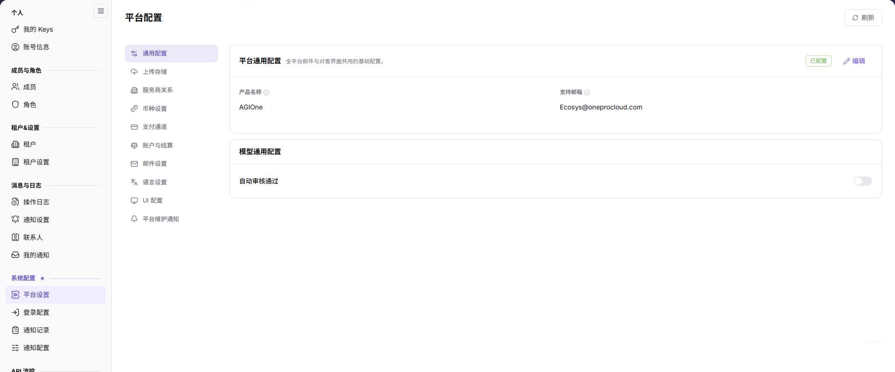

图示为平台配置分区列表，共 10 个区域；菜单名为平台设置，页面标题显示为平台配置。

| 配置区域 | 主要职责 | 通常需要验证的影响 |
| --- | --- | --- |
| 通用配置 | 维护平台共享参数和默认展示设置。 | 全局默认值和通用展示。 |
| 上传存储 | 维护图片与视频上传使用的对象存储或本地存储、对象前缀和访问凭据。 | 上传、预览和文件访问地址。 |
| 服务商关系 | 维护服务商关系、启用状态和结算归属。 | 服务商可见性、业务归属和结算关系。 |
| 币种设置 | 维护可用币种、展示规则、精度和换算相关设置。 | 金额展示、充值、计费和结算。 |
| 支付通道 | 维护支付服务、凭据、回调和连通性。 | 充值、支付回调和结算。 |
| 账户与结算 | 维护账户、结算周期、充值和 Credits 相关参数。 | 账户余额、Credits 计算、账务和结算。 |
| 邮件设置 | 维护邮件服务、发件人、通知和验证邮件设置。 | 登录验证和通知送达。 |
| 语言设置 | 维护登录页、控制台和通知共用的可用语言及默认语言。 | 控制台、登录页和通知的语言展示。 |
| UI 配置 | 维护登录页、平台标识、主题和展示设置。 | 用户可见界面和品牌展示。 |
| 平台维护通知 | 由具备发送权限的运营账号手动发送维护前通知或更新完成通知。 | 目标租户、收件角色和通知送达。 |
| 区域操作 | 刷新页面或打开目标配置的维护入口。 | 当前值是否最新，以及账号是否具备写权限。 |

修改前，先根据配置区域名称及其 **"编辑"** 入口定位目标设置。

## 主要操作

### 通用操作顺序

各配置区域均按以下步骤处理，再查看下方的区域差异：

1. 打开目标配置区域，确认当前值、启用状态和受影响模块。
2. 执行经过审批的变更时，点击 **"编辑"**，只修改目标字段。
3. 点击 **"保存"**、**"启用"**、**"禁用"**、**"重置"** 或 **"测试连接"** 前，确认审批、外部系统影响和回退方式。
4. 根据页面提示判断操作结果，重新打开配置区域并核对显示值或启用状态。
5. 到受影响的业务模块验证登录、充值、结算、邮件发送或 UI 展示结果。

如果只用于了解页面或截图，查看配置后停止，不提交任何变更。

### 编辑通用配置

1. 进入 `设置 > 系统配置 > 平台设置`。
2. 点击 **"通用配置"**。
3. 查看平台名称、默认展示、全局参数等通用项。

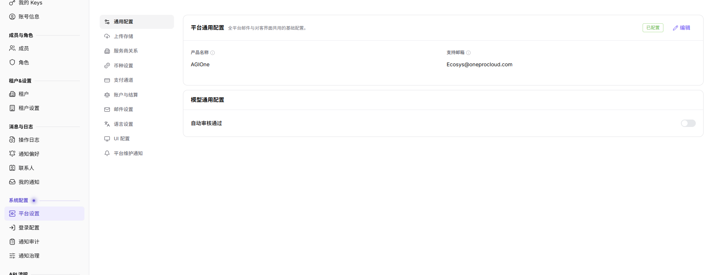

图示为通用配置区域，展示产品名称、支持邮箱和自动审核等平台级默认项；修改会影响全局展示和审核行为。

### 编辑上传存储

1. 进入 `设置 > 系统配置 > 平台设置`。
2. 点击 **"上传存储"**。
3. 查看对象存储开关、对象前缀（环境隔离）、Endpoint、Region、Bucket 名称和存储凭据状态。

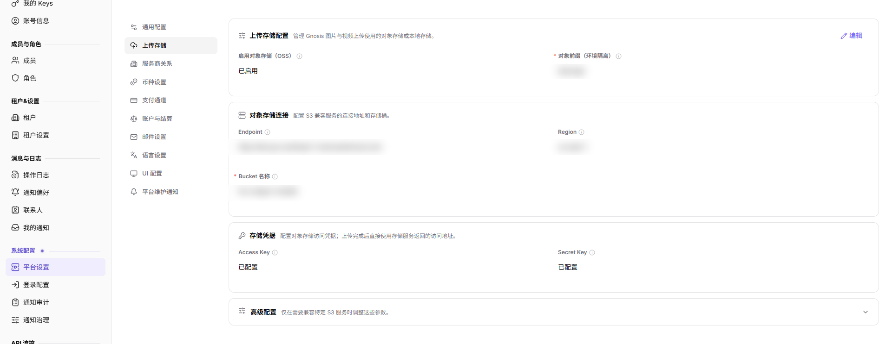
4. 需要兼容特定 S3 服务时，展开 `高级配置` 核对额外参数。
5. 保存前确认存储凭据、对象前缀和访问地址；不要将 Endpoint、Bucket、Access Key 或 Secret Key 写入文档、工单或截图。

### 编辑服务商关系

1. 进入 `设置 > 系统配置 > 平台设置`。
2. 点击 **"服务商关系"**。
3. 查看服务商、关联关系、启用状态或结算归属等配置。

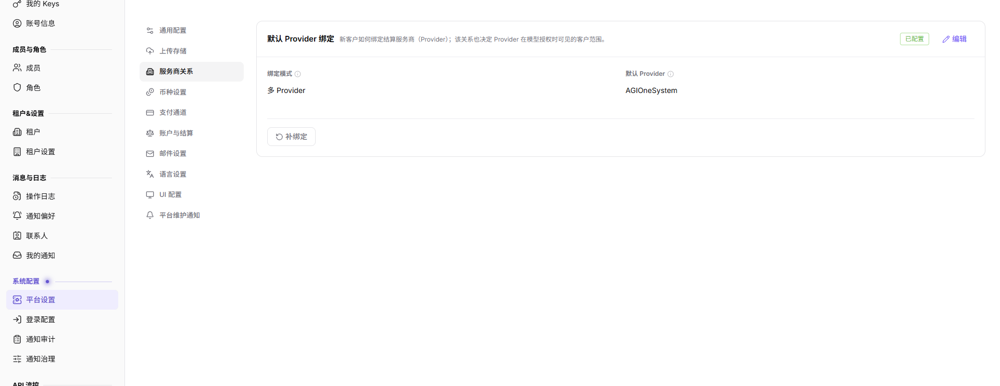

图示为 `默认 Provider 绑定`，展示 `绑定模式`、`默认 Provider` 和 `补绑定` 入口；调整前确认业务归属。

### 编辑币种配置

1. 进入 `设置 > 系统配置 > 平台设置`。
2. 点击 **"币种设置"**。
3. 查看默认币种、币种展示、精度或换算相关配置。

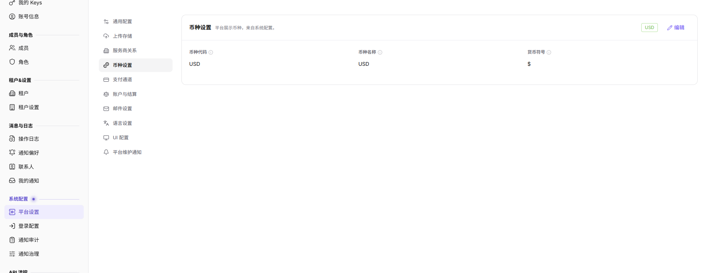

图示为币种设置，展示 `币种代码`、`币种名称` 和 `货币符号`；变更前确认对充值、计费和结算的影响。

### 查看支付通道配置

1. 进入 `设置 > 系统配置 > 平台设置`。
2. 点击 **"支付通道"**。
3. 查看当前充值与支付模式：账户额度申请或在线支付。

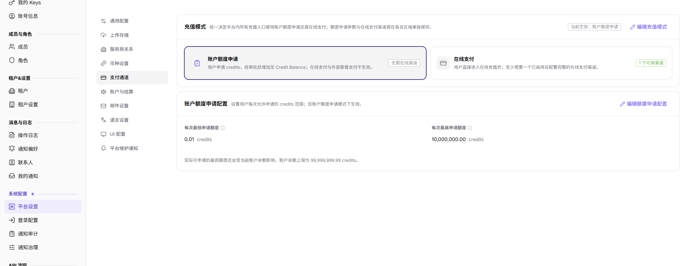
4. 当前测试环境在线支付未启用，页面只显示充值模式和额度申请配置，不显示 Stripe / Alipay 渠道。
5. 本版本文档不覆盖 Stripe / Alipay 渠道配置。需要覆盖时，应在启用在线支付的环境单独采证，不沿用旧截图或旧版流程。

### 编辑账户与结算配置

1. 进入 `设置 > 系统配置 > 平台设置`。
2. 点击 **"账户与结算"**。
3. 查看账户、结算周期、充值或 credits 相关参数。

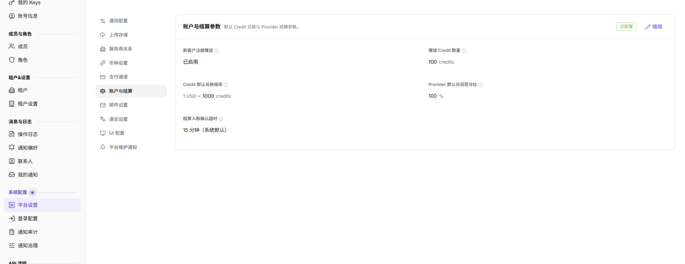

图示为账户与结算参数，展示新客户注册赠送、Credit 默认兑换倍率、Provider 默认分润百分比和结算入账确认超时；变更前确认对账务和结算的影响。

### 编辑邮件配置

1. 进入 `设置 > 系统配置 > 平台设置`。
2. 点击 **"邮件设置"**。
3. 查看邮件服务、发件配置、通知模板或验证邮件相关配置。

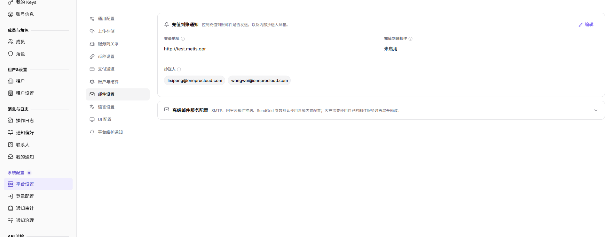

图示为 `充值到账通知`，展示 `登录地址`、`充值到账邮件` 和 `抄送人`；`高级邮件服务配置` 当前折叠。修改后验证登录验证码和通知送达。

### 编辑语言设置

1. 进入 `设置 > 系统配置 > 平台设置`。
2. 点击 **"语言设置"**。
3. 查看 `可用语言` 和 `系统默认语言`；当前可用语言包括英文、中文和 Español。
4. 修改前确认登录页、控制台和通知需要支持的语言范围。
5. 保存后到登录页、控制台和通知页面核对语言展示。

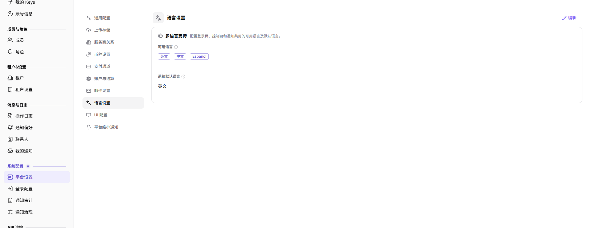

图示为语言设置，包含可用语言（英文/中文/Español）和系统默认语言；保存后影响登录页、控制台和通知展示。

### 编辑 UI 配置

1. 进入 `设置 > 系统配置 > 平台设置`。
2. 点击 **"UI 配置"**。
3. 查看登录页、平台标识、主题或展示相关配置。

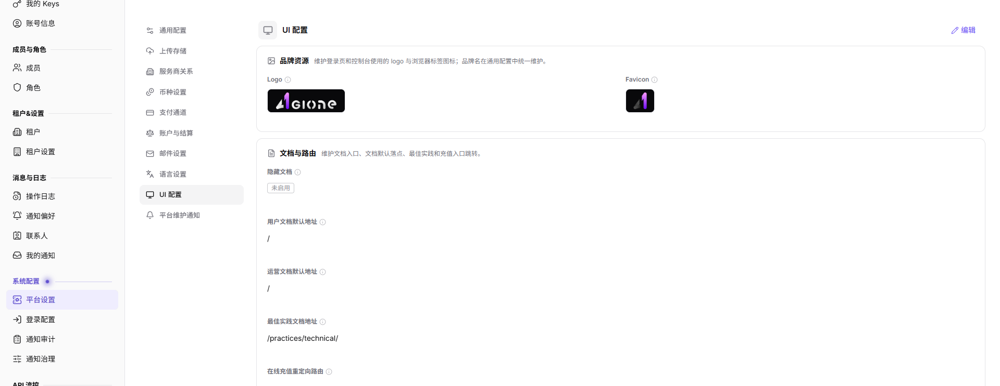

图示为 UI 配置中的 `品牌资源` 和 `文档与路由`；变更后核对用户可见界面和品牌展示。

### 编辑平台维护通知

1. 进入 `设置 > 系统配置 > 平台设置`。
2. 点击 **"平台维护通知"**。
3. 查看当前账号是否具备发送权限；没有权限时只能查看表单，不能发送。
4. 具备权限时，选择通知类型（维护前通知或更新完成通知），填写平台访问地址、业务截止时间、维护窗口和预计影响。
5. 选择目标租户（全部有效租户或指定租户）和收件角色（仅租户管理员，或管理员和全部有效成员）。
6. 发送前核对通知内容和收件范围；截止时间只控制进入通知受理，不保证邮件或站内信最终投递完成。

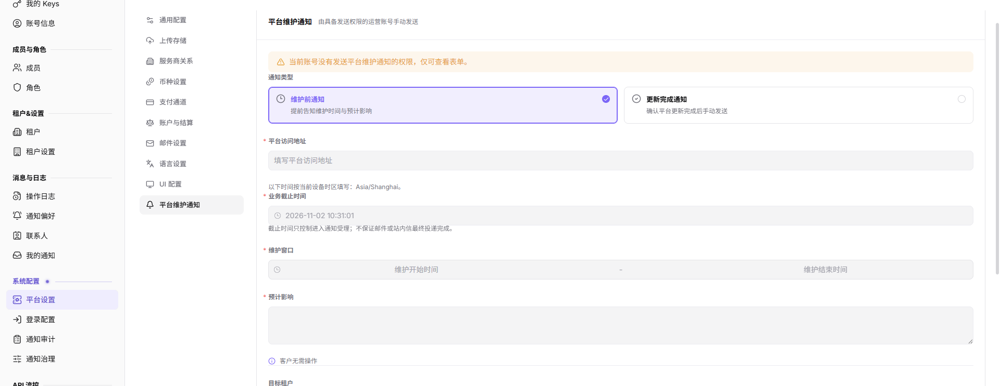

图示为平台维护通知，包含通知类型、平台访问地址、业务截止时间、维护窗口、预计影响、目标租户和收件角色；无发送权限时仅可查看。

## 参数速查表

### 基础配置字段

| 字段名称 | 是否必填 | 字段类型 | 示例 | 说明 |
| --- | --- | --- | --- | --- |
| 配置分类 | 系统展示 | 文本 | 通用配置 | 平台设置中的配置分组。 |
| 配置项 | 系统展示 | 文本 | 默认币种 | 需要查看或维护的系统参数。 |
| 默认值 | 系统展示 | 文本 | CNY | 配置项的默认值或系统预置值。 |
| 当前值 | 系统展示 / 可编辑 | 文本 | CNY | 当前生效的配置值。 |
| 启用状态 | 系统展示 / 可编辑 | 枚举 | 启用 | 判断配置项或能力是否启用。 |
| 测试连接 | 操作按钮 | 按钮 | 测试连接 | 验证邮件、支付或外部服务配置连通性。 |
| 保存 | 操作按钮 | 按钮 | 保存 | 保存当前配置变更。 |
| 重置 | 操作按钮 | 按钮 | 重置 | 将配置恢复为默认值或上次保存状态。 |
| 操作 | 系统生成 | 按钮 | 编辑 / 启用 / 禁用 | 提供配置查看或维护入口。 |

### 上传存储与语言字段

| 字段名称 | 是否必填 | 字段类型 | 示例 | 说明 |
| --- | --- | --- | --- | --- |
| 对象存储开关 | 否 | 开关 | 已启用 | 控制图片和视频上传是否使用对象存储。 |
| 对象前缀（环境隔离） | 条件必填 | 文本 | 已隐藏 | 对象存储中的环境隔离前缀。 |
| Endpoint | 条件必填 | 文本 | 已隐藏 | S3 兼容服务的连接地址。 |
| Region | 条件必填 | 文本 | 已隐藏 | 对象存储区域。 |
| Bucket 名称 | 条件必填 | 文本 | 已隐藏 | 图片和视频上传使用的存储桶。 |
| 存储凭据 | 条件必填 | 文本 | 已配置 | Access Key 和 Secret Key 的配置状态。 |
| 可用语言 | 是 | 多选 | 英文、中文、Español | 登录页、控制台和通知可用的语言。 |
| 系统默认语言 | 是 | 枚举 | 中文 | 新用户和默认界面使用的语言。 |

### 平台维护通知字段

| 字段名称 | 是否必填 | 字段类型 | 示例 | 说明 |
| --- | --- | --- | --- | --- |
| 通知类型 | 是 | 枚举 | 维护前通知 | 平台维护通知的类型。 |
| 平台访问地址 | 是 | 文本 | https://example.com | 通知中提供给租户的平台地址。 |
| 业务截止时间 | 是 | 日期时间 | 2026-10-30 19:03 | 进入通知受理的截止时间。 |
| 维护窗口 | 是 | 日期时间范围 | 2026-10-30 20:00–22:00 | 计划维护的开始和结束时间。 |
| 预计影响 | 是 | 多行文本 | 客户无需操作 | 通知中说明的影响范围。 |
| 目标租户 | 是 | 单选 | 全部有效租户 | 通知发送到的租户范围。 |
| 收件角色 | 是 | 单选 | 仅租户管理员 | 通知接收人的角色范围。 |

## 踩坑提示

- 平台设置影响范围大，不要在不明确业务归属时直接修改。
- 支付、结算、邮件和 UI 配置变更后，应回到相关业务模块验证。
- 配置值异常时先确认是否有近期操作日志或发布记录。
- 平台设置会影响登录、展示、服务商关系、币种、支付、账务、结算、邮件通知和用户可见 UI。
- `保存`、`重置`、`启用`、`禁用`、`测试连接` 是高风险动作。
- 学习或截图时只查看配置项，不提交真实配置变更。
- Stripe / Alipay 密钥、私钥、Webhook secret、SMTP 密码、内部地址、账号、Token、客户名、结算参数不能写入文档、截图、工单或聊天。

## 结果校验

| 检查项 | 成功表现 | 异常时处理 |
| --- | --- | --- |
| 分类展示 | 配置分类正常显示。 | 刷新页面后重新进入。 |
| 配置可读 | 配置项和值正常展示。 | 检查系统配置权限。 |
| 编辑入口 | 编辑按钮按权限展示。 | 没有权限时联系管理员处理。 |
| 保存值 | 执行经过审批的变更后，重新打开区域可看到目标值或启用状态。 | 检查页面提示、权限、审批状态，以及是否需要刷新页面。 |
| 业务影响 | 受影响的登录、充值、结算、邮件或 UI 流程符合预期。 | 按变更方案回退，并检查操作日志和对应业务模块。 |
| 截图引用 | 通用配置、服务商关系、币种设置、支付通道、账户与结算、邮件设置和 UI 配置截图正常展示。 | 检查图片路径是否存在。 |

## 常见问题

#### 修改配置后影响哪些模块

**问题现象：**

平台设置中存在多个配置分类。

**可能原因：**

不同配置可能影响登录、账务、邮件、页面展示或服务商关系。

**处理方式：**

先确认配置分类和业务影响，再选择合适窗口执行变更。

#### 平台设置项为什么没有显示？

**问题现象：**

平台设置页没有目标配置项，或配置项区域为空。

**可能原因：**

当前账号缺少系统设置权限，配置项按部署版本或租户范围裁剪，或配置中心同步异常。

**处理方式：**

确认运营管理员权限和当前租户范围；核对配置项是否适用于当前版本；仍为空时联系平台管理员检查配置中心状态。
#### 为什么平台配置保存按钮不可用？

**问题现象：**

平台设置项可见，但保存、启用或重置按钮不可点击。

**可能原因：**

当前账号缺少系统配置写权限，配置项被版本锁定，或该配置需要审批后才能变更。

**处理方式：**

核对系统管理员权限和配置项说明；需要调整时先走审批，再由具备权限的管理员保存。

## 注意事项

- 平台配置可能影响全局行为，不要在业务高峰期随意修改。
- 支付、结算、邮件相关配置应经过复核后再保存。
- `保存`、`重置`、`启用`、`禁用`、`测试连接` 是高风险动作。
- 学习或截图时只查看配置项，不提交真实配置变更。
- Stripe / Alipay 密钥、私钥、Webhook secret、SMTP 密码、内部地址、账号、Token、客户名、结算参数不能写入文档、截图、工单或聊天。

## 后续操作

1. 需要维护登录安全，进入 [登录配置](../login-properties/)。
2. 需要维护 API 流控，进入 [Overview](../../api-rate-control/overview/)。
