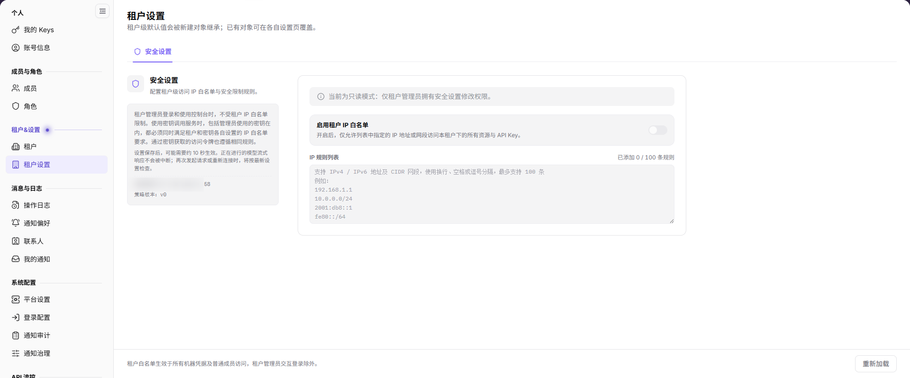

# 租户设置

## 功能概述

| 项目 | 内容 |
| --- | --- |
| 适用角色 | 运营管理员 |
| 导航路径 | 设置 > 租户&设置 > 租户设置 |
| 页面路由 | `/user/user-space/settings` |
| 管理对象 | 租户级安全设置、IP 白名单、策略版本和当前来源 IP |

#### 新手理解

租户设置用于维护租户级默认规则和安全边界。运营管理员当前可见“安全设置”页签；该页提示仅租户管理员拥有修改权限，运营侧通常为只读。

#### 术语速查

| 术语 | 说明 |
| --- | --- |
| 租户级默认值 | 新建对象继承的默认规则；已有对象可在各自设置页覆盖。 |
| IP 白名单 | 仅允许指定 IP 或网段访问租户资源的规则。 |
| 策略版本 | 当前租户安全策略的版本号。 |
| 当前来源 IP | 当前访问控制台的来源地址。 |

## 前提条件

1. 当前账号可以进入 `设置 > 租户&设置 > 租户设置`。
2. 修改安全设置前，已确认租户管理员权限和影响范围。
3. 已收集需要加入白名单的 IPv4、IPv6 或 CIDR 网段。

## 页面说明

页面当前展示“安全设置”页签。

| 区域 | 说明 |
| --- | --- |
| 安全设置 | 配置租户级访问 IP 白名单与安全限制规则。 |
| 启用租户 IP 白名单 | 开启后仅允许列表中的 IP 或网段访问租户资源和 API Key。 |
| IP 规则列表 | 支持 IPv4、IPv6 和 CIDR，最多 100 条。 |
| 当前来源 IP | 展示当前访问控制台的来源地址。 |
| 策略版本 | 展示当前安全策略版本。 |

页面提示：租户管理员登录和使用控制台时不受租户 IP 白名单限制；使用密钥调用服务时，包括管理员使用的密钥，都必须同时满足租户和密钥各自的白名单要求。设置保存后约 10 秒生效。

## 主要操作

### 查看安全设置

1. 进入 `设置 > 租户&设置 > 租户设置`。
2. 保持 `安全设置` 页签选中。
3. 查看白名单开关、IP 规则数量、当前来源 IP 和策略版本。
4. 页面显示只读模式时，确认当前账号不是租户管理员。

### 配置 IP 白名单

1. 确认当前账号具备租户管理员权限。
2. 开启 `启用租户 IP 白名单`。
3. 在 `IP 规则列表` 中输入 IPv4、IPv6 或 CIDR 网段，使用换行、空格或逗号分隔。
4. 确认规则数量和范围，保存设置。
5. 等待约 10 秒生效；正在进行的模型流式响应不会中断，新请求按最新规则检查。

### 重新加载安全设置

1. 修改或保存后需要刷新时，点击 `重新加载`。
2. 核对策略版本、当前来源 IP 和规则数量是否更新。

## 参数速查表

| 字段名称 | 是否必填 | 字段类型 | 示例 | 说明 |
| --- | --- | --- | --- | --- |
| 启用租户 IP 白名单 | 否 | 开关 | 开启 | 开启后仅允许列表中的 IP 或网段访问。 |
| IP 规则列表 | 条件必填 | 多行文本 | 192.0.2.0/24 | 支持 IPv4、IPv6 和 CIDR，最多 100 条。 |
| 当前来源 IP | 系统展示 | 文本 | 192.0.2.10 | 当前访问控制台的来源地址。 |
| 策略版本 | 系统展示 | 文本 | v0 | 当前安全策略版本。 |

## 踩坑提示

- 租户管理员交互登录不受租户 IP 白名单限制，但使用密钥调用仍受限制。
- 密钥访问必须同时满足租户和密钥各自的白名单要求。
- 白名单最多 100 条，规则格式错误会导致保存失败。
- 保存后约 10 秒生效；流式响应不会被中断，新请求按最新规则检查。
- 开启白名单前确认当前来源 IP 已加入，避免把自己锁在外面。
- 不在文档或截图中写真实 IP、租户 ID 或内部网络地址。

## 结果校验

| 检查项 | 成功表现 | 异常时处理 |
| --- | --- | --- |
| 页面可进入 | 安全设置页正常展示。 | 检查账号权限和菜单可见性。 |
| 规则数量 | 规则列表显示已添加数量和上限。 | 检查格式和是否超过 100 条。 |
| 保存生效 | 约 10 秒后新规则生效。 | 等待后重新加载；仍不生效时检查权限和策略版本。 |
| 只读提示 | 无修改权限时显示只读模式。 | 联系租户管理员修改。 |

## 常见问题

#### 为什么不能修改租户安全设置？

**问题现象：**

安全设置页显示只读，开关和输入框不可用。

**可能原因：**

当前账号不是租户管理员，或运营侧只具备查看权限。

**处理方式：**

由租户管理员修改；运营侧只做核对，不绕过权限。

#### 开启白名单后无法访问怎么办？

**问题现象：**

开启 IP 白名单后当前地址无法访问控制台或 API。

**可能原因：**

当前来源 IP 未加入白名单，或规则格式不正确。

**处理方式：**

由租户管理员通过受信网络登录并补充规则；确认当前来源 IP 和 CIDR 格式。

## 注意事项

- 安全设置影响租户下所有资源和 API Key，变更前确认影响范围。
- 租户管理员交互登录不受白名单限制，但密钥调用仍受限制。
- 保存后约 10 秒生效，不要连续重复提交。
- 不写真实 IP、租户 ID 或内部网络地址。

## 后续操作

1. 查看租户信息和角色，进入 [租户](../tenants/)。
2. 追踪设置变更，进入 [操作日志](../../activity-notifications/operation-logs/)。
