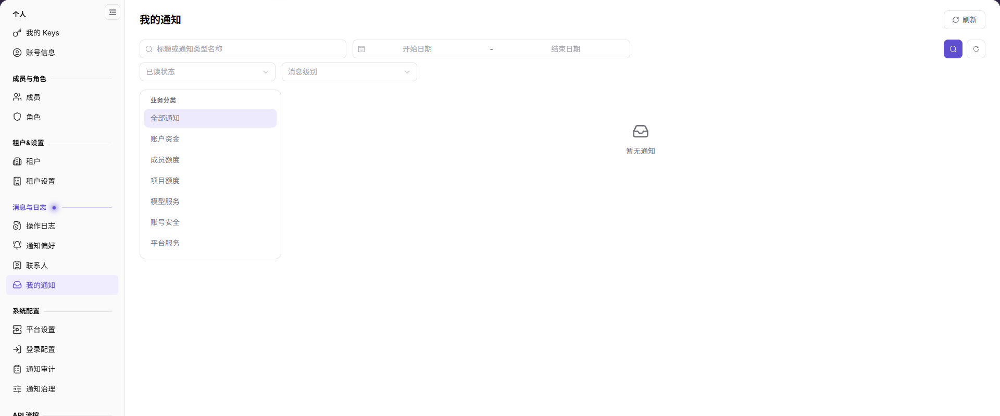

# 我的通知

::: info 文档信息
版本：v2.0
更新日期：2026-11-04
:::

## 功能概述

| 项目 | 内容 |
| --- | --- |
| 适用角色 | 模型提供方&用户 |
| 导航路径 | 设置 > 消息与日志 > 我的通知 |
| 页面路由 | `/user/user-space/notification/inbox` |
| 管理对象 | 当前账号收到的通知、业务主题、消息级别、接收时间、已读状态和通知详情 |

#### 新手理解

我的通知是当前账号的个人通知收件箱，用来查看账户资金、产品、安全、异常、活动和服务消息。通知内容可能包含业务结果摘要，查看和转发前需要脱敏。

#### 术语速查

| 术语 | 说明 |
| --- | --- |
| 业务主题 | 通知所属的业务分类。 |
| 消息级别 | 通知的严重程度，例如普通或警告。 |
| 已读状态 | 通知是否已经查看。 |
| 通知详情 | 包含结果、时间、对象和建议的完整内容。 |

## 前提条件

1. 当前账号可以进入 `设置 > 消息与日志 > 我的通知`。
2. 查看或转发通知前，已确认内容是否包含敏感信息。

## 页面说明

图示为我的通知列表，页面提供标题/通知类型、日期范围、已读状态和消息级别筛选，以及业务主题按钮。

| 区域 | 说明 |
| --- | --- |
| 搜索 | 按标题或通知类型名称搜索。 |
| 日期范围 | 选择开始日期和结束日期。 |
| 已读状态 | 按已读或未读筛选。 |
| 消息级别 | 按普通、警告等级别筛选。 |
| 业务主题 | 全部通知、账户资金消息、产品消息、安全消息、异常通知、活动消息、服务消息。 |
| 列表 | 展示通知内容、业务主题、消息级别、接收时间、状态和详情入口。 |

## 主要操作

### 查看通知列表

1. 进入 `设置 > 消息与日志 > 我的通知`。
2. 按标题、日期范围、已读状态或消息级别筛选。
3. 使用业务主题按钮缩小范围。
4. 查看列表中的通知内容、业务主题、消息级别、接收时间和状态。

### 查看通知详情

1. 在列表中找到目标通知。
2. 点击该行的 `详情`。
3. 查看完整通知内容，包括结果、时间、受影响对象和建议。
4. 需要继续处理时，按通知中的建议进入对应业务页面；不要直接转发包含敏感信息的完整内容。

## 参数速查表

| 字段名称 | 是否必填 | 字段类型 | 示例 | 说明 |
| --- | --- | --- | --- | --- |
| 通知内容 | 系统展示 | 文本 | 账户余额不足 | 通知标题和结果摘要。 |
| 业务主题 | 系统展示 | 枚举 | 账户资金消息 | 通知所属业务分类。 |
| 消息级别 | 系统展示 | 枚举 | 普通 | 通知严重程度。 |
| 接收时间 | 系统展示 | 日期时间 | 2026-10-28 16:49:57 | 通知进入收件箱的时间。 |
| 状态 | 系统展示 | 枚举 | 已读 | 通知是否已读。 |

## 踩坑提示

- 通知列表只展示当前账号有资格接收的通知，不能据此判断平台是否发送过其他通知。
- 业务主题和消息级别筛选会叠加，清空筛选后再判断是否缺少通知。
- 通知正文可能包含租户、账号、金额或业务结果，截图和外发前必须脱敏。
- `详情` 展示的是通知生成时的内容，不替代业务页面的实时状态。

## 结果校验

| 检查项 | 成功表现 | 异常时处理 |
| --- | --- | --- |
| 列表加载 | 通知列表和分页正常显示。 | 刷新页面；仍为空时检查账号权限和筛选条件。 |
| 筛选 | 列表按标题、日期、状态或级别刷新。 | 清空筛选后重新查询。 |
| 详情 | 点击 `详情` 可以查看完整通知内容。 | 刷新页面；仍无法查看时联系管理员。 |
| 业务主题 | 切换主题后列表范围符合预期。 | 确认是否叠加了其他筛选条件。 |

## 常见问题

#### 为什么找不到目标通知？

**问题现象：**

收件箱中没有预期通知。

**可能原因：**

通知类型未启用、当前账号不在接收范围、日期或业务主题筛选过窄，或通知已超过保留范围。

**处理方式：**

清空筛选并扩大日期范围；仍找不到时检查通知治理和通知审计。

#### 为什么通知状态没有变化？

**问题现象：**

已经查看通知，但状态仍显示未读或不符合预期。

**可能原因：**

页面状态尚未刷新，或当前操作没有触发状态更新。

**处理方式：**

刷新页面后重新查看；仍不更新时记录通知时间和内容，联系管理员核查。

## 注意事项

- 通知内容可能包含账号、租户、金额、Key 或业务数据，禁止直接外发。
- 通知状态和内容以当前页面为准，不用旧截图作为结论。
- 需要排查投递问题时，进入通知审计查看派发状态。

## 后续操作

1. 调整接收偏好，进入 [通知偏好](../notification-settings/)。
2. 查看平台投递记录，进入 [操作日志](../operation-logs/)。
