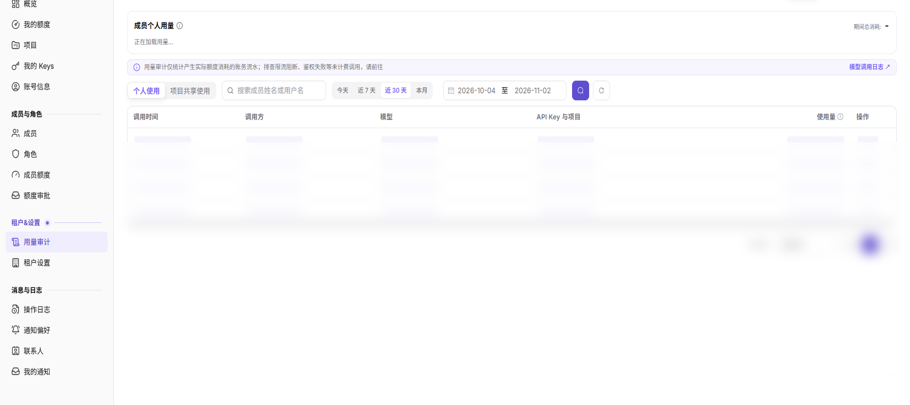

# 用量审计

::: info 文档信息
版本：v2.2
更新日期：2026-11-12
:::

## 功能概述

| 项目 | 内容 |
| --- | --- |
| 适用角色 | 模型调用方 |
| 导航路径 | 设置 > 租户&设置 > 用量审计 |
| 页面路由 | `/user/user-space/usage-log` |
| 管理对象 | 额度使用事件及其只读详情 |

#### 新手理解

先确认时间和用量范围，再查询或刷新列表，核对目标事件并查看详情。

#### 术语速查

| 术语 | 说明 |
| --- | --- |
| 额度使用日志 | 额度使用事件的只读查询记录。 |
| 状态 | 事件信息中展示的处理结果；以当前页面可见字段为准。 |
| 操作入口 | 页面提供的按钮、行内操作或详情入口。 |

## 前提条件

1. 当前终端用户账号可以在设置菜单中看到 `额度使用日志` 入口。
2. 账号至少有一条可见额度使用事件，或需要验证空列表状态。
3. 不要复制或记录真实 API Key、调用方标识、项目名、主题和请求详情。

## 页面说明

筛选区提供 `开始时间`、`结束时间`、`用户 ID` 和 `API Key` 字段，并提供 `搜索`、`重置` 和 `展开` 控件。

表格包含：

| 字段 | 说明 |
| --- | --- |
| 调用时间 | 用量事件发生时间。 |
| 调用方 | 事件对应的调用方标识。 |
| API Key | 与事件关联的脱敏或缩略 Key。 |
| 项目 | 适用时展示项目上下文。 |
| 调用对象 | 事件对应的模型或请求对象。 |
| 请求额度 | 请求额度和扣减额度信息。 |
| 状态 | 处理结果，例如 `SUCCESS`。 |
| 操作 | 点击 `详情` 打开只读事件信息。 |

图示为用量审计列表，展示 `调用时间`、`调用方`、`模型`、`API Key 与项目`、`使用量` 和 `操作`；筛选条件决定汇总范围。

## 主要操作

### 查看额度使用事件

1. 进入 `设置 > 租户&设置 > 额度使用日志`。
2. 选择时间范围，并按成员、项目、资源类型、动作或结果筛选。
3. 核对目标事件的时间、额度变化、对象和原因。
4. 无结果时检查时区并清除组合筛选；额度和成员数据外发前必须脱敏。

### 查看额度使用事件详情

1. 点击目标事件的 **"详情"**。
2. 对比变化前额度、变化量、变化后额度和关联对象。
3. 核对同一时间附近是否存在撤销或后续调整。
4. 无法解释时记录脱敏事件 ID 和时间范围后升级，不直接修改额度。

## 参数速查表

| 字段名称 | 是否必填 | 字段类型 | 示例 | 说明 |
| --- | --- | --- | --- | --- |
| 时间范围 | 查询条件 | 时间选项 | `近 7 天` | 按当前选择的时间范围查询事件。 |
| 用量范围 | 查询条件 | 范围选项 | `我的用量` | 按当前账号可见的用量范围查询。 |
| 操作入口 | 页面操作 | 按钮 | `刷新`、`详情` | 刷新列表或查看事件详情。 |
| 使用量 | 页面展示 | 展示值 | 以页面展示为准 | 用于核对目标事件用量，不在此编辑。 |

## 踩坑提示

- 本页按只读查询方式使用，不在此变更额度或账务状态；可见入口以当前账号和页面状态为准。
- 脱敏或缩略后的 API Key 仍然属于敏感信息，不要复制到文档或工单。
- 空列表可能由时间范围、账号范围或当前没有用量事件导致。

## 结果校验

| 检查项 | 成功表现 | 异常时处理 |
| --- | --- | --- |
| 页面可进入 | 从可见的设置菜单打开 `额度使用日志`。 | 检查账号权限和菜单是否显示。 |
| 筛选生效 | `搜索` 刷新列表，`重置` 清空条件。 | 清空条件后重新查询。 |
| 事件字段可见 | 能看到事件时间、调用方、API Key、项目、主题、请求额度、状态和操作。 | 确认当前账号是否有可见用量事件。 |
| 详情只读 | 点击 `详情` 打开事件信息，页面没有保存或提交动作。 | 关闭详情并记录受限原因。 |

## 常见问题

#### 为什么列表中看不到目标额度使用日志？

**问题现象：**

进入页面后没有找到目标额度使用日志。

**可能原因：**

当前查询限定了时间和用量范围，需先核对目标事件是否在所选范围内。

**处理方式：**

核对当前可见的时间和用量范围，刷新列表后再查看目标事件。

#### 当前页面支持哪些核对操作？

**问题现象：**

需要核对用量事件，当前页面可见查询、刷新和 `详情` 入口。

**可能原因：**

当前打开的是用量事件查询页，当前账号视图未显示编辑、保存或提交控件。

**处理方式：**

使用当前账号可见的时间和用量范围查询，刷新列表并查看目标事件详情；不在此变更额度或流水。

#### 如何排查未计费调用？

**问题现象：**

需要排查限流阻断或鉴权失败等未计费调用。

**可能原因：**

页面说明用量审计统计产生实际额度消耗的账务流水。

**处理方式：**

使用页面上的 `模型调用日志` 入口排查未计费调用；本页用于查询和核对用量流水。

## 注意事项

- 本页面是在 Demo 核查中确认新增到终端用户设置菜单的入口。
- 文档截图已遮挡全部事件记录和身份值，仅保留筛选项和字段标题。

## 后续操作

1. 返回本页，核对当前时间和用量范围并刷新列表。
2. 需要进一步核对事件时，使用当前可见的 `详情` 入口。

相关页面：[租户设置](../org-settings/)、[成员额度](../../members-roles/member-quotas/)
