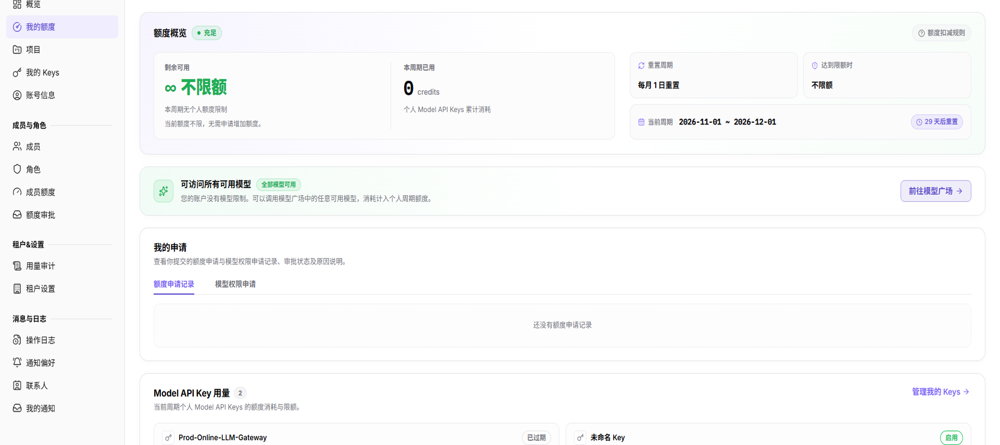

# 我的额度

::: info 文档信息
版本：v2.0
更新日期：2026-11-04
:::

## 功能概述

| 项目 | 内容 |
| --- | --- |
| 适用角色 | 模型调用方 |
| 导航路径 | 设置 > 个人 > 我的额度 |
| 页面路由 | `/user/user-space/my-quota` |
| 管理对象 | 个人周期额度、重置周期、已用额度、模型访问范围、额度/模型权限申请和 Model API Key 用量 |

#### 新手理解

我的额度页集中展示当前账号本周期可用的个人额度、已用额度、重置时间和模型访问范围，以及额度申请、模型权限申请和 Model API Key 用量。

#### 术语速查

| 术语 | 说明 |
| --- | --- |
| 个人周期额度 | 当前账号在一个周期内可用的额度；由成员额度策略决定。 |
| 重置周期 | 额度重新计算的周期；页面展示当前周期和下次重置时间。 |
| 模型访问范围 | 当前账号可调用的模型范围；可能为全部模型或指定模型。 |
| 额度申请 | 向管理员申请增加额度的记录；审批结果在这里查看。 |
| 模型权限申请 | 申请访问指定模型的记录。 |

## 前提条件

1. 当前账号可以进入 `设置 > 个人 > 我的额度`。
2. 查看额度或申请前，已确认当前租户和个人账号。
3. 提交申请前，已确认所需额度、用途和审批人。

## 页面说明

页面顶部展示额度概览，下方依次展示模型访问范围、我的申请、Model API Key 用量和额度变更历史。

图示为我的额度页，顶部展示额度概览和重置周期，下方包括模型访问范围、我的申请、Model API Key 用量和额度变更历史。

| 区域 | 说明 |
| --- | --- |
| 额度概览 | 展示额度状态、剩余可用、本周期已用、重置周期、达到限额时行为和当前周期。 |
| 模型访问范围 | 展示可访问全部模型或指定模型；提供 `前往模型广场` 入口。 |
| 我的申请 | 包含 `额度申请记录` 和 `模型权限申请` 两个页签。 |
| Model API Key 用量 | 展示当前周期个人 Model API Keys 的额度消耗和限额，提供 `管理我的 Keys`。 |
| 额度变更历史 | 展示额度分配、调整、审批通过和周期重置记录。 |

## 主要操作

### 查看额度概览

1. 进入 `设置 > 个人 > 我的额度`。
2. 查看额度状态、剩余可用、本周期已用、重置周期和当前周期。
3. 点击 `额度扣减规则` 查看额度扣减说明。
4. 额度不足时点击 `申请额度`；不限额时页面会提示无需申请。

### 查看模型访问范围

1. 在“可访问所有可用模型”区域确认当前模型范围。
2. 范围受限时查看允许的模型列表。
3. 需要调用新模型时，点击 `前往模型广场` 查看可用模型，或提交模型权限申请。

### 查看额度与模型权限申请

1. 在“我的申请”区选择 `额度申请记录` 或 `模型权限申请`。
2. 查看申请时间、额度/模型、审批状态和原因说明。
3. 没有记录时确认当前账号和页签；提交新申请后回到这里核对状态。

### 查看 Model API Key 用量

1. 在“Model API Key 用量”区查看当前周期的 Key 数量和已用/限额。
2. 点击 `管理我的 Keys` 进入我的 Keys 页面。
3. 对照 Key 名称、状态和已用额度，判断是否需要调整 Key 限额或申请额度。

### 查看额度变更历史

1. 在“额度变更历史”区查看额度分配、调整、审批通过和周期重置记录。
2. 没有记录时页面显示“暂无额度变更”。
3. 需要排查差异时，结合成员额度、我的 Keys 和操作日志核对。

## 参数速查表

| 字段名称 | 是否必填 | 字段类型 | 示例 | 说明 |
| --- | --- | --- | --- | --- |
| 额度状态 | 系统展示 | 枚举 | 充足 | 当前周期额度的健康状态。 |
| 剩余可用 | 系统展示 | 额度 | 不限额 | 当前周期剩余可用额度。 |
| 本周期已用 | 系统展示 | 额度 | 0 credits | 个人 Model API Keys 累计消耗。 |
| 重置周期 | 系统展示 | 枚举 | 每月 1 日重置 | 额度重新计算的周期。 |
| 达到限额时 | 系统展示 | 枚举 | 不限额 | 达到限额后的处理方式。 |
| 当前周期 | 系统展示 | 日期范围 | 2026-11-01 ~ 2026-12-01 | 当前额度周期。 |
| 模型访问范围 | 系统展示 | 文本 | 全部模型可用 | 当前账号可调用的模型范围。 |
| 申请状态 | 系统展示 | 枚举 | 待审批 | 额度或模型权限申请的处理状态。 |

## 踩坑提示

- “不限额”表示当前周期没有个人额度限制，不代表平台没有其他配额或模型权限限制。
- 剩余可用和已用额度按周期计算，跨周期后数值会重置。
- 额度申请和模型权限申请是两条不同记录，分别在对应页签查看。
- Model API Key 用量只统计个人 Key，不包含 Project Key。
- 截图或外发前隐藏账号、额度、Key 名称和申请原因中的敏感信息。

## 结果校验

| 检查项 | 成功表现 | 异常时处理 |
| --- | --- | --- |
| 额度概览 | 状态、剩余、已用、重置周期和当前周期正常展示。 | 刷新页面；仍为空时检查账号权限。 |
| 模型范围 | 显示全部模型可用或允许的模型列表。 | 检查模型权限申请和租户策略。 |
| 申请记录 | 页签切换后显示对应申请记录。 | 确认页签和账号；无记录属于正常空态。 |
| Key 用量 | Key 数量和已用/限额正常展示。 | 进入我的 Keys 核对 Key 状态和限额。 |

## 常见问题

#### 为什么额度显示不限额？

**问题现象：**

剩余可用和达到限额时都显示“不限额”。

**可能原因：**

当前成员额度策略未设置个人额度上限。

**处理方式：**

无需申请增加额度；仍需关注平台或项目级配额限制。

#### 为什么提交额度申请后没有记录？

**问题现象：**

提交申请后“额度申请记录”仍为空。

**可能原因：**

提交未成功、当前页签不是额度申请记录，或账号上下文不一致。

**处理方式：**

确认提交提示和当前账号，切换页签后刷新；仍无记录时重新提交或联系管理员。

## 注意事项

- 额度与模型权限受租户策略控制，不能通过页面绕过。
- 额度申请原因中不要填写密码、完整 Key、内部地址或客户敏感信息。
- 额度数据按周期变化，截图时保留当前周期时间。
- 不在文档或截图中写真实账号、额度、Key 名称或申请原因。

## 后续操作

1. 管理个人 Key，进入 [我的 Keys](../my-keys/)。
2. 查看成员额度，进入 [成员额度](../../members-roles/member-quotas/)。
